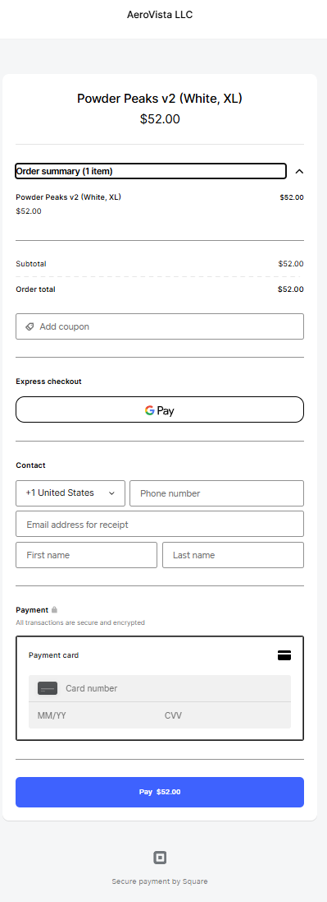

Navigated to https://aerovista-us.github.io/store/
store/:1477 Fetch finished loading: GET "https://api.aerovista.us/api/square/bootstrap".
checkApiHealth @ store/:1477
(anonymous) @ store/:3662
store/:2335 Fetch finished loading: GET "https://aerovista-us.github.io/store/storefront_overlay.json".
loadOverlay @ store/:2335
init @ store/:3702
(anonymous) @ store/:3751
store/:1852 Trying to load products from: ./square_products_latest.json?v=2026-02-13-2118
store/:1854 Fetch response status: 200 true for path: ./square_products_latest.json?v=2026-02-13-2118
store/:1853 Fetch finished loading: GET "https://aerovista-us.github.io/store/square_products_latest.json?v=2026-02-13-2118".
loadProducts @ store/:1853
init @ store/:3705
await in init
(anonymous) @ store/:3751
store/:1859 JSON loaded, products count: 242
store/:1904 Excluding utility product: a- - A
store/:1904 Excluding utility product: glitch_drone-2xl - glitch_drone
store/:1904 Excluding utility product: glitch_drone-3xl - glitch_drone
store/:1904 Excluding utility product: glitch_drone-l - glitch_drone
store/:1904 Excluding utility product: glitch_drone-m - glitch_drone
store/:1904 Excluding utility product: glitch_drone-s - glitch_drone
store/:1904 Excluding utility product: glitch_drone-xl - glitch_drone
store/:1904 Excluding utility product: neck-gaiter- - Neck Gaiter
store/:1904 Excluding utility product: neck-gaiter-1- - Neck Gaiter
store/:1904 Excluding utility product: neck-gaiter-2- - Neck Gaiter
store/:1904 Excluding utility product: observer-2xl - Observer
store/:1904 Excluding utility product: observer-3xl - Observer
store/:1904 Excluding utility product: observer-l - Observer
store/:1904 Excluding utility product: observer-m - Observer
store/:1904 Excluding utility product: observer-s - Observer
store/:1904 Excluding utility product: observer-xl - Observer
store/:1897 Excluding product (pattern): phone-bill-1-regular - Phone Bill
store/:1897 Excluding product (pattern): phone-bill-regular - Phone Bill
store/:1904 Excluding utility product: powder-peaks-v2-black-2xl - Powder Peaks v2
store/:1904 Excluding utility product: powder-peaks-v2-black-3xl - Powder Peaks v2
store/:1904 Excluding utility product: powder-peaks-v2-black-l - Powder Peaks v2
store/:1904 Excluding utility product: powder-peaks-v2-black-m - Powder Peaks v2
store/:1904 Excluding utility product: powder-peaks-v2-black-s - Powder Peaks v2
store/:1904 Excluding utility product: powder-peaks-v2-black-xl - Powder Peaks v2
store/:1904 Excluding utility product: powder-peaks-v2-white-2xl - Powder Peaks v2
store/:1904 Excluding utility product: powder-peaks-v2-white-3xl - Powder Peaks v2
store/:1904 Excluding utility product: powder-peaks-v2-white-l - Powder Peaks v2
store/:1904 Excluding utility product: powder-peaks-v2-white-m - Powder Peaks v2
store/:1904 Excluding utility product: powder-peaks-v2-white-s - Powder Peaks v2
store/:1904 Excluding utility product: powder-peaks-v2-white-xl - Powder Peaks v2
store/:1911 Filtered 30 utility products, 212 remaining
store/:2041 Successfully loaded 26 products (one per item, variants merged) from: ./square_products_latest.json?v=2026-02-13-2118
store/:3747 Initializing with 27 products. Build: 2026-02-13-2118
store/:1 [Intervention] Images loaded lazily and replaced with placeholders. Load events are deferred. See https://go.microsoft.com/fwlink/?linkid=2048113
Navigated to https://aerovista-us.github.io/store/
store/:1477 Fetch finished loading: GET "https://api.aerovista.us/api/square/bootstrap".
checkApiHealth @ store/:1477
(anonymous) @ store/:3662
store/:2335 Fetch finished loading: GET "https://aerovista-us.github.io/store/storefront_overlay.json".
loadOverlay @ store/:2335
init @ store/:3702
(anonymous) @ store/:3751
store/:1852 Trying to load products from: ./square_products_latest.json?v=2026-02-13-2118
store/:1854 Fetch response status: 200 true for path: ./square_products_latest.json?v=2026-02-13-2118
store/:1859 JSON loaded, products count: 242
store/:1904 Excluding utility product: a- - A
store/:1904 Excluding utility product: glitch_drone-2xl - glitch_drone
store/:1904 Excluding utility product: glitch_drone-3xl - glitch_drone
store/:1904 Excluding utility product: glitch_drone-l - glitch_drone
store/:1904 Excluding utility product: glitch_drone-m - glitch_drone
store/:1904 Excluding utility product: glitch_drone-s - glitch_drone
store/:1904 Excluding utility product: glitch_drone-xl - glitch_drone
store/:1904 Excluding utility product: neck-gaiter- - Neck Gaiter
store/:1904 Excluding utility product: neck-gaiter-1- - Neck Gaiter
store/:1904 Excluding utility product: neck-gaiter-2- - Neck Gaiter
store/:1904 Excluding utility product: observer-2xl - Observer
store/:1904 Excluding utility product: observer-3xl - Observer
store/:1904 Excluding utility product: observer-l - Observer
store/:1904 Excluding utility product: observer-m - Observer
store/:1904 Excluding utility product: observer-s - Observer
store/:1904 Excluding utility product: observer-xl - Observer
store/:1897 Excluding product (pattern): phone-bill-1-regular - Phone Bill
store/:1897 Excluding product (pattern): phone-bill-regular - Phone Bill
store/:1904 Excluding utility product: powder-peaks-v2-black-2xl - Powder Peaks v2
store/:1904 Excluding utility product: powder-peaks-v2-black-3xl - Powder Peaks v2
store/:1904 Excluding utility product: powder-peaks-v2-black-l - Powder Peaks v2
store/:1904 Excluding utility product: powder-peaks-v2-black-m - Powder Peaks v2
store/:1904 Excluding utility product: powder-peaks-v2-black-s - Powder Peaks v2
store/:1904 Excluding utility product: powder-peaks-v2-black-xl - Powder Peaks v2
store/:1904 Excluding utility product: powder-peaks-v2-white-2xl - Powder Peaks v2
store/:1904 Excluding utility product: powder-peaks-v2-white-3xl - Powder Peaks v2
store/:1904 Excluding utility product: powder-peaks-v2-white-l - Powder Peaks v2
store/:1904 Excluding utility product: powder-peaks-v2-white-m - Powder Peaks v2
store/:1904 Excluding utility product: powder-peaks-v2-white-s - Powder Peaks v2
store/:1904 Excluding utility product: powder-peaks-v2-white-xl - Powder Peaks v2
store/:1911 Filtered 30 utility products, 212 remaining
store/:2041 Successfully loaded 26 products (one per item, variants merged) from: ./square_products_latest.json?v=2026-02-13-2118
store/:1853 Fetch finished loading: GET "https://aerovista-us.github.io/store/square_products_latest.json?v=2026-02-13-2118".
loadProducts @ store/:1853
init @ store/:3705
await in init
(anonymous) @ store/:3751
store/:3747 Initializing with 27 products. Build: 2026-02-13-2118
store/:1 [Intervention] Images loaded lazily and replaced with placeholders. Load events are deferred. See https://go.microsoft.com/fwlink/?linkid=2048113
store/:3389 CHECKOUT payload: {cart: Array(1), currency: 'USD'} | body length: 96 | preview: {"cart":[{"sku":"White__XL","variationId":"SHORMSQAFZKCHCUD2DRTRVRO","qty":1}],"currency":"USD"}
store/:3053 Fetch finished loading: GET "https://api.aerovista.us/api/square/bootstrap".
squareBootstrap @ store/:3053
$.onclick @ store/:3367
store/:3402 CHECKOUT response: 200 {checkoutUrl: 'https://square.link/u/P1GBPnwM', idempotencyKey: '0d8cfcae-586a-4755-be84-2c4390ababe0', ok: true}
store/:3396 Fetch finished loading: POST "https://api.aerovista.us/api/square/checkout".
$.onclick @ store/:3396
Navigated to https://checkout.square.site/merchant/1149XBNG8C8ZE/order/4qsFC4cSlkO6I4amvkNgPoPaPMEZY
vendors.4a9772e607b0cd8179ab.en.js:2  Datadog Browser SDK: Tag version:SOC:ce70f97014bd4736ef551f457b1b52ba62fb96cf doesn't meet tag requirements and will be sanitized. More details: https://docs.datadoghq.com/getting_started/tagging/#defining-tags
overrideMethod @ hook.js:608
t @ vendors.4a9772e607b0cd8179ab.en.js:2
n @ vendors.4a9772e607b0cd8179ab.en.js:2
(anonymous) @ vendors.4a9772e607b0cd8179ab.en.js:9
(anonymous) @ vendors.4a9772e607b0cd8179ab.en.js:9
notify @ vendors.4a9772e607b0cd8179ab.en.js:9
(anonymous) @ vendors.4a9772e607b0cd8179ab.en.js:9
(anonymous) @ vendors.4a9772e607b0cd8179ab.en.js:9
notify @ vendors.4a9772e607b0cd8179ab.en.js:9
ra @ vendors.4a9772e607b0cd8179ab.en.js:9
vc @ vendors.4a9772e607b0cd8179ab.en.js:9
o @ vendors.4a9772e607b0cd8179ab.en.js:9
Ql @ vendors.4a9772e607b0cd8179ab.en.js:9
$a @ vendors.4a9772e607b0cd8179ab.en.js:9
Xu @ vendors.4a9772e607b0cd8179ab.en.js:9
(anonymous) @ vendors.4a9772e607b0cd8179ab.en.js:9
H @ vendors.4a9772e607b0cd8179ab.en.js:9
Z @ vendors.4a9772e607b0cd8179ab.en.js:9
init @ vendors.4a9772e607b0cd8179ab.en.js:9
(anonymous) @ vendors.4a9772e607b0cd8179ab.en.js:9
f @ vendors.4a9772e607b0cd8179ab.en.js:2
init @ vendors.4a9772e607b0cd8179ab.en.js:9
install @ main.e488948af7217ce805c5.en.js:18
o.use @ vendors.4a9772e607b0cd8179ab.en.js:744
75967 @ main.e488948af7217ce805c5.en.js:216
r @ runtime.a1938a577c8a3c4b126c.en.js:1
yr @ main.e488948af7217ce805c5.en.js:216
(anonymous) @ main.e488948af7217ce805c5.en.js:216
r.O @ runtime.a1938a577c8a3c4b126c.en.js:1
(anonymous) @ main.e488948af7217ce805c5.en.js:216
n @ runtime.a1938a577c8a3c4b126c.en.js:1
(anonymous) @ main.e488948af7217ce805c5.en.js:1
vendors.4a9772e607b0cd8179ab.en.js:2  Datadog Browser SDK: Tag version:SOC:ce70f97014bd4736ef551f457b1b52ba62fb96cf doesn't meet tag requirements and will be sanitized. More details: https://docs.datadoghq.com/getting_started/tagging/#defining-tags
overrideMethod @ hook.js:608
t @ vendors.4a9772e607b0cd8179ab.en.js:2
n @ vendors.4a9772e607b0cd8179ab.en.js:2
(anonymous) @ vendors.4a9772e607b0cd8179ab.en.js:9
(anonymous) @ vendors.4a9772e607b0cd8179ab.en.js:9
notify @ vendors.4a9772e607b0cd8179ab.en.js:9
(anonymous) @ vendors.4a9772e607b0cd8179ab.en.js:9
(anonymous) @ vendors.4a9772e607b0cd8179ab.en.js:9
notify @ vendors.4a9772e607b0cd8179ab.en.js:9
ra @ vendors.4a9772e607b0cd8179ab.en.js:9
end @ vendors.4a9772e607b0cd8179ab.en.js:9
startView @ vendors.4a9772e607b0cd8179ab.en.js:9
(anonymous) @ vendors.4a9772e607b0cd8179ab.en.js:9
f @ vendors.4a9772e607b0cd8179ab.en.js:2
(anonymous) @ vendors.4a9772e607b0cd8179ab.en.js:2
created @ main.e488948af7217ce805c5.en.js:216
Qn @ vendors.4a9772e607b0cd8179ab.en.js:744
vi @ vendors.4a9772e607b0cd8179ab.en.js:744
Ha.o._init @ vendors.4a9772e607b0cd8179ab.en.js:744
Ue @ vendors.4a9772e607b0cd8179ab.en.js:744
Ms @ vendors.4a9772e607b0cd8179ab.en.js:744
init @ vendors.4a9772e607b0cd8179ab.en.js:744
b @ vendors.4a9772e607b0cd8179ab.en.js:744
xn @ vendors.4a9772e607b0cd8179ab.en.js:744
on @ vendors.4a9772e607b0cd8179ab.en.js:744
Ii @ vendors.4a9772e607b0cd8179ab.en.js:744
on @ vendors.4a9772e607b0cd8179ab.en.js:744
Ii @ vendors.4a9772e607b0cd8179ab.en.js:744
on @ vendors.4a9772e607b0cd8179ab.en.js:744
(anonymous) @ vendors.4a9772e607b0cd8179ab.en.js:744
o._update @ vendors.4a9772e607b0cd8179ab.en.js:744
H @ vendors.4a9772e607b0cd8179ab.en.js:744
o.get @ vendors.4a9772e607b0cd8179ab.en.js:744
o @ vendors.4a9772e607b0cd8179ab.en.js:744
lo @ vendors.4a9772e607b0cd8179ab.en.js:744
ni.$mount @ vendors.4a9772e607b0cd8179ab.en.js:744
init @ vendors.4a9772e607b0cd8179ab.en.js:744
xn @ vendors.4a9772e607b0cd8179ab.en.js:744
on @ vendors.4a9772e607b0cd8179ab.en.js:744
Ii @ vendors.4a9772e607b0cd8179ab.en.js:744
on @ vendors.4a9772e607b0cd8179ab.en.js:744
(anonymous) @ vendors.4a9772e607b0cd8179ab.en.js:744
o._update @ vendors.4a9772e607b0cd8179ab.en.js:744
H @ vendors.4a9772e607b0cd8179ab.en.js:744
o.get @ vendors.4a9772e607b0cd8179ab.en.js:744
o @ vendors.4a9772e607b0cd8179ab.en.js:744
lo @ vendors.4a9772e607b0cd8179ab.en.js:744
ni.$mount @ vendors.4a9772e607b0cd8179ab.en.js:744
init @ vendors.4a9772e607b0cd8179ab.en.js:744
xn @ vendors.4a9772e607b0cd8179ab.en.js:744
on @ vendors.4a9772e607b0cd8179ab.en.js:744
(anonymous) @ vendors.4a9772e607b0cd8179ab.en.js:744
o._update @ vendors.4a9772e607b0cd8179ab.en.js:744
H @ vendors.4a9772e607b0cd8179ab.en.js:744
o.get @ vendors.4a9772e607b0cd8179ab.en.js:744
o @ vendors.4a9772e607b0cd8179ab.en.js:744
lo @ vendors.4a9772e607b0cd8179ab.en.js:744
ni.$mount @ vendors.4a9772e607b0cd8179ab.en.js:744
init @ vendors.4a9772e607b0cd8179ab.en.js:744
xn @ vendors.4a9772e607b0cd8179ab.en.js:744
on @ vendors.4a9772e607b0cd8179ab.en.js:744
(anonymous) @ vendors.4a9772e607b0cd8179ab.en.js:744
o._update @ vendors.4a9772e607b0cd8179ab.en.js:744
H @ vendors.4a9772e607b0cd8179ab.en.js:744
o.get @ vendors.4a9772e607b0cd8179ab.en.js:744
o @ vendors.4a9772e607b0cd8179ab.en.js:744
lo @ vendors.4a9772e607b0cd8179ab.en.js:744
ni.$mount @ vendors.4a9772e607b0cd8179ab.en.js:744
Ha.o._init @ vendors.4a9772e607b0cd8179ab.en.js:744
ni @ vendors.4a9772e607b0cd8179ab.en.js:744
75967 @ main.e488948af7217ce805c5.en.js:216
r @ runtime.a1938a577c8a3c4b126c.en.js:1
yr @ main.e488948af7217ce805c5.en.js:216
(anonymous) @ main.e488948af7217ce805c5.en.js:216
r.O @ runtime.a1938a577c8a3c4b126c.en.js:1
(anonymous) @ main.e488948af7217ce805c5.en.js:216
n @ runtime.a1938a577c8a3c4b126c.en.js:1
(anonymous) @ main.e488948af7217ce805c5.en.js:1
vendors.4a9772e607b0cd8179ab.en.js:2  Datadog Browser SDK: Tag version:SOC:ce70f97014bd4736ef551f457b1b52ba62fb96cf doesn't meet tag requirements and will be sanitized. More details: https://docs.datadoghq.com/getting_started/tagging/#defining-tags
overrideMethod @ hook.js:608
t @ vendors.4a9772e607b0cd8179ab.en.js:2
n @ vendors.4a9772e607b0cd8179ab.en.js:2
(anonymous) @ vendors.4a9772e607b0cd8179ab.en.js:9
(anonymous) @ vendors.4a9772e607b0cd8179ab.en.js:9
notify @ vendors.4a9772e607b0cd8179ab.en.js:9
(anonymous) @ vendors.4a9772e607b0cd8179ab.en.js:9
(anonymous) @ vendors.4a9772e607b0cd8179ab.en.js:9
notify @ vendors.4a9772e607b0cd8179ab.en.js:9
ra @ vendors.4a9772e607b0cd8179ab.en.js:9
vc @ vendors.4a9772e607b0cd8179ab.en.js:9
o @ vendors.4a9772e607b0cd8179ab.en.js:9
startView @ vendors.4a9772e607b0cd8179ab.en.js:9
(anonymous) @ vendors.4a9772e607b0cd8179ab.en.js:9
f @ vendors.4a9772e607b0cd8179ab.en.js:2
(anonymous) @ vendors.4a9772e607b0cd8179ab.en.js:2
created @ main.e488948af7217ce805c5.en.js:216
Qn @ vendors.4a9772e607b0cd8179ab.en.js:744
vi @ vendors.4a9772e607b0cd8179ab.en.js:744
Ha.o._init @ vendors.4a9772e607b0cd8179ab.en.js:744
Ue @ vendors.4a9772e607b0cd8179ab.en.js:744
Ms @ vendors.4a9772e607b0cd8179ab.en.js:744
init @ vendors.4a9772e607b0cd8179ab.en.js:744
b @ vendors.4a9772e607b0cd8179ab.en.js:744
xn @ vendors.4a9772e607b0cd8179ab.en.js:744
on @ vendors.4a9772e607b0cd8179ab.en.js:744
Ii @ vendors.4a9772e607b0cd8179ab.en.js:744
on @ vendors.4a9772e607b0cd8179ab.en.js:744
Ii @ vendors.4a9772e607b0cd8179ab.en.js:744
on @ vendors.4a9772e607b0cd8179ab.en.js:744
(anonymous) @ vendors.4a9772e607b0cd8179ab.en.js:744
o._update @ vendors.4a9772e607b0cd8179ab.en.js:744
H @ vendors.4a9772e607b0cd8179ab.en.js:744
o.get @ vendors.4a9772e607b0cd8179ab.en.js:744
o @ vendors.4a9772e607b0cd8179ab.en.js:744
lo @ vendors.4a9772e607b0cd8179ab.en.js:744
ni.$mount @ vendors.4a9772e607b0cd8179ab.en.js:744
init @ vendors.4a9772e607b0cd8179ab.en.js:744
xn @ vendors.4a9772e607b0cd8179ab.en.js:744
on @ vendors.4a9772e607b0cd8179ab.en.js:744
Ii @ vendors.4a9772e607b0cd8179ab.en.js:744
on @ vendors.4a9772e607b0cd8179ab.en.js:744
(anonymous) @ vendors.4a9772e607b0cd8179ab.en.js:744
o._update @ vendors.4a9772e607b0cd8179ab.en.js:744
H @ vendors.4a9772e607b0cd8179ab.en.js:744
o.get @ vendors.4a9772e607b0cd8179ab.en.js:744
o @ vendors.4a9772e607b0cd8179ab.en.js:744
lo @ vendors.4a9772e607b0cd8179ab.en.js:744
ni.$mount @ vendors.4a9772e607b0cd8179ab.en.js:744
init @ vendors.4a9772e607b0cd8179ab.en.js:744
xn @ vendors.4a9772e607b0cd8179ab.en.js:744
on @ vendors.4a9772e607b0cd8179ab.en.js:744
(anonymous) @ vendors.4a9772e607b0cd8179ab.en.js:744
o._update @ vendors.4a9772e607b0cd8179ab.en.js:744
H @ vendors.4a9772e607b0cd8179ab.en.js:744
o.get @ vendors.4a9772e607b0cd8179ab.en.js:744
o @ vendors.4a9772e607b0cd8179ab.en.js:744
lo @ vendors.4a9772e607b0cd8179ab.en.js:744
ni.$mount @ vendors.4a9772e607b0cd8179ab.en.js:744
init @ vendors.4a9772e607b0cd8179ab.en.js:744
xn @ vendors.4a9772e607b0cd8179ab.en.js:744
on @ vendors.4a9772e607b0cd8179ab.en.js:744
(anonymous) @ vendors.4a9772e607b0cd8179ab.en.js:744
o._update @ vendors.4a9772e607b0cd8179ab.en.js:744
H @ vendors.4a9772e607b0cd8179ab.en.js:744
o.get @ vendors.4a9772e607b0cd8179ab.en.js:744
o @ vendors.4a9772e607b0cd8179ab.en.js:744
lo @ vendors.4a9772e607b0cd8179ab.en.js:744
ni.$mount @ vendors.4a9772e607b0cd8179ab.en.js:744
Ha.o._init @ vendors.4a9772e607b0cd8179ab.en.js:744
ni @ vendors.4a9772e607b0cd8179ab.en.js:744
75967 @ main.e488948af7217ce805c5.en.js:216
r @ runtime.a1938a577c8a3c4b126c.en.js:1
yr @ main.e488948af7217ce805c5.en.js:216
(anonymous) @ main.e488948af7217ce805c5.en.js:216
r.O @ runtime.a1938a577c8a3c4b126c.en.js:1
(anonymous) @ main.e488948af7217ce805c5.en.js:216
n @ runtime.a1938a577c8a3c4b126c.en.js:1
(anonymous) @ main.e488948af7217ce805c5.en.js:1
vendors.4a9772e607b0cd8179ab.en.js:2  Datadog Browser SDK: Tag version:SOC:ce70f97014bd4736ef551f457b1b52ba62fb96cf doesn't meet tag requirements and will be sanitized. More details: https://docs.datadoghq.com/getting_started/tagging/#defining-tags
overrideMethod @ hook.js:608
t @ vendors.4a9772e607b0cd8179ab.en.js:2
n @ vendors.4a9772e607b0cd8179ab.en.js:2
(anonymous) @ vendors.4a9772e607b0cd8179ab.en.js:9
(anonymous) @ vendors.4a9772e607b0cd8179ab.en.js:9
notify @ vendors.4a9772e607b0cd8179ab.en.js:9
addAction @ vendors.4a9772e607b0cd8179ab.en.js:9
(anonymous) @ vendors.4a9772e607b0cd8179ab.en.js:9
f @ vendors.4a9772e607b0cd8179ab.en.js:2
addAction @ vendors.4a9772e607b0cd8179ab.en.js:9
created @ main.e488948af7217ce805c5.en.js:216
Qn @ vendors.4a9772e607b0cd8179ab.en.js:744
vi @ vendors.4a9772e607b0cd8179ab.en.js:744
Ha.o._init @ vendors.4a9772e607b0cd8179ab.en.js:744
Ue @ vendors.4a9772e607b0cd8179ab.en.js:744
Ms @ vendors.4a9772e607b0cd8179ab.en.js:744
init @ vendors.4a9772e607b0cd8179ab.en.js:744
b @ vendors.4a9772e607b0cd8179ab.en.js:744
xn @ vendors.4a9772e607b0cd8179ab.en.js:744
on @ vendors.4a9772e607b0cd8179ab.en.js:744
Ii @ vendors.4a9772e607b0cd8179ab.en.js:744
on @ vendors.4a9772e607b0cd8179ab.en.js:744
Ii @ vendors.4a9772e607b0cd8179ab.en.js:744
on @ vendors.4a9772e607b0cd8179ab.en.js:744
(anonymous) @ vendors.4a9772e607b0cd8179ab.en.js:744
o._update @ vendors.4a9772e607b0cd8179ab.en.js:744
H @ vendors.4a9772e607b0cd8179ab.en.js:744
o.get @ vendors.4a9772e607b0cd8179ab.en.js:744
o @ vendors.4a9772e607b0cd8179ab.en.js:744
lo @ vendors.4a9772e607b0cd8179ab.en.js:744
ni.$mount @ vendors.4a9772e607b0cd8179ab.en.js:744
init @ vendors.4a9772e607b0cd8179ab.en.js:744
xn @ vendors.4a9772e607b0cd8179ab.en.js:744
on @ vendors.4a9772e607b0cd8179ab.en.js:744
Ii @ vendors.4a9772e607b0cd8179ab.en.js:744
on @ vendors.4a9772e607b0cd8179ab.en.js:744
(anonymous) @ vendors.4a9772e607b0cd8179ab.en.js:744
o._update @ vendors.4a9772e607b0cd8179ab.en.js:744
H @ vendors.4a9772e607b0cd8179ab.en.js:744
o.get @ vendors.4a9772e607b0cd8179ab.en.js:744
o @ vendors.4a9772e607b0cd8179ab.en.js:744
lo @ vendors.4a9772e607b0cd8179ab.en.js:744
ni.$mount @ vendors.4a9772e607b0cd8179ab.en.js:744
init @ vendors.4a9772e607b0cd8179ab.en.js:744
xn @ vendors.4a9772e607b0cd8179ab.en.js:744
on @ vendors.4a9772e607b0cd8179ab.en.js:744
(anonymous) @ vendors.4a9772e607b0cd8179ab.en.js:744
o._update @ vendors.4a9772e607b0cd8179ab.en.js:744
H @ vendors.4a9772e607b0cd8179ab.en.js:744
o.get @ vendors.4a9772e607b0cd8179ab.en.js:744
o @ vendors.4a9772e607b0cd8179ab.en.js:744
lo @ vendors.4a9772e607b0cd8179ab.en.js:744
ni.$mount @ vendors.4a9772e607b0cd8179ab.en.js:744
init @ vendors.4a9772e607b0cd8179ab.en.js:744
xn @ vendors.4a9772e607b0cd8179ab.en.js:744
on @ vendors.4a9772e607b0cd8179ab.en.js:744
(anonymous) @ vendors.4a9772e607b0cd8179ab.en.js:744
o._update @ vendors.4a9772e607b0cd8179ab.en.js:744
H @ vendors.4a9772e607b0cd8179ab.en.js:744
o.get @ vendors.4a9772e607b0cd8179ab.en.js:744
o @ vendors.4a9772e607b0cd8179ab.en.js:744
lo @ vendors.4a9772e607b0cd8179ab.en.js:744
ni.$mount @ vendors.4a9772e607b0cd8179ab.en.js:744
Ha.o._init @ vendors.4a9772e607b0cd8179ab.en.js:744
ni @ vendors.4a9772e607b0cd8179ab.en.js:744
75967 @ main.e488948af7217ce805c5.en.js:216
r @ runtime.a1938a577c8a3c4b126c.en.js:1
yr @ main.e488948af7217ce805c5.en.js:216
(anonymous) @ main.e488948af7217ce805c5.en.js:216
r.O @ runtime.a1938a577c8a3c4b126c.en.js:1
(anonymous) @ main.e488948af7217ce805c5.en.js:216
n @ runtime.a1938a577c8a3c4b126c.en.js:1
(anonymous) @ main.e488948af7217ce805c5.en.js:1
[Violation] Forced reflow while executing JavaScript took 39ms
Connecting to 'https://private-assets.weebly.net/uploads/c/00e8dbc9-8879-11e9-9040-089e018b1a8c/checkout/public/assets/checkout-links/js/vendors.4a9772e607b0cd8179ab.en.js.map' violates the following Content Security Policy directive: "connect-src 'self' https://*.analytics.google.com/ https://*.editmysite.com/ https://*.google-analytics.com/ https://*.sentry.io/ https://analytics.google.com/ https://api.lab.amplitude.com/ https://api.pinterest.com/ https://api.squareup.com/ https://browser-intake-datadoghq.com/ https://connect.facebook.net/ https://consentcdn.cookiebot.com/ https://ct.pinterest.com/ https://ec.editmysite.com/ https://google.com/ https://pay.google.com/ https://pci-connect.squareup.com/ https://promote.weebly.com/ https://rum.browser-intake-datadoghq.com/ https://rum.browser-intake-us5-datadoghq.com/ https://sentry.io/ https://session-replay.browser-intake-datadoghq.com/ https://spay.samsung.com/ https://tez.google.com/ https://www.facebook.com/ https://www.google.com/ https://www.paypal.com/ https://www.weebly.com/". The request has been blocked.

Connecting to 'https://private-assets.weebly.net/uploads/c/00e8dbc9-8879-11e9-9040-089e018b1a8c/checkout/public/assets/checkout-links/js/main.e488948af7217ce805c5.en.js.map' violates the following Content Security Policy directive: "connect-src 'self' https://*.analytics.google.com/ https://*.editmysite.com/ https://*.google-analytics.com/ https://*.sentry.io/ https://analytics.google.com/ https://api.lab.amplitude.com/ https://api.pinterest.com/ https://api.squareup.com/ https://browser-intake-datadoghq.com/ https://connect.facebook.net/ https://consentcdn.cookiebot.com/ https://ct.pinterest.com/ https://ec.editmysite.com/ https://google.com/ https://pay.google.com/ https://pci-connect.squareup.com/ https://promote.weebly.com/ https://rum.browser-intake-datadoghq.com/ https://rum.browser-intake-us5-datadoghq.com/ https://sentry.io/ https://session-replay.browser-intake-datadoghq.com/ https://spay.samsung.com/ https://tez.google.com/ https://www.facebook.com/ https://www.google.com/ https://www.paypal.com/ https://www.weebly.com/". The request has been blocked.

vendors.4a9772e607b0cd8179ab.en.js:2  Datadog Browser SDK: Tag version:SOC:ce70f97014bd4736ef551f457b1b52ba62fb96cf doesn't meet tag requirements and will be sanitized. More details: https://docs.datadoghq.com/getting_started/tagging/#defining-tags
overrideMethod @ hook.js:608
t @ vendors.4a9772e607b0cd8179ab.en.js:2
n @ vendors.4a9772e607b0cd8179ab.en.js:2
(anonymous) @ vendors.4a9772e607b0cd8179ab.en.js:9
(anonymous) @ vendors.4a9772e607b0cd8179ab.en.js:9
notify @ vendors.4a9772e607b0cd8179ab.en.js:9
(anonymous) @ vendors.4a9772e607b0cd8179ab.en.js:9
(anonymous) @ vendors.4a9772e607b0cd8179ab.en.js:9
notify @ vendors.4a9772e607b0cd8179ab.en.js:9
(anonymous) @ vendors.4a9772e607b0cd8179ab.en.js:9
(anonymous) @ vendors.4a9772e607b0cd8179ab.en.js:2
notify @ vendors.4a9772e607b0cd8179ab.en.js:2
(anonymous) @ vendors.4a9772e607b0cd8179ab.en.js:9
(anonymous) @ vendors.4a9772e607b0cd8179ab.en.js:2
notify @ vendors.4a9772e607b0cd8179ab.en.js:2
(anonymous) @ vendors.4a9772e607b0cd8179ab.en.js:2
(anonymous) @ vendors.4a9772e607b0cd8179ab.en.js:2
notify @ vendors.4a9772e607b0cd8179ab.en.js:2
(anonymous) @ vendors.4a9772e607b0cd8179ab.en.js:9
(anonymous) @ vendors.4a9772e607b0cd8179ab.en.js:1
f @ vendors.4a9772e607b0cd8179ab.en.js:2
(anonymous) @ vendors.4a9772e607b0cd8179ab.en.js:2
vendors.4a9772e607b0cd8179ab.en.js:2  Datadog Browser SDK: Tag version:SOC:ce70f97014bd4736ef551f457b1b52ba62fb96cf doesn't meet tag requirements and will be sanitized. More details: https://docs.datadoghq.com/getting_started/tagging/#defining-tags
overrideMethod @ hook.js:608
t @ vendors.4a9772e607b0cd8179ab.en.js:2
n @ vendors.4a9772e607b0cd8179ab.en.js:2
(anonymous) @ vendors.4a9772e607b0cd8179ab.en.js:9
(anonymous) @ vendors.4a9772e607b0cd8179ab.en.js:9
notify @ vendors.4a9772e607b0cd8179ab.en.js:9
(anonymous) @ vendors.4a9772e607b0cd8179ab.en.js:9
(anonymous) @ vendors.4a9772e607b0cd8179ab.en.js:9
notify @ vendors.4a9772e607b0cd8179ab.en.js:9
(anonymous) @ vendors.4a9772e607b0cd8179ab.en.js:9
(anonymous) @ vendors.4a9772e607b0cd8179ab.en.js:2
notify @ vendors.4a9772e607b0cd8179ab.en.js:2
(anonymous) @ vendors.4a9772e607b0cd8179ab.en.js:9
(anonymous) @ vendors.4a9772e607b0cd8179ab.en.js:2
notify @ vendors.4a9772e607b0cd8179ab.en.js:2
(anonymous) @ vendors.4a9772e607b0cd8179ab.en.js:2
(anonymous) @ vendors.4a9772e607b0cd8179ab.en.js:2
notify @ vendors.4a9772e607b0cd8179ab.en.js:2
(anonymous) @ vendors.4a9772e607b0cd8179ab.en.js:9
(anonymous) @ vendors.4a9772e607b0cd8179ab.en.js:1
f @ vendors.4a9772e607b0cd8179ab.en.js:2
(anonymous) @ vendors.4a9772e607b0cd8179ab.en.js:2
system.c3b89b0b94f4ef0671b1.js:2 Fetch finished loading: GET "https://cdn3.editmysite.com/app/checkout/assets/checkout/locale-imports-map.e8df1fd1313126a2.json".
t.fetch @ system.c3b89b0b94f4ef0671b1.js:2
(anonymous) @ system.c3b89b0b94f4ef0671b1.js:2
y @ system.c3b89b0b94f4ef0671b1.js:2
I.prepareImport @ system.c3b89b0b94f4ef0671b1.js:2
I.import @ system.c3b89b0b94f4ef0671b1.js:2
o.import @ system.c3b89b0b94f4ef0671b1.js:2
(anonymous) @ main.e488948af7217ce805c5.en.js:9
(anonymous) @ main.e488948af7217ce805c5.en.js:9
Gq @ main.e488948af7217ce805c5.en.js:9
tL @ main.e488948af7217ce805c5.en.js:9
install @ main.e488948af7217ce805c5.en.js:18
o.use @ vendors.4a9772e607b0cd8179ab.en.js:744
75967 @ main.e488948af7217ce805c5.en.js:216
r @ runtime.a1938a577c8a3c4b126c.en.js:1
yr @ main.e488948af7217ce805c5.en.js:216
(anonymous) @ main.e488948af7217ce805c5.en.js:216
r.O @ runtime.a1938a577c8a3c4b126c.en.js:1
(anonymous) @ main.e488948af7217ce805c5.en.js:216
n @ runtime.a1938a577c8a3c4b126c.en.js:1
(anonymous) @ main.e488948af7217ce805c5.en.js:1
system.c3b89b0b94f4ef0671b1.js:2 Fetch finished loading: GET "https://cdn3.editmysite.com/app/checkout/assets/checkout/imports.en.86476b26fd14981f.js".
t.fetch @ system.c3b89b0b94f4ef0671b1.js:2
(anonymous) @ system.c3b89b0b94f4ef0671b1.js:2
y @ system.c3b89b0b94f4ef0671b1.js:2
I.prepareImport @ system.c3b89b0b94f4ef0671b1.js:2
I.import @ system.c3b89b0b94f4ef0671b1.js:2
o.import @ system.c3b89b0b94f4ef0671b1.js:2
(anonymous) @ main.e488948af7217ce805c5.en.js:9
(anonymous) @ main.e488948af7217ce805c5.en.js:9
Gq @ main.e488948af7217ce805c5.en.js:9
tL @ main.e488948af7217ce805c5.en.js:9
install @ main.e488948af7217ce805c5.en.js:18
o.use @ vendors.4a9772e607b0cd8179ab.en.js:744
75967 @ main.e488948af7217ce805c5.en.js:216
r @ runtime.a1938a577c8a3c4b126c.en.js:1
yr @ main.e488948af7217ce805c5.en.js:216
(anonymous) @ main.e488948af7217ce805c5.en.js:216
r.O @ runtime.a1938a577c8a3c4b126c.en.js:1
(anonymous) @ main.e488948af7217ce805c5.en.js:216
n @ runtime.a1938a577c8a3c4b126c.en.js:1
(anonymous) @ main.e488948af7217ce805c5.en.js:1
system.c3b89b0b94f4ef0671b1.js:2 SYSTEMJS[instantiate] attempting to import-with-retry:  (3) ['https://cdn3.editmysite.com/app/checkout/assets/checkout/languages/en/strings.d7a1b5245bf13985.json', undefined, undefined]
vendors.4a9772e607b0cd8179ab.en.js:2  Datadog Browser SDK: Tag version:SOC:ce70f97014bd4736ef551f457b1b52ba62fb96cf doesn't meet tag requirements and will be sanitized. More details: https://docs.datadoghq.com/getting_started/tagging/#defining-tags
overrideMethod @ hook.js:608
t @ vendors.4a9772e607b0cd8179ab.en.js:2
n @ vendors.4a9772e607b0cd8179ab.en.js:2
(anonymous) @ vendors.4a9772e607b0cd8179ab.en.js:9
(anonymous) @ vendors.4a9772e607b0cd8179ab.en.js:9
notify @ vendors.4a9772e607b0cd8179ab.en.js:9
(anonymous) @ vendors.4a9772e607b0cd8179ab.en.js:9
k @ vendors.4a9772e607b0cd8179ab.en.js:9
f @ vendors.4a9772e607b0cd8179ab.en.js:2
(anonymous) @ vendors.4a9772e607b0cd8179ab.en.js:2
requestIdleCallback
t @ vendors.4a9772e607b0cd8179ab.en.js:2
G @ vendors.4a9772e607b0cd8179ab.en.js:9
push @ vendors.4a9772e607b0cd8179ab.en.js:9
je @ vendors.4a9772e607b0cd8179ab.en.js:9
(anonymous) @ vendors.4a9772e607b0cd8179ab.en.js:9
(anonymous) @ vendors.4a9772e607b0cd8179ab.en.js:2
notify @ vendors.4a9772e607b0cd8179ab.en.js:2
J @ vendors.4a9772e607b0cd8179ab.en.js:9
(anonymous) @ vendors.4a9772e607b0cd8179ab.en.js:9
f @ vendors.4a9772e607b0cd8179ab.en.js:2
(anonymous) @ vendors.4a9772e607b0cd8179ab.en.js:2
vendors.4a9772e607b0cd8179ab.en.js:2  Datadog Browser SDK: Tag version:SOC:ce70f97014bd4736ef551f457b1b52ba62fb96cf doesn't meet tag requirements and will be sanitized. More details: https://docs.datadoghq.com/getting_started/tagging/#defining-tags
overrideMethod @ hook.js:608
t @ vendors.4a9772e607b0cd8179ab.en.js:2
n @ vendors.4a9772e607b0cd8179ab.en.js:2
(anonymous) @ vendors.4a9772e607b0cd8179ab.en.js:9
(anonymous) @ vendors.4a9772e607b0cd8179ab.en.js:9
notify @ vendors.4a9772e607b0cd8179ab.en.js:9
(anonymous) @ vendors.4a9772e607b0cd8179ab.en.js:9
k @ vendors.4a9772e607b0cd8179ab.en.js:9
f @ vendors.4a9772e607b0cd8179ab.en.js:2
(anonymous) @ vendors.4a9772e607b0cd8179ab.en.js:2
requestIdleCallback
t @ vendors.4a9772e607b0cd8179ab.en.js:2
G @ vendors.4a9772e607b0cd8179ab.en.js:9
k @ vendors.4a9772e607b0cd8179ab.en.js:9
f @ vendors.4a9772e607b0cd8179ab.en.js:2
(anonymous) @ vendors.4a9772e607b0cd8179ab.en.js:2
requestIdleCallback
t @ vendors.4a9772e607b0cd8179ab.en.js:2
G @ vendors.4a9772e607b0cd8179ab.en.js:9
push @ vendors.4a9772e607b0cd8179ab.en.js:9
je @ vendors.4a9772e607b0cd8179ab.en.js:9
(anonymous) @ vendors.4a9772e607b0cd8179ab.en.js:9
(anonymous) @ vendors.4a9772e607b0cd8179ab.en.js:2
notify @ vendors.4a9772e607b0cd8179ab.en.js:2
J @ vendors.4a9772e607b0cd8179ab.en.js:9
(anonymous) @ vendors.4a9772e607b0cd8179ab.en.js:9
f @ vendors.4a9772e607b0cd8179ab.en.js:2
(anonymous) @ vendors.4a9772e607b0cd8179ab.en.js:2
vendors.4a9772e607b0cd8179ab.en.js:2  Datadog Browser SDK: Tag version:SOC:ce70f97014bd4736ef551f457b1b52ba62fb96cf doesn't meet tag requirements and will be sanitized. More details: https://docs.datadoghq.com/getting_started/tagging/#defining-tags
overrideMethod @ hook.js:608
t @ vendors.4a9772e607b0cd8179ab.en.js:2
n @ vendors.4a9772e607b0cd8179ab.en.js:2
(anonymous) @ vendors.4a9772e607b0cd8179ab.en.js:9
(anonymous) @ vendors.4a9772e607b0cd8179ab.en.js:9
notify @ vendors.4a9772e607b0cd8179ab.en.js:9
(anonymous) @ vendors.4a9772e607b0cd8179ab.en.js:9
k @ vendors.4a9772e607b0cd8179ab.en.js:9
f @ vendors.4a9772e607b0cd8179ab.en.js:2
(anonymous) @ vendors.4a9772e607b0cd8179ab.en.js:2
requestIdleCallback
t @ vendors.4a9772e607b0cd8179ab.en.js:2
G @ vendors.4a9772e607b0cd8179ab.en.js:9
k @ vendors.4a9772e607b0cd8179ab.en.js:9
f @ vendors.4a9772e607b0cd8179ab.en.js:2
(anonymous) @ vendors.4a9772e607b0cd8179ab.en.js:2
requestIdleCallback
t @ vendors.4a9772e607b0cd8179ab.en.js:2
G @ vendors.4a9772e607b0cd8179ab.en.js:9
push @ vendors.4a9772e607b0cd8179ab.en.js:9
je @ vendors.4a9772e607b0cd8179ab.en.js:9
(anonymous) @ vendors.4a9772e607b0cd8179ab.en.js:9
(anonymous) @ vendors.4a9772e607b0cd8179ab.en.js:2
notify @ vendors.4a9772e607b0cd8179ab.en.js:2
J @ vendors.4a9772e607b0cd8179ab.en.js:9
(anonymous) @ vendors.4a9772e607b0cd8179ab.en.js:9
f @ vendors.4a9772e607b0cd8179ab.en.js:2
(anonymous) @ vendors.4a9772e607b0cd8179ab.en.js:2
vendors.4a9772e607b0cd8179ab.en.js:2  Datadog Browser SDK: Tag version:SOC:ce70f97014bd4736ef551f457b1b52ba62fb96cf doesn't meet tag requirements and will be sanitized. More details: https://docs.datadoghq.com/getting_started/tagging/#defining-tags
overrideMethod @ hook.js:608
t @ vendors.4a9772e607b0cd8179ab.en.js:2
n @ vendors.4a9772e607b0cd8179ab.en.js:2
(anonymous) @ vendors.4a9772e607b0cd8179ab.en.js:9
(anonymous) @ vendors.4a9772e607b0cd8179ab.en.js:9
notify @ vendors.4a9772e607b0cd8179ab.en.js:9
(anonymous) @ vendors.4a9772e607b0cd8179ab.en.js:9
k @ vendors.4a9772e607b0cd8179ab.en.js:9
f @ vendors.4a9772e607b0cd8179ab.en.js:2
(anonymous) @ vendors.4a9772e607b0cd8179ab.en.js:2
requestIdleCallback
t @ vendors.4a9772e607b0cd8179ab.en.js:2
G @ vendors.4a9772e607b0cd8179ab.en.js:9
k @ vendors.4a9772e607b0cd8179ab.en.js:9
f @ vendors.4a9772e607b0cd8179ab.en.js:2
(anonymous) @ vendors.4a9772e607b0cd8179ab.en.js:2
requestIdleCallback
t @ vendors.4a9772e607b0cd8179ab.en.js:2
G @ vendors.4a9772e607b0cd8179ab.en.js:9
push @ vendors.4a9772e607b0cd8179ab.en.js:9
je @ vendors.4a9772e607b0cd8179ab.en.js:9
(anonymous) @ vendors.4a9772e607b0cd8179ab.en.js:9
(anonymous) @ vendors.4a9772e607b0cd8179ab.en.js:2
notify @ vendors.4a9772e607b0cd8179ab.en.js:2
J @ vendors.4a9772e607b0cd8179ab.en.js:9
(anonymous) @ vendors.4a9772e607b0cd8179ab.en.js:9
f @ vendors.4a9772e607b0cd8179ab.en.js:2
(anonymous) @ vendors.4a9772e607b0cd8179ab.en.js:2
vendors.4a9772e607b0cd8179ab.en.js:2  Datadog Browser SDK: Tag version:SOC:ce70f97014bd4736ef551f457b1b52ba62fb96cf doesn't meet tag requirements and will be sanitized. More details: https://docs.datadoghq.com/getting_started/tagging/#defining-tags
overrideMethod @ hook.js:608
t @ vendors.4a9772e607b0cd8179ab.en.js:2
n @ vendors.4a9772e607b0cd8179ab.en.js:2
(anonymous) @ vendors.4a9772e607b0cd8179ab.en.js:9
(anonymous) @ vendors.4a9772e607b0cd8179ab.en.js:9
notify @ vendors.4a9772e607b0cd8179ab.en.js:9
(anonymous) @ vendors.4a9772e607b0cd8179ab.en.js:9
k @ vendors.4a9772e607b0cd8179ab.en.js:9
f @ vendors.4a9772e607b0cd8179ab.en.js:2
(anonymous) @ vendors.4a9772e607b0cd8179ab.en.js:2
requestIdleCallback
t @ vendors.4a9772e607b0cd8179ab.en.js:2
G @ vendors.4a9772e607b0cd8179ab.en.js:9
k @ vendors.4a9772e607b0cd8179ab.en.js:9
f @ vendors.4a9772e607b0cd8179ab.en.js:2
(anonymous) @ vendors.4a9772e607b0cd8179ab.en.js:2
requestIdleCallback
t @ vendors.4a9772e607b0cd8179ab.en.js:2
G @ vendors.4a9772e607b0cd8179ab.en.js:9
push @ vendors.4a9772e607b0cd8179ab.en.js:9
je @ vendors.4a9772e607b0cd8179ab.en.js:9
(anonymous) @ vendors.4a9772e607b0cd8179ab.en.js:9
(anonymous) @ vendors.4a9772e607b0cd8179ab.en.js:2
notify @ vendors.4a9772e607b0cd8179ab.en.js:2
J @ vendors.4a9772e607b0cd8179ab.en.js:9
(anonymous) @ vendors.4a9772e607b0cd8179ab.en.js:9
f @ vendors.4a9772e607b0cd8179ab.en.js:2
(anonymous) @ vendors.4a9772e607b0cd8179ab.en.js:2
vendors.4a9772e607b0cd8179ab.en.js:2  Datadog Browser SDK: Tag version:SOC:ce70f97014bd4736ef551f457b1b52ba62fb96cf doesn't meet tag requirements and will be sanitized. More details: https://docs.datadoghq.com/getting_started/tagging/#defining-tags
overrideMethod @ hook.js:608
t @ vendors.4a9772e607b0cd8179ab.en.js:2
n @ vendors.4a9772e607b0cd8179ab.en.js:2
(anonymous) @ vendors.4a9772e607b0cd8179ab.en.js:9
(anonymous) @ vendors.4a9772e607b0cd8179ab.en.js:9
notify @ vendors.4a9772e607b0cd8179ab.en.js:9
(anonymous) @ vendors.4a9772e607b0cd8179ab.en.js:9
k @ vendors.4a9772e607b0cd8179ab.en.js:9
f @ vendors.4a9772e607b0cd8179ab.en.js:2
(anonymous) @ vendors.4a9772e607b0cd8179ab.en.js:2
requestIdleCallback
t @ vendors.4a9772e607b0cd8179ab.en.js:2
G @ vendors.4a9772e607b0cd8179ab.en.js:9
k @ vendors.4a9772e607b0cd8179ab.en.js:9
f @ vendors.4a9772e607b0cd8179ab.en.js:2
(anonymous) @ vendors.4a9772e607b0cd8179ab.en.js:2
requestIdleCallback
t @ vendors.4a9772e607b0cd8179ab.en.js:2
G @ vendors.4a9772e607b0cd8179ab.en.js:9
push @ vendors.4a9772e607b0cd8179ab.en.js:9
je @ vendors.4a9772e607b0cd8179ab.en.js:9
(anonymous) @ vendors.4a9772e607b0cd8179ab.en.js:9
(anonymous) @ vendors.4a9772e607b0cd8179ab.en.js:2
notify @ vendors.4a9772e607b0cd8179ab.en.js:2
J @ vendors.4a9772e607b0cd8179ab.en.js:9
(anonymous) @ vendors.4a9772e607b0cd8179ab.en.js:9
f @ vendors.4a9772e607b0cd8179ab.en.js:2
(anonymous) @ vendors.4a9772e607b0cd8179ab.en.js:2
system.c3b89b0b94f4ef0671b1.js:2 Fetch finished loading: GET "https://cdn3.editmysite.com/app/checkout/assets/checkout/languages/en/strings.d7a1b5245bf13985.json".
t.fetch @ system.c3b89b0b94f4ef0671b1.js:2
I.instantiate @ system.c3b89b0b94f4ef0671b1.js:2
I.instantiate @ system.c3b89b0b94f4ef0671b1.js:2
n @ system.c3b89b0b94f4ef0671b1.js:2
window.System.instantiate @ system.c3b89b0b94f4ef0671b1.js:2
(anonymous) @ system.c3b89b0b94f4ef0671b1.js:2
Promise.then
h @ system.c3b89b0b94f4ef0671b1.js:2
(anonymous) @ system.c3b89b0b94f4ef0671b1.js:2
Promise.then
I.import @ system.c3b89b0b94f4ef0671b1.js:2
o.import @ system.c3b89b0b94f4ef0671b1.js:2
(anonymous) @ main.e488948af7217ce805c5.en.js:9
(anonymous) @ main.e488948af7217ce805c5.en.js:9
Gq @ main.e488948af7217ce805c5.en.js:9
tL @ main.e488948af7217ce805c5.en.js:9
install @ main.e488948af7217ce805c5.en.js:18
o.use @ vendors.4a9772e607b0cd8179ab.en.js:744
75967 @ main.e488948af7217ce805c5.en.js:216
r @ runtime.a1938a577c8a3c4b126c.en.js:1
yr @ main.e488948af7217ce805c5.en.js:216
(anonymous) @ main.e488948af7217ce805c5.en.js:216
r.O @ runtime.a1938a577c8a3c4b126c.en.js:1
(anonymous) @ main.e488948af7217ce805c5.en.js:216
n @ runtime.a1938a577c8a3c4b126c.en.js:1
(anonymous) @ main.e488948af7217ce805c5.en.js:1
system.c3b89b0b94f4ef0671b1.js:2 SYSTEMJS[instantiate] attempting to import-with-retry:  (3) ['https://web.squarecdn.com/v1/square.js', undefined, undefined]
system.c3b89b0b94f4ef0671b1.js:2 SYSTEMJS[instantiate] attempting to import-with-retry:  (3) ['https://cdn3.editmysite.com/app/checkout/assets/checkout/js/en/soccko.ca53fd77c79e23a8c4fa.js', undefined, undefined]
snowday262.js:29  Snowplow: Tracker namespace _wn already exists.
overrideMethod @ hook.js:608
d.warn @ snowday262.js:29
s @ snowday262.js:24
u @ snowday262.js:24
window.<computed> @ main.e488948af7217ce805c5.en.js:17
(anonymous) @ buyer-analytics-0.13.0.js:2
Promise.then
value @ buyer-analytics-0.13.0.js:2
(anonymous) @ buyer-analytics-0.13.0.js:2
(anonymous) @ buyer-analytics-0.13.0.js:2
Promise.then
value @ buyer-analytics-0.13.0.js:2
value @ buyer-analytics-0.13.0.js:2
value @ buyer-analytics-0.13.0.js:2
(anonymous) @ buyer-analytics-0.13.0.js:2
__webpack_require__ @ buyer-analytics-0.13.0.js:2
(anonymous) @ buyer-analytics-0.13.0.js:2
__webpack_require__ @ buyer-analytics-0.13.0.js:2
(anonymous) @ buyer-analytics-0.13.0.js:2
(anonymous) @ buyer-analytics-0.13.0.js:2
PendingScript
value @ vendors.4a9772e607b0cd8179ab.en.js:49
z @ vendors.4a9772e607b0cd8179ab.en.js:49
value @ vendors.4a9772e607b0cd8179ab.en.js:49
createBuyerAnalytics @ main.e488948af7217ce805c5.en.js:17
Ow @ main.e488948af7217ce805c5.en.js:17
75967 @ main.e488948af7217ce805c5.en.js:17
r @ runtime.a1938a577c8a3c4b126c.en.js:1
yr @ main.e488948af7217ce805c5.en.js:216
(anonymous) @ main.e488948af7217ce805c5.en.js:216
r.O @ runtime.a1938a577c8a3c4b126c.en.js:1
(anonymous) @ main.e488948af7217ce805c5.en.js:216
n @ runtime.a1938a577c8a3c4b126c.en.js:1
(anonymous) @ main.e488948af7217ce805c5.en.js:1
vendors.4a9772e607b0cd8179ab.en.js:2  Datadog Browser SDK: Tag version:SOC:ce70f97014bd4736ef551f457b1b52ba62fb96cf doesn't meet tag requirements and will be sanitized. More details: https://docs.datadoghq.com/getting_started/tagging/#defining-tags
overrideMethod @ hook.js:608
t @ vendors.4a9772e607b0cd8179ab.en.js:2
n @ vendors.4a9772e607b0cd8179ab.en.js:2
(anonymous) @ vendors.4a9772e607b0cd8179ab.en.js:9
(anonymous) @ vendors.4a9772e607b0cd8179ab.en.js:9
notify @ vendors.4a9772e607b0cd8179ab.en.js:9
(anonymous) @ vendors.4a9772e607b0cd8179ab.en.js:9
(anonymous) @ vendors.4a9772e607b0cd8179ab.en.js:2
notify @ vendors.4a9772e607b0cd8179ab.en.js:2
J @ vendors.4a9772e607b0cd8179ab.en.js:9
(anonymous) @ vendors.4a9772e607b0cd8179ab.en.js:9
f @ vendors.4a9772e607b0cd8179ab.en.js:2
(anonymous) @ vendors.4a9772e607b0cd8179ab.en.js:2
vendors.4a9772e607b0cd8179ab.en.js:2  Datadog Browser SDK: Tag version:SOC:ce70f97014bd4736ef551f457b1b52ba62fb96cf doesn't meet tag requirements and will be sanitized. More details: https://docs.datadoghq.com/getting_started/tagging/#defining-tags
overrideMethod @ hook.js:608
t @ vendors.4a9772e607b0cd8179ab.en.js:2
n @ vendors.4a9772e607b0cd8179ab.en.js:2
(anonymous) @ vendors.4a9772e607b0cd8179ab.en.js:9
(anonymous) @ vendors.4a9772e607b0cd8179ab.en.js:9
notify @ vendors.4a9772e607b0cd8179ab.en.js:9
(anonymous) @ vendors.4a9772e607b0cd8179ab.en.js:9
(anonymous) @ vendors.4a9772e607b0cd8179ab.en.js:2
notify @ vendors.4a9772e607b0cd8179ab.en.js:2
J @ vendors.4a9772e607b0cd8179ab.en.js:9
(anonymous) @ vendors.4a9772e607b0cd8179ab.en.js:9
f @ vendors.4a9772e607b0cd8179ab.en.js:2
(anonymous) @ vendors.4a9772e607b0cd8179ab.en.js:2
vendors.4a9772e607b0cd8179ab.en.js:2  Datadog Browser SDK: Tag version:SOC:ce70f97014bd4736ef551f457b1b52ba62fb96cf doesn't meet tag requirements and will be sanitized. More details: https://docs.datadoghq.com/getting_started/tagging/#defining-tags
overrideMethod @ hook.js:608
t @ vendors.4a9772e607b0cd8179ab.en.js:2
n @ vendors.4a9772e607b0cd8179ab.en.js:2
(anonymous) @ vendors.4a9772e607b0cd8179ab.en.js:9
(anonymous) @ vendors.4a9772e607b0cd8179ab.en.js:9
notify @ vendors.4a9772e607b0cd8179ab.en.js:9
(anonymous) @ vendors.4a9772e607b0cd8179ab.en.js:9
(anonymous) @ vendors.4a9772e607b0cd8179ab.en.js:2
notify @ vendors.4a9772e607b0cd8179ab.en.js:2
J @ vendors.4a9772e607b0cd8179ab.en.js:9
(anonymous) @ vendors.4a9772e607b0cd8179ab.en.js:9
f @ vendors.4a9772e607b0cd8179ab.en.js:2
(anonymous) @ vendors.4a9772e607b0cd8179ab.en.js:2
vendors.4a9772e607b0cd8179ab.en.js:2  Datadog Browser SDK: Tag version:SOC:ce70f97014bd4736ef551f457b1b52ba62fb96cf doesn't meet tag requirements and will be sanitized. More details: https://docs.datadoghq.com/getting_started/tagging/#defining-tags
overrideMethod @ hook.js:608
t @ vendors.4a9772e607b0cd8179ab.en.js:2
n @ vendors.4a9772e607b0cd8179ab.en.js:2
(anonymous) @ vendors.4a9772e607b0cd8179ab.en.js:9
(anonymous) @ vendors.4a9772e607b0cd8179ab.en.js:9
notify @ vendors.4a9772e607b0cd8179ab.en.js:9
(anonymous) @ vendors.4a9772e607b0cd8179ab.en.js:9
k @ vendors.4a9772e607b0cd8179ab.en.js:9
f @ vendors.4a9772e607b0cd8179ab.en.js:2
(anonymous) @ vendors.4a9772e607b0cd8179ab.en.js:2
requestIdleCallback
t @ vendors.4a9772e607b0cd8179ab.en.js:2
G @ vendors.4a9772e607b0cd8179ab.en.js:9
k @ vendors.4a9772e607b0cd8179ab.en.js:9
f @ vendors.4a9772e607b0cd8179ab.en.js:2
(anonymous) @ vendors.4a9772e607b0cd8179ab.en.js:2
requestIdleCallback
t @ vendors.4a9772e607b0cd8179ab.en.js:2
G @ vendors.4a9772e607b0cd8179ab.en.js:9
k @ vendors.4a9772e607b0cd8179ab.en.js:9
f @ vendors.4a9772e607b0cd8179ab.en.js:2
(anonymous) @ vendors.4a9772e607b0cd8179ab.en.js:2
requestIdleCallback
t @ vendors.4a9772e607b0cd8179ab.en.js:2
G @ vendors.4a9772e607b0cd8179ab.en.js:9
push @ vendors.4a9772e607b0cd8179ab.en.js:9
je @ vendors.4a9772e607b0cd8179ab.en.js:9
(anonymous) @ vendors.4a9772e607b0cd8179ab.en.js:9
(anonymous) @ vendors.4a9772e607b0cd8179ab.en.js:2
notify @ vendors.4a9772e607b0cd8179ab.en.js:2
J @ vendors.4a9772e607b0cd8179ab.en.js:9
(anonymous) @ vendors.4a9772e607b0cd8179ab.en.js:9
f @ vendors.4a9772e607b0cd8179ab.en.js:2
(anonymous) @ vendors.4a9772e607b0cd8179ab.en.js:2
vendors.4a9772e607b0cd8179ab.en.js:2  Datadog Browser SDK: Tag version:SOC:ce70f97014bd4736ef551f457b1b52ba62fb96cf doesn't meet tag requirements and will be sanitized. More details: https://docs.datadoghq.com/getting_started/tagging/#defining-tags
overrideMethod @ hook.js:608
t @ vendors.4a9772e607b0cd8179ab.en.js:2
n @ vendors.4a9772e607b0cd8179ab.en.js:2
(anonymous) @ vendors.4a9772e607b0cd8179ab.en.js:9
(anonymous) @ vendors.4a9772e607b0cd8179ab.en.js:9
notify @ vendors.4a9772e607b0cd8179ab.en.js:9
(anonymous) @ vendors.4a9772e607b0cd8179ab.en.js:9
k @ vendors.4a9772e607b0cd8179ab.en.js:9
f @ vendors.4a9772e607b0cd8179ab.en.js:2
(anonymous) @ vendors.4a9772e607b0cd8179ab.en.js:2
requestIdleCallback
t @ vendors.4a9772e607b0cd8179ab.en.js:2
G @ vendors.4a9772e607b0cd8179ab.en.js:9
k @ vendors.4a9772e607b0cd8179ab.en.js:9
f @ vendors.4a9772e607b0cd8179ab.en.js:2
(anonymous) @ vendors.4a9772e607b0cd8179ab.en.js:2
requestIdleCallback
t @ vendors.4a9772e607b0cd8179ab.en.js:2
G @ vendors.4a9772e607b0cd8179ab.en.js:9
k @ vendors.4a9772e607b0cd8179ab.en.js:9
f @ vendors.4a9772e607b0cd8179ab.en.js:2
(anonymous) @ vendors.4a9772e607b0cd8179ab.en.js:2
requestIdleCallback
t @ vendors.4a9772e607b0cd8179ab.en.js:2
G @ vendors.4a9772e607b0cd8179ab.en.js:9
k @ vendors.4a9772e607b0cd8179ab.en.js:9
f @ vendors.4a9772e607b0cd8179ab.en.js:2
(anonymous) @ vendors.4a9772e607b0cd8179ab.en.js:2
requestIdleCallback
t @ vendors.4a9772e607b0cd8179ab.en.js:2
G @ vendors.4a9772e607b0cd8179ab.en.js:9
push @ vendors.4a9772e607b0cd8179ab.en.js:9
je @ vendors.4a9772e607b0cd8179ab.en.js:9
(anonymous) @ vendors.4a9772e607b0cd8179ab.en.js:9
(anonymous) @ vendors.4a9772e607b0cd8179ab.en.js:2
notify @ vendors.4a9772e607b0cd8179ab.en.js:2
J @ vendors.4a9772e607b0cd8179ab.en.js:9
(anonymous) @ vendors.4a9772e607b0cd8179ab.en.js:9
f @ vendors.4a9772e607b0cd8179ab.en.js:2
(anonymous) @ vendors.4a9772e607b0cd8179ab.en.js:2
vendors.4a9772e607b0cd8179ab.en.js:2  Datadog Browser SDK: Tag version:SOC:ce70f97014bd4736ef551f457b1b52ba62fb96cf doesn't meet tag requirements and will be sanitized. More details: https://docs.datadoghq.com/getting_started/tagging/#defining-tags
overrideMethod @ hook.js:608
t @ vendors.4a9772e607b0cd8179ab.en.js:2
n @ vendors.4a9772e607b0cd8179ab.en.js:2
(anonymous) @ vendors.4a9772e607b0cd8179ab.en.js:9
(anonymous) @ vendors.4a9772e607b0cd8179ab.en.js:9
notify @ vendors.4a9772e607b0cd8179ab.en.js:9
(anonymous) @ vendors.4a9772e607b0cd8179ab.en.js:9
k @ vendors.4a9772e607b0cd8179ab.en.js:9
f @ vendors.4a9772e607b0cd8179ab.en.js:2
(anonymous) @ vendors.4a9772e607b0cd8179ab.en.js:2
requestIdleCallback
t @ vendors.4a9772e607b0cd8179ab.en.js:2
G @ vendors.4a9772e607b0cd8179ab.en.js:9
k @ vendors.4a9772e607b0cd8179ab.en.js:9
f @ vendors.4a9772e607b0cd8179ab.en.js:2
(anonymous) @ vendors.4a9772e607b0cd8179ab.en.js:2
requestIdleCallback
t @ vendors.4a9772e607b0cd8179ab.en.js:2
G @ vendors.4a9772e607b0cd8179ab.en.js:9
k @ vendors.4a9772e607b0cd8179ab.en.js:9
f @ vendors.4a9772e607b0cd8179ab.en.js:2
(anonymous) @ vendors.4a9772e607b0cd8179ab.en.js:2
requestIdleCallback
t @ vendors.4a9772e607b0cd8179ab.en.js:2
G @ vendors.4a9772e607b0cd8179ab.en.js:9
k @ vendors.4a9772e607b0cd8179ab.en.js:9
f @ vendors.4a9772e607b0cd8179ab.en.js:2
(anonymous) @ vendors.4a9772e607b0cd8179ab.en.js:2
requestIdleCallback
t @ vendors.4a9772e607b0cd8179ab.en.js:2
G @ vendors.4a9772e607b0cd8179ab.en.js:9
push @ vendors.4a9772e607b0cd8179ab.en.js:9
je @ vendors.4a9772e607b0cd8179ab.en.js:9
(anonymous) @ vendors.4a9772e607b0cd8179ab.en.js:9
(anonymous) @ vendors.4a9772e607b0cd8179ab.en.js:2
notify @ vendors.4a9772e607b0cd8179ab.en.js:2
J @ vendors.4a9772e607b0cd8179ab.en.js:9
(anonymous) @ vendors.4a9772e607b0cd8179ab.en.js:9
f @ vendors.4a9772e607b0cd8179ab.en.js:2
(anonymous) @ vendors.4a9772e607b0cd8179ab.en.js:2
vendors.4a9772e607b0cd8179ab.en.js:2  Datadog Browser SDK: Tag version:SOC:ce70f97014bd4736ef551f457b1b52ba62fb96cf doesn't meet tag requirements and will be sanitized. More details: https://docs.datadoghq.com/getting_started/tagging/#defining-tags
overrideMethod @ hook.js:608
t @ vendors.4a9772e607b0cd8179ab.en.js:2
n @ vendors.4a9772e607b0cd8179ab.en.js:2
(anonymous) @ vendors.4a9772e607b0cd8179ab.en.js:9
(anonymous) @ vendors.4a9772e607b0cd8179ab.en.js:9
notify @ vendors.4a9772e607b0cd8179ab.en.js:9
(anonymous) @ vendors.4a9772e607b0cd8179ab.en.js:9
k @ vendors.4a9772e607b0cd8179ab.en.js:9
f @ vendors.4a9772e607b0cd8179ab.en.js:2
(anonymous) @ vendors.4a9772e607b0cd8179ab.en.js:2
requestIdleCallback
t @ vendors.4a9772e607b0cd8179ab.en.js:2
G @ vendors.4a9772e607b0cd8179ab.en.js:9
k @ vendors.4a9772e607b0cd8179ab.en.js:9
f @ vendors.4a9772e607b0cd8179ab.en.js:2
(anonymous) @ vendors.4a9772e607b0cd8179ab.en.js:2
requestIdleCallback
t @ vendors.4a9772e607b0cd8179ab.en.js:2
G @ vendors.4a9772e607b0cd8179ab.en.js:9
k @ vendors.4a9772e607b0cd8179ab.en.js:9
f @ vendors.4a9772e607b0cd8179ab.en.js:2
(anonymous) @ vendors.4a9772e607b0cd8179ab.en.js:2
requestIdleCallback
t @ vendors.4a9772e607b0cd8179ab.en.js:2
G @ vendors.4a9772e607b0cd8179ab.en.js:9
k @ vendors.4a9772e607b0cd8179ab.en.js:9
f @ vendors.4a9772e607b0cd8179ab.en.js:2
(anonymous) @ vendors.4a9772e607b0cd8179ab.en.js:2
requestIdleCallback
t @ vendors.4a9772e607b0cd8179ab.en.js:2
G @ vendors.4a9772e607b0cd8179ab.en.js:9
push @ vendors.4a9772e607b0cd8179ab.en.js:9
je @ vendors.4a9772e607b0cd8179ab.en.js:9
(anonymous) @ vendors.4a9772e607b0cd8179ab.en.js:9
(anonymous) @ vendors.4a9772e607b0cd8179ab.en.js:2
notify @ vendors.4a9772e607b0cd8179ab.en.js:2
J @ vendors.4a9772e607b0cd8179ab.en.js:9
(anonymous) @ vendors.4a9772e607b0cd8179ab.en.js:9
f @ vendors.4a9772e607b0cd8179ab.en.js:2
(anonymous) @ vendors.4a9772e607b0cd8179ab.en.js:2
vendors.4a9772e607b0cd8179ab.en.js:2  Datadog Browser SDK: Tag version:SOC:ce70f97014bd4736ef551f457b1b52ba62fb96cf doesn't meet tag requirements and will be sanitized. More details: https://docs.datadoghq.com/getting_started/tagging/#defining-tags
overrideMethod @ hook.js:608
t @ vendors.4a9772e607b0cd8179ab.en.js:2
n @ vendors.4a9772e607b0cd8179ab.en.js:2
(anonymous) @ vendors.4a9772e607b0cd8179ab.en.js:9
(anonymous) @ vendors.4a9772e607b0cd8179ab.en.js:9
notify @ vendors.4a9772e607b0cd8179ab.en.js:9
(anonymous) @ vendors.4a9772e607b0cd8179ab.en.js:9
(anonymous) @ vendors.4a9772e607b0cd8179ab.en.js:2
notify @ vendors.4a9772e607b0cd8179ab.en.js:2
J @ vendors.4a9772e607b0cd8179ab.en.js:9
(anonymous) @ vendors.4a9772e607b0cd8179ab.en.js:9
f @ vendors.4a9772e607b0cd8179ab.en.js:2
(anonymous) @ vendors.4a9772e607b0cd8179ab.en.js:2
vendors.4a9772e607b0cd8179ab.en.js:2  Datadog Browser SDK: Tag version:SOC:ce70f97014bd4736ef551f457b1b52ba62fb96cf doesn't meet tag requirements and will be sanitized. More details: https://docs.datadoghq.com/getting_started/tagging/#defining-tags
overrideMethod @ hook.js:608
t @ vendors.4a9772e607b0cd8179ab.en.js:2
n @ vendors.4a9772e607b0cd8179ab.en.js:2
(anonymous) @ vendors.4a9772e607b0cd8179ab.en.js:9
(anonymous) @ vendors.4a9772e607b0cd8179ab.en.js:9
notify @ vendors.4a9772e607b0cd8179ab.en.js:9
(anonymous) @ vendors.4a9772e607b0cd8179ab.en.js:9
k @ vendors.4a9772e607b0cd8179ab.en.js:9
f @ vendors.4a9772e607b0cd8179ab.en.js:2
(anonymous) @ vendors.4a9772e607b0cd8179ab.en.js:2
requestIdleCallback
t @ vendors.4a9772e607b0cd8179ab.en.js:2
G @ vendors.4a9772e607b0cd8179ab.en.js:9
push @ vendors.4a9772e607b0cd8179ab.en.js:9
je @ vendors.4a9772e607b0cd8179ab.en.js:9
(anonymous) @ vendors.4a9772e607b0cd8179ab.en.js:9
(anonymous) @ vendors.4a9772e607b0cd8179ab.en.js:9
notify @ vendors.4a9772e607b0cd8179ab.en.js:9
(anonymous) @ vendors.4a9772e607b0cd8179ab.en.js:9
(anonymous) @ vendors.4a9772e607b0cd8179ab.en.js:2
notify @ vendors.4a9772e607b0cd8179ab.en.js:2
(anonymous) @ vendors.4a9772e607b0cd8179ab.en.js:8
n @ vendors.4a9772e607b0cd8179ab.en.js:1
Promise.then
s @ vendors.4a9772e607b0cd8179ab.en.js:1
n @ vendors.4a9772e607b0cd8179ab.en.js:1
Promise.then
s @ vendors.4a9772e607b0cd8179ab.en.js:1
(anonymous) @ vendors.4a9772e607b0cd8179ab.en.js:1
ia @ vendors.4a9772e607b0cd8179ab.en.js:1
Xe @ vendors.4a9772e607b0cd8179ab.en.js:8
(anonymous) @ vendors.4a9772e607b0cd8179ab.en.js:8
f @ vendors.4a9772e607b0cd8179ab.en.js:2
M @ vendors.4a9772e607b0cd8179ab.en.js:2
value @ buyer-analytics-0.13.0.js:2
value @ buyer-analytics-0.13.0.js:2
(anonymous) @ buyer-analytics-0.13.0.js:2
__webpack_require__ @ buyer-analytics-0.13.0.js:2
(anonymous) @ buyer-analytics-0.13.0.js:2
__webpack_require__ @ buyer-analytics-0.13.0.js:2
(anonymous) @ buyer-analytics-0.13.0.js:2
(anonymous) @ buyer-analytics-0.13.0.js:2
PendingScript
value @ vendors.4a9772e607b0cd8179ab.en.js:49
z @ vendors.4a9772e607b0cd8179ab.en.js:49
value @ vendors.4a9772e607b0cd8179ab.en.js:49
createBuyerAnalytics @ main.e488948af7217ce805c5.en.js:17
Ow @ main.e488948af7217ce805c5.en.js:17
75967 @ main.e488948af7217ce805c5.en.js:17
r @ runtime.a1938a577c8a3c4b126c.en.js:1
yr @ main.e488948af7217ce805c5.en.js:216
(anonymous) @ main.e488948af7217ce805c5.en.js:216
r.O @ runtime.a1938a577c8a3c4b126c.en.js:1
(anonymous) @ main.e488948af7217ce805c5.en.js:216
n @ runtime.a1938a577c8a3c4b126c.en.js:1
(anonymous) @ main.e488948af7217ce805c5.en.js:1
vendors.4a9772e607b0cd8179ab.en.js:2 Fetch finished loading: GET "https://www.weebly.com/tracking/rtmetrics/buyer-analytics/0.13.0".
M @ vendors.4a9772e607b0cd8179ab.en.js:2
value @ buyer-analytics-0.13.0.js:2
value @ buyer-analytics-0.13.0.js:2
(anonymous) @ buyer-analytics-0.13.0.js:2
__webpack_require__ @ buyer-analytics-0.13.0.js:2
(anonymous) @ buyer-analytics-0.13.0.js:2
__webpack_require__ @ buyer-analytics-0.13.0.js:2
(anonymous) @ buyer-analytics-0.13.0.js:2
(anonymous) @ buyer-analytics-0.13.0.js:2
PendingScript
value @ vendors.4a9772e607b0cd8179ab.en.js:49
z @ vendors.4a9772e607b0cd8179ab.en.js:49
value @ vendors.4a9772e607b0cd8179ab.en.js:49
createBuyerAnalytics @ main.e488948af7217ce805c5.en.js:17
Ow @ main.e488948af7217ce805c5.en.js:17
75967 @ main.e488948af7217ce805c5.en.js:17
r @ runtime.a1938a577c8a3c4b126c.en.js:1
yr @ main.e488948af7217ce805c5.en.js:216
(anonymous) @ main.e488948af7217ce805c5.en.js:216
r.O @ runtime.a1938a577c8a3c4b126c.en.js:1
(anonymous) @ main.e488948af7217ce805c5.en.js:216
n @ runtime.a1938a577c8a3c4b126c.en.js:1
(anonymous) @ main.e488948af7217ce805c5.en.js:1
vendors.4a9772e607b0cd8179ab.en.js:2  Datadog Browser SDK: Tag version:SOC:ce70f97014bd4736ef551f457b1b52ba62fb96cf doesn't meet tag requirements and will be sanitized. More details: https://docs.datadoghq.com/getting_started/tagging/#defining-tags
overrideMethod @ hook.js:608
t @ vendors.4a9772e607b0cd8179ab.en.js:2
n @ vendors.4a9772e607b0cd8179ab.en.js:2
(anonymous) @ vendors.4a9772e607b0cd8179ab.en.js:9
(anonymous) @ vendors.4a9772e607b0cd8179ab.en.js:9
notify @ vendors.4a9772e607b0cd8179ab.en.js:9
(anonymous) @ vendors.4a9772e607b0cd8179ab.en.js:9
(anonymous) @ vendors.4a9772e607b0cd8179ab.en.js:2
notify @ vendors.4a9772e607b0cd8179ab.en.js:2
J @ vendors.4a9772e607b0cd8179ab.en.js:9
(anonymous) @ vendors.4a9772e607b0cd8179ab.en.js:9
f @ vendors.4a9772e607b0cd8179ab.en.js:2
(anonymous) @ vendors.4a9772e607b0cd8179ab.en.js:2
vendors.4a9772e607b0cd8179ab.en.js:2 XHR finished loading: PATCH "https://checkout.square.site/api/merchant/1149XBNG8C8ZE/location/C82WTH84H1ZET/order/4qsFC4cSlkO6I4amvkNgPoPaPMEZY/visited".
M @ vendors.4a9772e607b0cd8179ab.en.js:2
(anonymous) @ vendors.4a9772e607b0cd8179ab.en.js:50
P.exports @ vendors.4a9772e607b0cd8179ab.en.js:50
P.exports @ vendors.4a9772e607b0cd8179ab.en.js:50
c.request @ vendors.4a9772e607b0cd8179ab.en.js:50
c.<computed> @ vendors.4a9772e607b0cd8179ab.en.js:50
(anonymous) @ vendors.4a9772e607b0cd8179ab.en.js:50
(anonymous) @ main.e488948af7217ce805c5.en.js:18
(anonymous) @ main.e488948af7217ce805c5.en.js:18
Hn @ main.e488948af7217ce805c5.en.js:18
SET_ORDER_AS_VISITED @ main.e488948af7217ce805c5.en.js:18
(anonymous) @ vendors.4a9772e607b0cd8179ab.en.js:748
j.dispatch @ vendors.4a9772e607b0cd8179ab.en.js:748
dispatch @ vendors.4a9772e607b0cd8179ab.en.js:748
O.yt.dispatch @ vendors.4a9772e607b0cd8179ab.en.js:748
Ne.<computed> @ vendors.4a9772e607b0cd8179ab.en.js:748
(anonymous) @ main.e488948af7217ce805c5.en.js:18
(anonymous) @ main.e488948af7217ce805c5.en.js:18
Ox @ main.e488948af7217ce805c5.en.js:18
mounted @ main.e488948af7217ce805c5.en.js:18
Qn @ vendors.4a9772e607b0cd8179ab.en.js:744
vi @ vendors.4a9772e607b0cd8179ab.en.js:744
insert @ vendors.4a9772e607b0cd8179ab.en.js:744
ks @ vendors.4a9772e607b0cd8179ab.en.js:744
(anonymous) @ vendors.4a9772e607b0cd8179ab.en.js:744
o._update @ vendors.4a9772e607b0cd8179ab.en.js:744
H @ vendors.4a9772e607b0cd8179ab.en.js:744
o.get @ vendors.4a9772e607b0cd8179ab.en.js:744
o.run @ vendors.4a9772e607b0cd8179ab.en.js:744
Hs @ vendors.4a9772e607b0cd8179ab.en.js:744
(anonymous) @ vendors.4a9772e607b0cd8179ab.en.js:744
Dr @ vendors.4a9772e607b0cd8179ab.en.js:744
Promise.then
va @ vendors.4a9772e607b0cd8179ab.en.js:744
As @ vendors.4a9772e607b0cd8179ab.en.js:744
No.o.$nextTick @ vendors.4a9772e607b0cd8179ab.en.js:744
(anonymous) @ vendors.4a9772e607b0cd8179ab.en.js:740
Ae @ vendors.4a9772e607b0cd8179ab.en.js:740
Ae @ vendors.4a9772e607b0cd8179ab.en.js:740
vr @ vendors.4a9772e607b0cd8179ab.en.js:740
(anonymous) @ vendors.4a9772e607b0cd8179ab.en.js:740
Ae @ vendors.4a9772e607b0cd8179ab.en.js:740
(anonymous) @ vendors.4a9772e607b0cd8179ab.en.js:740
(anonymous) @ vendors.4a9772e607b0cd8179ab.en.js:740
(anonymous) @ vendors.4a9772e607b0cd8179ab.en.js:740
yn @ vendors.4a9772e607b0cd8179ab.en.js:740
Ae @ vendors.4a9772e607b0cd8179ab.en.js:740
Ae @ vendors.4a9772e607b0cd8179ab.en.js:740
vr @ vendors.4a9772e607b0cd8179ab.en.js:740
pt.confirmTransition @ vendors.4a9772e607b0cd8179ab.en.js:740
pt.transitionTo @ vendors.4a9772e607b0cd8179ab.en.js:740
At.init @ vendors.4a9772e607b0cd8179ab.en.js:740
beforeCreate @ vendors.4a9772e607b0cd8179ab.en.js:740
Qn @ vendors.4a9772e607b0cd8179ab.en.js:744
vi @ vendors.4a9772e607b0cd8179ab.en.js:744
Ha.o._init @ vendors.4a9772e607b0cd8179ab.en.js:744
ni @ vendors.4a9772e607b0cd8179ab.en.js:744
75967 @ main.e488948af7217ce805c5.en.js:216
r @ runtime.a1938a577c8a3c4b126c.en.js:1
yr @ main.e488948af7217ce805c5.en.js:216
(anonymous) @ main.e488948af7217ce805c5.en.js:216
r.O @ runtime.a1938a577c8a3c4b126c.en.js:1
(anonymous) @ main.e488948af7217ce805c5.en.js:216
n @ runtime.a1938a577c8a3c4b126c.en.js:1
(anonymous) @ main.e488948af7217ce805c5.en.js:1
vendors.4a9772e607b0cd8179ab.en.js:2 Fetch finished loading: POST "https://www.weebly.com//api/JsonRPC/Ocular?Ocular[Logger::log]".
M @ vendors.4a9772e607b0cd8179ab.en.js:2
value @ buyer-analytics-0.13.0.js:2
value @ buyer-analytics-0.13.0.js:2
value @ buyer-analytics-0.13.0.js:2
value @ buyer-analytics-0.13.0.js:2
(anonymous) @ buyer-analytics-0.13.0.js:2
Promise.catch
value @ buyer-analytics-0.13.0.js:2
value @ buyer-analytics-0.13.0.js:2
value @ buyer-analytics-0.13.0.js:2
(anonymous) @ buyer-analytics-0.13.0.js:2
__webpack_require__ @ buyer-analytics-0.13.0.js:2
(anonymous) @ buyer-analytics-0.13.0.js:2
__webpack_require__ @ buyer-analytics-0.13.0.js:2
(anonymous) @ buyer-analytics-0.13.0.js:2
(anonymous) @ buyer-analytics-0.13.0.js:2
PendingScript
value @ vendors.4a9772e607b0cd8179ab.en.js:49
z @ vendors.4a9772e607b0cd8179ab.en.js:49
value @ vendors.4a9772e607b0cd8179ab.en.js:49
createBuyerAnalytics @ main.e488948af7217ce805c5.en.js:17
Ow @ main.e488948af7217ce805c5.en.js:17
75967 @ main.e488948af7217ce805c5.en.js:17
r @ runtime.a1938a577c8a3c4b126c.en.js:1
yr @ main.e488948af7217ce805c5.en.js:216
(anonymous) @ main.e488948af7217ce805c5.en.js:216
r.O @ runtime.a1938a577c8a3c4b126c.en.js:1
(anonymous) @ main.e488948af7217ce805c5.en.js:216
n @ runtime.a1938a577c8a3c4b126c.en.js:1
(anonymous) @ main.e488948af7217ce805c5.en.js:1
soccko.ca53fd77c79e23a8c4fa.js:2 Initializing buyer analytics {analyticsInstance: z}
vendors.4a9772e607b0cd8179ab.en.js:2 XHR finished loading: POST "https://ec.editmysite.com/com.snowplowanalytics.snowplow/tp2".
M @ vendors.4a9772e607b0cd8179ab.en.js:2
B @ snowday262.js:50
w @ snowday262.js:49
aj @ snowday262.js:54
(anonymous) @ snowday262.js:52
i @ snowday262.js:13
trackPageView @ snowday262.js:14
aC @ snowday262.js:61
(anonymous) @ snowday262.js:66
ab @ snowday262.js:63
trackPageView @ snowday262.js:66
u @ snowday262.js:24
window.<computed> @ main.e488948af7217ce805c5.en.js:17
(anonymous) @ main.e488948af7217ce805c5.en.js:17
Promise.then
Ow @ main.e488948af7217ce805c5.en.js:17
75967 @ main.e488948af7217ce805c5.en.js:17
r @ runtime.a1938a577c8a3c4b126c.en.js:1
yr @ main.e488948af7217ce805c5.en.js:216
(anonymous) @ main.e488948af7217ce805c5.en.js:216
r.O @ runtime.a1938a577c8a3c4b126c.en.js:1
(anonymous) @ main.e488948af7217ce805c5.en.js:216
n @ runtime.a1938a577c8a3c4b126c.en.js:1
(anonymous) @ main.e488948af7217ce805c5.en.js:1
vendors.4a9772e607b0cd8179ab.en.js:2 Fetch finished loading: POST "https://browser-intake-datadoghq.com/api/v2/rum?ddsource=browser&dd-api-key=pubc3a229422065a6650c92b7079f063a88&dd-evp-origin-version=6.24.0&dd-evp-origin=browser&dd-request-id=265c23a8-eaab-4b18-b575-84b290fe02ed&batch_time=1771817386395&_dd.api=fetch-keepalive".
M @ vendors.4a9772e607b0cd8179ab.en.js:2
x @ vendors.4a9772e607b0cd8179ab.en.js:8
(anonymous) @ vendors.4a9772e607b0cd8179ab.en.js:8
q @ vendors.4a9772e607b0cd8179ab.en.js:8
N @ vendors.4a9772e607b0cd8179ab.en.js:8
send @ vendors.4a9772e607b0cd8179ab.en.js:8
(anonymous) @ vendors.4a9772e607b0cd8179ab.en.js:8
finish @ vendors.4a9772e607b0cd8179ab.en.js:8
W @ vendors.4a9772e607b0cd8179ab.en.js:8
(anonymous) @ vendors.4a9772e607b0cd8179ab.en.js:4
(anonymous) @ vendors.4a9772e607b0cd8179ab.en.js:2
notify @ vendors.4a9772e607b0cd8179ab.en.js:2
N @ vendors.4a9772e607b0cd8179ab.en.js:8
notifyBeforeAddMessage @ vendors.4a9772e607b0cd8179ab.en.js:8
N @ vendors.4a9772e607b0cd8179ab.en.js:4
z @ vendors.4a9772e607b0cd8179ab.en.js:5
(anonymous) @ vendors.4a9772e607b0cd8179ab.en.js:9
(anonymous) @ vendors.4a9772e607b0cd8179ab.en.js:9
notify @ vendors.4a9772e607b0cd8179ab.en.js:9
(anonymous) @ vendors.4a9772e607b0cd8179ab.en.js:9
(anonymous) @ vendors.4a9772e607b0cd8179ab.en.js:9
notify @ vendors.4a9772e607b0cd8179ab.en.js:9
(anonymous) @ vendors.4a9772e607b0cd8179ab.en.js:9
(anonymous) @ vendors.4a9772e607b0cd8179ab.en.js:2
notify @ vendors.4a9772e607b0cd8179ab.en.js:2
J @ vendors.4a9772e607b0cd8179ab.en.js:9
(anonymous) @ vendors.4a9772e607b0cd8179ab.en.js:9
f @ vendors.4a9772e607b0cd8179ab.en.js:2
(anonymous) @ vendors.4a9772e607b0cd8179ab.en.js:2
vendors.4a9772e607b0cd8179ab.en.js:2  Datadog Browser SDK: Tag version:SOC:ce70f97014bd4736ef551f457b1b52ba62fb96cf doesn't meet tag requirements and will be sanitized. More details: https://docs.datadoghq.com/getting_started/tagging/#defining-tags
overrideMethod @ hook.js:608
t @ vendors.4a9772e607b0cd8179ab.en.js:2
n @ vendors.4a9772e607b0cd8179ab.en.js:2
(anonymous) @ vendors.4a9772e607b0cd8179ab.en.js:9
(anonymous) @ vendors.4a9772e607b0cd8179ab.en.js:9
notify @ vendors.4a9772e607b0cd8179ab.en.js:9
(anonymous) @ vendors.4a9772e607b0cd8179ab.en.js:9
(anonymous) @ vendors.4a9772e607b0cd8179ab.en.js:2
notify @ vendors.4a9772e607b0cd8179ab.en.js:2
J @ vendors.4a9772e607b0cd8179ab.en.js:9
(anonymous) @ vendors.4a9772e607b0cd8179ab.en.js:9
f @ vendors.4a9772e607b0cd8179ab.en.js:2
(anonymous) @ vendors.4a9772e607b0cd8179ab.en.js:2
vendors.4a9772e607b0cd8179ab.en.js:2  Datadog Browser SDK: Tag version:SOC:ce70f97014bd4736ef551f457b1b52ba62fb96cf doesn't meet tag requirements and will be sanitized. More details: https://docs.datadoghq.com/getting_started/tagging/#defining-tags
overrideMethod @ hook.js:608
t @ vendors.4a9772e607b0cd8179ab.en.js:2
n @ vendors.4a9772e607b0cd8179ab.en.js:2
(anonymous) @ vendors.4a9772e607b0cd8179ab.en.js:9
(anonymous) @ vendors.4a9772e607b0cd8179ab.en.js:9
notify @ vendors.4a9772e607b0cd8179ab.en.js:9
(anonymous) @ vendors.4a9772e607b0cd8179ab.en.js:9
k @ vendors.4a9772e607b0cd8179ab.en.js:9
f @ vendors.4a9772e607b0cd8179ab.en.js:2
(anonymous) @ vendors.4a9772e607b0cd8179ab.en.js:2
requestIdleCallback
t @ vendors.4a9772e607b0cd8179ab.en.js:2
G @ vendors.4a9772e607b0cd8179ab.en.js:9
push @ vendors.4a9772e607b0cd8179ab.en.js:9
je @ vendors.4a9772e607b0cd8179ab.en.js:9
(anonymous) @ vendors.4a9772e607b0cd8179ab.en.js:9
(anonymous) @ vendors.4a9772e607b0cd8179ab.en.js:2
notify @ vendors.4a9772e607b0cd8179ab.en.js:2
J @ vendors.4a9772e607b0cd8179ab.en.js:9
(anonymous) @ vendors.4a9772e607b0cd8179ab.en.js:9
f @ vendors.4a9772e607b0cd8179ab.en.js:2
(anonymous) @ vendors.4a9772e607b0cd8179ab.en.js:2
vendors.4a9772e607b0cd8179ab.en.js:2  Datadog Browser SDK: Tag version:SOC:ce70f97014bd4736ef551f457b1b52ba62fb96cf doesn't meet tag requirements and will be sanitized. More details: https://docs.datadoghq.com/getting_started/tagging/#defining-tags
overrideMethod @ hook.js:608
t @ vendors.4a9772e607b0cd8179ab.en.js:2
n @ vendors.4a9772e607b0cd8179ab.en.js:2
(anonymous) @ vendors.4a9772e607b0cd8179ab.en.js:9
(anonymous) @ vendors.4a9772e607b0cd8179ab.en.js:9
notify @ vendors.4a9772e607b0cd8179ab.en.js:9
(anonymous) @ vendors.4a9772e607b0cd8179ab.en.js:9
k @ vendors.4a9772e607b0cd8179ab.en.js:9
f @ vendors.4a9772e607b0cd8179ab.en.js:2
(anonymous) @ vendors.4a9772e607b0cd8179ab.en.js:2
requestIdleCallback
t @ vendors.4a9772e607b0cd8179ab.en.js:2
G @ vendors.4a9772e607b0cd8179ab.en.js:9
k @ vendors.4a9772e607b0cd8179ab.en.js:9
f @ vendors.4a9772e607b0cd8179ab.en.js:2
(anonymous) @ vendors.4a9772e607b0cd8179ab.en.js:2
requestIdleCallback
t @ vendors.4a9772e607b0cd8179ab.en.js:2
G @ vendors.4a9772e607b0cd8179ab.en.js:9
push @ vendors.4a9772e607b0cd8179ab.en.js:9
je @ vendors.4a9772e607b0cd8179ab.en.js:9
(anonymous) @ vendors.4a9772e607b0cd8179ab.en.js:9
(anonymous) @ vendors.4a9772e607b0cd8179ab.en.js:2
notify @ vendors.4a9772e607b0cd8179ab.en.js:2
J @ vendors.4a9772e607b0cd8179ab.en.js:9
(anonymous) @ vendors.4a9772e607b0cd8179ab.en.js:9
f @ vendors.4a9772e607b0cd8179ab.en.js:2
(anonymous) @ vendors.4a9772e607b0cd8179ab.en.js:2
vendors.4a9772e607b0cd8179ab.en.js:2  Datadog Browser SDK: Tag version:SOC:ce70f97014bd4736ef551f457b1b52ba62fb96cf doesn't meet tag requirements and will be sanitized. More details: https://docs.datadoghq.com/getting_started/tagging/#defining-tags
overrideMethod @ hook.js:608
t @ vendors.4a9772e607b0cd8179ab.en.js:2
n @ vendors.4a9772e607b0cd8179ab.en.js:2
(anonymous) @ vendors.4a9772e607b0cd8179ab.en.js:9
(anonymous) @ vendors.4a9772e607b0cd8179ab.en.js:9
notify @ vendors.4a9772e607b0cd8179ab.en.js:9
(anonymous) @ vendors.4a9772e607b0cd8179ab.en.js:9
k @ vendors.4a9772e607b0cd8179ab.en.js:9
f @ vendors.4a9772e607b0cd8179ab.en.js:2
(anonymous) @ vendors.4a9772e607b0cd8179ab.en.js:2
requestIdleCallback
t @ vendors.4a9772e607b0cd8179ab.en.js:2
G @ vendors.4a9772e607b0cd8179ab.en.js:9
k @ vendors.4a9772e607b0cd8179ab.en.js:9
f @ vendors.4a9772e607b0cd8179ab.en.js:2
(anonymous) @ vendors.4a9772e607b0cd8179ab.en.js:2
requestIdleCallback
t @ vendors.4a9772e607b0cd8179ab.en.js:2
G @ vendors.4a9772e607b0cd8179ab.en.js:9
push @ vendors.4a9772e607b0cd8179ab.en.js:9
je @ vendors.4a9772e607b0cd8179ab.en.js:9
(anonymous) @ vendors.4a9772e607b0cd8179ab.en.js:9
(anonymous) @ vendors.4a9772e607b0cd8179ab.en.js:2
notify @ vendors.4a9772e607b0cd8179ab.en.js:2
J @ vendors.4a9772e607b0cd8179ab.en.js:9
(anonymous) @ vendors.4a9772e607b0cd8179ab.en.js:9
f @ vendors.4a9772e607b0cd8179ab.en.js:2
(anonymous) @ vendors.4a9772e607b0cd8179ab.en.js:2
vendors.4a9772e607b0cd8179ab.en.js:2  Datadog Browser SDK: Tag version:SOC:ce70f97014bd4736ef551f457b1b52ba62fb96cf doesn't meet tag requirements and will be sanitized. More details: https://docs.datadoghq.com/getting_started/tagging/#defining-tags
overrideMethod @ hook.js:608
t @ vendors.4a9772e607b0cd8179ab.en.js:2
n @ vendors.4a9772e607b0cd8179ab.en.js:2
(anonymous) @ vendors.4a9772e607b0cd8179ab.en.js:9
(anonymous) @ vendors.4a9772e607b0cd8179ab.en.js:9
notify @ vendors.4a9772e607b0cd8179ab.en.js:9
(anonymous) @ vendors.4a9772e607b0cd8179ab.en.js:9
k @ vendors.4a9772e607b0cd8179ab.en.js:9
f @ vendors.4a9772e607b0cd8179ab.en.js:2
(anonymous) @ vendors.4a9772e607b0cd8179ab.en.js:2
requestIdleCallback
t @ vendors.4a9772e607b0cd8179ab.en.js:2
G @ vendors.4a9772e607b0cd8179ab.en.js:9
k @ vendors.4a9772e607b0cd8179ab.en.js:9
f @ vendors.4a9772e607b0cd8179ab.en.js:2
(anonymous) @ vendors.4a9772e607b0cd8179ab.en.js:2
requestIdleCallback
t @ vendors.4a9772e607b0cd8179ab.en.js:2
G @ vendors.4a9772e607b0cd8179ab.en.js:9
push @ vendors.4a9772e607b0cd8179ab.en.js:9
je @ vendors.4a9772e607b0cd8179ab.en.js:9
(anonymous) @ vendors.4a9772e607b0cd8179ab.en.js:9
(anonymous) @ vendors.4a9772e607b0cd8179ab.en.js:2
notify @ vendors.4a9772e607b0cd8179ab.en.js:2
J @ vendors.4a9772e607b0cd8179ab.en.js:9
(anonymous) @ vendors.4a9772e607b0cd8179ab.en.js:9
f @ vendors.4a9772e607b0cd8179ab.en.js:2
(anonymous) @ vendors.4a9772e607b0cd8179ab.en.js:2
vendors.4a9772e607b0cd8179ab.en.js:2  Datadog Browser SDK: Tag version:SOC:ce70f97014bd4736ef551f457b1b52ba62fb96cf doesn't meet tag requirements and will be sanitized. More details: https://docs.datadoghq.com/getting_started/tagging/#defining-tags
overrideMethod @ hook.js:608
t @ vendors.4a9772e607b0cd8179ab.en.js:2
n @ vendors.4a9772e607b0cd8179ab.en.js:2
(anonymous) @ vendors.4a9772e607b0cd8179ab.en.js:9
(anonymous) @ vendors.4a9772e607b0cd8179ab.en.js:9
notify @ vendors.4a9772e607b0cd8179ab.en.js:9
(anonymous) @ vendors.4a9772e607b0cd8179ab.en.js:9
k @ vendors.4a9772e607b0cd8179ab.en.js:9
f @ vendors.4a9772e607b0cd8179ab.en.js:2
(anonymous) @ vendors.4a9772e607b0cd8179ab.en.js:2
requestIdleCallback
t @ vendors.4a9772e607b0cd8179ab.en.js:2
G @ vendors.4a9772e607b0cd8179ab.en.js:9
k @ vendors.4a9772e607b0cd8179ab.en.js:9
f @ vendors.4a9772e607b0cd8179ab.en.js:2
(anonymous) @ vendors.4a9772e607b0cd8179ab.en.js:2
requestIdleCallback
t @ vendors.4a9772e607b0cd8179ab.en.js:2
G @ vendors.4a9772e607b0cd8179ab.en.js:9
push @ vendors.4a9772e607b0cd8179ab.en.js:9
je @ vendors.4a9772e607b0cd8179ab.en.js:9
(anonymous) @ vendors.4a9772e607b0cd8179ab.en.js:9
(anonymous) @ vendors.4a9772e607b0cd8179ab.en.js:2
notify @ vendors.4a9772e607b0cd8179ab.en.js:2
J @ vendors.4a9772e607b0cd8179ab.en.js:9
(anonymous) @ vendors.4a9772e607b0cd8179ab.en.js:9
f @ vendors.4a9772e607b0cd8179ab.en.js:2
(anonymous) @ vendors.4a9772e607b0cd8179ab.en.js:2
vendors.4a9772e607b0cd8179ab.en.js:2  Datadog Browser SDK: Tag version:SOC:ce70f97014bd4736ef551f457b1b52ba62fb96cf doesn't meet tag requirements and will be sanitized. More details: https://docs.datadoghq.com/getting_started/tagging/#defining-tags
overrideMethod @ hook.js:608
t @ vendors.4a9772e607b0cd8179ab.en.js:2
n @ vendors.4a9772e607b0cd8179ab.en.js:2
(anonymous) @ vendors.4a9772e607b0cd8179ab.en.js:9
(anonymous) @ vendors.4a9772e607b0cd8179ab.en.js:9
notify @ vendors.4a9772e607b0cd8179ab.en.js:9
(anonymous) @ vendors.4a9772e607b0cd8179ab.en.js:9
k @ vendors.4a9772e607b0cd8179ab.en.js:9
f @ vendors.4a9772e607b0cd8179ab.en.js:2
(anonymous) @ vendors.4a9772e607b0cd8179ab.en.js:2
requestIdleCallback
t @ vendors.4a9772e607b0cd8179ab.en.js:2
G @ vendors.4a9772e607b0cd8179ab.en.js:9
k @ vendors.4a9772e607b0cd8179ab.en.js:9
f @ vendors.4a9772e607b0cd8179ab.en.js:2
(anonymous) @ vendors.4a9772e607b0cd8179ab.en.js:2
requestIdleCallback
t @ vendors.4a9772e607b0cd8179ab.en.js:2
G @ vendors.4a9772e607b0cd8179ab.en.js:9
k @ vendors.4a9772e607b0cd8179ab.en.js:9
f @ vendors.4a9772e607b0cd8179ab.en.js:2
(anonymous) @ vendors.4a9772e607b0cd8179ab.en.js:2
requestIdleCallback
t @ vendors.4a9772e607b0cd8179ab.en.js:2
G @ vendors.4a9772e607b0cd8179ab.en.js:9
push @ vendors.4a9772e607b0cd8179ab.en.js:9
je @ vendors.4a9772e607b0cd8179ab.en.js:9
(anonymous) @ vendors.4a9772e607b0cd8179ab.en.js:9
(anonymous) @ vendors.4a9772e607b0cd8179ab.en.js:2
notify @ vendors.4a9772e607b0cd8179ab.en.js:2
J @ vendors.4a9772e607b0cd8179ab.en.js:9
(anonymous) @ vendors.4a9772e607b0cd8179ab.en.js:9
f @ vendors.4a9772e607b0cd8179ab.en.js:2
(anonymous) @ vendors.4a9772e607b0cd8179ab.en.js:2
vendors.4a9772e607b0cd8179ab.en.js:2  Datadog Browser SDK: Tag version:SOC:ce70f97014bd4736ef551f457b1b52ba62fb96cf doesn't meet tag requirements and will be sanitized. More details: https://docs.datadoghq.com/getting_started/tagging/#defining-tags
overrideMethod @ hook.js:608
t @ vendors.4a9772e607b0cd8179ab.en.js:2
n @ vendors.4a9772e607b0cd8179ab.en.js:2
(anonymous) @ vendors.4a9772e607b0cd8179ab.en.js:9
(anonymous) @ vendors.4a9772e607b0cd8179ab.en.js:9
notify @ vendors.4a9772e607b0cd8179ab.en.js:9
(anonymous) @ vendors.4a9772e607b0cd8179ab.en.js:9
k @ vendors.4a9772e607b0cd8179ab.en.js:9
f @ vendors.4a9772e607b0cd8179ab.en.js:2
(anonymous) @ vendors.4a9772e607b0cd8179ab.en.js:2
requestIdleCallback
t @ vendors.4a9772e607b0cd8179ab.en.js:2
G @ vendors.4a9772e607b0cd8179ab.en.js:9
k @ vendors.4a9772e607b0cd8179ab.en.js:9
f @ vendors.4a9772e607b0cd8179ab.en.js:2
(anonymous) @ vendors.4a9772e607b0cd8179ab.en.js:2
requestIdleCallback
t @ vendors.4a9772e607b0cd8179ab.en.js:2
G @ vendors.4a9772e607b0cd8179ab.en.js:9
k @ vendors.4a9772e607b0cd8179ab.en.js:9
f @ vendors.4a9772e607b0cd8179ab.en.js:2
(anonymous) @ vendors.4a9772e607b0cd8179ab.en.js:2
requestIdleCallback
t @ vendors.4a9772e607b0cd8179ab.en.js:2
G @ vendors.4a9772e607b0cd8179ab.en.js:9
push @ vendors.4a9772e607b0cd8179ab.en.js:9
je @ vendors.4a9772e607b0cd8179ab.en.js:9
(anonymous) @ vendors.4a9772e607b0cd8179ab.en.js:9
(anonymous) @ vendors.4a9772e607b0cd8179ab.en.js:2
notify @ vendors.4a9772e607b0cd8179ab.en.js:2
J @ vendors.4a9772e607b0cd8179ab.en.js:9
(anonymous) @ vendors.4a9772e607b0cd8179ab.en.js:9
f @ vendors.4a9772e607b0cd8179ab.en.js:2
(anonymous) @ vendors.4a9772e607b0cd8179ab.en.js:2
Connecting to 'https://private-assets.weebly.net/uploads/c/00e8dbc9-8879-11e9-9040-089e018b1a8c/checkout/public/assets/checkout/js/en/composite-root.27ce41d7bdfc301579c7.js.map' violates the following Content Security Policy directive: "connect-src 'self' https://*.analytics.google.com/ https://*.editmysite.com/ https://*.google-analytics.com/ https://*.sentry.io/ https://analytics.google.com/ https://api.lab.amplitude.com/ https://api.pinterest.com/ https://api.squareup.com/ https://browser-intake-datadoghq.com/ https://connect.facebook.net/ https://consentcdn.cookiebot.com/ https://ct.pinterest.com/ https://ec.editmysite.com/ https://google.com/ https://pay.google.com/ https://pci-connect.squareup.com/ https://promote.weebly.com/ https://rum.browser-intake-datadoghq.com/ https://rum.browser-intake-us5-datadoghq.com/ https://sentry.io/ https://session-replay.browser-intake-datadoghq.com/ https://spay.samsung.com/ https://tez.google.com/ https://www.facebook.com/ https://www.google.com/ https://www.paypal.com/ https://www.weebly.com/". The request has been blocked.

vendors.4a9772e607b0cd8179ab.en.js:2  Datadog Browser SDK: Tag version:SOC:ce70f97014bd4736ef551f457b1b52ba62fb96cf doesn't meet tag requirements and will be sanitized. More details: https://docs.datadoghq.com/getting_started/tagging/#defining-tags
overrideMethod @ hook.js:608
t @ vendors.4a9772e607b0cd8179ab.en.js:2
n @ vendors.4a9772e607b0cd8179ab.en.js:2
(anonymous) @ vendors.4a9772e607b0cd8179ab.en.js:9
(anonymous) @ vendors.4a9772e607b0cd8179ab.en.js:9
notify @ vendors.4a9772e607b0cd8179ab.en.js:9
(anonymous) @ vendors.4a9772e607b0cd8179ab.en.js:9
(anonymous) @ vendors.4a9772e607b0cd8179ab.en.js:9
notify @ vendors.4a9772e607b0cd8179ab.en.js:9
(anonymous) @ vendors.4a9772e607b0cd8179ab.en.js:9
(anonymous) @ vendors.4a9772e607b0cd8179ab.en.js:2
notify @ vendors.4a9772e607b0cd8179ab.en.js:2
(anonymous) @ vendors.4a9772e607b0cd8179ab.en.js:9
(anonymous) @ vendors.4a9772e607b0cd8179ab.en.js:2
notify @ vendors.4a9772e607b0cd8179ab.en.js:2
(anonymous) @ vendors.4a9772e607b0cd8179ab.en.js:2
(anonymous) @ vendors.4a9772e607b0cd8179ab.en.js:2
notify @ vendors.4a9772e607b0cd8179ab.en.js:2
(anonymous) @ vendors.4a9772e607b0cd8179ab.en.js:9
(anonymous) @ vendors.4a9772e607b0cd8179ab.en.js:1
f @ vendors.4a9772e607b0cd8179ab.en.js:2
(anonymous) @ vendors.4a9772e607b0cd8179ab.en.js:2
vendors.4a9772e607b0cd8179ab.en.js:2  Datadog Browser SDK: Tag version:SOC:ce70f97014bd4736ef551f457b1b52ba62fb96cf doesn't meet tag requirements and will be sanitized. More details: https://docs.datadoghq.com/getting_started/tagging/#defining-tags
overrideMethod @ hook.js:608
t @ vendors.4a9772e607b0cd8179ab.en.js:2
n @ vendors.4a9772e607b0cd8179ab.en.js:2
(anonymous) @ vendors.4a9772e607b0cd8179ab.en.js:9
(anonymous) @ vendors.4a9772e607b0cd8179ab.en.js:9
notify @ vendors.4a9772e607b0cd8179ab.en.js:9
(anonymous) @ vendors.4a9772e607b0cd8179ab.en.js:9
k @ vendors.4a9772e607b0cd8179ab.en.js:9
f @ vendors.4a9772e607b0cd8179ab.en.js:2
(anonymous) @ vendors.4a9772e607b0cd8179ab.en.js:2
requestIdleCallback
t @ vendors.4a9772e607b0cd8179ab.en.js:2
G @ vendors.4a9772e607b0cd8179ab.en.js:9
push @ vendors.4a9772e607b0cd8179ab.en.js:9
je @ vendors.4a9772e607b0cd8179ab.en.js:9
(anonymous) @ vendors.4a9772e607b0cd8179ab.en.js:9
(anonymous) @ vendors.4a9772e607b0cd8179ab.en.js:9
notify @ vendors.4a9772e607b0cd8179ab.en.js:9
(anonymous) @ vendors.4a9772e607b0cd8179ab.en.js:9
(anonymous) @ vendors.4a9772e607b0cd8179ab.en.js:2
notify @ vendors.4a9772e607b0cd8179ab.en.js:2
ze @ vendors.4a9772e607b0cd8179ab.en.js:9
(anonymous) @ vendors.4a9772e607b0cd8179ab.en.js:9
f @ vendors.4a9772e607b0cd8179ab.en.js:2
M @ vendors.4a9772e607b0cd8179ab.en.js:2
XMLHttpRequest.send
M @ vendors.4a9772e607b0cd8179ab.en.js:2
(anonymous) @ soccko.ca53fd77c79e23a8c4fa.js:2
(anonymous) @ soccko.ca53fd77c79e23a8c4fa.js:2
(anonymous) @ vendors.4a9772e607b0cd8179ab.en.js:50
P.exports @ vendors.4a9772e607b0cd8179ab.en.js:50
P.exports @ vendors.4a9772e607b0cd8179ab.en.js:50
Promise.then
c.request @ vendors.4a9772e607b0cd8179ab.en.js:50
c.<computed> @ vendors.4a9772e607b0cd8179ab.en.js:50
(anonymous) @ vendors.4a9772e607b0cd8179ab.en.js:50
created @ soccko.ca53fd77c79e23a8c4fa.js:2
Qn @ vendors.4a9772e607b0cd8179ab.en.js:744
vi @ vendors.4a9772e607b0cd8179ab.en.js:744
Ha.o._init @ vendors.4a9772e607b0cd8179ab.en.js:744
Ue @ vendors.4a9772e607b0cd8179ab.en.js:744
Ms @ vendors.4a9772e607b0cd8179ab.en.js:744
init @ vendors.4a9772e607b0cd8179ab.en.js:744
xn @ vendors.4a9772e607b0cd8179ab.en.js:744
on @ vendors.4a9772e607b0cd8179ab.en.js:744
(anonymous) @ vendors.4a9772e607b0cd8179ab.en.js:744
o._update @ vendors.4a9772e607b0cd8179ab.en.js:744
H @ vendors.4a9772e607b0cd8179ab.en.js:744
o.get @ vendors.4a9772e607b0cd8179ab.en.js:744
o @ vendors.4a9772e607b0cd8179ab.en.js:744
lo @ vendors.4a9772e607b0cd8179ab.en.js:744
ni.$mount @ vendors.4a9772e607b0cd8179ab.en.js:744
(anonymous) @ soccko.ca53fd77c79e23a8c4fa.js:2
(anonymous) @ soccko.ca53fd77c79e23a8c4fa.js:2
await in (anonymous)
(anonymous) @ main.e488948af7217ce805c5.en.js:17
Promise.then
(anonymous) @ main.e488948af7217ce805c5.en.js:17
r @ main.e488948af7217ce805c5.en.js:17
Promise.then
E @ main.e488948af7217ce805c5.en.js:17
(anonymous) @ main.e488948af7217ce805c5.en.js:17
Uw @ main.e488948af7217ce805c5.en.js:17
gw @ main.e488948af7217ce805c5.en.js:17
(anonymous) @ main.e488948af7217ce805c5.en.js:18
(anonymous) @ main.e488948af7217ce805c5.en.js:18
Ox @ main.e488948af7217ce805c5.en.js:18
launchCheckout @ main.e488948af7217ce805c5.en.js:18
(anonymous) @ main.e488948af7217ce805c5.en.js:18
r @ main.e488948af7217ce805c5.en.js:18
Promise.then
E @ main.e488948af7217ce805c5.en.js:18
(anonymous) @ main.e488948af7217ce805c5.en.js:18
Ox @ main.e488948af7217ce805c5.en.js:18
mounted @ main.e488948af7217ce805c5.en.js:18
Qn @ vendors.4a9772e607b0cd8179ab.en.js:744
vi @ vendors.4a9772e607b0cd8179ab.en.js:744
insert @ vendors.4a9772e607b0cd8179ab.en.js:744
ks @ vendors.4a9772e607b0cd8179ab.en.js:744
(anonymous) @ vendors.4a9772e607b0cd8179ab.en.js:744
o._update @ vendors.4a9772e607b0cd8179ab.en.js:744
H @ vendors.4a9772e607b0cd8179ab.en.js:744
o.get @ vendors.4a9772e607b0cd8179ab.en.js:744
o.run @ vendors.4a9772e607b0cd8179ab.en.js:744
Hs @ vendors.4a9772e607b0cd8179ab.en.js:744
(anonymous) @ vendors.4a9772e607b0cd8179ab.en.js:744
Dr @ vendors.4a9772e607b0cd8179ab.en.js:744
Promise.then
va @ vendors.4a9772e607b0cd8179ab.en.js:744
As @ vendors.4a9772e607b0cd8179ab.en.js:744
No.o.$nextTick @ vendors.4a9772e607b0cd8179ab.en.js:744
(anonymous) @ vendors.4a9772e607b0cd8179ab.en.js:740
Ae @ vendors.4a9772e607b0cd8179ab.en.js:740
Ae @ vendors.4a9772e607b0cd8179ab.en.js:740
vr @ vendors.4a9772e607b0cd8179ab.en.js:740
(anonymous) @ vendors.4a9772e607b0cd8179ab.en.js:740
Ae @ vendors.4a9772e607b0cd8179ab.en.js:740
(anonymous) @ vendors.4a9772e607b0cd8179ab.en.js:740
(anonymous) @ vendors.4a9772e607b0cd8179ab.en.js:740
(anonymous) @ vendors.4a9772e607b0cd8179ab.en.js:740
yn @ vendors.4a9772e607b0cd8179ab.en.js:740
Ae @ vendors.4a9772e607b0cd8179ab.en.js:740
Ae @ vendors.4a9772e607b0cd8179ab.en.js:740
vr @ vendors.4a9772e607b0cd8179ab.en.js:740
pt.confirmTransition @ vendors.4a9772e607b0cd8179ab.en.js:740
pt.transitionTo @ vendors.4a9772e607b0cd8179ab.en.js:740
At.init @ vendors.4a9772e607b0cd8179ab.en.js:740
beforeCreate @ vendors.4a9772e607b0cd8179ab.en.js:740
Qn @ vendors.4a9772e607b0cd8179ab.en.js:744
vi @ vendors.4a9772e607b0cd8179ab.en.js:744
Ha.o._init @ vendors.4a9772e607b0cd8179ab.en.js:744
ni @ vendors.4a9772e607b0cd8179ab.en.js:744
75967 @ main.e488948af7217ce805c5.en.js:216
r @ runtime.a1938a577c8a3c4b126c.en.js:1
yr @ main.e488948af7217ce805c5.en.js:216
(anonymous) @ main.e488948af7217ce805c5.en.js:216
r.O @ runtime.a1938a577c8a3c4b126c.en.js:1
(anonymous) @ main.e488948af7217ce805c5.en.js:216
n @ runtime.a1938a577c8a3c4b126c.en.js:1
(anonymous) @ main.e488948af7217ce805c5.en.js:1
vendors.4a9772e607b0cd8179ab.en.js:2 XHR finished loading: GET "https://checkout.square.site/app/square-sync/published/ping".
M @ vendors.4a9772e607b0cd8179ab.en.js:2
(anonymous) @ soccko.ca53fd77c79e23a8c4fa.js:2
(anonymous) @ soccko.ca53fd77c79e23a8c4fa.js:2
(anonymous) @ vendors.4a9772e607b0cd8179ab.en.js:50
P.exports @ vendors.4a9772e607b0cd8179ab.en.js:50
P.exports @ vendors.4a9772e607b0cd8179ab.en.js:50
Promise.then
c.request @ vendors.4a9772e607b0cd8179ab.en.js:50
c.<computed> @ vendors.4a9772e607b0cd8179ab.en.js:50
(anonymous) @ vendors.4a9772e607b0cd8179ab.en.js:50
created @ soccko.ca53fd77c79e23a8c4fa.js:2
Qn @ vendors.4a9772e607b0cd8179ab.en.js:744
vi @ vendors.4a9772e607b0cd8179ab.en.js:744
Ha.o._init @ vendors.4a9772e607b0cd8179ab.en.js:744
Ue @ vendors.4a9772e607b0cd8179ab.en.js:744
Ms @ vendors.4a9772e607b0cd8179ab.en.js:744
init @ vendors.4a9772e607b0cd8179ab.en.js:744
xn @ vendors.4a9772e607b0cd8179ab.en.js:744
on @ vendors.4a9772e607b0cd8179ab.en.js:744
(anonymous) @ vendors.4a9772e607b0cd8179ab.en.js:744
o._update @ vendors.4a9772e607b0cd8179ab.en.js:744
H @ vendors.4a9772e607b0cd8179ab.en.js:744
o.get @ vendors.4a9772e607b0cd8179ab.en.js:744
o @ vendors.4a9772e607b0cd8179ab.en.js:744
lo @ vendors.4a9772e607b0cd8179ab.en.js:744
ni.$mount @ vendors.4a9772e607b0cd8179ab.en.js:744
(anonymous) @ soccko.ca53fd77c79e23a8c4fa.js:2
(anonymous) @ soccko.ca53fd77c79e23a8c4fa.js:2
await in (anonymous)
(anonymous) @ main.e488948af7217ce805c5.en.js:17
Promise.then
(anonymous) @ main.e488948af7217ce805c5.en.js:17
r @ main.e488948af7217ce805c5.en.js:17
Promise.then
E @ main.e488948af7217ce805c5.en.js:17
(anonymous) @ main.e488948af7217ce805c5.en.js:17
Uw @ main.e488948af7217ce805c5.en.js:17
gw @ main.e488948af7217ce805c5.en.js:17
(anonymous) @ main.e488948af7217ce805c5.en.js:18
(anonymous) @ main.e488948af7217ce805c5.en.js:18
Ox @ main.e488948af7217ce805c5.en.js:18
launchCheckout @ main.e488948af7217ce805c5.en.js:18
(anonymous) @ main.e488948af7217ce805c5.en.js:18
r @ main.e488948af7217ce805c5.en.js:18
Promise.then
E @ main.e488948af7217ce805c5.en.js:18
(anonymous) @ main.e488948af7217ce805c5.en.js:18
Ox @ main.e488948af7217ce805c5.en.js:18
mounted @ main.e488948af7217ce805c5.en.js:18
Qn @ vendors.4a9772e607b0cd8179ab.en.js:744
vi @ vendors.4a9772e607b0cd8179ab.en.js:744
insert @ vendors.4a9772e607b0cd8179ab.en.js:744
ks @ vendors.4a9772e607b0cd8179ab.en.js:744
(anonymous) @ vendors.4a9772e607b0cd8179ab.en.js:744
o._update @ vendors.4a9772e607b0cd8179ab.en.js:744
H @ vendors.4a9772e607b0cd8179ab.en.js:744
o.get @ vendors.4a9772e607b0cd8179ab.en.js:744
o.run @ vendors.4a9772e607b0cd8179ab.en.js:744
Hs @ vendors.4a9772e607b0cd8179ab.en.js:744
(anonymous) @ vendors.4a9772e607b0cd8179ab.en.js:744
Dr @ vendors.4a9772e607b0cd8179ab.en.js:744
Promise.then
va @ vendors.4a9772e607b0cd8179ab.en.js:744
As @ vendors.4a9772e607b0cd8179ab.en.js:744
No.o.$nextTick @ vendors.4a9772e607b0cd8179ab.en.js:744
(anonymous) @ vendors.4a9772e607b0cd8179ab.en.js:740
Ae @ vendors.4a9772e607b0cd8179ab.en.js:740
Ae @ vendors.4a9772e607b0cd8179ab.en.js:740
vr @ vendors.4a9772e607b0cd8179ab.en.js:740
(anonymous) @ vendors.4a9772e607b0cd8179ab.en.js:740
Ae @ vendors.4a9772e607b0cd8179ab.en.js:740
(anonymous) @ vendors.4a9772e607b0cd8179ab.en.js:740
(anonymous) @ vendors.4a9772e607b0cd8179ab.en.js:740
(anonymous) @ vendors.4a9772e607b0cd8179ab.en.js:740
yn @ vendors.4a9772e607b0cd8179ab.en.js:740
Ae @ vendors.4a9772e607b0cd8179ab.en.js:740
Ae @ vendors.4a9772e607b0cd8179ab.en.js:740
vr @ vendors.4a9772e607b0cd8179ab.en.js:740
pt.confirmTransition @ vendors.4a9772e607b0cd8179ab.en.js:740
pt.transitionTo @ vendors.4a9772e607b0cd8179ab.en.js:740
At.init @ vendors.4a9772e607b0cd8179ab.en.js:740
beforeCreate @ vendors.4a9772e607b0cd8179ab.en.js:740
Qn @ vendors.4a9772e607b0cd8179ab.en.js:744
vi @ vendors.4a9772e607b0cd8179ab.en.js:744
Ha.o._init @ vendors.4a9772e607b0cd8179ab.en.js:744
ni @ vendors.4a9772e607b0cd8179ab.en.js:744
75967 @ main.e488948af7217ce805c5.en.js:216
r @ runtime.a1938a577c8a3c4b126c.en.js:1
yr @ main.e488948af7217ce805c5.en.js:216
(anonymous) @ main.e488948af7217ce805c5.en.js:216
r.O @ runtime.a1938a577c8a3c4b126c.en.js:1
(anonymous) @ main.e488948af7217ce805c5.en.js:216
n @ runtime.a1938a577c8a3c4b126c.en.js:1
(anonymous) @ main.e488948af7217ce805c5.en.js:1
vendors.4a9772e607b0cd8179ab.en.js:2  Datadog Browser SDK: Tag version:SOC:ce70f97014bd4736ef551f457b1b52ba62fb96cf doesn't meet tag requirements and will be sanitized. More details: https://docs.datadoghq.com/getting_started/tagging/#defining-tags
overrideMethod @ hook.js:608
t @ vendors.4a9772e607b0cd8179ab.en.js:2
n @ vendors.4a9772e607b0cd8179ab.en.js:2
(anonymous) @ vendors.4a9772e607b0cd8179ab.en.js:9
(anonymous) @ vendors.4a9772e607b0cd8179ab.en.js:9
notify @ vendors.4a9772e607b0cd8179ab.en.js:9
(anonymous) @ vendors.4a9772e607b0cd8179ab.en.js:9
k @ vendors.4a9772e607b0cd8179ab.en.js:9
f @ vendors.4a9772e607b0cd8179ab.en.js:2
(anonymous) @ vendors.4a9772e607b0cd8179ab.en.js:2
requestIdleCallback
t @ vendors.4a9772e607b0cd8179ab.en.js:2
G @ vendors.4a9772e607b0cd8179ab.en.js:9
push @ vendors.4a9772e607b0cd8179ab.en.js:9
je @ vendors.4a9772e607b0cd8179ab.en.js:9
(anonymous) @ vendors.4a9772e607b0cd8179ab.en.js:9
(anonymous) @ vendors.4a9772e607b0cd8179ab.en.js:2
notify @ vendors.4a9772e607b0cd8179ab.en.js:2
J @ vendors.4a9772e607b0cd8179ab.en.js:9
(anonymous) @ vendors.4a9772e607b0cd8179ab.en.js:9
f @ vendors.4a9772e607b0cd8179ab.en.js:2
(anonymous) @ vendors.4a9772e607b0cd8179ab.en.js:2
vendors.4a9772e607b0cd8179ab.en.js:2 Fetch finished loading: POST "https://browser-intake-datadoghq.com/api/v2/rum?ddsource=browser&dd-api-key=pubc3a229422065a6650c92b7079f063a88&dd-evp-origin-version=6.24.0&dd-evp-origin=browser&dd-request-id=17e6b9cd-d91e-4c9e-921f-7a26cbaa548d&batch_time=1771817386880&_dd.api=fetch-keepalive".
M @ vendors.4a9772e607b0cd8179ab.en.js:2
(anonymous) @ soccko.ca53fd77c79e23a8c4fa.js:2
x @ vendors.4a9772e607b0cd8179ab.en.js:8
(anonymous) @ vendors.4a9772e607b0cd8179ab.en.js:8
q @ vendors.4a9772e607b0cd8179ab.en.js:8
N @ vendors.4a9772e607b0cd8179ab.en.js:8
send @ vendors.4a9772e607b0cd8179ab.en.js:8
(anonymous) @ vendors.4a9772e607b0cd8179ab.en.js:8
finish @ vendors.4a9772e607b0cd8179ab.en.js:8
W @ vendors.4a9772e607b0cd8179ab.en.js:8
(anonymous) @ vendors.4a9772e607b0cd8179ab.en.js:4
(anonymous) @ vendors.4a9772e607b0cd8179ab.en.js:2
notify @ vendors.4a9772e607b0cd8179ab.en.js:2
N @ vendors.4a9772e607b0cd8179ab.en.js:8
notifyBeforeAddMessage @ vendors.4a9772e607b0cd8179ab.en.js:8
N @ vendors.4a9772e607b0cd8179ab.en.js:4
z @ vendors.4a9772e607b0cd8179ab.en.js:5
(anonymous) @ vendors.4a9772e607b0cd8179ab.en.js:9
(anonymous) @ vendors.4a9772e607b0cd8179ab.en.js:9
notify @ vendors.4a9772e607b0cd8179ab.en.js:9
(anonymous) @ vendors.4a9772e607b0cd8179ab.en.js:9
(anonymous) @ vendors.4a9772e607b0cd8179ab.en.js:9
notify @ vendors.4a9772e607b0cd8179ab.en.js:9
(anonymous) @ vendors.4a9772e607b0cd8179ab.en.js:9
(anonymous) @ vendors.4a9772e607b0cd8179ab.en.js:2
notify @ vendors.4a9772e607b0cd8179ab.en.js:2
J @ vendors.4a9772e607b0cd8179ab.en.js:9
(anonymous) @ vendors.4a9772e607b0cd8179ab.en.js:9
f @ vendors.4a9772e607b0cd8179ab.en.js:2
(anonymous) @ vendors.4a9772e607b0cd8179ab.en.js:2
vendors.4a9772e607b0cd8179ab.en.js:2 Fetch finished loading: POST "https://browser-intake-datadoghq.com/api/v2/rum?ddsource=browser&dd-api-key=pubc3a229422065a6650c92b7079f063a88&dd-evp-origin-version=6.24.0&dd-evp-origin=browser&dd-request-id=0627c696-e555-40e0-a744-7e48f8bcb8f9&batch_time=1771817386975&_dd.api=fetch-keepalive".
M @ vendors.4a9772e607b0cd8179ab.en.js:2
(anonymous) @ soccko.ca53fd77c79e23a8c4fa.js:2
x @ vendors.4a9772e607b0cd8179ab.en.js:8
(anonymous) @ vendors.4a9772e607b0cd8179ab.en.js:8
q @ vendors.4a9772e607b0cd8179ab.en.js:8
N @ vendors.4a9772e607b0cd8179ab.en.js:8
send @ vendors.4a9772e607b0cd8179ab.en.js:8
(anonymous) @ vendors.4a9772e607b0cd8179ab.en.js:8
finish @ vendors.4a9772e607b0cd8179ab.en.js:8
W @ vendors.4a9772e607b0cd8179ab.en.js:8
(anonymous) @ vendors.4a9772e607b0cd8179ab.en.js:4
(anonymous) @ vendors.4a9772e607b0cd8179ab.en.js:2
notify @ vendors.4a9772e607b0cd8179ab.en.js:2
N @ vendors.4a9772e607b0cd8179ab.en.js:8
notifyBeforeAddMessage @ vendors.4a9772e607b0cd8179ab.en.js:8
N @ vendors.4a9772e607b0cd8179ab.en.js:4
z @ vendors.4a9772e607b0cd8179ab.en.js:5
(anonymous) @ vendors.4a9772e607b0cd8179ab.en.js:9
(anonymous) @ vendors.4a9772e607b0cd8179ab.en.js:9
notify @ vendors.4a9772e607b0cd8179ab.en.js:9
(anonymous) @ vendors.4a9772e607b0cd8179ab.en.js:9
(anonymous) @ vendors.4a9772e607b0cd8179ab.en.js:9
notify @ vendors.4a9772e607b0cd8179ab.en.js:9
(anonymous) @ vendors.4a9772e607b0cd8179ab.en.js:9
k @ vendors.4a9772e607b0cd8179ab.en.js:9
f @ vendors.4a9772e607b0cd8179ab.en.js:2
(anonymous) @ vendors.4a9772e607b0cd8179ab.en.js:2
requestIdleCallback
t @ vendors.4a9772e607b0cd8179ab.en.js:2
G @ vendors.4a9772e607b0cd8179ab.en.js:9
push @ vendors.4a9772e607b0cd8179ab.en.js:9
je @ vendors.4a9772e607b0cd8179ab.en.js:9
(anonymous) @ vendors.4a9772e607b0cd8179ab.en.js:9
(anonymous) @ vendors.4a9772e607b0cd8179ab.en.js:9
notify @ vendors.4a9772e607b0cd8179ab.en.js:9
(anonymous) @ vendors.4a9772e607b0cd8179ab.en.js:9
(anonymous) @ vendors.4a9772e607b0cd8179ab.en.js:2
notify @ vendors.4a9772e607b0cd8179ab.en.js:2
ze @ vendors.4a9772e607b0cd8179ab.en.js:9
(anonymous) @ vendors.4a9772e607b0cd8179ab.en.js:9
f @ vendors.4a9772e607b0cd8179ab.en.js:2
M @ vendors.4a9772e607b0cd8179ab.en.js:2
XMLHttpRequest.send
M @ vendors.4a9772e607b0cd8179ab.en.js:2
(anonymous) @ soccko.ca53fd77c79e23a8c4fa.js:2
(anonymous) @ soccko.ca53fd77c79e23a8c4fa.js:2
(anonymous) @ vendors.4a9772e607b0cd8179ab.en.js:50
P.exports @ vendors.4a9772e607b0cd8179ab.en.js:50
P.exports @ vendors.4a9772e607b0cd8179ab.en.js:50
Promise.then
c.request @ vendors.4a9772e607b0cd8179ab.en.js:50
c.<computed> @ vendors.4a9772e607b0cd8179ab.en.js:50
(anonymous) @ vendors.4a9772e607b0cd8179ab.en.js:50
created @ soccko.ca53fd77c79e23a8c4fa.js:2
Qn @ vendors.4a9772e607b0cd8179ab.en.js:744
vi @ vendors.4a9772e607b0cd8179ab.en.js:744
Ha.o._init @ vendors.4a9772e607b0cd8179ab.en.js:744
Ue @ vendors.4a9772e607b0cd8179ab.en.js:744
Ms @ vendors.4a9772e607b0cd8179ab.en.js:744
init @ vendors.4a9772e607b0cd8179ab.en.js:744
xn @ vendors.4a9772e607b0cd8179ab.en.js:744
on @ vendors.4a9772e607b0cd8179ab.en.js:744
(anonymous) @ vendors.4a9772e607b0cd8179ab.en.js:744
o._update @ vendors.4a9772e607b0cd8179ab.en.js:744
H @ vendors.4a9772e607b0cd8179ab.en.js:744
o.get @ vendors.4a9772e607b0cd8179ab.en.js:744
o @ vendors.4a9772e607b0cd8179ab.en.js:744
lo @ vendors.4a9772e607b0cd8179ab.en.js:744
ni.$mount @ vendors.4a9772e607b0cd8179ab.en.js:744
(anonymous) @ soccko.ca53fd77c79e23a8c4fa.js:2
(anonymous) @ soccko.ca53fd77c79e23a8c4fa.js:2
await in (anonymous)
(anonymous) @ main.e488948af7217ce805c5.en.js:17
Promise.then
(anonymous) @ main.e488948af7217ce805c5.en.js:17
r @ main.e488948af7217ce805c5.en.js:17
Promise.then
E @ main.e488948af7217ce805c5.en.js:17
(anonymous) @ main.e488948af7217ce805c5.en.js:17
Uw @ main.e488948af7217ce805c5.en.js:17
gw @ main.e488948af7217ce805c5.en.js:17
(anonymous) @ main.e488948af7217ce805c5.en.js:18
(anonymous) @ main.e488948af7217ce805c5.en.js:18
Ox @ main.e488948af7217ce805c5.en.js:18
launchCheckout @ main.e488948af7217ce805c5.en.js:18
(anonymous) @ main.e488948af7217ce805c5.en.js:18
r @ main.e488948af7217ce805c5.en.js:18
Promise.then
E @ main.e488948af7217ce805c5.en.js:18
(anonymous) @ main.e488948af7217ce805c5.en.js:18
Ox @ main.e488948af7217ce805c5.en.js:18
mounted @ main.e488948af7217ce805c5.en.js:18
Qn @ vendors.4a9772e607b0cd8179ab.en.js:744
vi @ vendors.4a9772e607b0cd8179ab.en.js:744
insert @ vendors.4a9772e607b0cd8179ab.en.js:744
ks @ vendors.4a9772e607b0cd8179ab.en.js:744
(anonymous) @ vendors.4a9772e607b0cd8179ab.en.js:744
o._update @ vendors.4a9772e607b0cd8179ab.en.js:744
H @ vendors.4a9772e607b0cd8179ab.en.js:744
o.get @ vendors.4a9772e607b0cd8179ab.en.js:744
o.run @ vendors.4a9772e607b0cd8179ab.en.js:744
Hs @ vendors.4a9772e607b0cd8179ab.en.js:744
(anonymous) @ vendors.4a9772e607b0cd8179ab.en.js:744
Dr @ vendors.4a9772e607b0cd8179ab.en.js:744
Promise.then
va @ vendors.4a9772e607b0cd8179ab.en.js:744
As @ vendors.4a9772e607b0cd8179ab.en.js:744
No.o.$nextTick @ vendors.4a9772e607b0cd8179ab.en.js:744
(anonymous) @ vendors.4a9772e607b0cd8179ab.en.js:740
Ae @ vendors.4a9772e607b0cd8179ab.en.js:740
Ae @ vendors.4a9772e607b0cd8179ab.en.js:740
vr @ vendors.4a9772e607b0cd8179ab.en.js:740
(anonymous) @ vendors.4a9772e607b0cd8179ab.en.js:740
Ae @ vendors.4a9772e607b0cd8179ab.en.js:740
(anonymous) @ vendors.4a9772e607b0cd8179ab.en.js:740
(anonymous) @ vendors.4a9772e607b0cd8179ab.en.js:740
(anonymous) @ vendors.4a9772e607b0cd8179ab.en.js:740
yn @ vendors.4a9772e607b0cd8179ab.en.js:740
Ae @ vendors.4a9772e607b0cd8179ab.en.js:740
Ae @ vendors.4a9772e607b0cd8179ab.en.js:740
vr @ vendors.4a9772e607b0cd8179ab.en.js:740
pt.confirmTransition @ vendors.4a9772e607b0cd8179ab.en.js:740
pt.transitionTo @ vendors.4a9772e607b0cd8179ab.en.js:740
At.init @ vendors.4a9772e607b0cd8179ab.en.js:740
beforeCreate @ vendors.4a9772e607b0cd8179ab.en.js:740
Qn @ vendors.4a9772e607b0cd8179ab.en.js:744
vi @ vendors.4a9772e607b0cd8179ab.en.js:744
Ha.o._init @ vendors.4a9772e607b0cd8179ab.en.js:744
ni @ vendors.4a9772e607b0cd8179ab.en.js:744
75967 @ main.e488948af7217ce805c5.en.js:216
r @ runtime.a1938a577c8a3c4b126c.en.js:1
yr @ main.e488948af7217ce805c5.en.js:216
(anonymous) @ main.e488948af7217ce805c5.en.js:216
r.O @ runtime.a1938a577c8a3c4b126c.en.js:1
(anonymous) @ main.e488948af7217ce805c5.en.js:216
n @ runtime.a1938a577c8a3c4b126c.en.js:1
(anonymous) @ main.e488948af7217ce805c5.en.js:1
soccko.ca53fd77c79e23a8c4fa.js:2  {response: {…}}
overrideMethod @ hook.js:608
(anonymous) @ soccko.ca53fd77c79e23a8c4fa.js:2
h @ soccko.ca53fd77c79e23a8c4fa.js:2
await in h
fetch @ soccko.ca53fd77c79e23a8c4fa.js:2
(anonymous) @ vendors.4a9772e607b0cd8179ab.en.js:748
j.dispatch @ vendors.4a9772e607b0cd8179ab.en.js:748
dispatch @ soccko.ca53fd77c79e23a8c4fa.js:2
O.yt.dispatch @ vendors.4a9772e607b0cd8179ab.en.js:748
initialConfig @ soccko.ca53fd77c79e23a8c4fa.js:2
(anonymous) @ vendors.4a9772e607b0cd8179ab.en.js:748
j.dispatch @ vendors.4a9772e607b0cd8179ab.en.js:748
dispatch @ soccko.ca53fd77c79e23a8c4fa.js:2
(anonymous) @ soccko.ca53fd77c79e23a8c4fa.js:2
await in (anonymous)
(anonymous) @ main.e488948af7217ce805c5.en.js:17
Promise.then
(anonymous) @ main.e488948af7217ce805c5.en.js:17
r @ main.e488948af7217ce805c5.en.js:17
Promise.then
E @ main.e488948af7217ce805c5.en.js:17
(anonymous) @ main.e488948af7217ce805c5.en.js:17
Uw @ main.e488948af7217ce805c5.en.js:17
gw @ main.e488948af7217ce805c5.en.js:17
(anonymous) @ main.e488948af7217ce805c5.en.js:18
(anonymous) @ main.e488948af7217ce805c5.en.js:18
Ox @ main.e488948af7217ce805c5.en.js:18
launchCheckout @ main.e488948af7217ce805c5.en.js:18
(anonymous) @ main.e488948af7217ce805c5.en.js:18
r @ main.e488948af7217ce805c5.en.js:18
Promise.then
E @ main.e488948af7217ce805c5.en.js:18
(anonymous) @ main.e488948af7217ce805c5.en.js:18
Ox @ main.e488948af7217ce805c5.en.js:18
mounted @ main.e488948af7217ce805c5.en.js:18
Qn @ vendors.4a9772e607b0cd8179ab.en.js:744
vi @ vendors.4a9772e607b0cd8179ab.en.js:744
insert @ vendors.4a9772e607b0cd8179ab.en.js:744
ks @ vendors.4a9772e607b0cd8179ab.en.js:744
(anonymous) @ vendors.4a9772e607b0cd8179ab.en.js:744
o._update @ vendors.4a9772e607b0cd8179ab.en.js:744
H @ vendors.4a9772e607b0cd8179ab.en.js:744
o.get @ vendors.4a9772e607b0cd8179ab.en.js:744
o.run @ vendors.4a9772e607b0cd8179ab.en.js:744
Hs @ vendors.4a9772e607b0cd8179ab.en.js:744
(anonymous) @ vendors.4a9772e607b0cd8179ab.en.js:744
Dr @ vendors.4a9772e607b0cd8179ab.en.js:744
Promise.then
va @ vendors.4a9772e607b0cd8179ab.en.js:744
As @ vendors.4a9772e607b0cd8179ab.en.js:744
No.o.$nextTick @ vendors.4a9772e607b0cd8179ab.en.js:744
(anonymous) @ vendors.4a9772e607b0cd8179ab.en.js:740
Ae @ vendors.4a9772e607b0cd8179ab.en.js:740
Ae @ vendors.4a9772e607b0cd8179ab.en.js:740
vr @ vendors.4a9772e607b0cd8179ab.en.js:740
(anonymous) @ vendors.4a9772e607b0cd8179ab.en.js:740
Ae @ vendors.4a9772e607b0cd8179ab.en.js:740
(anonymous) @ vendors.4a9772e607b0cd8179ab.en.js:740
(anonymous) @ vendors.4a9772e607b0cd8179ab.en.js:740
(anonymous) @ vendors.4a9772e607b0cd8179ab.en.js:740
yn @ vendors.4a9772e607b0cd8179ab.en.js:740
Ae @ vendors.4a9772e607b0cd8179ab.en.js:740
Ae @ vendors.4a9772e607b0cd8179ab.en.js:740
vr @ vendors.4a9772e607b0cd8179ab.en.js:740
pt.confirmTransition @ vendors.4a9772e607b0cd8179ab.en.js:740
pt.transitionTo @ vendors.4a9772e607b0cd8179ab.en.js:740
At.init @ vendors.4a9772e607b0cd8179ab.en.js:740
beforeCreate @ vendors.4a9772e607b0cd8179ab.en.js:740
Qn @ vendors.4a9772e607b0cd8179ab.en.js:744
vi @ vendors.4a9772e607b0cd8179ab.en.js:744
Ha.o._init @ vendors.4a9772e607b0cd8179ab.en.js:744
ni @ vendors.4a9772e607b0cd8179ab.en.js:744
75967 @ main.e488948af7217ce805c5.en.js:216
r @ runtime.a1938a577c8a3c4b126c.en.js:1
yr @ main.e488948af7217ce805c5.en.js:216
(anonymous) @ main.e488948af7217ce805c5.en.js:216
r.O @ runtime.a1938a577c8a3c4b126c.en.js:1
(anonymous) @ main.e488948af7217ce805c5.en.js:216
n @ runtime.a1938a577c8a3c4b126c.en.js:1
(anonymous) @ main.e488948af7217ce805c5.en.js:1
vendors.4a9772e607b0cd8179ab.en.js:2  Datadog Browser SDK: Tag version:SOC:ce70f97014bd4736ef551f457b1b52ba62fb96cf doesn't meet tag requirements and will be sanitized. More details: https://docs.datadoghq.com/getting_started/tagging/#defining-tags
overrideMethod @ hook.js:608
t @ vendors.4a9772e607b0cd8179ab.en.js:2
n @ vendors.4a9772e607b0cd8179ab.en.js:2
(anonymous) @ vendors.4a9772e607b0cd8179ab.en.js:9
(anonymous) @ vendors.4a9772e607b0cd8179ab.en.js:9
notify @ vendors.4a9772e607b0cd8179ab.en.js:9
addAction @ vendors.4a9772e607b0cd8179ab.en.js:9
(anonymous) @ vendors.4a9772e607b0cd8179ab.en.js:9
f @ vendors.4a9772e607b0cd8179ab.en.js:2
addAction @ vendors.4a9772e607b0cd8179ab.en.js:9
sendLog @ soccko.ca53fd77c79e23a8c4fa.js:2
(anonymous) @ soccko.ca53fd77c79e23a8c4fa.js:2
sendLog @ soccko.ca53fd77c79e23a8c4fa.js:2
sendLog @ soccko.ca53fd77c79e23a8c4fa.js:2
h @ soccko.ca53fd77c79e23a8c4fa.js:2
await in h
fetch @ soccko.ca53fd77c79e23a8c4fa.js:2
(anonymous) @ vendors.4a9772e607b0cd8179ab.en.js:748
j.dispatch @ vendors.4a9772e607b0cd8179ab.en.js:748
dispatch @ soccko.ca53fd77c79e23a8c4fa.js:2
O.yt.dispatch @ vendors.4a9772e607b0cd8179ab.en.js:748
initialConfig @ soccko.ca53fd77c79e23a8c4fa.js:2
(anonymous) @ vendors.4a9772e607b0cd8179ab.en.js:748
j.dispatch @ vendors.4a9772e607b0cd8179ab.en.js:748
dispatch @ soccko.ca53fd77c79e23a8c4fa.js:2
(anonymous) @ soccko.ca53fd77c79e23a8c4fa.js:2
await in (anonymous)
(anonymous) @ main.e488948af7217ce805c5.en.js:17
Promise.then
(anonymous) @ main.e488948af7217ce805c5.en.js:17
r @ main.e488948af7217ce805c5.en.js:17
Promise.then
E @ main.e488948af7217ce805c5.en.js:17
(anonymous) @ main.e488948af7217ce805c5.en.js:17
Uw @ main.e488948af7217ce805c5.en.js:17
gw @ main.e488948af7217ce805c5.en.js:17
(anonymous) @ main.e488948af7217ce805c5.en.js:18
(anonymous) @ main.e488948af7217ce805c5.en.js:18
Ox @ main.e488948af7217ce805c5.en.js:18
launchCheckout @ main.e488948af7217ce805c5.en.js:18
(anonymous) @ main.e488948af7217ce805c5.en.js:18
r @ main.e488948af7217ce805c5.en.js:18
Promise.then
E @ main.e488948af7217ce805c5.en.js:18
(anonymous) @ main.e488948af7217ce805c5.en.js:18
Ox @ main.e488948af7217ce805c5.en.js:18
mounted @ main.e488948af7217ce805c5.en.js:18
Qn @ vendors.4a9772e607b0cd8179ab.en.js:744
vi @ vendors.4a9772e607b0cd8179ab.en.js:744
insert @ vendors.4a9772e607b0cd8179ab.en.js:744
ks @ vendors.4a9772e607b0cd8179ab.en.js:744
(anonymous) @ vendors.4a9772e607b0cd8179ab.en.js:744
o._update @ vendors.4a9772e607b0cd8179ab.en.js:744
H @ vendors.4a9772e607b0cd8179ab.en.js:744
o.get @ vendors.4a9772e607b0cd8179ab.en.js:744
o.run @ vendors.4a9772e607b0cd8179ab.en.js:744
Hs @ vendors.4a9772e607b0cd8179ab.en.js:744
(anonymous) @ vendors.4a9772e607b0cd8179ab.en.js:744
Dr @ vendors.4a9772e607b0cd8179ab.en.js:744
Promise.then
va @ vendors.4a9772e607b0cd8179ab.en.js:744
As @ vendors.4a9772e607b0cd8179ab.en.js:744
No.o.$nextTick @ vendors.4a9772e607b0cd8179ab.en.js:744
(anonymous) @ vendors.4a9772e607b0cd8179ab.en.js:740
Ae @ vendors.4a9772e607b0cd8179ab.en.js:740
Ae @ vendors.4a9772e607b0cd8179ab.en.js:740
vr @ vendors.4a9772e607b0cd8179ab.en.js:740
(anonymous) @ vendors.4a9772e607b0cd8179ab.en.js:740
Ae @ vendors.4a9772e607b0cd8179ab.en.js:740
(anonymous) @ vendors.4a9772e607b0cd8179ab.en.js:740
(anonymous) @ vendors.4a9772e607b0cd8179ab.en.js:740
(anonymous) @ vendors.4a9772e607b0cd8179ab.en.js:740
yn @ vendors.4a9772e607b0cd8179ab.en.js:740
Ae @ vendors.4a9772e607b0cd8179ab.en.js:740
Ae @ vendors.4a9772e607b0cd8179ab.en.js:740
vr @ vendors.4a9772e607b0cd8179ab.en.js:740
pt.confirmTransition @ vendors.4a9772e607b0cd8179ab.en.js:740
pt.transitionTo @ vendors.4a9772e607b0cd8179ab.en.js:740
At.init @ vendors.4a9772e607b0cd8179ab.en.js:740
beforeCreate @ vendors.4a9772e607b0cd8179ab.en.js:740
Qn @ vendors.4a9772e607b0cd8179ab.en.js:744
vi @ vendors.4a9772e607b0cd8179ab.en.js:744
Ha.o._init @ vendors.4a9772e607b0cd8179ab.en.js:744
ni @ vendors.4a9772e607b0cd8179ab.en.js:744
75967 @ main.e488948af7217ce805c5.en.js:216
r @ runtime.a1938a577c8a3c4b126c.en.js:1
yr @ main.e488948af7217ce805c5.en.js:216
(anonymous) @ main.e488948af7217ce805c5.en.js:216
r.O @ runtime.a1938a577c8a3c4b126c.en.js:1
(anonymous) @ main.e488948af7217ce805c5.en.js:216
n @ runtime.a1938a577c8a3c4b126c.en.js:1
(anonymous) @ main.e488948af7217ce805c5.en.js:1
vendors.4a9772e607b0cd8179ab.en.js:2  Datadog Browser SDK: Tag version:SOC:ce70f97014bd4736ef551f457b1b52ba62fb96cf doesn't meet tag requirements and will be sanitized. More details: https://docs.datadoghq.com/getting_started/tagging/#defining-tags
overrideMethod @ hook.js:608
t @ vendors.4a9772e607b0cd8179ab.en.js:2
n @ vendors.4a9772e607b0cd8179ab.en.js:2
(anonymous) @ vendors.4a9772e607b0cd8179ab.en.js:9
(anonymous) @ vendors.4a9772e607b0cd8179ab.en.js:9
notify @ vendors.4a9772e607b0cd8179ab.en.js:9
addAction @ vendors.4a9772e607b0cd8179ab.en.js:9
(anonymous) @ vendors.4a9772e607b0cd8179ab.en.js:9
f @ vendors.4a9772e607b0cd8179ab.en.js:2
addAction @ vendors.4a9772e607b0cd8179ab.en.js:9
sendLog @ soccko.ca53fd77c79e23a8c4fa.js:2
(anonymous) @ soccko.ca53fd77c79e23a8c4fa.js:2
sendLog @ soccko.ca53fd77c79e23a8c4fa.js:2
sendLog @ soccko.ca53fd77c79e23a8c4fa.js:2
immediate @ soccko.ca53fd77c79e23a8c4fa.js:2
Qn @ vendors.4a9772e607b0cd8179ab.en.js:744
xn @ vendors.4a9772e607b0cd8179ab.en.js:744
wr.run @ vendors.4a9772e607b0cd8179ab.en.js:744
se @ vendors.4a9772e607b0cd8179ab.en.js:744
Tn @ vendors.4a9772e607b0cd8179ab.en.js:744
setup @ soccko.ca53fd77c79e23a8c4fa.js:2
Qn @ vendors.4a9772e607b0cd8179ab.en.js:744
xa @ vendors.4a9772e607b0cd8179ab.en.js:744
Bi @ vendors.4a9772e607b0cd8179ab.en.js:744
Ha.o._init @ vendors.4a9772e607b0cd8179ab.en.js:744
Ue @ vendors.4a9772e607b0cd8179ab.en.js:744
Ms @ vendors.4a9772e607b0cd8179ab.en.js:744
init @ vendors.4a9772e607b0cd8179ab.en.js:744
xn @ vendors.4a9772e607b0cd8179ab.en.js:744
on @ vendors.4a9772e607b0cd8179ab.en.js:744
(anonymous) @ vendors.4a9772e607b0cd8179ab.en.js:744
o._update @ vendors.4a9772e607b0cd8179ab.en.js:744
H @ vendors.4a9772e607b0cd8179ab.en.js:744
o.get @ vendors.4a9772e607b0cd8179ab.en.js:744
o @ vendors.4a9772e607b0cd8179ab.en.js:744
lo @ vendors.4a9772e607b0cd8179ab.en.js:744
ni.$mount @ vendors.4a9772e607b0cd8179ab.en.js:744
init @ vendors.4a9772e607b0cd8179ab.en.js:744
xn @ vendors.4a9772e607b0cd8179ab.en.js:744
on @ vendors.4a9772e607b0cd8179ab.en.js:744
(anonymous) @ vendors.4a9772e607b0cd8179ab.en.js:744
o._update @ vendors.4a9772e607b0cd8179ab.en.js:744
H @ vendors.4a9772e607b0cd8179ab.en.js:744
o.get @ vendors.4a9772e607b0cd8179ab.en.js:744
o @ vendors.4a9772e607b0cd8179ab.en.js:744
lo @ vendors.4a9772e607b0cd8179ab.en.js:744
ni.$mount @ vendors.4a9772e607b0cd8179ab.en.js:744
init @ vendors.4a9772e607b0cd8179ab.en.js:744
xn @ vendors.4a9772e607b0cd8179ab.en.js:744
on @ vendors.4a9772e607b0cd8179ab.en.js:744
(anonymous) @ vendors.4a9772e607b0cd8179ab.en.js:744
o._update @ vendors.4a9772e607b0cd8179ab.en.js:744
H @ vendors.4a9772e607b0cd8179ab.en.js:744
o.get @ vendors.4a9772e607b0cd8179ab.en.js:744
o @ vendors.4a9772e607b0cd8179ab.en.js:744
lo @ vendors.4a9772e607b0cd8179ab.en.js:744
ni.$mount @ vendors.4a9772e607b0cd8179ab.en.js:744
init @ vendors.4a9772e607b0cd8179ab.en.js:744
xn @ vendors.4a9772e607b0cd8179ab.en.js:744
on @ vendors.4a9772e607b0cd8179ab.en.js:744
(anonymous) @ vendors.4a9772e607b0cd8179ab.en.js:744
o._update @ vendors.4a9772e607b0cd8179ab.en.js:744
H @ vendors.4a9772e607b0cd8179ab.en.js:744
o.get @ vendors.4a9772e607b0cd8179ab.en.js:744
o @ vendors.4a9772e607b0cd8179ab.en.js:744
lo @ vendors.4a9772e607b0cd8179ab.en.js:744
ni.$mount @ vendors.4a9772e607b0cd8179ab.en.js:744
init @ vendors.4a9772e607b0cd8179ab.en.js:744
xn @ vendors.4a9772e607b0cd8179ab.en.js:744
on @ vendors.4a9772e607b0cd8179ab.en.js:744
Ii @ vendors.4a9772e607b0cd8179ab.en.js:744
on @ vendors.4a9772e607b0cd8179ab.en.js:744
ra @ vendors.4a9772e607b0cd8179ab.en.js:744
Ni @ vendors.4a9772e607b0cd8179ab.en.js:744
(anonymous) @ vendors.4a9772e607b0cd8179ab.en.js:744
o._update @ vendors.4a9772e607b0cd8179ab.en.js:744
H @ vendors.4a9772e607b0cd8179ab.en.js:744
o.get @ vendors.4a9772e607b0cd8179ab.en.js:744
o.run @ vendors.4a9772e607b0cd8179ab.en.js:744
Hs @ vendors.4a9772e607b0cd8179ab.en.js:744
(anonymous) @ vendors.4a9772e607b0cd8179ab.en.js:744
Dr @ vendors.4a9772e607b0cd8179ab.en.js:744
Promise.then
va @ vendors.4a9772e607b0cd8179ab.en.js:744
As @ vendors.4a9772e607b0cd8179ab.en.js:744
mo @ vendors.4a9772e607b0cd8179ab.en.js:744
o.update @ vendors.4a9772e607b0cd8179ab.en.js:744
o.notify @ vendors.4a9772e607b0cd8179ab.en.js:744
set @ vendors.4a9772e607b0cd8179ab.en.js:744
isApplicationReadyForInitialization @ soccko.ca53fd77c79e23a8c4fa.js:2
(anonymous) @ vendors.4a9772e607b0cd8179ab.en.js:748
(anonymous) @ vendors.4a9772e607b0cd8179ab.en.js:748
(anonymous) @ vendors.4a9772e607b0cd8179ab.en.js:748
j._withCommit @ vendors.4a9772e607b0cd8179ab.en.js:748
j.commit @ vendors.4a9772e607b0cd8179ab.en.js:748
commit @ vendors.4a9772e607b0cd8179ab.en.js:748
after @ soccko.ca53fd77c79e23a8c4fa.js:2
(anonymous) @ vendors.4a9772e607b0cd8179ab.en.js:748
(anonymous) @ vendors.4a9772e607b0cd8179ab.en.js:748
Promise.then
(anonymous) @ vendors.4a9772e607b0cd8179ab.en.js:748
j.dispatch @ vendors.4a9772e607b0cd8179ab.en.js:748
dispatch @ soccko.ca53fd77c79e23a8c4fa.js:2
(anonymous) @ soccko.ca53fd77c79e23a8c4fa.js:2
await in (anonymous)
(anonymous) @ main.e488948af7217ce805c5.en.js:17
Promise.then
(anonymous) @ main.e488948af7217ce805c5.en.js:17
r @ main.e488948af7217ce805c5.en.js:17
Promise.then
E @ main.e488948af7217ce805c5.en.js:17
(anonymous) @ main.e488948af7217ce805c5.en.js:17
Uw @ main.e488948af7217ce805c5.en.js:17
gw @ main.e488948af7217ce805c5.en.js:17
(anonymous) @ main.e488948af7217ce805c5.en.js:18
(anonymous) @ main.e488948af7217ce805c5.en.js:18
Ox @ main.e488948af7217ce805c5.en.js:18
launchCheckout @ main.e488948af7217ce805c5.en.js:18
(anonymous) @ main.e488948af7217ce805c5.en.js:18
r @ main.e488948af7217ce805c5.en.js:18
Promise.then
E @ main.e488948af7217ce805c5.en.js:18
(anonymous) @ main.e488948af7217ce805c5.en.js:18
Ox @ main.e488948af7217ce805c5.en.js:18
mounted @ main.e488948af7217ce805c5.en.js:18
Qn @ vendors.4a9772e607b0cd8179ab.en.js:744
vi @ vendors.4a9772e607b0cd8179ab.en.js:744
insert @ vendors.4a9772e607b0cd8179ab.en.js:744
ks @ vendors.4a9772e607b0cd8179ab.en.js:744
(anonymous) @ vendors.4a9772e607b0cd8179ab.en.js:744
o._update @ vendors.4a9772e607b0cd8179ab.en.js:744
H @ vendors.4a9772e607b0cd8179ab.en.js:744
o.get @ vendors.4a9772e607b0cd8179ab.en.js:744
o.run @ vendors.4a9772e607b0cd8179ab.en.js:744
Hs @ vendors.4a9772e607b0cd8179ab.en.js:744
(anonymous) @ vendors.4a9772e607b0cd8179ab.en.js:744
Dr @ vendors.4a9772e607b0cd8179ab.en.js:744
Promise.then
va @ vendors.4a9772e607b0cd8179ab.en.js:744
As @ vendors.4a9772e607b0cd8179ab.en.js:744
No.o.$nextTick @ vendors.4a9772e607b0cd8179ab.en.js:744
(anonymous) @ vendors.4a9772e607b0cd8179ab.en.js:740
Ae @ vendors.4a9772e607b0cd8179ab.en.js:740
Ae @ vendors.4a9772e607b0cd8179ab.en.js:740
vr @ vendors.4a9772e607b0cd8179ab.en.js:740
(anonymous) @ vendors.4a9772e607b0cd8179ab.en.js:740
Ae @ vendors.4a9772e607b0cd8179ab.en.js:740
(anonymous) @ vendors.4a9772e607b0cd8179ab.en.js:740
(anonymous) @ vendors.4a9772e607b0cd8179ab.en.js:740
(anonymous) @ vendors.4a9772e607b0cd8179ab.en.js:740
yn @ vendors.4a9772e607b0cd8179ab.en.js:740
Ae @ vendors.4a9772e607b0cd8179ab.en.js:740
Ae @ vendors.4a9772e607b0cd8179ab.en.js:740
vr @ vendors.4a9772e607b0cd8179ab.en.js:740
pt.confirmTransition @ vendors.4a9772e607b0cd8179ab.en.js:740
pt.transitionTo @ vendors.4a9772e607b0cd8179ab.en.js:740
At.init @ vendors.4a9772e607b0cd8179ab.en.js:740
beforeCreate @ vendors.4a9772e607b0cd8179ab.en.js:740
Qn @ vendors.4a9772e607b0cd8179ab.en.js:744
vi @ vendors.4a9772e607b0cd8179ab.en.js:744
Ha.o._init @ vendors.4a9772e607b0cd8179ab.en.js:744
ni @ vendors.4a9772e607b0cd8179ab.en.js:744
75967 @ main.e488948af7217ce805c5.en.js:216
r @ runtime.a1938a577c8a3c4b126c.en.js:1
yr @ main.e488948af7217ce805c5.en.js:216
(anonymous) @ main.e488948af7217ce805c5.en.js:216
r.O @ runtime.a1938a577c8a3c4b126c.en.js:1
(anonymous) @ main.e488948af7217ce805c5.en.js:216
n @ runtime.a1938a577c8a3c4b126c.en.js:1
(anonymous) @ main.e488948af7217ce805c5.en.js:1
vendors.4a9772e607b0cd8179ab.en.js:2  Datadog Browser SDK: Tag version:SOC:ce70f97014bd4736ef551f457b1b52ba62fb96cf doesn't meet tag requirements and will be sanitized. More details: https://docs.datadoghq.com/getting_started/tagging/#defining-tags
overrideMethod @ hook.js:608
t @ vendors.4a9772e607b0cd8179ab.en.js:2
n @ vendors.4a9772e607b0cd8179ab.en.js:2
(anonymous) @ vendors.4a9772e607b0cd8179ab.en.js:9
(anonymous) @ vendors.4a9772e607b0cd8179ab.en.js:9
notify @ vendors.4a9772e607b0cd8179ab.en.js:9
(anonymous) @ vendors.4a9772e607b0cd8179ab.en.js:9
k @ vendors.4a9772e607b0cd8179ab.en.js:9
f @ vendors.4a9772e607b0cd8179ab.en.js:2
(anonymous) @ vendors.4a9772e607b0cd8179ab.en.js:2
requestIdleCallback
t @ vendors.4a9772e607b0cd8179ab.en.js:2
G @ vendors.4a9772e607b0cd8179ab.en.js:9
push @ vendors.4a9772e607b0cd8179ab.en.js:9
je @ vendors.4a9772e607b0cd8179ab.en.js:9
(anonymous) @ vendors.4a9772e607b0cd8179ab.en.js:9
(anonymous) @ vendors.4a9772e607b0cd8179ab.en.js:9
notify @ vendors.4a9772e607b0cd8179ab.en.js:9
(anonymous) @ vendors.4a9772e607b0cd8179ab.en.js:9
(anonymous) @ vendors.4a9772e607b0cd8179ab.en.js:2
notify @ vendors.4a9772e607b0cd8179ab.en.js:2
ze @ vendors.4a9772e607b0cd8179ab.en.js:9
(anonymous) @ vendors.4a9772e607b0cd8179ab.en.js:9
f @ vendors.4a9772e607b0cd8179ab.en.js:2
M @ vendors.4a9772e607b0cd8179ab.en.js:2
XMLHttpRequest.send
M @ vendors.4a9772e607b0cd8179ab.en.js:2
(anonymous) @ soccko.ca53fd77c79e23a8c4fa.js:2
(anonymous) @ soccko.ca53fd77c79e23a8c4fa.js:2
(anonymous) @ vendors.4a9772e607b0cd8179ab.en.js:50
P.exports @ vendors.4a9772e607b0cd8179ab.en.js:50
P.exports @ vendors.4a9772e607b0cd8179ab.en.js:50
c.request @ vendors.4a9772e607b0cd8179ab.en.js:50
c.<computed> @ vendors.4a9772e607b0cd8179ab.en.js:50
(anonymous) @ vendors.4a9772e607b0cd8179ab.en.js:50
T @ soccko.ca53fd77c79e23a8c4fa.js:2
h @ soccko.ca53fd77c79e23a8c4fa.js:2
fetch @ soccko.ca53fd77c79e23a8c4fa.js:2
(anonymous) @ vendors.4a9772e607b0cd8179ab.en.js:748
j.dispatch @ vendors.4a9772e607b0cd8179ab.en.js:748
dispatch @ soccko.ca53fd77c79e23a8c4fa.js:2
O.yt.dispatch @ vendors.4a9772e607b0cd8179ab.en.js:748
initialConfig @ soccko.ca53fd77c79e23a8c4fa.js:2
(anonymous) @ vendors.4a9772e607b0cd8179ab.en.js:748
j.dispatch @ vendors.4a9772e607b0cd8179ab.en.js:748
dispatch @ soccko.ca53fd77c79e23a8c4fa.js:2
(anonymous) @ soccko.ca53fd77c79e23a8c4fa.js:2
await in (anonymous)
(anonymous) @ main.e488948af7217ce805c5.en.js:17
Promise.then
(anonymous) @ main.e488948af7217ce805c5.en.js:17
r @ main.e488948af7217ce805c5.en.js:17
Promise.then
E @ main.e488948af7217ce805c5.en.js:17
(anonymous) @ main.e488948af7217ce805c5.en.js:17
Uw @ main.e488948af7217ce805c5.en.js:17
gw @ main.e488948af7217ce805c5.en.js:17
(anonymous) @ main.e488948af7217ce805c5.en.js:18
(anonymous) @ main.e488948af7217ce805c5.en.js:18
Ox @ main.e488948af7217ce805c5.en.js:18
launchCheckout @ main.e488948af7217ce805c5.en.js:18
(anonymous) @ main.e488948af7217ce805c5.en.js:18
r @ main.e488948af7217ce805c5.en.js:18
Promise.then
E @ main.e488948af7217ce805c5.en.js:18
(anonymous) @ main.e488948af7217ce805c5.en.js:18
Ox @ main.e488948af7217ce805c5.en.js:18
mounted @ main.e488948af7217ce805c5.en.js:18
Qn @ vendors.4a9772e607b0cd8179ab.en.js:744
vi @ vendors.4a9772e607b0cd8179ab.en.js:744
insert @ vendors.4a9772e607b0cd8179ab.en.js:744
ks @ vendors.4a9772e607b0cd8179ab.en.js:744
(anonymous) @ vendors.4a9772e607b0cd8179ab.en.js:744
o._update @ vendors.4a9772e607b0cd8179ab.en.js:744
H @ vendors.4a9772e607b0cd8179ab.en.js:744
o.get @ vendors.4a9772e607b0cd8179ab.en.js:744
o.run @ vendors.4a9772e607b0cd8179ab.en.js:744
Hs @ vendors.4a9772e607b0cd8179ab.en.js:744
(anonymous) @ vendors.4a9772e607b0cd8179ab.en.js:744
Dr @ vendors.4a9772e607b0cd8179ab.en.js:744
Promise.then
va @ vendors.4a9772e607b0cd8179ab.en.js:744
As @ vendors.4a9772e607b0cd8179ab.en.js:744
No.o.$nextTick @ vendors.4a9772e607b0cd8179ab.en.js:744
(anonymous) @ vendors.4a9772e607b0cd8179ab.en.js:740
Ae @ vendors.4a9772e607b0cd8179ab.en.js:740
Ae @ vendors.4a9772e607b0cd8179ab.en.js:740
vr @ vendors.4a9772e607b0cd8179ab.en.js:740
(anonymous) @ vendors.4a9772e607b0cd8179ab.en.js:740
Ae @ vendors.4a9772e607b0cd8179ab.en.js:740
(anonymous) @ vendors.4a9772e607b0cd8179ab.en.js:740
(anonymous) @ vendors.4a9772e607b0cd8179ab.en.js:740
(anonymous) @ vendors.4a9772e607b0cd8179ab.en.js:740
yn @ vendors.4a9772e607b0cd8179ab.en.js:740
Ae @ vendors.4a9772e607b0cd8179ab.en.js:740
Ae @ vendors.4a9772e607b0cd8179ab.en.js:740
vr @ vendors.4a9772e607b0cd8179ab.en.js:740
pt.confirmTransition @ vendors.4a9772e607b0cd8179ab.en.js:740
pt.transitionTo @ vendors.4a9772e607b0cd8179ab.en.js:740
At.init @ vendors.4a9772e607b0cd8179ab.en.js:740
beforeCreate @ vendors.4a9772e607b0cd8179ab.en.js:740
Qn @ vendors.4a9772e607b0cd8179ab.en.js:744
vi @ vendors.4a9772e607b0cd8179ab.en.js:744
Ha.o._init @ vendors.4a9772e607b0cd8179ab.en.js:744
ni @ vendors.4a9772e607b0cd8179ab.en.js:744
75967 @ main.e488948af7217ce805c5.en.js:216
r @ runtime.a1938a577c8a3c4b126c.en.js:1
yr @ main.e488948af7217ce805c5.en.js:216
(anonymous) @ main.e488948af7217ce805c5.en.js:216
r.O @ runtime.a1938a577c8a3c4b126c.en.js:1
(anonymous) @ main.e488948af7217ce805c5.en.js:216
n @ runtime.a1938a577c8a3c4b126c.en.js:1
(anonymous) @ main.e488948af7217ce805c5.en.js:1
vendors.4a9772e607b0cd8179ab.en.js:2 XHR finished loading: GET "https://checkout.square.site/api/soc-platform/merchant/1149XBNG8C8ZE/location/C82WTH84H1ZET/order/4qsFC4cSlkO6I4amvkNgPoPaPMEZY/bootstrap/en-US".
M @ vendors.4a9772e607b0cd8179ab.en.js:2
(anonymous) @ soccko.ca53fd77c79e23a8c4fa.js:2
(anonymous) @ soccko.ca53fd77c79e23a8c4fa.js:2
(anonymous) @ vendors.4a9772e607b0cd8179ab.en.js:50
P.exports @ vendors.4a9772e607b0cd8179ab.en.js:50
P.exports @ vendors.4a9772e607b0cd8179ab.en.js:50
c.request @ vendors.4a9772e607b0cd8179ab.en.js:50
c.<computed> @ vendors.4a9772e607b0cd8179ab.en.js:50
(anonymous) @ vendors.4a9772e607b0cd8179ab.en.js:50
T @ soccko.ca53fd77c79e23a8c4fa.js:2
h @ soccko.ca53fd77c79e23a8c4fa.js:2
fetch @ soccko.ca53fd77c79e23a8c4fa.js:2
(anonymous) @ vendors.4a9772e607b0cd8179ab.en.js:748
j.dispatch @ vendors.4a9772e607b0cd8179ab.en.js:748
dispatch @ soccko.ca53fd77c79e23a8c4fa.js:2
O.yt.dispatch @ vendors.4a9772e607b0cd8179ab.en.js:748
initialConfig @ soccko.ca53fd77c79e23a8c4fa.js:2
(anonymous) @ vendors.4a9772e607b0cd8179ab.en.js:748
j.dispatch @ vendors.4a9772e607b0cd8179ab.en.js:748
dispatch @ soccko.ca53fd77c79e23a8c4fa.js:2
(anonymous) @ soccko.ca53fd77c79e23a8c4fa.js:2
await in (anonymous)
(anonymous) @ main.e488948af7217ce805c5.en.js:17
Promise.then
(anonymous) @ main.e488948af7217ce805c5.en.js:17
r @ main.e488948af7217ce805c5.en.js:17
Promise.then
E @ main.e488948af7217ce805c5.en.js:17
(anonymous) @ main.e488948af7217ce805c5.en.js:17
Uw @ main.e488948af7217ce805c5.en.js:17
gw @ main.e488948af7217ce805c5.en.js:17
(anonymous) @ main.e488948af7217ce805c5.en.js:18
(anonymous) @ main.e488948af7217ce805c5.en.js:18
Ox @ main.e488948af7217ce805c5.en.js:18
launchCheckout @ main.e488948af7217ce805c5.en.js:18
(anonymous) @ main.e488948af7217ce805c5.en.js:18
r @ main.e488948af7217ce805c5.en.js:18
Promise.then
E @ main.e488948af7217ce805c5.en.js:18
(anonymous) @ main.e488948af7217ce805c5.en.js:18
Ox @ main.e488948af7217ce805c5.en.js:18
mounted @ main.e488948af7217ce805c5.en.js:18
Qn @ vendors.4a9772e607b0cd8179ab.en.js:744
vi @ vendors.4a9772e607b0cd8179ab.en.js:744
insert @ vendors.4a9772e607b0cd8179ab.en.js:744
ks @ vendors.4a9772e607b0cd8179ab.en.js:744
(anonymous) @ vendors.4a9772e607b0cd8179ab.en.js:744
o._update @ vendors.4a9772e607b0cd8179ab.en.js:744
H @ vendors.4a9772e607b0cd8179ab.en.js:744
o.get @ vendors.4a9772e607b0cd8179ab.en.js:744
o.run @ vendors.4a9772e607b0cd8179ab.en.js:744
Hs @ vendors.4a9772e607b0cd8179ab.en.js:744
(anonymous) @ vendors.4a9772e607b0cd8179ab.en.js:744
Dr @ vendors.4a9772e607b0cd8179ab.en.js:744
Promise.then
va @ vendors.4a9772e607b0cd8179ab.en.js:744
As @ vendors.4a9772e607b0cd8179ab.en.js:744
No.o.$nextTick @ vendors.4a9772e607b0cd8179ab.en.js:744
(anonymous) @ vendors.4a9772e607b0cd8179ab.en.js:740
Ae @ vendors.4a9772e607b0cd8179ab.en.js:740
Ae @ vendors.4a9772e607b0cd8179ab.en.js:740
vr @ vendors.4a9772e607b0cd8179ab.en.js:740
(anonymous) @ vendors.4a9772e607b0cd8179ab.en.js:740
Ae @ vendors.4a9772e607b0cd8179ab.en.js:740
(anonymous) @ vendors.4a9772e607b0cd8179ab.en.js:740
(anonymous) @ vendors.4a9772e607b0cd8179ab.en.js:740
(anonymous) @ vendors.4a9772e607b0cd8179ab.en.js:740
yn @ vendors.4a9772e607b0cd8179ab.en.js:740
Ae @ vendors.4a9772e607b0cd8179ab.en.js:740
Ae @ vendors.4a9772e607b0cd8179ab.en.js:740
vr @ vendors.4a9772e607b0cd8179ab.en.js:740
pt.confirmTransition @ vendors.4a9772e607b0cd8179ab.en.js:740
pt.transitionTo @ vendors.4a9772e607b0cd8179ab.en.js:740
At.init @ vendors.4a9772e607b0cd8179ab.en.js:740
beforeCreate @ vendors.4a9772e607b0cd8179ab.en.js:740
Qn @ vendors.4a9772e607b0cd8179ab.en.js:744
vi @ vendors.4a9772e607b0cd8179ab.en.js:744
Ha.o._init @ vendors.4a9772e607b0cd8179ab.en.js:744
ni @ vendors.4a9772e607b0cd8179ab.en.js:744
75967 @ main.e488948af7217ce805c5.en.js:216
r @ runtime.a1938a577c8a3c4b126c.en.js:1
yr @ main.e488948af7217ce805c5.en.js:216
(anonymous) @ main.e488948af7217ce805c5.en.js:216
r.O @ runtime.a1938a577c8a3c4b126c.en.js:1
(anonymous) @ main.e488948af7217ce805c5.en.js:216
n @ runtime.a1938a577c8a3c4b126c.en.js:1
(anonymous) @ main.e488948af7217ce805c5.en.js:1
vendors.4a9772e607b0cd8179ab.en.js:2  Datadog Browser SDK: Tag version:SOC:ce70f97014bd4736ef551f457b1b52ba62fb96cf doesn't meet tag requirements and will be sanitized. More details: https://docs.datadoghq.com/getting_started/tagging/#defining-tags
overrideMethod @ hook.js:608
t @ vendors.4a9772e607b0cd8179ab.en.js:2
n @ vendors.4a9772e607b0cd8179ab.en.js:2
(anonymous) @ vendors.4a9772e607b0cd8179ab.en.js:9
(anonymous) @ vendors.4a9772e607b0cd8179ab.en.js:9
notify @ vendors.4a9772e607b0cd8179ab.en.js:9
(anonymous) @ vendors.4a9772e607b0cd8179ab.en.js:9
(anonymous) @ vendors.4a9772e607b0cd8179ab.en.js:2
notify @ vendors.4a9772e607b0cd8179ab.en.js:2
J @ vendors.4a9772e607b0cd8179ab.en.js:9
(anonymous) @ vendors.4a9772e607b0cd8179ab.en.js:9
f @ vendors.4a9772e607b0cd8179ab.en.js:2
(anonymous) @ vendors.4a9772e607b0cd8179ab.en.js:2
vendors.4a9772e607b0cd8179ab.en.js:2  Datadog Browser SDK: Tag version:SOC:ce70f97014bd4736ef551f457b1b52ba62fb96cf doesn't meet tag requirements and will be sanitized. More details: https://docs.datadoghq.com/getting_started/tagging/#defining-tags
overrideMethod @ hook.js:608
t @ vendors.4a9772e607b0cd8179ab.en.js:2
n @ vendors.4a9772e607b0cd8179ab.en.js:2
(anonymous) @ vendors.4a9772e607b0cd8179ab.en.js:9
(anonymous) @ vendors.4a9772e607b0cd8179ab.en.js:9
notify @ vendors.4a9772e607b0cd8179ab.en.js:9
addAction @ vendors.4a9772e607b0cd8179ab.en.js:9
(anonymous) @ vendors.4a9772e607b0cd8179ab.en.js:9
f @ vendors.4a9772e607b0cd8179ab.en.js:2
addAction @ vendors.4a9772e607b0cd8179ab.en.js:9
sendLog @ soccko.ca53fd77c79e23a8c4fa.js:2
(anonymous) @ soccko.ca53fd77c79e23a8c4fa.js:2
sendLog @ soccko.ca53fd77c79e23a8c4fa.js:2
sendLog @ soccko.ca53fd77c79e23a8c4fa.js:2
create @ soccko.ca53fd77c79e23a8c4fa.js:2
await in create
handler @ soccko.ca53fd77c79e23a8c4fa.js:2
Qn @ vendors.4a9772e607b0cd8179ab.en.js:744
o.run @ vendors.4a9772e607b0cd8179ab.en.js:744
Hs @ vendors.4a9772e607b0cd8179ab.en.js:744
(anonymous) @ vendors.4a9772e607b0cd8179ab.en.js:744
Dr @ vendors.4a9772e607b0cd8179ab.en.js:744
Promise.then
va @ vendors.4a9772e607b0cd8179ab.en.js:744
As @ vendors.4a9772e607b0cd8179ab.en.js:744
mo @ vendors.4a9772e607b0cd8179ab.en.js:744
wr.update @ vendors.4a9772e607b0cd8179ab.en.js:744
o.notify @ vendors.4a9772e607b0cd8179ab.en.js:744
set @ vendors.4a9772e607b0cd8179ab.en.js:744
Cr @ vendors.4a9772e607b0cd8179ab.en.js:744
setOrder @ soccko.ca53fd77c79e23a8c4fa.js:2
(anonymous) @ vendors.4a9772e607b0cd8179ab.en.js:748
(anonymous) @ vendors.4a9772e607b0cd8179ab.en.js:748
(anonymous) @ vendors.4a9772e607b0cd8179ab.en.js:748
j._withCommit @ vendors.4a9772e607b0cd8179ab.en.js:748
j.commit @ vendors.4a9772e607b0cd8179ab.en.js:748
commit @ vendors.4a9772e607b0cd8179ab.en.js:748
O.yt.commit @ vendors.4a9772e607b0cd8179ab.en.js:748
processCartUpdate @ soccko.ca53fd77c79e23a8c4fa.js:2
(anonymous) @ vendors.4a9772e607b0cd8179ab.en.js:748
j.dispatch @ vendors.4a9772e607b0cd8179ab.en.js:748
dispatch @ soccko.ca53fd77c79e23a8c4fa.js:2
O.yt.dispatch @ vendors.4a9772e607b0cd8179ab.en.js:748
loadOrder @ soccko.ca53fd77c79e23a8c4fa.js:2
await in loadOrder
(anonymous) @ vendors.4a9772e607b0cd8179ab.en.js:748
j.dispatch @ vendors.4a9772e607b0cd8179ab.en.js:748
dispatch @ soccko.ca53fd77c79e23a8c4fa.js:2
O.yt.dispatch @ vendors.4a9772e607b0cd8179ab.en.js:748
initializeCheckout @ soccko.ca53fd77c79e23a8c4fa.js:2
(anonymous) @ vendors.4a9772e607b0cd8179ab.en.js:748
j.dispatch @ vendors.4a9772e607b0cd8179ab.en.js:748
dispatch @ soccko.ca53fd77c79e23a8c4fa.js:2
after @ soccko.ca53fd77c79e23a8c4fa.js:2
(anonymous) @ vendors.4a9772e607b0cd8179ab.en.js:748
(anonymous) @ vendors.4a9772e607b0cd8179ab.en.js:748
Promise.then
(anonymous) @ vendors.4a9772e607b0cd8179ab.en.js:748
j.dispatch @ vendors.4a9772e607b0cd8179ab.en.js:748
dispatch @ soccko.ca53fd77c79e23a8c4fa.js:2
(anonymous) @ soccko.ca53fd77c79e23a8c4fa.js:2
await in (anonymous)
(anonymous) @ main.e488948af7217ce805c5.en.js:17
Promise.then
(anonymous) @ main.e488948af7217ce805c5.en.js:17
r @ main.e488948af7217ce805c5.en.js:17
Promise.then
E @ main.e488948af7217ce805c5.en.js:17
(anonymous) @ main.e488948af7217ce805c5.en.js:17
Uw @ main.e488948af7217ce805c5.en.js:17
gw @ main.e488948af7217ce805c5.en.js:17
(anonymous) @ main.e488948af7217ce805c5.en.js:18
(anonymous) @ main.e488948af7217ce805c5.en.js:18
Ox @ main.e488948af7217ce805c5.en.js:18
launchCheckout @ main.e488948af7217ce805c5.en.js:18
(anonymous) @ main.e488948af7217ce805c5.en.js:18
r @ main.e488948af7217ce805c5.en.js:18
Promise.then
E @ main.e488948af7217ce805c5.en.js:18
(anonymous) @ main.e488948af7217ce805c5.en.js:18
Ox @ main.e488948af7217ce805c5.en.js:18
mounted @ main.e488948af7217ce805c5.en.js:18
Qn @ vendors.4a9772e607b0cd8179ab.en.js:744
vi @ vendors.4a9772e607b0cd8179ab.en.js:744
insert @ vendors.4a9772e607b0cd8179ab.en.js:744
ks @ vendors.4a9772e607b0cd8179ab.en.js:744
(anonymous) @ vendors.4a9772e607b0cd8179ab.en.js:744
o._update @ vendors.4a9772e607b0cd8179ab.en.js:744
H @ vendors.4a9772e607b0cd8179ab.en.js:744
o.get @ vendors.4a9772e607b0cd8179ab.en.js:744
o.run @ vendors.4a9772e607b0cd8179ab.en.js:744
Hs @ vendors.4a9772e607b0cd8179ab.en.js:744
(anonymous) @ vendors.4a9772e607b0cd8179ab.en.js:744
Dr @ vendors.4a9772e607b0cd8179ab.en.js:744
Promise.then
va @ vendors.4a9772e607b0cd8179ab.en.js:744
As @ vendors.4a9772e607b0cd8179ab.en.js:744
No.o.$nextTick @ vendors.4a9772e607b0cd8179ab.en.js:744
(anonymous) @ vendors.4a9772e607b0cd8179ab.en.js:740
Ae @ vendors.4a9772e607b0cd8179ab.en.js:740
Ae @ vendors.4a9772e607b0cd8179ab.en.js:740
vr @ vendors.4a9772e607b0cd8179ab.en.js:740
(anonymous) @ vendors.4a9772e607b0cd8179ab.en.js:740
Ae @ vendors.4a9772e607b0cd8179ab.en.js:740
(anonymous) @ vendors.4a9772e607b0cd8179ab.en.js:740
(anonymous) @ vendors.4a9772e607b0cd8179ab.en.js:740
(anonymous) @ vendors.4a9772e607b0cd8179ab.en.js:740
yn @ vendors.4a9772e607b0cd8179ab.en.js:740
Ae @ vendors.4a9772e607b0cd8179ab.en.js:740
Ae @ vendors.4a9772e607b0cd8179ab.en.js:740
vr @ vendors.4a9772e607b0cd8179ab.en.js:740
pt.confirmTransition @ vendors.4a9772e607b0cd8179ab.en.js:740
pt.transitionTo @ vendors.4a9772e607b0cd8179ab.en.js:740
At.init @ vendors.4a9772e607b0cd8179ab.en.js:740
beforeCreate @ vendors.4a9772e607b0cd8179ab.en.js:740
Qn @ vendors.4a9772e607b0cd8179ab.en.js:744
vi @ vendors.4a9772e607b0cd8179ab.en.js:744
Ha.o._init @ vendors.4a9772e607b0cd8179ab.en.js:744
ni @ vendors.4a9772e607b0cd8179ab.en.js:744
75967 @ main.e488948af7217ce805c5.en.js:216
r @ runtime.a1938a577c8a3c4b126c.en.js:1
yr @ main.e488948af7217ce805c5.en.js:216
(anonymous) @ main.e488948af7217ce805c5.en.js:216
r.O @ runtime.a1938a577c8a3c4b126c.en.js:1
(anonymous) @ main.e488948af7217ce805c5.en.js:216
n @ runtime.a1938a577c8a3c4b126c.en.js:1
(anonymous) @ main.e488948af7217ce805c5.en.js:1
vendors.4a9772e607b0cd8179ab.en.js:2  Datadog Browser SDK: Tag version:SOC:ce70f97014bd4736ef551f457b1b52ba62fb96cf doesn't meet tag requirements and will be sanitized. More details: https://docs.datadoghq.com/getting_started/tagging/#defining-tags
overrideMethod @ hook.js:608
t @ vendors.4a9772e607b0cd8179ab.en.js:2
n @ vendors.4a9772e607b0cd8179ab.en.js:2
(anonymous) @ vendors.4a9772e607b0cd8179ab.en.js:9
(anonymous) @ vendors.4a9772e607b0cd8179ab.en.js:9
notify @ vendors.4a9772e607b0cd8179ab.en.js:9
(anonymous) @ vendors.4a9772e607b0cd8179ab.en.js:9
k @ vendors.4a9772e607b0cd8179ab.en.js:9
f @ vendors.4a9772e607b0cd8179ab.en.js:2
(anonymous) @ vendors.4a9772e607b0cd8179ab.en.js:2
requestIdleCallback
t @ vendors.4a9772e607b0cd8179ab.en.js:2
G @ vendors.4a9772e607b0cd8179ab.en.js:9
push @ vendors.4a9772e607b0cd8179ab.en.js:9
je @ vendors.4a9772e607b0cd8179ab.en.js:9
(anonymous) @ vendors.4a9772e607b0cd8179ab.en.js:9
(anonymous) @ vendors.4a9772e607b0cd8179ab.en.js:9
notify @ vendors.4a9772e607b0cd8179ab.en.js:9
(anonymous) @ vendors.4a9772e607b0cd8179ab.en.js:9
(anonymous) @ vendors.4a9772e607b0cd8179ab.en.js:2
notify @ vendors.4a9772e607b0cd8179ab.en.js:2
ze @ vendors.4a9772e607b0cd8179ab.en.js:9
(anonymous) @ vendors.4a9772e607b0cd8179ab.en.js:9
f @ vendors.4a9772e607b0cd8179ab.en.js:2
M @ vendors.4a9772e607b0cd8179ab.en.js:2
XMLHttpRequest.send
M @ vendors.4a9772e607b0cd8179ab.en.js:2
(anonymous) @ soccko.ca53fd77c79e23a8c4fa.js:2
(anonymous) @ soccko.ca53fd77c79e23a8c4fa.js:2
(anonymous) @ vendors.4a9772e607b0cd8179ab.en.js:50
P.exports @ vendors.4a9772e607b0cd8179ab.en.js:50
P.exports @ vendors.4a9772e607b0cd8179ab.en.js:50
c.request @ vendors.4a9772e607b0cd8179ab.en.js:50
c.<computed> @ vendors.4a9772e607b0cd8179ab.en.js:50
(anonymous) @ vendors.4a9772e607b0cd8179ab.en.js:50
v @ soccko.ca53fd77c79e23a8c4fa.js:2
_ @ soccko.ca53fd77c79e23a8c4fa.js:2
loadOrder @ soccko.ca53fd77c79e23a8c4fa.js:2
(anonymous) @ vendors.4a9772e607b0cd8179ab.en.js:748
j.dispatch @ vendors.4a9772e607b0cd8179ab.en.js:748
dispatch @ soccko.ca53fd77c79e23a8c4fa.js:2
O.yt.dispatch @ vendors.4a9772e607b0cd8179ab.en.js:748
initializeCheckout @ soccko.ca53fd77c79e23a8c4fa.js:2
(anonymous) @ vendors.4a9772e607b0cd8179ab.en.js:748
j.dispatch @ vendors.4a9772e607b0cd8179ab.en.js:748
dispatch @ soccko.ca53fd77c79e23a8c4fa.js:2
after @ soccko.ca53fd77c79e23a8c4fa.js:2
(anonymous) @ vendors.4a9772e607b0cd8179ab.en.js:748
(anonymous) @ vendors.4a9772e607b0cd8179ab.en.js:748
Promise.then
(anonymous) @ vendors.4a9772e607b0cd8179ab.en.js:748
j.dispatch @ vendors.4a9772e607b0cd8179ab.en.js:748
dispatch @ soccko.ca53fd77c79e23a8c4fa.js:2
(anonymous) @ soccko.ca53fd77c79e23a8c4fa.js:2
await in (anonymous)
(anonymous) @ main.e488948af7217ce805c5.en.js:17
Promise.then
(anonymous) @ main.e488948af7217ce805c5.en.js:17
r @ main.e488948af7217ce805c5.en.js:17
Promise.then
E @ main.e488948af7217ce805c5.en.js:17
(anonymous) @ main.e488948af7217ce805c5.en.js:17
Uw @ main.e488948af7217ce805c5.en.js:17
gw @ main.e488948af7217ce805c5.en.js:17
(anonymous) @ main.e488948af7217ce805c5.en.js:18
(anonymous) @ main.e488948af7217ce805c5.en.js:18
Ox @ main.e488948af7217ce805c5.en.js:18
launchCheckout @ main.e488948af7217ce805c5.en.js:18
(anonymous) @ main.e488948af7217ce805c5.en.js:18
r @ main.e488948af7217ce805c5.en.js:18
Promise.then
E @ main.e488948af7217ce805c5.en.js:18
(anonymous) @ main.e488948af7217ce805c5.en.js:18
Ox @ main.e488948af7217ce805c5.en.js:18
mounted @ main.e488948af7217ce805c5.en.js:18
Qn @ vendors.4a9772e607b0cd8179ab.en.js:744
vi @ vendors.4a9772e607b0cd8179ab.en.js:744
insert @ vendors.4a9772e607b0cd8179ab.en.js:744
ks @ vendors.4a9772e607b0cd8179ab.en.js:744
(anonymous) @ vendors.4a9772e607b0cd8179ab.en.js:744
o._update @ vendors.4a9772e607b0cd8179ab.en.js:744
H @ vendors.4a9772e607b0cd8179ab.en.js:744
o.get @ vendors.4a9772e607b0cd8179ab.en.js:744
o.run @ vendors.4a9772e607b0cd8179ab.en.js:744
Hs @ vendors.4a9772e607b0cd8179ab.en.js:744
(anonymous) @ vendors.4a9772e607b0cd8179ab.en.js:744
Dr @ vendors.4a9772e607b0cd8179ab.en.js:744
Promise.then
va @ vendors.4a9772e607b0cd8179ab.en.js:744
As @ vendors.4a9772e607b0cd8179ab.en.js:744
No.o.$nextTick @ vendors.4a9772e607b0cd8179ab.en.js:744
(anonymous) @ vendors.4a9772e607b0cd8179ab.en.js:740
Ae @ vendors.4a9772e607b0cd8179ab.en.js:740
Ae @ vendors.4a9772e607b0cd8179ab.en.js:740
vr @ vendors.4a9772e607b0cd8179ab.en.js:740
(anonymous) @ vendors.4a9772e607b0cd8179ab.en.js:740
Ae @ vendors.4a9772e607b0cd8179ab.en.js:740
(anonymous) @ vendors.4a9772e607b0cd8179ab.en.js:740
(anonymous) @ vendors.4a9772e607b0cd8179ab.en.js:740
(anonymous) @ vendors.4a9772e607b0cd8179ab.en.js:740
yn @ vendors.4a9772e607b0cd8179ab.en.js:740
Ae @ vendors.4a9772e607b0cd8179ab.en.js:740
Ae @ vendors.4a9772e607b0cd8179ab.en.js:740
vr @ vendors.4a9772e607b0cd8179ab.en.js:740
pt.confirmTransition @ vendors.4a9772e607b0cd8179ab.en.js:740
pt.transitionTo @ vendors.4a9772e607b0cd8179ab.en.js:740
At.init @ vendors.4a9772e607b0cd8179ab.en.js:740
beforeCreate @ vendors.4a9772e607b0cd8179ab.en.js:740
Qn @ vendors.4a9772e607b0cd8179ab.en.js:744
vi @ vendors.4a9772e607b0cd8179ab.en.js:744
Ha.o._init @ vendors.4a9772e607b0cd8179ab.en.js:744
ni @ vendors.4a9772e607b0cd8179ab.en.js:744
75967 @ main.e488948af7217ce805c5.en.js:216
r @ runtime.a1938a577c8a3c4b126c.en.js:1
yr @ main.e488948af7217ce805c5.en.js:216
(anonymous) @ main.e488948af7217ce805c5.en.js:216
r.O @ runtime.a1938a577c8a3c4b126c.en.js:1
(anonymous) @ main.e488948af7217ce805c5.en.js:216
n @ runtime.a1938a577c8a3c4b126c.en.js:1
(anonymous) @ main.e488948af7217ce805c5.en.js:1
vendors.4a9772e607b0cd8179ab.en.js:2 XHR finished loading: GET "https://checkout.square.site/api/soc-platform/merchant/1149XBNG8C8ZE/location/C82WTH84H1ZET/order/4qsFC4cSlkO6I4amvkNgPoPaPMEZY/".
M @ vendors.4a9772e607b0cd8179ab.en.js:2
(anonymous) @ soccko.ca53fd77c79e23a8c4fa.js:2
(anonymous) @ soccko.ca53fd77c79e23a8c4fa.js:2
(anonymous) @ vendors.4a9772e607b0cd8179ab.en.js:50
P.exports @ vendors.4a9772e607b0cd8179ab.en.js:50
P.exports @ vendors.4a9772e607b0cd8179ab.en.js:50
c.request @ vendors.4a9772e607b0cd8179ab.en.js:50
c.<computed> @ vendors.4a9772e607b0cd8179ab.en.js:50
(anonymous) @ vendors.4a9772e607b0cd8179ab.en.js:50
v @ soccko.ca53fd77c79e23a8c4fa.js:2
_ @ soccko.ca53fd77c79e23a8c4fa.js:2
loadOrder @ soccko.ca53fd77c79e23a8c4fa.js:2
(anonymous) @ vendors.4a9772e607b0cd8179ab.en.js:748
j.dispatch @ vendors.4a9772e607b0cd8179ab.en.js:748
dispatch @ soccko.ca53fd77c79e23a8c4fa.js:2
O.yt.dispatch @ vendors.4a9772e607b0cd8179ab.en.js:748
initializeCheckout @ soccko.ca53fd77c79e23a8c4fa.js:2
(anonymous) @ vendors.4a9772e607b0cd8179ab.en.js:748
j.dispatch @ vendors.4a9772e607b0cd8179ab.en.js:748
dispatch @ soccko.ca53fd77c79e23a8c4fa.js:2
after @ soccko.ca53fd77c79e23a8c4fa.js:2
(anonymous) @ vendors.4a9772e607b0cd8179ab.en.js:748
(anonymous) @ vendors.4a9772e607b0cd8179ab.en.js:748
Promise.then
(anonymous) @ vendors.4a9772e607b0cd8179ab.en.js:748
j.dispatch @ vendors.4a9772e607b0cd8179ab.en.js:748
dispatch @ soccko.ca53fd77c79e23a8c4fa.js:2
(anonymous) @ soccko.ca53fd77c79e23a8c4fa.js:2
await in (anonymous)
(anonymous) @ main.e488948af7217ce805c5.en.js:17
Promise.then
(anonymous) @ main.e488948af7217ce805c5.en.js:17
r @ main.e488948af7217ce805c5.en.js:17
Promise.then
E @ main.e488948af7217ce805c5.en.js:17
(anonymous) @ main.e488948af7217ce805c5.en.js:17
Uw @ main.e488948af7217ce805c5.en.js:17
gw @ main.e488948af7217ce805c5.en.js:17
(anonymous) @ main.e488948af7217ce805c5.en.js:18
(anonymous) @ main.e488948af7217ce805c5.en.js:18
Ox @ main.e488948af7217ce805c5.en.js:18
launchCheckout @ main.e488948af7217ce805c5.en.js:18
(anonymous) @ main.e488948af7217ce805c5.en.js:18
r @ main.e488948af7217ce805c5.en.js:18
Promise.then
E @ main.e488948af7217ce805c5.en.js:18
(anonymous) @ main.e488948af7217ce805c5.en.js:18
Ox @ main.e488948af7217ce805c5.en.js:18
mounted @ main.e488948af7217ce805c5.en.js:18
Qn @ vendors.4a9772e607b0cd8179ab.en.js:744
vi @ vendors.4a9772e607b0cd8179ab.en.js:744
insert @ vendors.4a9772e607b0cd8179ab.en.js:744
ks @ vendors.4a9772e607b0cd8179ab.en.js:744
(anonymous) @ vendors.4a9772e607b0cd8179ab.en.js:744
o._update @ vendors.4a9772e607b0cd8179ab.en.js:744
H @ vendors.4a9772e607b0cd8179ab.en.js:744
o.get @ vendors.4a9772e607b0cd8179ab.en.js:744
o.run @ vendors.4a9772e607b0cd8179ab.en.js:744
Hs @ vendors.4a9772e607b0cd8179ab.en.js:744
(anonymous) @ vendors.4a9772e607b0cd8179ab.en.js:744
Dr @ vendors.4a9772e607b0cd8179ab.en.js:744
Promise.then
va @ vendors.4a9772e607b0cd8179ab.en.js:744
As @ vendors.4a9772e607b0cd8179ab.en.js:744
No.o.$nextTick @ vendors.4a9772e607b0cd8179ab.en.js:744
(anonymous) @ vendors.4a9772e607b0cd8179ab.en.js:740
Ae @ vendors.4a9772e607b0cd8179ab.en.js:740
Ae @ vendors.4a9772e607b0cd8179ab.en.js:740
vr @ vendors.4a9772e607b0cd8179ab.en.js:740
(anonymous) @ vendors.4a9772e607b0cd8179ab.en.js:740
Ae @ vendors.4a9772e607b0cd8179ab.en.js:740
(anonymous) @ vendors.4a9772e607b0cd8179ab.en.js:740
(anonymous) @ vendors.4a9772e607b0cd8179ab.en.js:740
(anonymous) @ vendors.4a9772e607b0cd8179ab.en.js:740
yn @ vendors.4a9772e607b0cd8179ab.en.js:740
Ae @ vendors.4a9772e607b0cd8179ab.en.js:740
Ae @ vendors.4a9772e607b0cd8179ab.en.js:740
vr @ vendors.4a9772e607b0cd8179ab.en.js:740
pt.confirmTransition @ vendors.4a9772e607b0cd8179ab.en.js:740
pt.transitionTo @ vendors.4a9772e607b0cd8179ab.en.js:740
At.init @ vendors.4a9772e607b0cd8179ab.en.js:740
beforeCreate @ vendors.4a9772e607b0cd8179ab.en.js:740
Qn @ vendors.4a9772e607b0cd8179ab.en.js:744
vi @ vendors.4a9772e607b0cd8179ab.en.js:744
Ha.o._init @ vendors.4a9772e607b0cd8179ab.en.js:744
ni @ vendors.4a9772e607b0cd8179ab.en.js:744
75967 @ main.e488948af7217ce805c5.en.js:216
r @ runtime.a1938a577c8a3c4b126c.en.js:1
yr @ main.e488948af7217ce805c5.en.js:216
(anonymous) @ main.e488948af7217ce805c5.en.js:216
r.O @ runtime.a1938a577c8a3c4b126c.en.js:1
(anonymous) @ main.e488948af7217ce805c5.en.js:216
n @ runtime.a1938a577c8a3c4b126c.en.js:1
(anonymous) @ main.e488948af7217ce805c5.en.js:1
vendors.4a9772e607b0cd8179ab.en.js:2  Datadog Browser SDK: Tag version:SOC:ce70f97014bd4736ef551f457b1b52ba62fb96cf doesn't meet tag requirements and will be sanitized. More details: https://docs.datadoghq.com/getting_started/tagging/#defining-tags
overrideMethod @ hook.js:608
t @ vendors.4a9772e607b0cd8179ab.en.js:2
n @ vendors.4a9772e607b0cd8179ab.en.js:2
(anonymous) @ vendors.4a9772e607b0cd8179ab.en.js:9
(anonymous) @ vendors.4a9772e607b0cd8179ab.en.js:9
notify @ vendors.4a9772e607b0cd8179ab.en.js:9
(anonymous) @ vendors.4a9772e607b0cd8179ab.en.js:9
k @ vendors.4a9772e607b0cd8179ab.en.js:9
f @ vendors.4a9772e607b0cd8179ab.en.js:2
(anonymous) @ vendors.4a9772e607b0cd8179ab.en.js:2
requestIdleCallback
t @ vendors.4a9772e607b0cd8179ab.en.js:2
G @ vendors.4a9772e607b0cd8179ab.en.js:9
push @ vendors.4a9772e607b0cd8179ab.en.js:9
je @ vendors.4a9772e607b0cd8179ab.en.js:9
(anonymous) @ vendors.4a9772e607b0cd8179ab.en.js:9
(anonymous) @ vendors.4a9772e607b0cd8179ab.en.js:2
notify @ vendors.4a9772e607b0cd8179ab.en.js:2
J @ vendors.4a9772e607b0cd8179ab.en.js:9
(anonymous) @ vendors.4a9772e607b0cd8179ab.en.js:9
f @ vendors.4a9772e607b0cd8179ab.en.js:2
(anonymous) @ vendors.4a9772e607b0cd8179ab.en.js:2
vendors.4a9772e607b0cd8179ab.en.js:2  Datadog Browser SDK: Tag version:SOC:ce70f97014bd4736ef551f457b1b52ba62fb96cf doesn't meet tag requirements and will be sanitized. More details: https://docs.datadoghq.com/getting_started/tagging/#defining-tags
overrideMethod @ hook.js:608
t @ vendors.4a9772e607b0cd8179ab.en.js:2
n @ vendors.4a9772e607b0cd8179ab.en.js:2
(anonymous) @ vendors.4a9772e607b0cd8179ab.en.js:9
(anonymous) @ vendors.4a9772e607b0cd8179ab.en.js:9
notify @ vendors.4a9772e607b0cd8179ab.en.js:9
(anonymous) @ vendors.4a9772e607b0cd8179ab.en.js:9
k @ vendors.4a9772e607b0cd8179ab.en.js:9
f @ vendors.4a9772e607b0cd8179ab.en.js:2
(anonymous) @ vendors.4a9772e607b0cd8179ab.en.js:2
requestIdleCallback
t @ vendors.4a9772e607b0cd8179ab.en.js:2
G @ vendors.4a9772e607b0cd8179ab.en.js:9
push @ vendors.4a9772e607b0cd8179ab.en.js:9
je @ vendors.4a9772e607b0cd8179ab.en.js:9
(anonymous) @ vendors.4a9772e607b0cd8179ab.en.js:9
(anonymous) @ vendors.4a9772e607b0cd8179ab.en.js:2
notify @ vendors.4a9772e607b0cd8179ab.en.js:2
J @ vendors.4a9772e607b0cd8179ab.en.js:9
(anonymous) @ vendors.4a9772e607b0cd8179ab.en.js:9
f @ vendors.4a9772e607b0cd8179ab.en.js:2
(anonymous) @ vendors.4a9772e607b0cd8179ab.en.js:2
vendors.4a9772e607b0cd8179ab.en.js:2  Datadog Browser SDK: Tag version:SOC:ce70f97014bd4736ef551f457b1b52ba62fb96cf doesn't meet tag requirements and will be sanitized. More details: https://docs.datadoghq.com/getting_started/tagging/#defining-tags
overrideMethod @ hook.js:608
t @ vendors.4a9772e607b0cd8179ab.en.js:2
n @ vendors.4a9772e607b0cd8179ab.en.js:2
(anonymous) @ vendors.4a9772e607b0cd8179ab.en.js:9
(anonymous) @ vendors.4a9772e607b0cd8179ab.en.js:9
notify @ vendors.4a9772e607b0cd8179ab.en.js:9
(anonymous) @ vendors.4a9772e607b0cd8179ab.en.js:9
k @ vendors.4a9772e607b0cd8179ab.en.js:9
f @ vendors.4a9772e607b0cd8179ab.en.js:2
(anonymous) @ vendors.4a9772e607b0cd8179ab.en.js:2
requestIdleCallback
t @ vendors.4a9772e607b0cd8179ab.en.js:2
G @ vendors.4a9772e607b0cd8179ab.en.js:9
push @ vendors.4a9772e607b0cd8179ab.en.js:9
je @ vendors.4a9772e607b0cd8179ab.en.js:9
(anonymous) @ vendors.4a9772e607b0cd8179ab.en.js:9
(anonymous) @ vendors.4a9772e607b0cd8179ab.en.js:2
notify @ vendors.4a9772e607b0cd8179ab.en.js:2
J @ vendors.4a9772e607b0cd8179ab.en.js:9
(anonymous) @ vendors.4a9772e607b0cd8179ab.en.js:9
f @ vendors.4a9772e607b0cd8179ab.en.js:2
(anonymous) @ vendors.4a9772e607b0cd8179ab.en.js:2
vendors.4a9772e607b0cd8179ab.en.js:2  Datadog Browser SDK: Tag version:SOC:ce70f97014bd4736ef551f457b1b52ba62fb96cf doesn't meet tag requirements and will be sanitized. More details: https://docs.datadoghq.com/getting_started/tagging/#defining-tags
overrideMethod @ hook.js:608
t @ vendors.4a9772e607b0cd8179ab.en.js:2
n @ vendors.4a9772e607b0cd8179ab.en.js:2
(anonymous) @ vendors.4a9772e607b0cd8179ab.en.js:9
(anonymous) @ vendors.4a9772e607b0cd8179ab.en.js:9
notify @ vendors.4a9772e607b0cd8179ab.en.js:9
(anonymous) @ vendors.4a9772e607b0cd8179ab.en.js:9
k @ vendors.4a9772e607b0cd8179ab.en.js:9
f @ vendors.4a9772e607b0cd8179ab.en.js:2
(anonymous) @ vendors.4a9772e607b0cd8179ab.en.js:2
requestIdleCallback
t @ vendors.4a9772e607b0cd8179ab.en.js:2
G @ vendors.4a9772e607b0cd8179ab.en.js:9
push @ vendors.4a9772e607b0cd8179ab.en.js:9
je @ vendors.4a9772e607b0cd8179ab.en.js:9
(anonymous) @ vendors.4a9772e607b0cd8179ab.en.js:9
(anonymous) @ vendors.4a9772e607b0cd8179ab.en.js:2
notify @ vendors.4a9772e607b0cd8179ab.en.js:2
J @ vendors.4a9772e607b0cd8179ab.en.js:9
(anonymous) @ vendors.4a9772e607b0cd8179ab.en.js:9
f @ vendors.4a9772e607b0cd8179ab.en.js:2
(anonymous) @ vendors.4a9772e607b0cd8179ab.en.js:2
vendors.4a9772e607b0cd8179ab.en.js:2  Datadog Browser SDK: Tag version:SOC:ce70f97014bd4736ef551f457b1b52ba62fb96cf doesn't meet tag requirements and will be sanitized. More details: https://docs.datadoghq.com/getting_started/tagging/#defining-tags
overrideMethod @ hook.js:608
t @ vendors.4a9772e607b0cd8179ab.en.js:2
n @ vendors.4a9772e607b0cd8179ab.en.js:2
(anonymous) @ vendors.4a9772e607b0cd8179ab.en.js:9
(anonymous) @ vendors.4a9772e607b0cd8179ab.en.js:9
notify @ vendors.4a9772e607b0cd8179ab.en.js:9
(anonymous) @ vendors.4a9772e607b0cd8179ab.en.js:9
(anonymous) @ vendors.4a9772e607b0cd8179ab.en.js:2
notify @ vendors.4a9772e607b0cd8179ab.en.js:2
J @ vendors.4a9772e607b0cd8179ab.en.js:9
(anonymous) @ vendors.4a9772e607b0cd8179ab.en.js:9
f @ vendors.4a9772e607b0cd8179ab.en.js:2
(anonymous) @ vendors.4a9772e607b0cd8179ab.en.js:2
vendors.4a9772e607b0cd8179ab.en.js:2 Fetch finished loading: POST "https://browser-intake-datadoghq.com/api/v2/rum?ddsource=browser&dd-api-key=pubc3a229422065a6650c92b7079f063a88&dd-evp-origin-version=6.24.0&dd-evp-origin=browser&dd-request-id=3bbc03b5-48ae-4fce-9042-9a8519cd9957&batch_time=1771817387949&_dd.api=fetch-keepalive".
M @ vendors.4a9772e607b0cd8179ab.en.js:2
(anonymous) @ soccko.ca53fd77c79e23a8c4fa.js:2
(anonymous) @ square.js:3
x @ vendors.4a9772e607b0cd8179ab.en.js:8
(anonymous) @ vendors.4a9772e607b0cd8179ab.en.js:8
q @ vendors.4a9772e607b0cd8179ab.en.js:8
N @ vendors.4a9772e607b0cd8179ab.en.js:8
send @ vendors.4a9772e607b0cd8179ab.en.js:8
(anonymous) @ vendors.4a9772e607b0cd8179ab.en.js:8
finish @ vendors.4a9772e607b0cd8179ab.en.js:8
W @ vendors.4a9772e607b0cd8179ab.en.js:8
(anonymous) @ vendors.4a9772e607b0cd8179ab.en.js:4
(anonymous) @ vendors.4a9772e607b0cd8179ab.en.js:2
notify @ vendors.4a9772e607b0cd8179ab.en.js:2
N @ vendors.4a9772e607b0cd8179ab.en.js:8
notifyBeforeAddMessage @ vendors.4a9772e607b0cd8179ab.en.js:8
N @ vendors.4a9772e607b0cd8179ab.en.js:4
z @ vendors.4a9772e607b0cd8179ab.en.js:5
(anonymous) @ vendors.4a9772e607b0cd8179ab.en.js:9
(anonymous) @ vendors.4a9772e607b0cd8179ab.en.js:9
notify @ vendors.4a9772e607b0cd8179ab.en.js:9
(anonymous) @ vendors.4a9772e607b0cd8179ab.en.js:9
(anonymous) @ vendors.4a9772e607b0cd8179ab.en.js:9
notify @ vendors.4a9772e607b0cd8179ab.en.js:9
addAction @ vendors.4a9772e607b0cd8179ab.en.js:9
(anonymous) @ vendors.4a9772e607b0cd8179ab.en.js:9
f @ vendors.4a9772e607b0cd8179ab.en.js:2
addAction @ vendors.4a9772e607b0cd8179ab.en.js:9
sendLog @ soccko.ca53fd77c79e23a8c4fa.js:2
(anonymous) @ soccko.ca53fd77c79e23a8c4fa.js:2
sendLog @ soccko.ca53fd77c79e23a8c4fa.js:2
sendLog @ soccko.ca53fd77c79e23a8c4fa.js:2
create @ soccko.ca53fd77c79e23a8c4fa.js:2
await in create
handler @ soccko.ca53fd77c79e23a8c4fa.js:2
Qn @ vendors.4a9772e607b0cd8179ab.en.js:744
o.run @ vendors.4a9772e607b0cd8179ab.en.js:744
Hs @ vendors.4a9772e607b0cd8179ab.en.js:744
(anonymous) @ vendors.4a9772e607b0cd8179ab.en.js:744
Dr @ vendors.4a9772e607b0cd8179ab.en.js:744
Promise.then
va @ vendors.4a9772e607b0cd8179ab.en.js:744
As @ vendors.4a9772e607b0cd8179ab.en.js:744
mo @ vendors.4a9772e607b0cd8179ab.en.js:744
wr.update @ vendors.4a9772e607b0cd8179ab.en.js:744
o.notify @ vendors.4a9772e607b0cd8179ab.en.js:744
set @ vendors.4a9772e607b0cd8179ab.en.js:744
Cr @ vendors.4a9772e607b0cd8179ab.en.js:744
setOrder @ soccko.ca53fd77c79e23a8c4fa.js:2
(anonymous) @ vendors.4a9772e607b0cd8179ab.en.js:748
(anonymous) @ vendors.4a9772e607b0cd8179ab.en.js:748
(anonymous) @ vendors.4a9772e607b0cd8179ab.en.js:748
j._withCommit @ vendors.4a9772e607b0cd8179ab.en.js:748
j.commit @ vendors.4a9772e607b0cd8179ab.en.js:748
commit @ vendors.4a9772e607b0cd8179ab.en.js:748
O.yt.commit @ vendors.4a9772e607b0cd8179ab.en.js:748
processCartUpdate @ soccko.ca53fd77c79e23a8c4fa.js:2
(anonymous) @ vendors.4a9772e607b0cd8179ab.en.js:748
j.dispatch @ vendors.4a9772e607b0cd8179ab.en.js:748
dispatch @ soccko.ca53fd77c79e23a8c4fa.js:2
O.yt.dispatch @ vendors.4a9772e607b0cd8179ab.en.js:748
loadOrder @ soccko.ca53fd77c79e23a8c4fa.js:2
await in loadOrder
(anonymous) @ vendors.4a9772e607b0cd8179ab.en.js:748
j.dispatch @ vendors.4a9772e607b0cd8179ab.en.js:748
dispatch @ soccko.ca53fd77c79e23a8c4fa.js:2
O.yt.dispatch @ vendors.4a9772e607b0cd8179ab.en.js:748
initializeCheckout @ soccko.ca53fd77c79e23a8c4fa.js:2
(anonymous) @ vendors.4a9772e607b0cd8179ab.en.js:748
j.dispatch @ vendors.4a9772e607b0cd8179ab.en.js:748
dispatch @ soccko.ca53fd77c79e23a8c4fa.js:2
after @ soccko.ca53fd77c79e23a8c4fa.js:2
(anonymous) @ vendors.4a9772e607b0cd8179ab.en.js:748
(anonymous) @ vendors.4a9772e607b0cd8179ab.en.js:748
Promise.then
(anonymous) @ vendors.4a9772e607b0cd8179ab.en.js:748
j.dispatch @ vendors.4a9772e607b0cd8179ab.en.js:748
dispatch @ soccko.ca53fd77c79e23a8c4fa.js:2
(anonymous) @ soccko.ca53fd77c79e23a8c4fa.js:2
await in (anonymous)
(anonymous) @ main.e488948af7217ce805c5.en.js:17
Promise.then
(anonymous) @ main.e488948af7217ce805c5.en.js:17
r @ main.e488948af7217ce805c5.en.js:17
Promise.then
E @ main.e488948af7217ce805c5.en.js:17
(anonymous) @ main.e488948af7217ce805c5.en.js:17
Uw @ main.e488948af7217ce805c5.en.js:17
gw @ main.e488948af7217ce805c5.en.js:17
(anonymous) @ main.e488948af7217ce805c5.en.js:18
(anonymous) @ main.e488948af7217ce805c5.en.js:18
Ox @ main.e488948af7217ce805c5.en.js:18
launchCheckout @ main.e488948af7217ce805c5.en.js:18
(anonymous) @ main.e488948af7217ce805c5.en.js:18
r @ main.e488948af7217ce805c5.en.js:18
Promise.then
E @ main.e488948af7217ce805c5.en.js:18
(anonymous) @ main.e488948af7217ce805c5.en.js:18
Ox @ main.e488948af7217ce805c5.en.js:18
mounted @ main.e488948af7217ce805c5.en.js:18
Qn @ vendors.4a9772e607b0cd8179ab.en.js:744
vi @ vendors.4a9772e607b0cd8179ab.en.js:744
insert @ vendors.4a9772e607b0cd8179ab.en.js:744
ks @ vendors.4a9772e607b0cd8179ab.en.js:744
(anonymous) @ vendors.4a9772e607b0cd8179ab.en.js:744
o._update @ vendors.4a9772e607b0cd8179ab.en.js:744
H @ vendors.4a9772e607b0cd8179ab.en.js:744
o.get @ vendors.4a9772e607b0cd8179ab.en.js:744
o.run @ vendors.4a9772e607b0cd8179ab.en.js:744
Hs @ vendors.4a9772e607b0cd8179ab.en.js:744
(anonymous) @ vendors.4a9772e607b0cd8179ab.en.js:744
Dr @ vendors.4a9772e607b0cd8179ab.en.js:744
Promise.then
va @ vendors.4a9772e607b0cd8179ab.en.js:744
As @ vendors.4a9772e607b0cd8179ab.en.js:744
No.o.$nextTick @ vendors.4a9772e607b0cd8179ab.en.js:744
(anonymous) @ vendors.4a9772e607b0cd8179ab.en.js:740
Ae @ vendors.4a9772e607b0cd8179ab.en.js:740
Ae @ vendors.4a9772e607b0cd8179ab.en.js:740
vr @ vendors.4a9772e607b0cd8179ab.en.js:740
(anonymous) @ vendors.4a9772e607b0cd8179ab.en.js:740
Ae @ vendors.4a9772e607b0cd8179ab.en.js:740
(anonymous) @ vendors.4a9772e607b0cd8179ab.en.js:740
(anonymous) @ vendors.4a9772e607b0cd8179ab.en.js:740
(anonymous) @ vendors.4a9772e607b0cd8179ab.en.js:740
yn @ vendors.4a9772e607b0cd8179ab.en.js:740
Ae @ vendors.4a9772e607b0cd8179ab.en.js:740
Ae @ vendors.4a9772e607b0cd8179ab.en.js:740
vr @ vendors.4a9772e607b0cd8179ab.en.js:740
pt.confirmTransition @ vendors.4a9772e607b0cd8179ab.en.js:740
pt.transitionTo @ vendors.4a9772e607b0cd8179ab.en.js:740
At.init @ vendors.4a9772e607b0cd8179ab.en.js:740
beforeCreate @ vendors.4a9772e607b0cd8179ab.en.js:740
Qn @ vendors.4a9772e607b0cd8179ab.en.js:744
vi @ vendors.4a9772e607b0cd8179ab.en.js:744
Ha.o._init @ vendors.4a9772e607b0cd8179ab.en.js:744
ni @ vendors.4a9772e607b0cd8179ab.en.js:744
75967 @ main.e488948af7217ce805c5.en.js:216
r @ runtime.a1938a577c8a3c4b126c.en.js:1
yr @ main.e488948af7217ce805c5.en.js:216
(anonymous) @ main.e488948af7217ce805c5.en.js:216
r.O @ runtime.a1938a577c8a3c4b126c.en.js:1
(anonymous) @ main.e488948af7217ce805c5.en.js:216
n @ runtime.a1938a577c8a3c4b126c.en.js:1
(anonymous) @ main.e488948af7217ce805c5.en.js:1
vendors.4a9772e607b0cd8179ab.en.js:2  Datadog Browser SDK: Tag version:SOC:ce70f97014bd4736ef551f457b1b52ba62fb96cf doesn't meet tag requirements and will be sanitized. More details: https://docs.datadoghq.com/getting_started/tagging/#defining-tags
overrideMethod @ hook.js:608
t @ vendors.4a9772e607b0cd8179ab.en.js:2
n @ vendors.4a9772e607b0cd8179ab.en.js:2
(anonymous) @ vendors.4a9772e607b0cd8179ab.en.js:9
(anonymous) @ vendors.4a9772e607b0cd8179ab.en.js:9
notify @ vendors.4a9772e607b0cd8179ab.en.js:9
addAction @ vendors.4a9772e607b0cd8179ab.en.js:9
(anonymous) @ vendors.4a9772e607b0cd8179ab.en.js:9
f @ vendors.4a9772e607b0cd8179ab.en.js:2
addAction @ vendors.4a9772e607b0cd8179ab.en.js:9
sendLog @ soccko.ca53fd77c79e23a8c4fa.js:2
(anonymous) @ soccko.ca53fd77c79e23a8c4fa.js:2
sendLog @ soccko.ca53fd77c79e23a8c4fa.js:2
sendLog @ soccko.ca53fd77c79e23a8c4fa.js:2
handleIsOpen @ 7335.087d6bba83f7fef880ba.js:1
Qn @ vendors.4a9772e607b0cd8179ab.en.js:744
b @ vendors.4a9772e607b0cd8179ab.en.js:744
Qn @ vendors.4a9772e607b0cd8179ab.en.js:744
o.$emit @ vendors.4a9772e607b0cd8179ab.en.js:744
handler @ 3429.89ab31bc482968bd71ed.js:1
Qn @ vendors.4a9772e607b0cd8179ab.en.js:744
Iu.o.$watch @ vendors.4a9772e607b0cd8179ab.en.js:744
Vi @ vendors.4a9772e607b0cd8179ab.en.js:744
ml @ vendors.4a9772e607b0cd8179ab.en.js:744
Bi @ vendors.4a9772e607b0cd8179ab.en.js:744
Ha.o._init @ vendors.4a9772e607b0cd8179ab.en.js:744
Ue @ vendors.4a9772e607b0cd8179ab.en.js:744
Ms @ vendors.4a9772e607b0cd8179ab.en.js:744
init @ vendors.4a9772e607b0cd8179ab.en.js:744
xn @ vendors.4a9772e607b0cd8179ab.en.js:744
on @ vendors.4a9772e607b0cd8179ab.en.js:744
Ii @ vendors.4a9772e607b0cd8179ab.en.js:744
on @ vendors.4a9772e607b0cd8179ab.en.js:744
(anonymous) @ vendors.4a9772e607b0cd8179ab.en.js:744
o._update @ vendors.4a9772e607b0cd8179ab.en.js:744
H @ vendors.4a9772e607b0cd8179ab.en.js:744
o.get @ vendors.4a9772e607b0cd8179ab.en.js:744
o @ vendors.4a9772e607b0cd8179ab.en.js:744
lo @ vendors.4a9772e607b0cd8179ab.en.js:744
ni.$mount @ vendors.4a9772e607b0cd8179ab.en.js:744
init @ vendors.4a9772e607b0cd8179ab.en.js:744
xn @ vendors.4a9772e607b0cd8179ab.en.js:744
on @ vendors.4a9772e607b0cd8179ab.en.js:744
Ii @ vendors.4a9772e607b0cd8179ab.en.js:744
on @ vendors.4a9772e607b0cd8179ab.en.js:744
Ii @ vendors.4a9772e607b0cd8179ab.en.js:744
on @ vendors.4a9772e607b0cd8179ab.en.js:744
(anonymous) @ vendors.4a9772e607b0cd8179ab.en.js:744
o._update @ vendors.4a9772e607b0cd8179ab.en.js:744
H @ vendors.4a9772e607b0cd8179ab.en.js:744
o.get @ vendors.4a9772e607b0cd8179ab.en.js:744
o @ vendors.4a9772e607b0cd8179ab.en.js:744
lo @ vendors.4a9772e607b0cd8179ab.en.js:744
ni.$mount @ vendors.4a9772e607b0cd8179ab.en.js:744
init @ vendors.4a9772e607b0cd8179ab.en.js:744
xn @ vendors.4a9772e607b0cd8179ab.en.js:744
on @ vendors.4a9772e607b0cd8179ab.en.js:744
(anonymous) @ vendors.4a9772e607b0cd8179ab.en.js:744
o._update @ vendors.4a9772e607b0cd8179ab.en.js:744
H @ vendors.4a9772e607b0cd8179ab.en.js:744
o.get @ vendors.4a9772e607b0cd8179ab.en.js:744
o @ vendors.4a9772e607b0cd8179ab.en.js:744
lo @ vendors.4a9772e607b0cd8179ab.en.js:744
ni.$mount @ vendors.4a9772e607b0cd8179ab.en.js:744
init @ vendors.4a9772e607b0cd8179ab.en.js:744
xn @ vendors.4a9772e607b0cd8179ab.en.js:744
on @ vendors.4a9772e607b0cd8179ab.en.js:744
(anonymous) @ vendors.4a9772e607b0cd8179ab.en.js:744
o._update @ vendors.4a9772e607b0cd8179ab.en.js:744
H @ vendors.4a9772e607b0cd8179ab.en.js:744
o.get @ vendors.4a9772e607b0cd8179ab.en.js:744
o @ vendors.4a9772e607b0cd8179ab.en.js:744
lo @ vendors.4a9772e607b0cd8179ab.en.js:744
ni.$mount @ vendors.4a9772e607b0cd8179ab.en.js:744
init @ vendors.4a9772e607b0cd8179ab.en.js:744
xn @ vendors.4a9772e607b0cd8179ab.en.js:744
on @ vendors.4a9772e607b0cd8179ab.en.js:744
ra @ vendors.4a9772e607b0cd8179ab.en.js:744
Ni @ vendors.4a9772e607b0cd8179ab.en.js:744
(anonymous) @ vendors.4a9772e607b0cd8179ab.en.js:744
o._update @ vendors.4a9772e607b0cd8179ab.en.js:744
H @ vendors.4a9772e607b0cd8179ab.en.js:744
o.get @ vendors.4a9772e607b0cd8179ab.en.js:744
o.run @ vendors.4a9772e607b0cd8179ab.en.js:744
Hs @ vendors.4a9772e607b0cd8179ab.en.js:744
(anonymous) @ vendors.4a9772e607b0cd8179ab.en.js:744
Dr @ vendors.4a9772e607b0cd8179ab.en.js:744
Promise.then
va @ vendors.4a9772e607b0cd8179ab.en.js:744
As @ vendors.4a9772e607b0cd8179ab.en.js:744
mo @ vendors.4a9772e607b0cd8179ab.en.js:744
o.update @ vendors.4a9772e607b0cd8179ab.en.js:744
o.$forceUpdate @ vendors.4a9772e607b0cd8179ab.en.js:744
Ue @ vendors.4a9772e607b0cd8179ab.en.js:744
(anonymous) @ vendors.4a9772e607b0cd8179ab.en.js:744
(anonymous) @ vendors.4a9772e607b0cd8179ab.en.js:744
Promise.then
qu @ vendors.4a9772e607b0cd8179ab.en.js:744
rs @ vendors.4a9772e607b0cd8179ab.en.js:744
bu @ vendors.4a9772e607b0cd8179ab.en.js:744
oa @ vendors.4a9772e607b0cd8179ab.en.js:744
o._c @ vendors.4a9772e607b0cd8179ab.en.js:744
d @ soccko.ca53fd77c79e23a8c4fa.js:2
No.o._render @ vendors.4a9772e607b0cd8179ab.en.js:744
H @ vendors.4a9772e607b0cd8179ab.en.js:744
o.get @ vendors.4a9772e607b0cd8179ab.en.js:744
o.run @ vendors.4a9772e607b0cd8179ab.en.js:744
Hs @ vendors.4a9772e607b0cd8179ab.en.js:744
(anonymous) @ vendors.4a9772e607b0cd8179ab.en.js:744
Dr @ vendors.4a9772e607b0cd8179ab.en.js:744
Promise.then
va @ vendors.4a9772e607b0cd8179ab.en.js:744
As @ vendors.4a9772e607b0cd8179ab.en.js:744
mo @ vendors.4a9772e607b0cd8179ab.en.js:744
o.update @ vendors.4a9772e607b0cd8179ab.en.js:744
o.notify @ vendors.4a9772e607b0cd8179ab.en.js:744
set @ vendors.4a9772e607b0cd8179ab.en.js:744
isApplicationInitialized @ soccko.ca53fd77c79e23a8c4fa.js:2
(anonymous) @ vendors.4a9772e607b0cd8179ab.en.js:748
(anonymous) @ vendors.4a9772e607b0cd8179ab.en.js:748
(anonymous) @ vendors.4a9772e607b0cd8179ab.en.js:748
j._withCommit @ vendors.4a9772e607b0cd8179ab.en.js:748
j.commit @ vendors.4a9772e607b0cd8179ab.en.js:748
commit @ vendors.4a9772e607b0cd8179ab.en.js:748
O.yt.commit @ vendors.4a9772e607b0cd8179ab.en.js:748
initializeCheckout @ soccko.ca53fd77c79e23a8c4fa.js:2
await in initializeCheckout
(anonymous) @ vendors.4a9772e607b0cd8179ab.en.js:748
j.dispatch @ vendors.4a9772e607b0cd8179ab.en.js:748
dispatch @ soccko.ca53fd77c79e23a8c4fa.js:2
after @ soccko.ca53fd77c79e23a8c4fa.js:2
(anonymous) @ vendors.4a9772e607b0cd8179ab.en.js:748
(anonymous) @ vendors.4a9772e607b0cd8179ab.en.js:748
Promise.then
(anonymous) @ vendors.4a9772e607b0cd8179ab.en.js:748
j.dispatch @ vendors.4a9772e607b0cd8179ab.en.js:748
dispatch @ soccko.ca53fd77c79e23a8c4fa.js:2
(anonymous) @ soccko.ca53fd77c79e23a8c4fa.js:2
await in (anonymous)
(anonymous) @ main.e488948af7217ce805c5.en.js:17
Promise.then
(anonymous) @ main.e488948af7217ce805c5.en.js:17
r @ main.e488948af7217ce805c5.en.js:17
Promise.then
E @ main.e488948af7217ce805c5.en.js:17
(anonymous) @ main.e488948af7217ce805c5.en.js:17
Uw @ main.e488948af7217ce805c5.en.js:17
gw @ main.e488948af7217ce805c5.en.js:17
(anonymous) @ main.e488948af7217ce805c5.en.js:18
(anonymous) @ main.e488948af7217ce805c5.en.js:18
Ox @ main.e488948af7217ce805c5.en.js:18
launchCheckout @ main.e488948af7217ce805c5.en.js:18
(anonymous) @ main.e488948af7217ce805c5.en.js:18
r @ main.e488948af7217ce805c5.en.js:18
Promise.then
E @ main.e488948af7217ce805c5.en.js:18
(anonymous) @ main.e488948af7217ce805c5.en.js:18
Ox @ main.e488948af7217ce805c5.en.js:18
mounted @ main.e488948af7217ce805c5.en.js:18
Qn @ vendors.4a9772e607b0cd8179ab.en.js:744
vi @ vendors.4a9772e607b0cd8179ab.en.js:744
insert @ vendors.4a9772e607b0cd8179ab.en.js:744
ks @ vendors.4a9772e607b0cd8179ab.en.js:744
(anonymous) @ vendors.4a9772e607b0cd8179ab.en.js:744
o._update @ vendors.4a9772e607b0cd8179ab.en.js:744
H @ vendors.4a9772e607b0cd8179ab.en.js:744
o.get @ vendors.4a9772e607b0cd8179ab.en.js:744
o.run @ vendors.4a9772e607b0cd8179ab.en.js:744
Hs @ vendors.4a9772e607b0cd8179ab.en.js:744
(anonymous) @ vendors.4a9772e607b0cd8179ab.en.js:744
Dr @ vendors.4a9772e607b0cd8179ab.en.js:744
Promise.then
va @ vendors.4a9772e607b0cd8179ab.en.js:744
As @ vendors.4a9772e607b0cd8179ab.en.js:744
No.o.$nextTick @ vendors.4a9772e607b0cd8179ab.en.js:744
(anonymous) @ vendors.4a9772e607b0cd8179ab.en.js:740
Ae @ vendors.4a9772e607b0cd8179ab.en.js:740
Ae @ vendors.4a9772e607b0cd8179ab.en.js:740
vr @ vendors.4a9772e607b0cd8179ab.en.js:740
(anonymous) @ vendors.4a9772e607b0cd8179ab.en.js:740
Ae @ vendors.4a9772e607b0cd8179ab.en.js:740
(anonymous) @ vendors.4a9772e607b0cd8179ab.en.js:740
(anonymous) @ vendors.4a9772e607b0cd8179ab.en.js:740
(anonymous) @ vendors.4a9772e607b0cd8179ab.en.js:740
yn @ vendors.4a9772e607b0cd8179ab.en.js:740
Ae @ vendors.4a9772e607b0cd8179ab.en.js:740
Ae @ vendors.4a9772e607b0cd8179ab.en.js:740
vr @ vendors.4a9772e607b0cd8179ab.en.js:740
pt.confirmTransition @ vendors.4a9772e607b0cd8179ab.en.js:740
pt.transitionTo @ vendors.4a9772e607b0cd8179ab.en.js:740
At.init @ vendors.4a9772e607b0cd8179ab.en.js:740
beforeCreate @ vendors.4a9772e607b0cd8179ab.en.js:740
Qn @ vendors.4a9772e607b0cd8179ab.en.js:744
vi @ vendors.4a9772e607b0cd8179ab.en.js:744
Ha.o._init @ vendors.4a9772e607b0cd8179ab.en.js:744
ni @ vendors.4a9772e607b0cd8179ab.en.js:744
75967 @ main.e488948af7217ce805c5.en.js:216
r @ runtime.a1938a577c8a3c4b126c.en.js:1
yr @ main.e488948af7217ce805c5.en.js:216
(anonymous) @ main.e488948af7217ce805c5.en.js:216
r.O @ runtime.a1938a577c8a3c4b126c.en.js:1
(anonymous) @ main.e488948af7217ce805c5.en.js:216
n @ runtime.a1938a577c8a3c4b126c.en.js:1
(anonymous) @ main.e488948af7217ce805c5.en.js:1
vendors.4a9772e607b0cd8179ab.en.js:2  Datadog Browser SDK: Tag version:SOC:ce70f97014bd4736ef551f457b1b52ba62fb96cf doesn't meet tag requirements and will be sanitized. More details: https://docs.datadoghq.com/getting_started/tagging/#defining-tags
overrideMethod @ hook.js:608
t @ vendors.4a9772e607b0cd8179ab.en.js:2
n @ vendors.4a9772e607b0cd8179ab.en.js:2
(anonymous) @ vendors.4a9772e607b0cd8179ab.en.js:9
(anonymous) @ vendors.4a9772e607b0cd8179ab.en.js:9
notify @ vendors.4a9772e607b0cd8179ab.en.js:9
addAction @ vendors.4a9772e607b0cd8179ab.en.js:9
(anonymous) @ vendors.4a9772e607b0cd8179ab.en.js:9
f @ vendors.4a9772e607b0cd8179ab.en.js:2
addAction @ vendors.4a9772e607b0cd8179ab.en.js:9
sendLog @ soccko.ca53fd77c79e23a8c4fa.js:2
(anonymous) @ soccko.ca53fd77c79e23a8c4fa.js:2
sendLog @ soccko.ca53fd77c79e23a8c4fa.js:2
sendLog @ soccko.ca53fd77c79e23a8c4fa.js:2
created @ 2558.5297948269b6b2dbb7a6.js:1
Qn @ vendors.4a9772e607b0cd8179ab.en.js:744
vi @ vendors.4a9772e607b0cd8179ab.en.js:744
Ha.o._init @ vendors.4a9772e607b0cd8179ab.en.js:744
Ue @ vendors.4a9772e607b0cd8179ab.en.js:744
Ms @ vendors.4a9772e607b0cd8179ab.en.js:744
init @ vendors.4a9772e607b0cd8179ab.en.js:744
xn @ vendors.4a9772e607b0cd8179ab.en.js:744
on @ vendors.4a9772e607b0cd8179ab.en.js:744
Ii @ vendors.4a9772e607b0cd8179ab.en.js:744
on @ vendors.4a9772e607b0cd8179ab.en.js:744
(anonymous) @ vendors.4a9772e607b0cd8179ab.en.js:744
o._update @ vendors.4a9772e607b0cd8179ab.en.js:744
H @ vendors.4a9772e607b0cd8179ab.en.js:744
o.get @ vendors.4a9772e607b0cd8179ab.en.js:744
o @ vendors.4a9772e607b0cd8179ab.en.js:744
lo @ vendors.4a9772e607b0cd8179ab.en.js:744
ni.$mount @ vendors.4a9772e607b0cd8179ab.en.js:744
init @ vendors.4a9772e607b0cd8179ab.en.js:744
xn @ vendors.4a9772e607b0cd8179ab.en.js:744
on @ vendors.4a9772e607b0cd8179ab.en.js:744
Ii @ vendors.4a9772e607b0cd8179ab.en.js:744
on @ vendors.4a9772e607b0cd8179ab.en.js:744
Ii @ vendors.4a9772e607b0cd8179ab.en.js:744
on @ vendors.4a9772e607b0cd8179ab.en.js:744
(anonymous) @ vendors.4a9772e607b0cd8179ab.en.js:744
o._update @ vendors.4a9772e607b0cd8179ab.en.js:744
H @ vendors.4a9772e607b0cd8179ab.en.js:744
o.get @ vendors.4a9772e607b0cd8179ab.en.js:744
o @ vendors.4a9772e607b0cd8179ab.en.js:744
lo @ vendors.4a9772e607b0cd8179ab.en.js:744
ni.$mount @ vendors.4a9772e607b0cd8179ab.en.js:744
init @ vendors.4a9772e607b0cd8179ab.en.js:744
xn @ vendors.4a9772e607b0cd8179ab.en.js:744
on @ vendors.4a9772e607b0cd8179ab.en.js:744
(anonymous) @ vendors.4a9772e607b0cd8179ab.en.js:744
o._update @ vendors.4a9772e607b0cd8179ab.en.js:744
H @ vendors.4a9772e607b0cd8179ab.en.js:744
o.get @ vendors.4a9772e607b0cd8179ab.en.js:744
o @ vendors.4a9772e607b0cd8179ab.en.js:744
lo @ vendors.4a9772e607b0cd8179ab.en.js:744
ni.$mount @ vendors.4a9772e607b0cd8179ab.en.js:744
init @ vendors.4a9772e607b0cd8179ab.en.js:744
xn @ vendors.4a9772e607b0cd8179ab.en.js:744
on @ vendors.4a9772e607b0cd8179ab.en.js:744
(anonymous) @ vendors.4a9772e607b0cd8179ab.en.js:744
o._update @ vendors.4a9772e607b0cd8179ab.en.js:744
H @ vendors.4a9772e607b0cd8179ab.en.js:744
o.get @ vendors.4a9772e607b0cd8179ab.en.js:744
o @ vendors.4a9772e607b0cd8179ab.en.js:744
lo @ vendors.4a9772e607b0cd8179ab.en.js:744
ni.$mount @ vendors.4a9772e607b0cd8179ab.en.js:744
init @ vendors.4a9772e607b0cd8179ab.en.js:744
xn @ vendors.4a9772e607b0cd8179ab.en.js:744
on @ vendors.4a9772e607b0cd8179ab.en.js:744
ra @ vendors.4a9772e607b0cd8179ab.en.js:744
Ni @ vendors.4a9772e607b0cd8179ab.en.js:744
(anonymous) @ vendors.4a9772e607b0cd8179ab.en.js:744
o._update @ vendors.4a9772e607b0cd8179ab.en.js:744
H @ vendors.4a9772e607b0cd8179ab.en.js:744
o.get @ vendors.4a9772e607b0cd8179ab.en.js:744
o.run @ vendors.4a9772e607b0cd8179ab.en.js:744
Hs @ vendors.4a9772e607b0cd8179ab.en.js:744
(anonymous) @ vendors.4a9772e607b0cd8179ab.en.js:744
Dr @ vendors.4a9772e607b0cd8179ab.en.js:744
Promise.then
va @ vendors.4a9772e607b0cd8179ab.en.js:744
As @ vendors.4a9772e607b0cd8179ab.en.js:744
mo @ vendors.4a9772e607b0cd8179ab.en.js:744
o.update @ vendors.4a9772e607b0cd8179ab.en.js:744
o.$forceUpdate @ vendors.4a9772e607b0cd8179ab.en.js:744
Ue @ vendors.4a9772e607b0cd8179ab.en.js:744
(anonymous) @ vendors.4a9772e607b0cd8179ab.en.js:744
(anonymous) @ vendors.4a9772e607b0cd8179ab.en.js:744
Promise.then
qu @ vendors.4a9772e607b0cd8179ab.en.js:744
rs @ vendors.4a9772e607b0cd8179ab.en.js:744
bu @ vendors.4a9772e607b0cd8179ab.en.js:744
oa @ vendors.4a9772e607b0cd8179ab.en.js:744
o._c @ vendors.4a9772e607b0cd8179ab.en.js:744
d @ soccko.ca53fd77c79e23a8c4fa.js:2
No.o._render @ vendors.4a9772e607b0cd8179ab.en.js:744
H @ vendors.4a9772e607b0cd8179ab.en.js:744
o.get @ vendors.4a9772e607b0cd8179ab.en.js:744
o.run @ vendors.4a9772e607b0cd8179ab.en.js:744
Hs @ vendors.4a9772e607b0cd8179ab.en.js:744
(anonymous) @ vendors.4a9772e607b0cd8179ab.en.js:744
Dr @ vendors.4a9772e607b0cd8179ab.en.js:744
Promise.then
va @ vendors.4a9772e607b0cd8179ab.en.js:744
As @ vendors.4a9772e607b0cd8179ab.en.js:744
mo @ vendors.4a9772e607b0cd8179ab.en.js:744
o.update @ vendors.4a9772e607b0cd8179ab.en.js:744
o.notify @ vendors.4a9772e607b0cd8179ab.en.js:744
set @ vendors.4a9772e607b0cd8179ab.en.js:744
isApplicationInitialized @ soccko.ca53fd77c79e23a8c4fa.js:2
(anonymous) @ vendors.4a9772e607b0cd8179ab.en.js:748
(anonymous) @ vendors.4a9772e607b0cd8179ab.en.js:748
(anonymous) @ vendors.4a9772e607b0cd8179ab.en.js:748
j._withCommit @ vendors.4a9772e607b0cd8179ab.en.js:748
j.commit @ vendors.4a9772e607b0cd8179ab.en.js:748
commit @ vendors.4a9772e607b0cd8179ab.en.js:748
O.yt.commit @ vendors.4a9772e607b0cd8179ab.en.js:748
initializeCheckout @ soccko.ca53fd77c79e23a8c4fa.js:2
await in initializeCheckout
(anonymous) @ vendors.4a9772e607b0cd8179ab.en.js:748
j.dispatch @ vendors.4a9772e607b0cd8179ab.en.js:748
dispatch @ soccko.ca53fd77c79e23a8c4fa.js:2
after @ soccko.ca53fd77c79e23a8c4fa.js:2
(anonymous) @ vendors.4a9772e607b0cd8179ab.en.js:748
(anonymous) @ vendors.4a9772e607b0cd8179ab.en.js:748
Promise.then
(anonymous) @ vendors.4a9772e607b0cd8179ab.en.js:748
j.dispatch @ vendors.4a9772e607b0cd8179ab.en.js:748
dispatch @ soccko.ca53fd77c79e23a8c4fa.js:2
(anonymous) @ soccko.ca53fd77c79e23a8c4fa.js:2
await in (anonymous)
(anonymous) @ main.e488948af7217ce805c5.en.js:17
Promise.then
(anonymous) @ main.e488948af7217ce805c5.en.js:17
r @ main.e488948af7217ce805c5.en.js:17
Promise.then
E @ main.e488948af7217ce805c5.en.js:17
(anonymous) @ main.e488948af7217ce805c5.en.js:17
Uw @ main.e488948af7217ce805c5.en.js:17
gw @ main.e488948af7217ce805c5.en.js:17
(anonymous) @ main.e488948af7217ce805c5.en.js:18
(anonymous) @ main.e488948af7217ce805c5.en.js:18
Ox @ main.e488948af7217ce805c5.en.js:18
launchCheckout @ main.e488948af7217ce805c5.en.js:18
(anonymous) @ main.e488948af7217ce805c5.en.js:18
r @ main.e488948af7217ce805c5.en.js:18
Promise.then
E @ main.e488948af7217ce805c5.en.js:18
(anonymous) @ main.e488948af7217ce805c5.en.js:18
Ox @ main.e488948af7217ce805c5.en.js:18
mounted @ main.e488948af7217ce805c5.en.js:18
Qn @ vendors.4a9772e607b0cd8179ab.en.js:744
vi @ vendors.4a9772e607b0cd8179ab.en.js:744
insert @ vendors.4a9772e607b0cd8179ab.en.js:744
ks @ vendors.4a9772e607b0cd8179ab.en.js:744
(anonymous) @ vendors.4a9772e607b0cd8179ab.en.js:744
o._update @ vendors.4a9772e607b0cd8179ab.en.js:744
H @ vendors.4a9772e607b0cd8179ab.en.js:744
o.get @ vendors.4a9772e607b0cd8179ab.en.js:744
o.run @ vendors.4a9772e607b0cd8179ab.en.js:744
Hs @ vendors.4a9772e607b0cd8179ab.en.js:744
(anonymous) @ vendors.4a9772e607b0cd8179ab.en.js:744
Dr @ vendors.4a9772e607b0cd8179ab.en.js:744
Promise.then
va @ vendors.4a9772e607b0cd8179ab.en.js:744
As @ vendors.4a9772e607b0cd8179ab.en.js:744
No.o.$nextTick @ vendors.4a9772e607b0cd8179ab.en.js:744
(anonymous) @ vendors.4a9772e607b0cd8179ab.en.js:740
Ae @ vendors.4a9772e607b0cd8179ab.en.js:740
Ae @ vendors.4a9772e607b0cd8179ab.en.js:740
vr @ vendors.4a9772e607b0cd8179ab.en.js:740
(anonymous) @ vendors.4a9772e607b0cd8179ab.en.js:740
Ae @ vendors.4a9772e607b0cd8179ab.en.js:740
(anonymous) @ vendors.4a9772e607b0cd8179ab.en.js:740
(anonymous) @ vendors.4a9772e607b0cd8179ab.en.js:740
(anonymous) @ vendors.4a9772e607b0cd8179ab.en.js:740
yn @ vendors.4a9772e607b0cd8179ab.en.js:740
Ae @ vendors.4a9772e607b0cd8179ab.en.js:740
Ae @ vendors.4a9772e607b0cd8179ab.en.js:740
vr @ vendors.4a9772e607b0cd8179ab.en.js:740
pt.confirmTransition @ vendors.4a9772e607b0cd8179ab.en.js:740
pt.transitionTo @ vendors.4a9772e607b0cd8179ab.en.js:740
At.init @ vendors.4a9772e607b0cd8179ab.en.js:740
beforeCreate @ vendors.4a9772e607b0cd8179ab.en.js:740
Qn @ vendors.4a9772e607b0cd8179ab.en.js:744
vi @ vendors.4a9772e607b0cd8179ab.en.js:744
Ha.o._init @ vendors.4a9772e607b0cd8179ab.en.js:744
ni @ vendors.4a9772e607b0cd8179ab.en.js:744
75967 @ main.e488948af7217ce805c5.en.js:216
r @ runtime.a1938a577c8a3c4b126c.en.js:1
yr @ main.e488948af7217ce805c5.en.js:216
(anonymous) @ main.e488948af7217ce805c5.en.js:216
r.O @ runtime.a1938a577c8a3c4b126c.en.js:1
(anonymous) @ main.e488948af7217ce805c5.en.js:216
n @ runtime.a1938a577c8a3c4b126c.en.js:1
(anonymous) @ main.e488948af7217ce805c5.en.js:1
vendors.4a9772e607b0cd8179ab.en.js:2  Datadog Browser SDK: Tag version:SOC:ce70f97014bd4736ef551f457b1b52ba62fb96cf doesn't meet tag requirements and will be sanitized. More details: https://docs.datadoghq.com/getting_started/tagging/#defining-tags
overrideMethod @ hook.js:608
t @ vendors.4a9772e607b0cd8179ab.en.js:2
n @ vendors.4a9772e607b0cd8179ab.en.js:2
(anonymous) @ vendors.4a9772e607b0cd8179ab.en.js:9
(anonymous) @ vendors.4a9772e607b0cd8179ab.en.js:9
notify @ vendors.4a9772e607b0cd8179ab.en.js:9
addAction @ vendors.4a9772e607b0cd8179ab.en.js:9
(anonymous) @ vendors.4a9772e607b0cd8179ab.en.js:9
f @ vendors.4a9772e607b0cd8179ab.en.js:2
addAction @ vendors.4a9772e607b0cd8179ab.en.js:9
sendLog @ soccko.ca53fd77c79e23a8c4fa.js:2
(anonymous) @ soccko.ca53fd77c79e23a8c4fa.js:2
sendLog @ soccko.ca53fd77c79e23a8c4fa.js:2
sendLog @ soccko.ca53fd77c79e23a8c4fa.js:2
created @ 2558.5297948269b6b2dbb7a6.js:1
Qn @ vendors.4a9772e607b0cd8179ab.en.js:744
vi @ vendors.4a9772e607b0cd8179ab.en.js:744
Ha.o._init @ vendors.4a9772e607b0cd8179ab.en.js:744
Ue @ vendors.4a9772e607b0cd8179ab.en.js:744
Ms @ vendors.4a9772e607b0cd8179ab.en.js:744
init @ vendors.4a9772e607b0cd8179ab.en.js:744
xn @ vendors.4a9772e607b0cd8179ab.en.js:744
on @ vendors.4a9772e607b0cd8179ab.en.js:744
Ii @ vendors.4a9772e607b0cd8179ab.en.js:744
on @ vendors.4a9772e607b0cd8179ab.en.js:744
(anonymous) @ vendors.4a9772e607b0cd8179ab.en.js:744
o._update @ vendors.4a9772e607b0cd8179ab.en.js:744
H @ vendors.4a9772e607b0cd8179ab.en.js:744
o.get @ vendors.4a9772e607b0cd8179ab.en.js:744
o @ vendors.4a9772e607b0cd8179ab.en.js:744
lo @ vendors.4a9772e607b0cd8179ab.en.js:744
ni.$mount @ vendors.4a9772e607b0cd8179ab.en.js:744
init @ vendors.4a9772e607b0cd8179ab.en.js:744
xn @ vendors.4a9772e607b0cd8179ab.en.js:744
on @ vendors.4a9772e607b0cd8179ab.en.js:744
Ii @ vendors.4a9772e607b0cd8179ab.en.js:744
on @ vendors.4a9772e607b0cd8179ab.en.js:744
Ii @ vendors.4a9772e607b0cd8179ab.en.js:744
on @ vendors.4a9772e607b0cd8179ab.en.js:744
(anonymous) @ vendors.4a9772e607b0cd8179ab.en.js:744
o._update @ vendors.4a9772e607b0cd8179ab.en.js:744
H @ vendors.4a9772e607b0cd8179ab.en.js:744
o.get @ vendors.4a9772e607b0cd8179ab.en.js:744
o @ vendors.4a9772e607b0cd8179ab.en.js:744
lo @ vendors.4a9772e607b0cd8179ab.en.js:744
ni.$mount @ vendors.4a9772e607b0cd8179ab.en.js:744
init @ vendors.4a9772e607b0cd8179ab.en.js:744
xn @ vendors.4a9772e607b0cd8179ab.en.js:744
on @ vendors.4a9772e607b0cd8179ab.en.js:744
(anonymous) @ vendors.4a9772e607b0cd8179ab.en.js:744
o._update @ vendors.4a9772e607b0cd8179ab.en.js:744
H @ vendors.4a9772e607b0cd8179ab.en.js:744
o.get @ vendors.4a9772e607b0cd8179ab.en.js:744
o @ vendors.4a9772e607b0cd8179ab.en.js:744
lo @ vendors.4a9772e607b0cd8179ab.en.js:744
ni.$mount @ vendors.4a9772e607b0cd8179ab.en.js:744
init @ vendors.4a9772e607b0cd8179ab.en.js:744
xn @ vendors.4a9772e607b0cd8179ab.en.js:744
on @ vendors.4a9772e607b0cd8179ab.en.js:744
(anonymous) @ vendors.4a9772e607b0cd8179ab.en.js:744
o._update @ vendors.4a9772e607b0cd8179ab.en.js:744
H @ vendors.4a9772e607b0cd8179ab.en.js:744
o.get @ vendors.4a9772e607b0cd8179ab.en.js:744
o @ vendors.4a9772e607b0cd8179ab.en.js:744
lo @ vendors.4a9772e607b0cd8179ab.en.js:744
ni.$mount @ vendors.4a9772e607b0cd8179ab.en.js:744
init @ vendors.4a9772e607b0cd8179ab.en.js:744
xn @ vendors.4a9772e607b0cd8179ab.en.js:744
on @ vendors.4a9772e607b0cd8179ab.en.js:744
ra @ vendors.4a9772e607b0cd8179ab.en.js:744
Ni @ vendors.4a9772e607b0cd8179ab.en.js:744
(anonymous) @ vendors.4a9772e607b0cd8179ab.en.js:744
o._update @ vendors.4a9772e607b0cd8179ab.en.js:744
H @ vendors.4a9772e607b0cd8179ab.en.js:744
o.get @ vendors.4a9772e607b0cd8179ab.en.js:744
o.run @ vendors.4a9772e607b0cd8179ab.en.js:744
Hs @ vendors.4a9772e607b0cd8179ab.en.js:744
(anonymous) @ vendors.4a9772e607b0cd8179ab.en.js:744
Dr @ vendors.4a9772e607b0cd8179ab.en.js:744
Promise.then
va @ vendors.4a9772e607b0cd8179ab.en.js:744
As @ vendors.4a9772e607b0cd8179ab.en.js:744
mo @ vendors.4a9772e607b0cd8179ab.en.js:744
o.update @ vendors.4a9772e607b0cd8179ab.en.js:744
o.$forceUpdate @ vendors.4a9772e607b0cd8179ab.en.js:744
Ue @ vendors.4a9772e607b0cd8179ab.en.js:744
(anonymous) @ vendors.4a9772e607b0cd8179ab.en.js:744
(anonymous) @ vendors.4a9772e607b0cd8179ab.en.js:744
Promise.then
qu @ vendors.4a9772e607b0cd8179ab.en.js:744
rs @ vendors.4a9772e607b0cd8179ab.en.js:744
bu @ vendors.4a9772e607b0cd8179ab.en.js:744
oa @ vendors.4a9772e607b0cd8179ab.en.js:744
o._c @ vendors.4a9772e607b0cd8179ab.en.js:744
d @ soccko.ca53fd77c79e23a8c4fa.js:2
No.o._render @ vendors.4a9772e607b0cd8179ab.en.js:744
H @ vendors.4a9772e607b0cd8179ab.en.js:744
o.get @ vendors.4a9772e607b0cd8179ab.en.js:744
o.run @ vendors.4a9772e607b0cd8179ab.en.js:744
Hs @ vendors.4a9772e607b0cd8179ab.en.js:744
(anonymous) @ vendors.4a9772e607b0cd8179ab.en.js:744
Dr @ vendors.4a9772e607b0cd8179ab.en.js:744
Promise.then
va @ vendors.4a9772e607b0cd8179ab.en.js:744
As @ vendors.4a9772e607b0cd8179ab.en.js:744
mo @ vendors.4a9772e607b0cd8179ab.en.js:744
o.update @ vendors.4a9772e607b0cd8179ab.en.js:744
o.notify @ vendors.4a9772e607b0cd8179ab.en.js:744
set @ vendors.4a9772e607b0cd8179ab.en.js:744
isApplicationInitialized @ soccko.ca53fd77c79e23a8c4fa.js:2
(anonymous) @ vendors.4a9772e607b0cd8179ab.en.js:748
(anonymous) @ vendors.4a9772e607b0cd8179ab.en.js:748
(anonymous) @ vendors.4a9772e607b0cd8179ab.en.js:748
j._withCommit @ vendors.4a9772e607b0cd8179ab.en.js:748
j.commit @ vendors.4a9772e607b0cd8179ab.en.js:748
commit @ vendors.4a9772e607b0cd8179ab.en.js:748
O.yt.commit @ vendors.4a9772e607b0cd8179ab.en.js:748
initializeCheckout @ soccko.ca53fd77c79e23a8c4fa.js:2
await in initializeCheckout
(anonymous) @ vendors.4a9772e607b0cd8179ab.en.js:748
j.dispatch @ vendors.4a9772e607b0cd8179ab.en.js:748
dispatch @ soccko.ca53fd77c79e23a8c4fa.js:2
after @ soccko.ca53fd77c79e23a8c4fa.js:2
(anonymous) @ vendors.4a9772e607b0cd8179ab.en.js:748
(anonymous) @ vendors.4a9772e607b0cd8179ab.en.js:748
Promise.then
(anonymous) @ vendors.4a9772e607b0cd8179ab.en.js:748
j.dispatch @ vendors.4a9772e607b0cd8179ab.en.js:748
dispatch @ soccko.ca53fd77c79e23a8c4fa.js:2
(anonymous) @ soccko.ca53fd77c79e23a8c4fa.js:2
await in (anonymous)
(anonymous) @ main.e488948af7217ce805c5.en.js:17
Promise.then
(anonymous) @ main.e488948af7217ce805c5.en.js:17
r @ main.e488948af7217ce805c5.en.js:17
Promise.then
E @ main.e488948af7217ce805c5.en.js:17
(anonymous) @ main.e488948af7217ce805c5.en.js:17
Uw @ main.e488948af7217ce805c5.en.js:17
gw @ main.e488948af7217ce805c5.en.js:17
(anonymous) @ main.e488948af7217ce805c5.en.js:18
(anonymous) @ main.e488948af7217ce805c5.en.js:18
Ox @ main.e488948af7217ce805c5.en.js:18
launchCheckout @ main.e488948af7217ce805c5.en.js:18
(anonymous) @ main.e488948af7217ce805c5.en.js:18
r @ main.e488948af7217ce805c5.en.js:18
Promise.then
E @ main.e488948af7217ce805c5.en.js:18
(anonymous) @ main.e488948af7217ce805c5.en.js:18
Ox @ main.e488948af7217ce805c5.en.js:18
mounted @ main.e488948af7217ce805c5.en.js:18
Qn @ vendors.4a9772e607b0cd8179ab.en.js:744
vi @ vendors.4a9772e607b0cd8179ab.en.js:744
insert @ vendors.4a9772e607b0cd8179ab.en.js:744
ks @ vendors.4a9772e607b0cd8179ab.en.js:744
(anonymous) @ vendors.4a9772e607b0cd8179ab.en.js:744
o._update @ vendors.4a9772e607b0cd8179ab.en.js:744
H @ vendors.4a9772e607b0cd8179ab.en.js:744
o.get @ vendors.4a9772e607b0cd8179ab.en.js:744
o.run @ vendors.4a9772e607b0cd8179ab.en.js:744
Hs @ vendors.4a9772e607b0cd8179ab.en.js:744
(anonymous) @ vendors.4a9772e607b0cd8179ab.en.js:744
Dr @ vendors.4a9772e607b0cd8179ab.en.js:744
Promise.then
va @ vendors.4a9772e607b0cd8179ab.en.js:744
As @ vendors.4a9772e607b0cd8179ab.en.js:744
No.o.$nextTick @ vendors.4a9772e607b0cd8179ab.en.js:744
(anonymous) @ vendors.4a9772e607b0cd8179ab.en.js:740
Ae @ vendors.4a9772e607b0cd8179ab.en.js:740
Ae @ vendors.4a9772e607b0cd8179ab.en.js:740
vr @ vendors.4a9772e607b0cd8179ab.en.js:740
(anonymous) @ vendors.4a9772e607b0cd8179ab.en.js:740
Ae @ vendors.4a9772e607b0cd8179ab.en.js:740
(anonymous) @ vendors.4a9772e607b0cd8179ab.en.js:740
(anonymous) @ vendors.4a9772e607b0cd8179ab.en.js:740
(anonymous) @ vendors.4a9772e607b0cd8179ab.en.js:740
yn @ vendors.4a9772e607b0cd8179ab.en.js:740
Ae @ vendors.4a9772e607b0cd8179ab.en.js:740
Ae @ vendors.4a9772e607b0cd8179ab.en.js:740
vr @ vendors.4a9772e607b0cd8179ab.en.js:740
pt.confirmTransition @ vendors.4a9772e607b0cd8179ab.en.js:740
pt.transitionTo @ vendors.4a9772e607b0cd8179ab.en.js:740
At.init @ vendors.4a9772e607b0cd8179ab.en.js:740
beforeCreate @ vendors.4a9772e607b0cd8179ab.en.js:740
Qn @ vendors.4a9772e607b0cd8179ab.en.js:744
vi @ vendors.4a9772e607b0cd8179ab.en.js:744
Ha.o._init @ vendors.4a9772e607b0cd8179ab.en.js:744
ni @ vendors.4a9772e607b0cd8179ab.en.js:744
75967 @ main.e488948af7217ce805c5.en.js:216
r @ runtime.a1938a577c8a3c4b126c.en.js:1
yr @ main.e488948af7217ce805c5.en.js:216
(anonymous) @ main.e488948af7217ce805c5.en.js:216
r.O @ runtime.a1938a577c8a3c4b126c.en.js:1
(anonymous) @ main.e488948af7217ce805c5.en.js:216
n @ runtime.a1938a577c8a3c4b126c.en.js:1
(anonymous) @ main.e488948af7217ce805c5.en.js:1
soccko.ca53fd77c79e23a8c4fa.js:2 Bootstrapped Square Payment Instance. {paymentsInstance: {…}}
soccko.ca53fd77c79e23a8c4fa.js:2 Bootstrapped Square Payment Instance. {paymentsInstance: {…}}
vendors.4a9772e607b0cd8179ab.en.js:2  Datadog Browser SDK: Tag version:SOC:ce70f97014bd4736ef551f457b1b52ba62fb96cf doesn't meet tag requirements and will be sanitized. More details: https://docs.datadoghq.com/getting_started/tagging/#defining-tags
overrideMethod @ hook.js:608
t @ vendors.4a9772e607b0cd8179ab.en.js:2
n @ vendors.4a9772e607b0cd8179ab.en.js:2
(anonymous) @ vendors.4a9772e607b0cd8179ab.en.js:9
(anonymous) @ vendors.4a9772e607b0cd8179ab.en.js:9
notify @ vendors.4a9772e607b0cd8179ab.en.js:9
addAction @ vendors.4a9772e607b0cd8179ab.en.js:9
(anonymous) @ vendors.4a9772e607b0cd8179ab.en.js:9
f @ vendors.4a9772e607b0cd8179ab.en.js:2
addAction @ vendors.4a9772e607b0cd8179ab.en.js:9
sendLog @ soccko.ca53fd77c79e23a8c4fa.js:2
(anonymous) @ soccko.ca53fd77c79e23a8c4fa.js:2
sendLog @ soccko.ca53fd77c79e23a8c4fa.js:2
sendLog @ soccko.ca53fd77c79e23a8c4fa.js:2
(anonymous) @ soccko.ca53fd77c79e23a8c4fa.js:2
Promise.then
T @ soccko.ca53fd77c79e23a8c4fa.js:2
o @ soccko.ca53fd77c79e23a8c4fa.js:2
created @ soccko.ca53fd77c79e23a8c4fa.js:2
Qn @ vendors.4a9772e607b0cd8179ab.en.js:744
vi @ vendors.4a9772e607b0cd8179ab.en.js:744
Ha.o._init @ vendors.4a9772e607b0cd8179ab.en.js:744
Ue @ vendors.4a9772e607b0cd8179ab.en.js:744
Ms @ vendors.4a9772e607b0cd8179ab.en.js:744
init @ vendors.4a9772e607b0cd8179ab.en.js:744
xn @ vendors.4a9772e607b0cd8179ab.en.js:744
on @ vendors.4a9772e607b0cd8179ab.en.js:744
ra @ vendors.4a9772e607b0cd8179ab.en.js:744
Ni @ vendors.4a9772e607b0cd8179ab.en.js:744
(anonymous) @ vendors.4a9772e607b0cd8179ab.en.js:744
o._update @ vendors.4a9772e607b0cd8179ab.en.js:744
H @ vendors.4a9772e607b0cd8179ab.en.js:744
o.get @ vendors.4a9772e607b0cd8179ab.en.js:744
o.run @ vendors.4a9772e607b0cd8179ab.en.js:744
Hs @ vendors.4a9772e607b0cd8179ab.en.js:744
(anonymous) @ vendors.4a9772e607b0cd8179ab.en.js:744
Dr @ vendors.4a9772e607b0cd8179ab.en.js:744
Promise.then
va @ vendors.4a9772e607b0cd8179ab.en.js:744
As @ vendors.4a9772e607b0cd8179ab.en.js:744
mo @ vendors.4a9772e607b0cd8179ab.en.js:744
o.update @ vendors.4a9772e607b0cd8179ab.en.js:744
o.$forceUpdate @ vendors.4a9772e607b0cd8179ab.en.js:744
Ue @ vendors.4a9772e607b0cd8179ab.en.js:744
(anonymous) @ vendors.4a9772e607b0cd8179ab.en.js:744
(anonymous) @ vendors.4a9772e607b0cd8179ab.en.js:744
Promise.then
qu @ vendors.4a9772e607b0cd8179ab.en.js:744
rs @ vendors.4a9772e607b0cd8179ab.en.js:744
bu @ vendors.4a9772e607b0cd8179ab.en.js:744
oa @ vendors.4a9772e607b0cd8179ab.en.js:744
o._c @ vendors.4a9772e607b0cd8179ab.en.js:744
d @ soccko.ca53fd77c79e23a8c4fa.js:2
No.o._render @ vendors.4a9772e607b0cd8179ab.en.js:744
H @ vendors.4a9772e607b0cd8179ab.en.js:744
o.get @ vendors.4a9772e607b0cd8179ab.en.js:744
o.run @ vendors.4a9772e607b0cd8179ab.en.js:744
Hs @ vendors.4a9772e607b0cd8179ab.en.js:744
(anonymous) @ vendors.4a9772e607b0cd8179ab.en.js:744
Dr @ vendors.4a9772e607b0cd8179ab.en.js:744
Promise.then
va @ vendors.4a9772e607b0cd8179ab.en.js:744
As @ vendors.4a9772e607b0cd8179ab.en.js:744
mo @ vendors.4a9772e607b0cd8179ab.en.js:744
o.update @ vendors.4a9772e607b0cd8179ab.en.js:744
o.notify @ vendors.4a9772e607b0cd8179ab.en.js:744
set @ vendors.4a9772e607b0cd8179ab.en.js:744
isApplicationInitialized @ soccko.ca53fd77c79e23a8c4fa.js:2
(anonymous) @ vendors.4a9772e607b0cd8179ab.en.js:748
(anonymous) @ vendors.4a9772e607b0cd8179ab.en.js:748
(anonymous) @ vendors.4a9772e607b0cd8179ab.en.js:748
j._withCommit @ vendors.4a9772e607b0cd8179ab.en.js:748
j.commit @ vendors.4a9772e607b0cd8179ab.en.js:748
commit @ vendors.4a9772e607b0cd8179ab.en.js:748
O.yt.commit @ vendors.4a9772e607b0cd8179ab.en.js:748
initializeCheckout @ soccko.ca53fd77c79e23a8c4fa.js:2
await in initializeCheckout
(anonymous) @ vendors.4a9772e607b0cd8179ab.en.js:748
j.dispatch @ vendors.4a9772e607b0cd8179ab.en.js:748
dispatch @ soccko.ca53fd77c79e23a8c4fa.js:2
after @ soccko.ca53fd77c79e23a8c4fa.js:2
(anonymous) @ vendors.4a9772e607b0cd8179ab.en.js:748
(anonymous) @ vendors.4a9772e607b0cd8179ab.en.js:748
Promise.then
(anonymous) @ vendors.4a9772e607b0cd8179ab.en.js:748
j.dispatch @ vendors.4a9772e607b0cd8179ab.en.js:748
dispatch @ soccko.ca53fd77c79e23a8c4fa.js:2
(anonymous) @ soccko.ca53fd77c79e23a8c4fa.js:2
await in (anonymous)
(anonymous) @ main.e488948af7217ce805c5.en.js:17
Promise.then
(anonymous) @ main.e488948af7217ce805c5.en.js:17
r @ main.e488948af7217ce805c5.en.js:17
Promise.then
E @ main.e488948af7217ce805c5.en.js:17
(anonymous) @ main.e488948af7217ce805c5.en.js:17
Uw @ main.e488948af7217ce805c5.en.js:17
gw @ main.e488948af7217ce805c5.en.js:17
(anonymous) @ main.e488948af7217ce805c5.en.js:18
(anonymous) @ main.e488948af7217ce805c5.en.js:18
Ox @ main.e488948af7217ce805c5.en.js:18
launchCheckout @ main.e488948af7217ce805c5.en.js:18
(anonymous) @ main.e488948af7217ce805c5.en.js:18
r @ main.e488948af7217ce805c5.en.js:18
Promise.then
E @ main.e488948af7217ce805c5.en.js:18
(anonymous) @ main.e488948af7217ce805c5.en.js:18
Ox @ main.e488948af7217ce805c5.en.js:18
mounted @ main.e488948af7217ce805c5.en.js:18
Qn @ vendors.4a9772e607b0cd8179ab.en.js:744
vi @ vendors.4a9772e607b0cd8179ab.en.js:744
insert @ vendors.4a9772e607b0cd8179ab.en.js:744
ks @ vendors.4a9772e607b0cd8179ab.en.js:744
(anonymous) @ vendors.4a9772e607b0cd8179ab.en.js:744
o._update @ vendors.4a9772e607b0cd8179ab.en.js:744
H @ vendors.4a9772e607b0cd8179ab.en.js:744
o.get @ vendors.4a9772e607b0cd8179ab.en.js:744
o.run @ vendors.4a9772e607b0cd8179ab.en.js:744
Hs @ vendors.4a9772e607b0cd8179ab.en.js:744
(anonymous) @ vendors.4a9772e607b0cd8179ab.en.js:744
Dr @ vendors.4a9772e607b0cd8179ab.en.js:744
Promise.then
va @ vendors.4a9772e607b0cd8179ab.en.js:744
As @ vendors.4a9772e607b0cd8179ab.en.js:744
No.o.$nextTick @ vendors.4a9772e607b0cd8179ab.en.js:744
(anonymous) @ vendors.4a9772e607b0cd8179ab.en.js:740
Ae @ vendors.4a9772e607b0cd8179ab.en.js:740
Ae @ vendors.4a9772e607b0cd8179ab.en.js:740
vr @ vendors.4a9772e607b0cd8179ab.en.js:740
(anonymous) @ vendors.4a9772e607b0cd8179ab.en.js:740
Ae @ vendors.4a9772e607b0cd8179ab.en.js:740
(anonymous) @ vendors.4a9772e607b0cd8179ab.en.js:740
(anonymous) @ vendors.4a9772e607b0cd8179ab.en.js:740
(anonymous) @ vendors.4a9772e607b0cd8179ab.en.js:740
yn @ vendors.4a9772e607b0cd8179ab.en.js:740
Ae @ vendors.4a9772e607b0cd8179ab.en.js:740
Ae @ vendors.4a9772e607b0cd8179ab.en.js:740
vr @ vendors.4a9772e607b0cd8179ab.en.js:740
pt.confirmTransition @ vendors.4a9772e607b0cd8179ab.en.js:740
pt.transitionTo @ vendors.4a9772e607b0cd8179ab.en.js:740
At.init @ vendors.4a9772e607b0cd8179ab.en.js:740
beforeCreate @ vendors.4a9772e607b0cd8179ab.en.js:740
Qn @ vendors.4a9772e607b0cd8179ab.en.js:744
vi @ vendors.4a9772e607b0cd8179ab.en.js:744
Ha.o._init @ vendors.4a9772e607b0cd8179ab.en.js:744
ni @ vendors.4a9772e607b0cd8179ab.en.js:744
75967 @ main.e488948af7217ce805c5.en.js:216
r @ runtime.a1938a577c8a3c4b126c.en.js:1
yr @ main.e488948af7217ce805c5.en.js:216
(anonymous) @ main.e488948af7217ce805c5.en.js:216
r.O @ runtime.a1938a577c8a3c4b126c.en.js:1
(anonymous) @ main.e488948af7217ce805c5.en.js:216
n @ runtime.a1938a577c8a3c4b126c.en.js:1
(anonymous) @ main.e488948af7217ce805c5.en.js:1
vendors.4a9772e607b0cd8179ab.en.js:2  Datadog Browser SDK: Tag version:SOC:ce70f97014bd4736ef551f457b1b52ba62fb96cf doesn't meet tag requirements and will be sanitized. More details: https://docs.datadoghq.com/getting_started/tagging/#defining-tags
overrideMethod @ hook.js:608
t @ vendors.4a9772e607b0cd8179ab.en.js:2
n @ vendors.4a9772e607b0cd8179ab.en.js:2
(anonymous) @ vendors.4a9772e607b0cd8179ab.en.js:9
(anonymous) @ vendors.4a9772e607b0cd8179ab.en.js:9
notify @ vendors.4a9772e607b0cd8179ab.en.js:9
addAction @ vendors.4a9772e607b0cd8179ab.en.js:9
(anonymous) @ vendors.4a9772e607b0cd8179ab.en.js:9
f @ vendors.4a9772e607b0cd8179ab.en.js:2
addAction @ vendors.4a9772e607b0cd8179ab.en.js:9
sendLog @ soccko.ca53fd77c79e23a8c4fa.js:2
(anonymous) @ soccko.ca53fd77c79e23a8c4fa.js:2
sendLog @ soccko.ca53fd77c79e23a8c4fa.js:2
sendLog @ soccko.ca53fd77c79e23a8c4fa.js:2
initializePaymentsWebSDKCreditCard @ 7768.bbbdfefdbf7c5f81b890.js:1
(anonymous) @ 7768.bbbdfefdbf7c5f81b890.js:1
(anonymous) @ vendors.4a9772e607b0cd8179ab.en.js:744
Dr @ vendors.4a9772e607b0cd8179ab.en.js:744
Promise.then
va @ vendors.4a9772e607b0cd8179ab.en.js:744
As @ vendors.4a9772e607b0cd8179ab.en.js:744
mo @ vendors.4a9772e607b0cd8179ab.en.js:744
o.update @ vendors.4a9772e607b0cd8179ab.en.js:744
o.notify @ vendors.4a9772e607b0cd8179ab.en.js:744
set @ vendors.4a9772e607b0cd8179ab.en.js:744
Mo.ja.set @ vendors.4a9772e607b0cd8179ab.en.js:744
mounted @ 7768.bbbdfefdbf7c5f81b890.js:1
await in mounted
Qn @ vendors.4a9772e607b0cd8179ab.en.js:744
vi @ vendors.4a9772e607b0cd8179ab.en.js:744
insert @ vendors.4a9772e607b0cd8179ab.en.js:744
ks @ vendors.4a9772e607b0cd8179ab.en.js:744
(anonymous) @ vendors.4a9772e607b0cd8179ab.en.js:744
o._update @ vendors.4a9772e607b0cd8179ab.en.js:744
H @ vendors.4a9772e607b0cd8179ab.en.js:744
o.get @ vendors.4a9772e607b0cd8179ab.en.js:744
o.run @ vendors.4a9772e607b0cd8179ab.en.js:744
Hs @ vendors.4a9772e607b0cd8179ab.en.js:744
(anonymous) @ vendors.4a9772e607b0cd8179ab.en.js:744
Dr @ vendors.4a9772e607b0cd8179ab.en.js:744
Promise.then
va @ vendors.4a9772e607b0cd8179ab.en.js:744
As @ vendors.4a9772e607b0cd8179ab.en.js:744
mo @ vendors.4a9772e607b0cd8179ab.en.js:744
o.update @ vendors.4a9772e607b0cd8179ab.en.js:744
o.$forceUpdate @ vendors.4a9772e607b0cd8179ab.en.js:744
Ue @ vendors.4a9772e607b0cd8179ab.en.js:744
(anonymous) @ vendors.4a9772e607b0cd8179ab.en.js:744
(anonymous) @ vendors.4a9772e607b0cd8179ab.en.js:744
Promise.then
qu @ vendors.4a9772e607b0cd8179ab.en.js:744
rs @ vendors.4a9772e607b0cd8179ab.en.js:744
bu @ vendors.4a9772e607b0cd8179ab.en.js:744
oa @ vendors.4a9772e607b0cd8179ab.en.js:744
o._c @ vendors.4a9772e607b0cd8179ab.en.js:744
d @ soccko.ca53fd77c79e23a8c4fa.js:2
No.o._render @ vendors.4a9772e607b0cd8179ab.en.js:744
H @ vendors.4a9772e607b0cd8179ab.en.js:744
o.get @ vendors.4a9772e607b0cd8179ab.en.js:744
o.run @ vendors.4a9772e607b0cd8179ab.en.js:744
Hs @ vendors.4a9772e607b0cd8179ab.en.js:744
(anonymous) @ vendors.4a9772e607b0cd8179ab.en.js:744
Dr @ vendors.4a9772e607b0cd8179ab.en.js:744
Promise.then
va @ vendors.4a9772e607b0cd8179ab.en.js:744
As @ vendors.4a9772e607b0cd8179ab.en.js:744
mo @ vendors.4a9772e607b0cd8179ab.en.js:744
o.update @ vendors.4a9772e607b0cd8179ab.en.js:744
o.notify @ vendors.4a9772e607b0cd8179ab.en.js:744
set @ vendors.4a9772e607b0cd8179ab.en.js:744
isApplicationInitialized @ soccko.ca53fd77c79e23a8c4fa.js:2
(anonymous) @ vendors.4a9772e607b0cd8179ab.en.js:748
(anonymous) @ vendors.4a9772e607b0cd8179ab.en.js:748
(anonymous) @ vendors.4a9772e607b0cd8179ab.en.js:748
j._withCommit @ vendors.4a9772e607b0cd8179ab.en.js:748
j.commit @ vendors.4a9772e607b0cd8179ab.en.js:748
commit @ vendors.4a9772e607b0cd8179ab.en.js:748
O.yt.commit @ vendors.4a9772e607b0cd8179ab.en.js:748
initializeCheckout @ soccko.ca53fd77c79e23a8c4fa.js:2
await in initializeCheckout
(anonymous) @ vendors.4a9772e607b0cd8179ab.en.js:748
j.dispatch @ vendors.4a9772e607b0cd8179ab.en.js:748
dispatch @ soccko.ca53fd77c79e23a8c4fa.js:2
after @ soccko.ca53fd77c79e23a8c4fa.js:2
(anonymous) @ vendors.4a9772e607b0cd8179ab.en.js:748
(anonymous) @ vendors.4a9772e607b0cd8179ab.en.js:748
Promise.then
(anonymous) @ vendors.4a9772e607b0cd8179ab.en.js:748
j.dispatch @ vendors.4a9772e607b0cd8179ab.en.js:748
dispatch @ soccko.ca53fd77c79e23a8c4fa.js:2
(anonymous) @ soccko.ca53fd77c79e23a8c4fa.js:2
await in (anonymous)
(anonymous) @ main.e488948af7217ce805c5.en.js:17
Promise.then
(anonymous) @ main.e488948af7217ce805c5.en.js:17
r @ main.e488948af7217ce805c5.en.js:17
Promise.then
E @ main.e488948af7217ce805c5.en.js:17
(anonymous) @ main.e488948af7217ce805c5.en.js:17
Uw @ main.e488948af7217ce805c5.en.js:17
gw @ main.e488948af7217ce805c5.en.js:17
(anonymous) @ main.e488948af7217ce805c5.en.js:18
(anonymous) @ main.e488948af7217ce805c5.en.js:18
Ox @ main.e488948af7217ce805c5.en.js:18
launchCheckout @ main.e488948af7217ce805c5.en.js:18
(anonymous) @ main.e488948af7217ce805c5.en.js:18
r @ main.e488948af7217ce805c5.en.js:18
Promise.then
E @ main.e488948af7217ce805c5.en.js:18
(anonymous) @ main.e488948af7217ce805c5.en.js:18
Ox @ main.e488948af7217ce805c5.en.js:18
mounted @ main.e488948af7217ce805c5.en.js:18
Qn @ vendors.4a9772e607b0cd8179ab.en.js:744
vi @ vendors.4a9772e607b0cd8179ab.en.js:744
insert @ vendors.4a9772e607b0cd8179ab.en.js:744
ks @ vendors.4a9772e607b0cd8179ab.en.js:744
(anonymous) @ vendors.4a9772e607b0cd8179ab.en.js:744
o._update @ vendors.4a9772e607b0cd8179ab.en.js:744
H @ vendors.4a9772e607b0cd8179ab.en.js:744
o.get @ vendors.4a9772e607b0cd8179ab.en.js:744
o.run @ vendors.4a9772e607b0cd8179ab.en.js:744
Hs @ vendors.4a9772e607b0cd8179ab.en.js:744
(anonymous) @ vendors.4a9772e607b0cd8179ab.en.js:744
Dr @ vendors.4a9772e607b0cd8179ab.en.js:744
Promise.then
va @ vendors.4a9772e607b0cd8179ab.en.js:744
As @ vendors.4a9772e607b0cd8179ab.en.js:744
No.o.$nextTick @ vendors.4a9772e607b0cd8179ab.en.js:744
(anonymous) @ vendors.4a9772e607b0cd8179ab.en.js:740
Ae @ vendors.4a9772e607b0cd8179ab.en.js:740
Ae @ vendors.4a9772e607b0cd8179ab.en.js:740
vr @ vendors.4a9772e607b0cd8179ab.en.js:740
(anonymous) @ vendors.4a9772e607b0cd8179ab.en.js:740
Ae @ vendors.4a9772e607b0cd8179ab.en.js:740
(anonymous) @ vendors.4a9772e607b0cd8179ab.en.js:740
(anonymous) @ vendors.4a9772e607b0cd8179ab.en.js:740
(anonymous) @ vendors.4a9772e607b0cd8179ab.en.js:740
yn @ vendors.4a9772e607b0cd8179ab.en.js:740
Ae @ vendors.4a9772e607b0cd8179ab.en.js:740
Ae @ vendors.4a9772e607b0cd8179ab.en.js:740
vr @ vendors.4a9772e607b0cd8179ab.en.js:740
pt.confirmTransition @ vendors.4a9772e607b0cd8179ab.en.js:740
pt.transitionTo @ vendors.4a9772e607b0cd8179ab.en.js:740
At.init @ vendors.4a9772e607b0cd8179ab.en.js:740
beforeCreate @ vendors.4a9772e607b0cd8179ab.en.js:740
Qn @ vendors.4a9772e607b0cd8179ab.en.js:744
vi @ vendors.4a9772e607b0cd8179ab.en.js:744
Ha.o._init @ vendors.4a9772e607b0cd8179ab.en.js:744
ni @ vendors.4a9772e607b0cd8179ab.en.js:744
75967 @ main.e488948af7217ce805c5.en.js:216
r @ runtime.a1938a577c8a3c4b126c.en.js:1
yr @ main.e488948af7217ce805c5.en.js:216
(anonymous) @ main.e488948af7217ce805c5.en.js:216
r.O @ runtime.a1938a577c8a3c4b126c.en.js:1
(anonymous) @ main.e488948af7217ce805c5.en.js:216
n @ runtime.a1938a577c8a3c4b126c.en.js:1
(anonymous) @ main.e488948af7217ce805c5.en.js:1
vendors.4a9772e607b0cd8179ab.en.js:2  Datadog Browser SDK: Tag version:SOC:ce70f97014bd4736ef551f457b1b52ba62fb96cf doesn't meet tag requirements and will be sanitized. More details: https://docs.datadoghq.com/getting_started/tagging/#defining-tags
overrideMethod @ hook.js:608
t @ vendors.4a9772e607b0cd8179ab.en.js:2
n @ vendors.4a9772e607b0cd8179ab.en.js:2
(anonymous) @ vendors.4a9772e607b0cd8179ab.en.js:9
(anonymous) @ vendors.4a9772e607b0cd8179ab.en.js:9
notify @ vendors.4a9772e607b0cd8179ab.en.js:9
addAction @ vendors.4a9772e607b0cd8179ab.en.js:9
(anonymous) @ vendors.4a9772e607b0cd8179ab.en.js:9
f @ vendors.4a9772e607b0cd8179ab.en.js:2
addAction @ vendors.4a9772e607b0cd8179ab.en.js:9
sendLog @ soccko.ca53fd77c79e23a8c4fa.js:2
(anonymous) @ soccko.ca53fd77c79e23a8c4fa.js:2
sendLog @ soccko.ca53fd77c79e23a8c4fa.js:2
sendLog @ soccko.ca53fd77c79e23a8c4fa.js:2
initializeGooglePay @ soccko.ca53fd77c79e23a8c4fa.js:2
(anonymous) @ vendors.4a9772e607b0cd8179ab.en.js:748
j.dispatch @ vendors.4a9772e607b0cd8179ab.en.js:748
dispatch @ soccko.ca53fd77c79e23a8c4fa.js:2
O.yt.dispatch @ vendors.4a9772e607b0cd8179ab.en.js:748
initializeDigitalWalletPaymentMethodInstances @ soccko.ca53fd77c79e23a8c4fa.js:2
await in initializeDigitalWalletPaymentMethodInstances
(anonymous) @ vendors.4a9772e607b0cd8179ab.en.js:748
j.dispatch @ vendors.4a9772e607b0cd8179ab.en.js:748
dispatch @ soccko.ca53fd77c79e23a8c4fa.js:2
O.yt.dispatch @ vendors.4a9772e607b0cd8179ab.en.js:748
Ne.<computed> @ vendors.4a9772e607b0cd8179ab.en.js:748
renderComponent @ 2228.5677703c790a9eadea2d.js:1
mounted @ 2228.5677703c790a9eadea2d.js:1
await in mounted
Qn @ vendors.4a9772e607b0cd8179ab.en.js:744
vi @ vendors.4a9772e607b0cd8179ab.en.js:744
insert @ vendors.4a9772e607b0cd8179ab.en.js:744
ks @ vendors.4a9772e607b0cd8179ab.en.js:744
(anonymous) @ vendors.4a9772e607b0cd8179ab.en.js:744
o._update @ vendors.4a9772e607b0cd8179ab.en.js:744
H @ vendors.4a9772e607b0cd8179ab.en.js:744
o.get @ vendors.4a9772e607b0cd8179ab.en.js:744
o.run @ vendors.4a9772e607b0cd8179ab.en.js:744
Hs @ vendors.4a9772e607b0cd8179ab.en.js:744
(anonymous) @ vendors.4a9772e607b0cd8179ab.en.js:744
Dr @ vendors.4a9772e607b0cd8179ab.en.js:744
Promise.then
va @ vendors.4a9772e607b0cd8179ab.en.js:744
As @ vendors.4a9772e607b0cd8179ab.en.js:744
mo @ vendors.4a9772e607b0cd8179ab.en.js:744
o.update @ vendors.4a9772e607b0cd8179ab.en.js:744
o.$forceUpdate @ vendors.4a9772e607b0cd8179ab.en.js:744
Ue @ vendors.4a9772e607b0cd8179ab.en.js:744
(anonymous) @ vendors.4a9772e607b0cd8179ab.en.js:744
(anonymous) @ vendors.4a9772e607b0cd8179ab.en.js:744
Promise.then
qu @ vendors.4a9772e607b0cd8179ab.en.js:744
rs @ vendors.4a9772e607b0cd8179ab.en.js:744
bu @ vendors.4a9772e607b0cd8179ab.en.js:744
oa @ vendors.4a9772e607b0cd8179ab.en.js:744
o._c @ vendors.4a9772e607b0cd8179ab.en.js:744
d @ soccko.ca53fd77c79e23a8c4fa.js:2
No.o._render @ vendors.4a9772e607b0cd8179ab.en.js:744
H @ vendors.4a9772e607b0cd8179ab.en.js:744
o.get @ vendors.4a9772e607b0cd8179ab.en.js:744
o.run @ vendors.4a9772e607b0cd8179ab.en.js:744
Hs @ vendors.4a9772e607b0cd8179ab.en.js:744
(anonymous) @ vendors.4a9772e607b0cd8179ab.en.js:744
Dr @ vendors.4a9772e607b0cd8179ab.en.js:744
Promise.then
va @ vendors.4a9772e607b0cd8179ab.en.js:744
As @ vendors.4a9772e607b0cd8179ab.en.js:744
mo @ vendors.4a9772e607b0cd8179ab.en.js:744
o.update @ vendors.4a9772e607b0cd8179ab.en.js:744
o.notify @ vendors.4a9772e607b0cd8179ab.en.js:744
set @ vendors.4a9772e607b0cd8179ab.en.js:744
isApplicationInitialized @ soccko.ca53fd77c79e23a8c4fa.js:2
(anonymous) @ vendors.4a9772e607b0cd8179ab.en.js:748
(anonymous) @ vendors.4a9772e607b0cd8179ab.en.js:748
(anonymous) @ vendors.4a9772e607b0cd8179ab.en.js:748
j._withCommit @ vendors.4a9772e607b0cd8179ab.en.js:748
j.commit @ vendors.4a9772e607b0cd8179ab.en.js:748
commit @ vendors.4a9772e607b0cd8179ab.en.js:748
O.yt.commit @ vendors.4a9772e607b0cd8179ab.en.js:748
initializeCheckout @ soccko.ca53fd77c79e23a8c4fa.js:2
await in initializeCheckout
(anonymous) @ vendors.4a9772e607b0cd8179ab.en.js:748
j.dispatch @ vendors.4a9772e607b0cd8179ab.en.js:748
dispatch @ soccko.ca53fd77c79e23a8c4fa.js:2
after @ soccko.ca53fd77c79e23a8c4fa.js:2
(anonymous) @ vendors.4a9772e607b0cd8179ab.en.js:748
(anonymous) @ vendors.4a9772e607b0cd8179ab.en.js:748
Promise.then
(anonymous) @ vendors.4a9772e607b0cd8179ab.en.js:748
j.dispatch @ vendors.4a9772e607b0cd8179ab.en.js:748
dispatch @ soccko.ca53fd77c79e23a8c4fa.js:2
(anonymous) @ soccko.ca53fd77c79e23a8c4fa.js:2
await in (anonymous)
(anonymous) @ main.e488948af7217ce805c5.en.js:17
Promise.then
(anonymous) @ main.e488948af7217ce805c5.en.js:17
r @ main.e488948af7217ce805c5.en.js:17
Promise.then
E @ main.e488948af7217ce805c5.en.js:17
(anonymous) @ main.e488948af7217ce805c5.en.js:17
Uw @ main.e488948af7217ce805c5.en.js:17
gw @ main.e488948af7217ce805c5.en.js:17
(anonymous) @ main.e488948af7217ce805c5.en.js:18
(anonymous) @ main.e488948af7217ce805c5.en.js:18
Ox @ main.e488948af7217ce805c5.en.js:18
launchCheckout @ main.e488948af7217ce805c5.en.js:18
(anonymous) @ main.e488948af7217ce805c5.en.js:18
r @ main.e488948af7217ce805c5.en.js:18
Promise.then
E @ main.e488948af7217ce805c5.en.js:18
(anonymous) @ main.e488948af7217ce805c5.en.js:18
Ox @ main.e488948af7217ce805c5.en.js:18
mounted @ main.e488948af7217ce805c5.en.js:18
Qn @ vendors.4a9772e607b0cd8179ab.en.js:744
vi @ vendors.4a9772e607b0cd8179ab.en.js:744
insert @ vendors.4a9772e607b0cd8179ab.en.js:744
ks @ vendors.4a9772e607b0cd8179ab.en.js:744
(anonymous) @ vendors.4a9772e607b0cd8179ab.en.js:744
o._update @ vendors.4a9772e607b0cd8179ab.en.js:744
H @ vendors.4a9772e607b0cd8179ab.en.js:744
o.get @ vendors.4a9772e607b0cd8179ab.en.js:744
o.run @ vendors.4a9772e607b0cd8179ab.en.js:744
Hs @ vendors.4a9772e607b0cd8179ab.en.js:744
(anonymous) @ vendors.4a9772e607b0cd8179ab.en.js:744
Dr @ vendors.4a9772e607b0cd8179ab.en.js:744
Promise.then
va @ vendors.4a9772e607b0cd8179ab.en.js:744
As @ vendors.4a9772e607b0cd8179ab.en.js:744
No.o.$nextTick @ vendors.4a9772e607b0cd8179ab.en.js:744
(anonymous) @ vendors.4a9772e607b0cd8179ab.en.js:740
Ae @ vendors.4a9772e607b0cd8179ab.en.js:740
Ae @ vendors.4a9772e607b0cd8179ab.en.js:740
vr @ vendors.4a9772e607b0cd8179ab.en.js:740
(anonymous) @ vendors.4a9772e607b0cd8179ab.en.js:740
Ae @ vendors.4a9772e607b0cd8179ab.en.js:740
(anonymous) @ vendors.4a9772e607b0cd8179ab.en.js:740
(anonymous) @ vendors.4a9772e607b0cd8179ab.en.js:740
(anonymous) @ vendors.4a9772e607b0cd8179ab.en.js:740
yn @ vendors.4a9772e607b0cd8179ab.en.js:740
Ae @ vendors.4a9772e607b0cd8179ab.en.js:740
Ae @ vendors.4a9772e607b0cd8179ab.en.js:740
vr @ vendors.4a9772e607b0cd8179ab.en.js:740
pt.confirmTransition @ vendors.4a9772e607b0cd8179ab.en.js:740
pt.transitionTo @ vendors.4a9772e607b0cd8179ab.en.js:740
At.init @ vendors.4a9772e607b0cd8179ab.en.js:740
beforeCreate @ vendors.4a9772e607b0cd8179ab.en.js:740
Qn @ vendors.4a9772e607b0cd8179ab.en.js:744
vi @ vendors.4a9772e607b0cd8179ab.en.js:744
Ha.o._init @ vendors.4a9772e607b0cd8179ab.en.js:744
ni @ vendors.4a9772e607b0cd8179ab.en.js:744
75967 @ main.e488948af7217ce805c5.en.js:216
r @ runtime.a1938a577c8a3c4b126c.en.js:1
yr @ main.e488948af7217ce805c5.en.js:216
(anonymous) @ main.e488948af7217ce805c5.en.js:216
r.O @ runtime.a1938a577c8a3c4b126c.en.js:1
(anonymous) @ main.e488948af7217ce805c5.en.js:216
n @ runtime.a1938a577c8a3c4b126c.en.js:1
(anonymous) @ main.e488948af7217ce805c5.en.js:1
vendors.4a9772e607b0cd8179ab.en.js:2  Datadog Browser SDK: Tag version:SOC:ce70f97014bd4736ef551f457b1b52ba62fb96cf doesn't meet tag requirements and will be sanitized. More details: https://docs.datadoghq.com/getting_started/tagging/#defining-tags
overrideMethod @ hook.js:608
t @ vendors.4a9772e607b0cd8179ab.en.js:2
n @ vendors.4a9772e607b0cd8179ab.en.js:2
(anonymous) @ vendors.4a9772e607b0cd8179ab.en.js:9
(anonymous) @ vendors.4a9772e607b0cd8179ab.en.js:9
notify @ vendors.4a9772e607b0cd8179ab.en.js:9
addAction @ vendors.4a9772e607b0cd8179ab.en.js:9
(anonymous) @ vendors.4a9772e607b0cd8179ab.en.js:9
f @ vendors.4a9772e607b0cd8179ab.en.js:2
addAction @ vendors.4a9772e607b0cd8179ab.en.js:9
sendLog @ soccko.ca53fd77c79e23a8c4fa.js:2
(anonymous) @ soccko.ca53fd77c79e23a8c4fa.js:2
sendLog @ soccko.ca53fd77c79e23a8c4fa.js:2
sendLog @ soccko.ca53fd77c79e23a8c4fa.js:2
initializeApplePay @ soccko.ca53fd77c79e23a8c4fa.js:2
(anonymous) @ vendors.4a9772e607b0cd8179ab.en.js:748
j.dispatch @ vendors.4a9772e607b0cd8179ab.en.js:748
dispatch @ soccko.ca53fd77c79e23a8c4fa.js:2
O.yt.dispatch @ vendors.4a9772e607b0cd8179ab.en.js:748
initializeDigitalWalletPaymentMethodInstances @ soccko.ca53fd77c79e23a8c4fa.js:2
await in initializeDigitalWalletPaymentMethodInstances
(anonymous) @ vendors.4a9772e607b0cd8179ab.en.js:748
j.dispatch @ vendors.4a9772e607b0cd8179ab.en.js:748
dispatch @ soccko.ca53fd77c79e23a8c4fa.js:2
O.yt.dispatch @ vendors.4a9772e607b0cd8179ab.en.js:748
Ne.<computed> @ vendors.4a9772e607b0cd8179ab.en.js:748
renderComponent @ 2228.5677703c790a9eadea2d.js:1
mounted @ 2228.5677703c790a9eadea2d.js:1
await in mounted
Qn @ vendors.4a9772e607b0cd8179ab.en.js:744
vi @ vendors.4a9772e607b0cd8179ab.en.js:744
insert @ vendors.4a9772e607b0cd8179ab.en.js:744
ks @ vendors.4a9772e607b0cd8179ab.en.js:744
(anonymous) @ vendors.4a9772e607b0cd8179ab.en.js:744
o._update @ vendors.4a9772e607b0cd8179ab.en.js:744
H @ vendors.4a9772e607b0cd8179ab.en.js:744
o.get @ vendors.4a9772e607b0cd8179ab.en.js:744
o.run @ vendors.4a9772e607b0cd8179ab.en.js:744
Hs @ vendors.4a9772e607b0cd8179ab.en.js:744
(anonymous) @ vendors.4a9772e607b0cd8179ab.en.js:744
Dr @ vendors.4a9772e607b0cd8179ab.en.js:744
Promise.then
va @ vendors.4a9772e607b0cd8179ab.en.js:744
As @ vendors.4a9772e607b0cd8179ab.en.js:744
mo @ vendors.4a9772e607b0cd8179ab.en.js:744
o.update @ vendors.4a9772e607b0cd8179ab.en.js:744
o.$forceUpdate @ vendors.4a9772e607b0cd8179ab.en.js:744
Ue @ vendors.4a9772e607b0cd8179ab.en.js:744
(anonymous) @ vendors.4a9772e607b0cd8179ab.en.js:744
(anonymous) @ vendors.4a9772e607b0cd8179ab.en.js:744
Promise.then
qu @ vendors.4a9772e607b0cd8179ab.en.js:744
rs @ vendors.4a9772e607b0cd8179ab.en.js:744
bu @ vendors.4a9772e607b0cd8179ab.en.js:744
oa @ vendors.4a9772e607b0cd8179ab.en.js:744
o._c @ vendors.4a9772e607b0cd8179ab.en.js:744
d @ soccko.ca53fd77c79e23a8c4fa.js:2
No.o._render @ vendors.4a9772e607b0cd8179ab.en.js:744
H @ vendors.4a9772e607b0cd8179ab.en.js:744
o.get @ vendors.4a9772e607b0cd8179ab.en.js:744
o.run @ vendors.4a9772e607b0cd8179ab.en.js:744
Hs @ vendors.4a9772e607b0cd8179ab.en.js:744
(anonymous) @ vendors.4a9772e607b0cd8179ab.en.js:744
Dr @ vendors.4a9772e607b0cd8179ab.en.js:744
Promise.then
va @ vendors.4a9772e607b0cd8179ab.en.js:744
As @ vendors.4a9772e607b0cd8179ab.en.js:744
mo @ vendors.4a9772e607b0cd8179ab.en.js:744
o.update @ vendors.4a9772e607b0cd8179ab.en.js:744
o.notify @ vendors.4a9772e607b0cd8179ab.en.js:744
set @ vendors.4a9772e607b0cd8179ab.en.js:744
isApplicationInitialized @ soccko.ca53fd77c79e23a8c4fa.js:2
(anonymous) @ vendors.4a9772e607b0cd8179ab.en.js:748
(anonymous) @ vendors.4a9772e607b0cd8179ab.en.js:748
(anonymous) @ vendors.4a9772e607b0cd8179ab.en.js:748
j._withCommit @ vendors.4a9772e607b0cd8179ab.en.js:748
j.commit @ vendors.4a9772e607b0cd8179ab.en.js:748
commit @ vendors.4a9772e607b0cd8179ab.en.js:748
O.yt.commit @ vendors.4a9772e607b0cd8179ab.en.js:748
initializeCheckout @ soccko.ca53fd77c79e23a8c4fa.js:2
await in initializeCheckout
(anonymous) @ vendors.4a9772e607b0cd8179ab.en.js:748
j.dispatch @ vendors.4a9772e607b0cd8179ab.en.js:748
dispatch @ soccko.ca53fd77c79e23a8c4fa.js:2
after @ soccko.ca53fd77c79e23a8c4fa.js:2
(anonymous) @ vendors.4a9772e607b0cd8179ab.en.js:748
(anonymous) @ vendors.4a9772e607b0cd8179ab.en.js:748
Promise.then
(anonymous) @ vendors.4a9772e607b0cd8179ab.en.js:748
j.dispatch @ vendors.4a9772e607b0cd8179ab.en.js:748
dispatch @ soccko.ca53fd77c79e23a8c4fa.js:2
(anonymous) @ soccko.ca53fd77c79e23a8c4fa.js:2
await in (anonymous)
(anonymous) @ main.e488948af7217ce805c5.en.js:17
Promise.then
(anonymous) @ main.e488948af7217ce805c5.en.js:17
r @ main.e488948af7217ce805c5.en.js:17
Promise.then
E @ main.e488948af7217ce805c5.en.js:17
(anonymous) @ main.e488948af7217ce805c5.en.js:17
Uw @ main.e488948af7217ce805c5.en.js:17
gw @ main.e488948af7217ce805c5.en.js:17
(anonymous) @ main.e488948af7217ce805c5.en.js:18
(anonymous) @ main.e488948af7217ce805c5.en.js:18
Ox @ main.e488948af7217ce805c5.en.js:18
launchCheckout @ main.e488948af7217ce805c5.en.js:18
(anonymous) @ main.e488948af7217ce805c5.en.js:18
r @ main.e488948af7217ce805c5.en.js:18
Promise.then
E @ main.e488948af7217ce805c5.en.js:18
(anonymous) @ main.e488948af7217ce805c5.en.js:18
Ox @ main.e488948af7217ce805c5.en.js:18
mounted @ main.e488948af7217ce805c5.en.js:18
Qn @ vendors.4a9772e607b0cd8179ab.en.js:744
vi @ vendors.4a9772e607b0cd8179ab.en.js:744
insert @ vendors.4a9772e607b0cd8179ab.en.js:744
ks @ vendors.4a9772e607b0cd8179ab.en.js:744
(anonymous) @ vendors.4a9772e607b0cd8179ab.en.js:744
o._update @ vendors.4a9772e607b0cd8179ab.en.js:744
H @ vendors.4a9772e607b0cd8179ab.en.js:744
o.get @ vendors.4a9772e607b0cd8179ab.en.js:744
o.run @ vendors.4a9772e607b0cd8179ab.en.js:744
Hs @ vendors.4a9772e607b0cd8179ab.en.js:744
(anonymous) @ vendors.4a9772e607b0cd8179ab.en.js:744
Dr @ vendors.4a9772e607b0cd8179ab.en.js:744
Promise.then
va @ vendors.4a9772e607b0cd8179ab.en.js:744
As @ vendors.4a9772e607b0cd8179ab.en.js:744
No.o.$nextTick @ vendors.4a9772e607b0cd8179ab.en.js:744
(anonymous) @ vendors.4a9772e607b0cd8179ab.en.js:740
Ae @ vendors.4a9772e607b0cd8179ab.en.js:740
Ae @ vendors.4a9772e607b0cd8179ab.en.js:740
vr @ vendors.4a9772e607b0cd8179ab.en.js:740
(anonymous) @ vendors.4a9772e607b0cd8179ab.en.js:740
Ae @ vendors.4a9772e607b0cd8179ab.en.js:740
(anonymous) @ vendors.4a9772e607b0cd8179ab.en.js:740
(anonymous) @ vendors.4a9772e607b0cd8179ab.en.js:740
(anonymous) @ vendors.4a9772e607b0cd8179ab.en.js:740
yn @ vendors.4a9772e607b0cd8179ab.en.js:740
Ae @ vendors.4a9772e607b0cd8179ab.en.js:740
Ae @ vendors.4a9772e607b0cd8179ab.en.js:740
vr @ vendors.4a9772e607b0cd8179ab.en.js:740
pt.confirmTransition @ vendors.4a9772e607b0cd8179ab.en.js:740
pt.transitionTo @ vendors.4a9772e607b0cd8179ab.en.js:740
At.init @ vendors.4a9772e607b0cd8179ab.en.js:740
beforeCreate @ vendors.4a9772e607b0cd8179ab.en.js:740
Qn @ vendors.4a9772e607b0cd8179ab.en.js:744
vi @ vendors.4a9772e607b0cd8179ab.en.js:744
Ha.o._init @ vendors.4a9772e607b0cd8179ab.en.js:744
ni @ vendors.4a9772e607b0cd8179ab.en.js:744
75967 @ main.e488948af7217ce805c5.en.js:216
r @ runtime.a1938a577c8a3c4b126c.en.js:1
yr @ main.e488948af7217ce805c5.en.js:216
(anonymous) @ main.e488948af7217ce805c5.en.js:216
r.O @ runtime.a1938a577c8a3c4b126c.en.js:1
(anonymous) @ main.e488948af7217ce805c5.en.js:216
n @ runtime.a1938a577c8a3c4b126c.en.js:1
(anonymous) @ main.e488948af7217ce805c5.en.js:1
Connecting to 'https://private-assets.weebly.net/uploads/c/00e8dbc9-8879-11e9-9040-089e018b1a8c/checkout/public/assets/checkout/js/en/3429.89ab31bc482968bd71ed.js.map' violates the following Content Security Policy directive: "connect-src 'self' https://*.analytics.google.com/ https://*.editmysite.com/ https://*.google-analytics.com/ https://*.sentry.io/ https://analytics.google.com/ https://api.lab.amplitude.com/ https://api.pinterest.com/ https://api.squareup.com/ https://browser-intake-datadoghq.com/ https://connect.facebook.net/ https://consentcdn.cookiebot.com/ https://ct.pinterest.com/ https://ec.editmysite.com/ https://google.com/ https://pay.google.com/ https://pci-connect.squareup.com/ https://promote.weebly.com/ https://rum.browser-intake-datadoghq.com/ https://rum.browser-intake-us5-datadoghq.com/ https://sentry.io/ https://session-replay.browser-intake-datadoghq.com/ https://spay.samsung.com/ https://tez.google.com/ https://www.facebook.com/ https://www.google.com/ https://www.paypal.com/ https://www.weebly.com/". The request has been blocked.

vendors.4a9772e607b0cd8179ab.en.js:2  Datadog Browser SDK: Tag version:SOC:ce70f97014bd4736ef551f457b1b52ba62fb96cf doesn't meet tag requirements and will be sanitized. More details: https://docs.datadoghq.com/getting_started/tagging/#defining-tags
overrideMethod @ hook.js:608
t @ vendors.4a9772e607b0cd8179ab.en.js:2
n @ vendors.4a9772e607b0cd8179ab.en.js:2
(anonymous) @ vendors.4a9772e607b0cd8179ab.en.js:9
(anonymous) @ vendors.4a9772e607b0cd8179ab.en.js:9
notify @ vendors.4a9772e607b0cd8179ab.en.js:9
(anonymous) @ vendors.4a9772e607b0cd8179ab.en.js:9
(anonymous) @ vendors.4a9772e607b0cd8179ab.en.js:9
notify @ vendors.4a9772e607b0cd8179ab.en.js:9
(anonymous) @ vendors.4a9772e607b0cd8179ab.en.js:9
(anonymous) @ vendors.4a9772e607b0cd8179ab.en.js:2
notify @ vendors.4a9772e607b0cd8179ab.en.js:2
(anonymous) @ vendors.4a9772e607b0cd8179ab.en.js:9
(anonymous) @ vendors.4a9772e607b0cd8179ab.en.js:2
notify @ vendors.4a9772e607b0cd8179ab.en.js:2
(anonymous) @ vendors.4a9772e607b0cd8179ab.en.js:2
(anonymous) @ vendors.4a9772e607b0cd8179ab.en.js:2
notify @ vendors.4a9772e607b0cd8179ab.en.js:2
(anonymous) @ vendors.4a9772e607b0cd8179ab.en.js:9
(anonymous) @ vendors.4a9772e607b0cd8179ab.en.js:1
f @ vendors.4a9772e607b0cd8179ab.en.js:2
(anonymous) @ vendors.4a9772e607b0cd8179ab.en.js:2
vendors.4a9772e607b0cd8179ab.en.js:2  Datadog Browser SDK: Tag version:SOC:ce70f97014bd4736ef551f457b1b52ba62fb96cf doesn't meet tag requirements and will be sanitized. More details: https://docs.datadoghq.com/getting_started/tagging/#defining-tags
overrideMethod @ hook.js:608
t @ vendors.4a9772e607b0cd8179ab.en.js:2
n @ vendors.4a9772e607b0cd8179ab.en.js:2
(anonymous) @ vendors.4a9772e607b0cd8179ab.en.js:9
(anonymous) @ vendors.4a9772e607b0cd8179ab.en.js:9
notify @ vendors.4a9772e607b0cd8179ab.en.js:9
(anonymous) @ vendors.4a9772e607b0cd8179ab.en.js:9
k @ vendors.4a9772e607b0cd8179ab.en.js:9
f @ vendors.4a9772e607b0cd8179ab.en.js:2
(anonymous) @ vendors.4a9772e607b0cd8179ab.en.js:2
requestIdleCallback
t @ vendors.4a9772e607b0cd8179ab.en.js:2
G @ vendors.4a9772e607b0cd8179ab.en.js:9
k @ vendors.4a9772e607b0cd8179ab.en.js:9
f @ vendors.4a9772e607b0cd8179ab.en.js:2
(anonymous) @ vendors.4a9772e607b0cd8179ab.en.js:2
requestIdleCallback
t @ vendors.4a9772e607b0cd8179ab.en.js:2
G @ vendors.4a9772e607b0cd8179ab.en.js:9
push @ vendors.4a9772e607b0cd8179ab.en.js:9
je @ vendors.4a9772e607b0cd8179ab.en.js:9
(anonymous) @ vendors.4a9772e607b0cd8179ab.en.js:9
(anonymous) @ vendors.4a9772e607b0cd8179ab.en.js:2
notify @ vendors.4a9772e607b0cd8179ab.en.js:2
J @ vendors.4a9772e607b0cd8179ab.en.js:9
(anonymous) @ vendors.4a9772e607b0cd8179ab.en.js:9
f @ vendors.4a9772e607b0cd8179ab.en.js:2
(anonymous) @ vendors.4a9772e607b0cd8179ab.en.js:2
vendors.4a9772e607b0cd8179ab.en.js:2  Datadog Browser SDK: Tag version:SOC:ce70f97014bd4736ef551f457b1b52ba62fb96cf doesn't meet tag requirements and will be sanitized. More details: https://docs.datadoghq.com/getting_started/tagging/#defining-tags
overrideMethod @ hook.js:608
t @ vendors.4a9772e607b0cd8179ab.en.js:2
n @ vendors.4a9772e607b0cd8179ab.en.js:2
(anonymous) @ vendors.4a9772e607b0cd8179ab.en.js:9
(anonymous) @ vendors.4a9772e607b0cd8179ab.en.js:9
notify @ vendors.4a9772e607b0cd8179ab.en.js:9
(anonymous) @ vendors.4a9772e607b0cd8179ab.en.js:9
k @ vendors.4a9772e607b0cd8179ab.en.js:9
f @ vendors.4a9772e607b0cd8179ab.en.js:2
(anonymous) @ vendors.4a9772e607b0cd8179ab.en.js:2
requestIdleCallback
t @ vendors.4a9772e607b0cd8179ab.en.js:2
G @ vendors.4a9772e607b0cd8179ab.en.js:9
k @ vendors.4a9772e607b0cd8179ab.en.js:9
f @ vendors.4a9772e607b0cd8179ab.en.js:2
(anonymous) @ vendors.4a9772e607b0cd8179ab.en.js:2
requestIdleCallback
t @ vendors.4a9772e607b0cd8179ab.en.js:2
G @ vendors.4a9772e607b0cd8179ab.en.js:9
push @ vendors.4a9772e607b0cd8179ab.en.js:9
je @ vendors.4a9772e607b0cd8179ab.en.js:9
(anonymous) @ vendors.4a9772e607b0cd8179ab.en.js:9
(anonymous) @ vendors.4a9772e607b0cd8179ab.en.js:2
notify @ vendors.4a9772e607b0cd8179ab.en.js:2
J @ vendors.4a9772e607b0cd8179ab.en.js:9
(anonymous) @ vendors.4a9772e607b0cd8179ab.en.js:9
f @ vendors.4a9772e607b0cd8179ab.en.js:2
(anonymous) @ vendors.4a9772e607b0cd8179ab.en.js:2
vendors.4a9772e607b0cd8179ab.en.js:2 XHR finished loading: GET "https://checkout.square.site/app/accounts/v1/loyalty/programs".
M @ vendors.4a9772e607b0cd8179ab.en.js:2
(anonymous) @ soccko.ca53fd77c79e23a8c4fa.js:2
(anonymous) @ soccko.ca53fd77c79e23a8c4fa.js:2
(anonymous) @ square.js:3
(anonymous) @ square.js:3
(anonymous) @ vendors.4a9772e607b0cd8179ab.en.js:50
P.exports @ vendors.4a9772e607b0cd8179ab.en.js:50
P.exports @ vendors.4a9772e607b0cd8179ab.en.js:50
c.request @ vendors.4a9772e607b0cd8179ab.en.js:50
c.<computed> @ vendors.4a9772e607b0cd8179ab.en.js:50
(anonymous) @ vendors.4a9772e607b0cd8179ab.en.js:50
I @ soccko.ca53fd77c79e23a8c4fa.js:2
fetchLoyaltyProgram @ soccko.ca53fd77c79e23a8c4fa.js:2
(anonymous) @ vendors.4a9772e607b0cd8179ab.en.js:748
j.dispatch @ vendors.4a9772e607b0cd8179ab.en.js:748
dispatch @ soccko.ca53fd77c79e23a8c4fa.js:2
after @ soccko.ca53fd77c79e23a8c4fa.js:2
await in after
(anonymous) @ vendors.4a9772e607b0cd8179ab.en.js:748
(anonymous) @ vendors.4a9772e607b0cd8179ab.en.js:748
Promise.then
(anonymous) @ vendors.4a9772e607b0cd8179ab.en.js:748
j.dispatch @ vendors.4a9772e607b0cd8179ab.en.js:748
dispatch @ soccko.ca53fd77c79e23a8c4fa.js:2
(anonymous) @ soccko.ca53fd77c79e23a8c4fa.js:2
await in (anonymous)
(anonymous) @ main.e488948af7217ce805c5.en.js:17
Promise.then
(anonymous) @ main.e488948af7217ce805c5.en.js:17
r @ main.e488948af7217ce805c5.en.js:17
Promise.then
E @ main.e488948af7217ce805c5.en.js:17
(anonymous) @ main.e488948af7217ce805c5.en.js:17
Uw @ main.e488948af7217ce805c5.en.js:17
gw @ main.e488948af7217ce805c5.en.js:17
(anonymous) @ main.e488948af7217ce805c5.en.js:18
(anonymous) @ main.e488948af7217ce805c5.en.js:18
Ox @ main.e488948af7217ce805c5.en.js:18
launchCheckout @ main.e488948af7217ce805c5.en.js:18
(anonymous) @ main.e488948af7217ce805c5.en.js:18
r @ main.e488948af7217ce805c5.en.js:18
Promise.then
E @ main.e488948af7217ce805c5.en.js:18
(anonymous) @ main.e488948af7217ce805c5.en.js:18
Ox @ main.e488948af7217ce805c5.en.js:18
mounted @ main.e488948af7217ce805c5.en.js:18
Qn @ vendors.4a9772e607b0cd8179ab.en.js:744
vi @ vendors.4a9772e607b0cd8179ab.en.js:744
insert @ vendors.4a9772e607b0cd8179ab.en.js:744
ks @ vendors.4a9772e607b0cd8179ab.en.js:744
(anonymous) @ vendors.4a9772e607b0cd8179ab.en.js:744
o._update @ vendors.4a9772e607b0cd8179ab.en.js:744
H @ vendors.4a9772e607b0cd8179ab.en.js:744
o.get @ vendors.4a9772e607b0cd8179ab.en.js:744
o.run @ vendors.4a9772e607b0cd8179ab.en.js:744
Hs @ vendors.4a9772e607b0cd8179ab.en.js:744
(anonymous) @ vendors.4a9772e607b0cd8179ab.en.js:744
Dr @ vendors.4a9772e607b0cd8179ab.en.js:744
Promise.then
va @ vendors.4a9772e607b0cd8179ab.en.js:744
As @ vendors.4a9772e607b0cd8179ab.en.js:744
No.o.$nextTick @ vendors.4a9772e607b0cd8179ab.en.js:744
(anonymous) @ vendors.4a9772e607b0cd8179ab.en.js:740
Ae @ vendors.4a9772e607b0cd8179ab.en.js:740
Ae @ vendors.4a9772e607b0cd8179ab.en.js:740
vr @ vendors.4a9772e607b0cd8179ab.en.js:740
(anonymous) @ vendors.4a9772e607b0cd8179ab.en.js:740
Ae @ vendors.4a9772e607b0cd8179ab.en.js:740
(anonymous) @ vendors.4a9772e607b0cd8179ab.en.js:740
(anonymous) @ vendors.4a9772e607b0cd8179ab.en.js:740
(anonymous) @ vendors.4a9772e607b0cd8179ab.en.js:740
yn @ vendors.4a9772e607b0cd8179ab.en.js:740
Ae @ vendors.4a9772e607b0cd8179ab.en.js:740
Ae @ vendors.4a9772e607b0cd8179ab.en.js:740
vr @ vendors.4a9772e607b0cd8179ab.en.js:740
pt.confirmTransition @ vendors.4a9772e607b0cd8179ab.en.js:740
pt.transitionTo @ vendors.4a9772e607b0cd8179ab.en.js:740
At.init @ vendors.4a9772e607b0cd8179ab.en.js:740
beforeCreate @ vendors.4a9772e607b0cd8179ab.en.js:740
Qn @ vendors.4a9772e607b0cd8179ab.en.js:744
vi @ vendors.4a9772e607b0cd8179ab.en.js:744
Ha.o._init @ vendors.4a9772e607b0cd8179ab.en.js:744
ni @ vendors.4a9772e607b0cd8179ab.en.js:744
75967 @ main.e488948af7217ce805c5.en.js:216
r @ runtime.a1938a577c8a3c4b126c.en.js:1
yr @ main.e488948af7217ce805c5.en.js:216
(anonymous) @ main.e488948af7217ce805c5.en.js:216
r.O @ runtime.a1938a577c8a3c4b126c.en.js:1
(anonymous) @ main.e488948af7217ce805c5.en.js:216
n @ runtime.a1938a577c8a3c4b126c.en.js:1
(anonymous) @ main.e488948af7217ce805c5.en.js:1
vendors.4a9772e607b0cd8179ab.en.js:2 XHR finished loading: POST "https://ec.editmysite.com/com.snowplowanalytics.snowplow/tp2".
M @ vendors.4a9772e607b0cd8179ab.en.js:2
(anonymous) @ soccko.ca53fd77c79e23a8c4fa.js:2
(anonymous) @ soccko.ca53fd77c79e23a8c4fa.js:2
(anonymous) @ square.js:3
(anonymous) @ square.js:3
B @ snowday262.js:50
w @ snowday262.js:49
aj @ snowday262.js:54
(anonymous) @ snowday262.js:52
i @ snowday262.js:13
o @ snowday262.js:13
trackUnstructEvent @ snowday262.js:66
u @ snowday262.js:24
window.<computed> @ main.e488948af7217ce805c5.en.js:17
(anonymous) @ buyer-analytics-0.13.0.js:2
value @ buyer-analytics-0.13.0.js:2
(anonymous) @ buyer-analytics-0.13.0.js:2
(anonymous) @ buyer-analytics-0.13.0.js:2
Promise.then
value @ buyer-analytics-0.13.0.js:2
value @ vendors.4a9772e607b0cd8179ab.en.js:49
T @ soccko.ca53fd77c79e23a8c4fa.js:2
o @ soccko.ca53fd77c79e23a8c4fa.js:2
created @ soccko.ca53fd77c79e23a8c4fa.js:2
Qn @ vendors.4a9772e607b0cd8179ab.en.js:744
vi @ vendors.4a9772e607b0cd8179ab.en.js:744
Ha.o._init @ vendors.4a9772e607b0cd8179ab.en.js:744
Ue @ vendors.4a9772e607b0cd8179ab.en.js:744
Ms @ vendors.4a9772e607b0cd8179ab.en.js:744
init @ vendors.4a9772e607b0cd8179ab.en.js:744
xn @ vendors.4a9772e607b0cd8179ab.en.js:744
on @ vendors.4a9772e607b0cd8179ab.en.js:744
ra @ vendors.4a9772e607b0cd8179ab.en.js:744
Ni @ vendors.4a9772e607b0cd8179ab.en.js:744
(anonymous) @ vendors.4a9772e607b0cd8179ab.en.js:744
o._update @ vendors.4a9772e607b0cd8179ab.en.js:744
H @ vendors.4a9772e607b0cd8179ab.en.js:744
o.get @ vendors.4a9772e607b0cd8179ab.en.js:744
o.run @ vendors.4a9772e607b0cd8179ab.en.js:744
Hs @ vendors.4a9772e607b0cd8179ab.en.js:744
(anonymous) @ vendors.4a9772e607b0cd8179ab.en.js:744
Dr @ vendors.4a9772e607b0cd8179ab.en.js:744
Promise.then
va @ vendors.4a9772e607b0cd8179ab.en.js:744
As @ vendors.4a9772e607b0cd8179ab.en.js:744
mo @ vendors.4a9772e607b0cd8179ab.en.js:744
o.update @ vendors.4a9772e607b0cd8179ab.en.js:744
o.$forceUpdate @ vendors.4a9772e607b0cd8179ab.en.js:744
Ue @ vendors.4a9772e607b0cd8179ab.en.js:744
(anonymous) @ vendors.4a9772e607b0cd8179ab.en.js:744
(anonymous) @ vendors.4a9772e607b0cd8179ab.en.js:744
Promise.then
qu @ vendors.4a9772e607b0cd8179ab.en.js:744
rs @ vendors.4a9772e607b0cd8179ab.en.js:744
bu @ vendors.4a9772e607b0cd8179ab.en.js:744
oa @ vendors.4a9772e607b0cd8179ab.en.js:744
o._c @ vendors.4a9772e607b0cd8179ab.en.js:744
d @ soccko.ca53fd77c79e23a8c4fa.js:2
No.o._render @ vendors.4a9772e607b0cd8179ab.en.js:744
H @ vendors.4a9772e607b0cd8179ab.en.js:744
o.get @ vendors.4a9772e607b0cd8179ab.en.js:744
o.run @ vendors.4a9772e607b0cd8179ab.en.js:744
Hs @ vendors.4a9772e607b0cd8179ab.en.js:744
(anonymous) @ vendors.4a9772e607b0cd8179ab.en.js:744
Dr @ vendors.4a9772e607b0cd8179ab.en.js:744
Promise.then
va @ vendors.4a9772e607b0cd8179ab.en.js:744
As @ vendors.4a9772e607b0cd8179ab.en.js:744
mo @ vendors.4a9772e607b0cd8179ab.en.js:744
o.update @ vendors.4a9772e607b0cd8179ab.en.js:744
o.notify @ vendors.4a9772e607b0cd8179ab.en.js:744
set @ vendors.4a9772e607b0cd8179ab.en.js:744
isApplicationInitialized @ soccko.ca53fd77c79e23a8c4fa.js:2
(anonymous) @ vendors.4a9772e607b0cd8179ab.en.js:748
(anonymous) @ vendors.4a9772e607b0cd8179ab.en.js:748
(anonymous) @ vendors.4a9772e607b0cd8179ab.en.js:748
j._withCommit @ vendors.4a9772e607b0cd8179ab.en.js:748
j.commit @ vendors.4a9772e607b0cd8179ab.en.js:748
commit @ vendors.4a9772e607b0cd8179ab.en.js:748
O.yt.commit @ vendors.4a9772e607b0cd8179ab.en.js:748
initializeCheckout @ soccko.ca53fd77c79e23a8c4fa.js:2
await in initializeCheckout
(anonymous) @ vendors.4a9772e607b0cd8179ab.en.js:748
j.dispatch @ vendors.4a9772e607b0cd8179ab.en.js:748
dispatch @ soccko.ca53fd77c79e23a8c4fa.js:2
after @ soccko.ca53fd77c79e23a8c4fa.js:2
(anonymous) @ vendors.4a9772e607b0cd8179ab.en.js:748
(anonymous) @ vendors.4a9772e607b0cd8179ab.en.js:748
Promise.then
(anonymous) @ vendors.4a9772e607b0cd8179ab.en.js:748
j.dispatch @ vendors.4a9772e607b0cd8179ab.en.js:748
dispatch @ soccko.ca53fd77c79e23a8c4fa.js:2
(anonymous) @ soccko.ca53fd77c79e23a8c4fa.js:2
await in (anonymous)
(anonymous) @ main.e488948af7217ce805c5.en.js:17
Promise.then
(anonymous) @ main.e488948af7217ce805c5.en.js:17
r @ main.e488948af7217ce805c5.en.js:17
Promise.then
E @ main.e488948af7217ce805c5.en.js:17
(anonymous) @ main.e488948af7217ce805c5.en.js:17
Uw @ main.e488948af7217ce805c5.en.js:17
gw @ main.e488948af7217ce805c5.en.js:17
(anonymous) @ main.e488948af7217ce805c5.en.js:18
(anonymous) @ main.e488948af7217ce805c5.en.js:18
Ox @ main.e488948af7217ce805c5.en.js:18
launchCheckout @ main.e488948af7217ce805c5.en.js:18
(anonymous) @ main.e488948af7217ce805c5.en.js:18
r @ main.e488948af7217ce805c5.en.js:18
Promise.then
E @ main.e488948af7217ce805c5.en.js:18
(anonymous) @ main.e488948af7217ce805c5.en.js:18
Ox @ main.e488948af7217ce805c5.en.js:18
mounted @ main.e488948af7217ce805c5.en.js:18
Qn @ vendors.4a9772e607b0cd8179ab.en.js:744
vi @ vendors.4a9772e607b0cd8179ab.en.js:744
insert @ vendors.4a9772e607b0cd8179ab.en.js:744
ks @ vendors.4a9772e607b0cd8179ab.en.js:744
(anonymous) @ vendors.4a9772e607b0cd8179ab.en.js:744
o._update @ vendors.4a9772e607b0cd8179ab.en.js:744
H @ vendors.4a9772e607b0cd8179ab.en.js:744
o.get @ vendors.4a9772e607b0cd8179ab.en.js:744
o.run @ vendors.4a9772e607b0cd8179ab.en.js:744
Hs @ vendors.4a9772e607b0cd8179ab.en.js:744
(anonymous) @ vendors.4a9772e607b0cd8179ab.en.js:744
Dr @ vendors.4a9772e607b0cd8179ab.en.js:744
Promise.then
va @ vendors.4a9772e607b0cd8179ab.en.js:744
As @ vendors.4a9772e607b0cd8179ab.en.js:744
No.o.$nextTick @ vendors.4a9772e607b0cd8179ab.en.js:744
(anonymous) @ vendors.4a9772e607b0cd8179ab.en.js:740
Ae @ vendors.4a9772e607b0cd8179ab.en.js:740
Ae @ vendors.4a9772e607b0cd8179ab.en.js:740
vr @ vendors.4a9772e607b0cd8179ab.en.js:740
(anonymous) @ vendors.4a9772e607b0cd8179ab.en.js:740
Ae @ vendors.4a9772e607b0cd8179ab.en.js:740
(anonymous) @ vendors.4a9772e607b0cd8179ab.en.js:740
(anonymous) @ vendors.4a9772e607b0cd8179ab.en.js:740
(anonymous) @ vendors.4a9772e607b0cd8179ab.en.js:740
yn @ vendors.4a9772e607b0cd8179ab.en.js:740
Ae @ vendors.4a9772e607b0cd8179ab.en.js:740
Ae @ vendors.4a9772e607b0cd8179ab.en.js:740
vr @ vendors.4a9772e607b0cd8179ab.en.js:740
pt.confirmTransition @ vendors.4a9772e607b0cd8179ab.en.js:740
pt.transitionTo @ vendors.4a9772e607b0cd8179ab.en.js:740
At.init @ vendors.4a9772e607b0cd8179ab.en.js:740
beforeCreate @ vendors.4a9772e607b0cd8179ab.en.js:740
Qn @ vendors.4a9772e607b0cd8179ab.en.js:744
vi @ vendors.4a9772e607b0cd8179ab.en.js:744
Ha.o._init @ vendors.4a9772e607b0cd8179ab.en.js:744
ni @ vendors.4a9772e607b0cd8179ab.en.js:744
75967 @ main.e488948af7217ce805c5.en.js:216
r @ runtime.a1938a577c8a3c4b126c.en.js:1
yr @ main.e488948af7217ce805c5.en.js:216
(anonymous) @ main.e488948af7217ce805c5.en.js:216
r.O @ runtime.a1938a577c8a3c4b126c.en.js:1
(anonymous) @ main.e488948af7217ce805c5.en.js:216
n @ runtime.a1938a577c8a3c4b126c.en.js:1
(anonymous) @ main.e488948af7217ce805c5.en.js:1
vendors.4a9772e607b0cd8179ab.en.js:2 Fetch finished loading: POST "https://browser-intake-datadoghq.com/api/v2/rum?ddsource=browser&dd-api-key=pubc3a229422065a6650c92b7079f063a88&dd-evp-origin-version=6.24.0&dd-evp-origin=browser&dd-request-id=8b7ef778-a707-4408-8bc6-b326e20ea062&batch_time=1771817388131&_dd.api=fetch-keepalive".
M @ vendors.4a9772e607b0cd8179ab.en.js:2
(anonymous) @ soccko.ca53fd77c79e23a8c4fa.js:2
(anonymous) @ square.js:3
x @ vendors.4a9772e607b0cd8179ab.en.js:8
(anonymous) @ vendors.4a9772e607b0cd8179ab.en.js:8
q @ vendors.4a9772e607b0cd8179ab.en.js:8
N @ vendors.4a9772e607b0cd8179ab.en.js:8
send @ vendors.4a9772e607b0cd8179ab.en.js:8
(anonymous) @ vendors.4a9772e607b0cd8179ab.en.js:8
finish @ vendors.4a9772e607b0cd8179ab.en.js:8
W @ vendors.4a9772e607b0cd8179ab.en.js:8
(anonymous) @ vendors.4a9772e607b0cd8179ab.en.js:4
(anonymous) @ vendors.4a9772e607b0cd8179ab.en.js:2
notify @ vendors.4a9772e607b0cd8179ab.en.js:2
N @ vendors.4a9772e607b0cd8179ab.en.js:8
notifyBeforeAddMessage @ vendors.4a9772e607b0cd8179ab.en.js:8
N @ vendors.4a9772e607b0cd8179ab.en.js:4
z @ vendors.4a9772e607b0cd8179ab.en.js:5
(anonymous) @ vendors.4a9772e607b0cd8179ab.en.js:9
(anonymous) @ vendors.4a9772e607b0cd8179ab.en.js:9
notify @ vendors.4a9772e607b0cd8179ab.en.js:9
(anonymous) @ vendors.4a9772e607b0cd8179ab.en.js:9
(anonymous) @ vendors.4a9772e607b0cd8179ab.en.js:9
notify @ vendors.4a9772e607b0cd8179ab.en.js:9
(anonymous) @ vendors.4a9772e607b0cd8179ab.en.js:9
k @ vendors.4a9772e607b0cd8179ab.en.js:9
f @ vendors.4a9772e607b0cd8179ab.en.js:2
(anonymous) @ vendors.4a9772e607b0cd8179ab.en.js:2
requestIdleCallback
t @ vendors.4a9772e607b0cd8179ab.en.js:2
G @ vendors.4a9772e607b0cd8179ab.en.js:9
push @ vendors.4a9772e607b0cd8179ab.en.js:9
je @ vendors.4a9772e607b0cd8179ab.en.js:9
(anonymous) @ vendors.4a9772e607b0cd8179ab.en.js:9
(anonymous) @ vendors.4a9772e607b0cd8179ab.en.js:2
notify @ vendors.4a9772e607b0cd8179ab.en.js:2
J @ vendors.4a9772e607b0cd8179ab.en.js:9
(anonymous) @ vendors.4a9772e607b0cd8179ab.en.js:9
f @ vendors.4a9772e607b0cd8179ab.en.js:2
(anonymous) @ vendors.4a9772e607b0cd8179ab.en.js:2
vendors.4a9772e607b0cd8179ab.en.js:2  Datadog Browser SDK: Tag version:SOC:ce70f97014bd4736ef551f457b1b52ba62fb96cf doesn't meet tag requirements and will be sanitized. More details: https://docs.datadoghq.com/getting_started/tagging/#defining-tags
overrideMethod @ hook.js:608
t @ vendors.4a9772e607b0cd8179ab.en.js:2
n @ vendors.4a9772e607b0cd8179ab.en.js:2
(anonymous) @ vendors.4a9772e607b0cd8179ab.en.js:9
(anonymous) @ vendors.4a9772e607b0cd8179ab.en.js:9
notify @ vendors.4a9772e607b0cd8179ab.en.js:9
(anonymous) @ vendors.4a9772e607b0cd8179ab.en.js:9
k @ vendors.4a9772e607b0cd8179ab.en.js:9
f @ vendors.4a9772e607b0cd8179ab.en.js:2
(anonymous) @ vendors.4a9772e607b0cd8179ab.en.js:2
requestIdleCallback
t @ vendors.4a9772e607b0cd8179ab.en.js:2
G @ vendors.4a9772e607b0cd8179ab.en.js:9
k @ vendors.4a9772e607b0cd8179ab.en.js:9
f @ vendors.4a9772e607b0cd8179ab.en.js:2
(anonymous) @ vendors.4a9772e607b0cd8179ab.en.js:2
requestIdleCallback
t @ vendors.4a9772e607b0cd8179ab.en.js:2
G @ vendors.4a9772e607b0cd8179ab.en.js:9
k @ vendors.4a9772e607b0cd8179ab.en.js:9
f @ vendors.4a9772e607b0cd8179ab.en.js:2
(anonymous) @ vendors.4a9772e607b0cd8179ab.en.js:2
requestIdleCallback
t @ vendors.4a9772e607b0cd8179ab.en.js:2
G @ vendors.4a9772e607b0cd8179ab.en.js:9
push @ vendors.4a9772e607b0cd8179ab.en.js:9
je @ vendors.4a9772e607b0cd8179ab.en.js:9
(anonymous) @ vendors.4a9772e607b0cd8179ab.en.js:9
(anonymous) @ vendors.4a9772e607b0cd8179ab.en.js:2
notify @ vendors.4a9772e607b0cd8179ab.en.js:2
J @ vendors.4a9772e607b0cd8179ab.en.js:9
(anonymous) @ vendors.4a9772e607b0cd8179ab.en.js:9
f @ vendors.4a9772e607b0cd8179ab.en.js:2
(anonymous) @ vendors.4a9772e607b0cd8179ab.en.js:2
vendors.4a9772e607b0cd8179ab.en.js:2  Datadog Browser SDK: Tag version:SOC:ce70f97014bd4736ef551f457b1b52ba62fb96cf doesn't meet tag requirements and will be sanitized. More details: https://docs.datadoghq.com/getting_started/tagging/#defining-tags
overrideMethod @ hook.js:608
t @ vendors.4a9772e607b0cd8179ab.en.js:2
n @ vendors.4a9772e607b0cd8179ab.en.js:2
(anonymous) @ vendors.4a9772e607b0cd8179ab.en.js:9
(anonymous) @ vendors.4a9772e607b0cd8179ab.en.js:9
notify @ vendors.4a9772e607b0cd8179ab.en.js:9
(anonymous) @ vendors.4a9772e607b0cd8179ab.en.js:9
k @ vendors.4a9772e607b0cd8179ab.en.js:9
f @ vendors.4a9772e607b0cd8179ab.en.js:2
(anonymous) @ vendors.4a9772e607b0cd8179ab.en.js:2
requestIdleCallback
t @ vendors.4a9772e607b0cd8179ab.en.js:2
G @ vendors.4a9772e607b0cd8179ab.en.js:9
k @ vendors.4a9772e607b0cd8179ab.en.js:9
f @ vendors.4a9772e607b0cd8179ab.en.js:2
(anonymous) @ vendors.4a9772e607b0cd8179ab.en.js:2
requestIdleCallback
t @ vendors.4a9772e607b0cd8179ab.en.js:2
G @ vendors.4a9772e607b0cd8179ab.en.js:9
k @ vendors.4a9772e607b0cd8179ab.en.js:9
f @ vendors.4a9772e607b0cd8179ab.en.js:2
(anonymous) @ vendors.4a9772e607b0cd8179ab.en.js:2
requestIdleCallback
t @ vendors.4a9772e607b0cd8179ab.en.js:2
G @ vendors.4a9772e607b0cd8179ab.en.js:9
push @ vendors.4a9772e607b0cd8179ab.en.js:9
je @ vendors.4a9772e607b0cd8179ab.en.js:9
(anonymous) @ vendors.4a9772e607b0cd8179ab.en.js:9
(anonymous) @ vendors.4a9772e607b0cd8179ab.en.js:2
notify @ vendors.4a9772e607b0cd8179ab.en.js:2
J @ vendors.4a9772e607b0cd8179ab.en.js:9
(anonymous) @ vendors.4a9772e607b0cd8179ab.en.js:9
f @ vendors.4a9772e607b0cd8179ab.en.js:2
(anonymous) @ vendors.4a9772e607b0cd8179ab.en.js:2
vendors.4a9772e607b0cd8179ab.en.js:2  Datadog Browser SDK: Tag version:SOC:ce70f97014bd4736ef551f457b1b52ba62fb96cf doesn't meet tag requirements and will be sanitized. More details: https://docs.datadoghq.com/getting_started/tagging/#defining-tags
overrideMethod @ hook.js:608
t @ vendors.4a9772e607b0cd8179ab.en.js:2
n @ vendors.4a9772e607b0cd8179ab.en.js:2
(anonymous) @ vendors.4a9772e607b0cd8179ab.en.js:9
(anonymous) @ vendors.4a9772e607b0cd8179ab.en.js:9
notify @ vendors.4a9772e607b0cd8179ab.en.js:9
(anonymous) @ vendors.4a9772e607b0cd8179ab.en.js:9
k @ vendors.4a9772e607b0cd8179ab.en.js:9
f @ vendors.4a9772e607b0cd8179ab.en.js:2
(anonymous) @ vendors.4a9772e607b0cd8179ab.en.js:2
requestIdleCallback
t @ vendors.4a9772e607b0cd8179ab.en.js:2
G @ vendors.4a9772e607b0cd8179ab.en.js:9
k @ vendors.4a9772e607b0cd8179ab.en.js:9
f @ vendors.4a9772e607b0cd8179ab.en.js:2
(anonymous) @ vendors.4a9772e607b0cd8179ab.en.js:2
requestIdleCallback
t @ vendors.4a9772e607b0cd8179ab.en.js:2
G @ vendors.4a9772e607b0cd8179ab.en.js:9
k @ vendors.4a9772e607b0cd8179ab.en.js:9
f @ vendors.4a9772e607b0cd8179ab.en.js:2
(anonymous) @ vendors.4a9772e607b0cd8179ab.en.js:2
requestIdleCallback
t @ vendors.4a9772e607b0cd8179ab.en.js:2
G @ vendors.4a9772e607b0cd8179ab.en.js:9
push @ vendors.4a9772e607b0cd8179ab.en.js:9
je @ vendors.4a9772e607b0cd8179ab.en.js:9
(anonymous) @ vendors.4a9772e607b0cd8179ab.en.js:9
(anonymous) @ vendors.4a9772e607b0cd8179ab.en.js:2
notify @ vendors.4a9772e607b0cd8179ab.en.js:2
J @ vendors.4a9772e607b0cd8179ab.en.js:9
(anonymous) @ vendors.4a9772e607b0cd8179ab.en.js:9
f @ vendors.4a9772e607b0cd8179ab.en.js:2
(anonymous) @ vendors.4a9772e607b0cd8179ab.en.js:2
vendors.4a9772e607b0cd8179ab.en.js:2  Datadog Browser SDK: Tag version:SOC:ce70f97014bd4736ef551f457b1b52ba62fb96cf doesn't meet tag requirements and will be sanitized. More details: https://docs.datadoghq.com/getting_started/tagging/#defining-tags
overrideMethod @ hook.js:608
t @ vendors.4a9772e607b0cd8179ab.en.js:2
n @ vendors.4a9772e607b0cd8179ab.en.js:2
(anonymous) @ vendors.4a9772e607b0cd8179ab.en.js:9
(anonymous) @ vendors.4a9772e607b0cd8179ab.en.js:9
notify @ vendors.4a9772e607b0cd8179ab.en.js:9
(anonymous) @ vendors.4a9772e607b0cd8179ab.en.js:9
k @ vendors.4a9772e607b0cd8179ab.en.js:9
f @ vendors.4a9772e607b0cd8179ab.en.js:2
(anonymous) @ vendors.4a9772e607b0cd8179ab.en.js:2
requestIdleCallback
t @ vendors.4a9772e607b0cd8179ab.en.js:2
G @ vendors.4a9772e607b0cd8179ab.en.js:9
k @ vendors.4a9772e607b0cd8179ab.en.js:9
f @ vendors.4a9772e607b0cd8179ab.en.js:2
(anonymous) @ vendors.4a9772e607b0cd8179ab.en.js:2
requestIdleCallback
t @ vendors.4a9772e607b0cd8179ab.en.js:2
G @ vendors.4a9772e607b0cd8179ab.en.js:9
k @ vendors.4a9772e607b0cd8179ab.en.js:9
f @ vendors.4a9772e607b0cd8179ab.en.js:2
(anonymous) @ vendors.4a9772e607b0cd8179ab.en.js:2
requestIdleCallback
t @ vendors.4a9772e607b0cd8179ab.en.js:2
G @ vendors.4a9772e607b0cd8179ab.en.js:9
push @ vendors.4a9772e607b0cd8179ab.en.js:9
je @ vendors.4a9772e607b0cd8179ab.en.js:9
(anonymous) @ vendors.4a9772e607b0cd8179ab.en.js:9
(anonymous) @ vendors.4a9772e607b0cd8179ab.en.js:2
notify @ vendors.4a9772e607b0cd8179ab.en.js:2
J @ vendors.4a9772e607b0cd8179ab.en.js:9
(anonymous) @ vendors.4a9772e607b0cd8179ab.en.js:9
f @ vendors.4a9772e607b0cd8179ab.en.js:2
(anonymous) @ vendors.4a9772e607b0cd8179ab.en.js:2
vendors.4a9772e607b0cd8179ab.en.js:2  Datadog Browser SDK: Tag version:SOC:ce70f97014bd4736ef551f457b1b52ba62fb96cf doesn't meet tag requirements and will be sanitized. More details: https://docs.datadoghq.com/getting_started/tagging/#defining-tags
overrideMethod @ hook.js:608
t @ vendors.4a9772e607b0cd8179ab.en.js:2
n @ vendors.4a9772e607b0cd8179ab.en.js:2
(anonymous) @ vendors.4a9772e607b0cd8179ab.en.js:9
(anonymous) @ vendors.4a9772e607b0cd8179ab.en.js:9
notify @ vendors.4a9772e607b0cd8179ab.en.js:9
(anonymous) @ vendors.4a9772e607b0cd8179ab.en.js:9
k @ vendors.4a9772e607b0cd8179ab.en.js:9
f @ vendors.4a9772e607b0cd8179ab.en.js:2
(anonymous) @ vendors.4a9772e607b0cd8179ab.en.js:2
requestIdleCallback
t @ vendors.4a9772e607b0cd8179ab.en.js:2
G @ vendors.4a9772e607b0cd8179ab.en.js:9
k @ vendors.4a9772e607b0cd8179ab.en.js:9
f @ vendors.4a9772e607b0cd8179ab.en.js:2
(anonymous) @ vendors.4a9772e607b0cd8179ab.en.js:2
requestIdleCallback
t @ vendors.4a9772e607b0cd8179ab.en.js:2
G @ vendors.4a9772e607b0cd8179ab.en.js:9
k @ vendors.4a9772e607b0cd8179ab.en.js:9
f @ vendors.4a9772e607b0cd8179ab.en.js:2
(anonymous) @ vendors.4a9772e607b0cd8179ab.en.js:2
requestIdleCallback
t @ vendors.4a9772e607b0cd8179ab.en.js:2
G @ vendors.4a9772e607b0cd8179ab.en.js:9
push @ vendors.4a9772e607b0cd8179ab.en.js:9
je @ vendors.4a9772e607b0cd8179ab.en.js:9
(anonymous) @ vendors.4a9772e607b0cd8179ab.en.js:9
(anonymous) @ vendors.4a9772e607b0cd8179ab.en.js:2
notify @ vendors.4a9772e607b0cd8179ab.en.js:2
J @ vendors.4a9772e607b0cd8179ab.en.js:9
(anonymous) @ vendors.4a9772e607b0cd8179ab.en.js:9
f @ vendors.4a9772e607b0cd8179ab.en.js:2
(anonymous) @ vendors.4a9772e607b0cd8179ab.en.js:2
vendors.4a9772e607b0cd8179ab.en.js:2  Datadog Browser SDK: Tag version:SOC:ce70f97014bd4736ef551f457b1b52ba62fb96cf doesn't meet tag requirements and will be sanitized. More details: https://docs.datadoghq.com/getting_started/tagging/#defining-tags
overrideMethod @ hook.js:608
t @ vendors.4a9772e607b0cd8179ab.en.js:2
n @ vendors.4a9772e607b0cd8179ab.en.js:2
(anonymous) @ vendors.4a9772e607b0cd8179ab.en.js:9
(anonymous) @ vendors.4a9772e607b0cd8179ab.en.js:9
notify @ vendors.4a9772e607b0cd8179ab.en.js:9
(anonymous) @ vendors.4a9772e607b0cd8179ab.en.js:9
k @ vendors.4a9772e607b0cd8179ab.en.js:9
f @ vendors.4a9772e607b0cd8179ab.en.js:2
(anonymous) @ vendors.4a9772e607b0cd8179ab.en.js:2
requestIdleCallback
t @ vendors.4a9772e607b0cd8179ab.en.js:2
G @ vendors.4a9772e607b0cd8179ab.en.js:9
k @ vendors.4a9772e607b0cd8179ab.en.js:9
f @ vendors.4a9772e607b0cd8179ab.en.js:2
(anonymous) @ vendors.4a9772e607b0cd8179ab.en.js:2
requestIdleCallback
t @ vendors.4a9772e607b0cd8179ab.en.js:2
G @ vendors.4a9772e607b0cd8179ab.en.js:9
k @ vendors.4a9772e607b0cd8179ab.en.js:9
f @ vendors.4a9772e607b0cd8179ab.en.js:2
(anonymous) @ vendors.4a9772e607b0cd8179ab.en.js:2
requestIdleCallback
t @ vendors.4a9772e607b0cd8179ab.en.js:2
G @ vendors.4a9772e607b0cd8179ab.en.js:9
push @ vendors.4a9772e607b0cd8179ab.en.js:9
je @ vendors.4a9772e607b0cd8179ab.en.js:9
(anonymous) @ vendors.4a9772e607b0cd8179ab.en.js:9
(anonymous) @ vendors.4a9772e607b0cd8179ab.en.js:2
notify @ vendors.4a9772e607b0cd8179ab.en.js:2
J @ vendors.4a9772e607b0cd8179ab.en.js:9
(anonymous) @ vendors.4a9772e607b0cd8179ab.en.js:9
f @ vendors.4a9772e607b0cd8179ab.en.js:2
(anonymous) @ vendors.4a9772e607b0cd8179ab.en.js:2
vendors.4a9772e607b0cd8179ab.en.js:2  Datadog Browser SDK: Tag version:SOC:ce70f97014bd4736ef551f457b1b52ba62fb96cf doesn't meet tag requirements and will be sanitized. More details: https://docs.datadoghq.com/getting_started/tagging/#defining-tags
overrideMethod @ hook.js:608
t @ vendors.4a9772e607b0cd8179ab.en.js:2
n @ vendors.4a9772e607b0cd8179ab.en.js:2
(anonymous) @ vendors.4a9772e607b0cd8179ab.en.js:9
(anonymous) @ vendors.4a9772e607b0cd8179ab.en.js:9
notify @ vendors.4a9772e607b0cd8179ab.en.js:9
(anonymous) @ vendors.4a9772e607b0cd8179ab.en.js:9
k @ vendors.4a9772e607b0cd8179ab.en.js:9
f @ vendors.4a9772e607b0cd8179ab.en.js:2
(anonymous) @ vendors.4a9772e607b0cd8179ab.en.js:2
requestIdleCallback
t @ vendors.4a9772e607b0cd8179ab.en.js:2
G @ vendors.4a9772e607b0cd8179ab.en.js:9
k @ vendors.4a9772e607b0cd8179ab.en.js:9
f @ vendors.4a9772e607b0cd8179ab.en.js:2
(anonymous) @ vendors.4a9772e607b0cd8179ab.en.js:2
requestIdleCallback
t @ vendors.4a9772e607b0cd8179ab.en.js:2
G @ vendors.4a9772e607b0cd8179ab.en.js:9
k @ vendors.4a9772e607b0cd8179ab.en.js:9
f @ vendors.4a9772e607b0cd8179ab.en.js:2
(anonymous) @ vendors.4a9772e607b0cd8179ab.en.js:2
requestIdleCallback
t @ vendors.4a9772e607b0cd8179ab.en.js:2
G @ vendors.4a9772e607b0cd8179ab.en.js:9
push @ vendors.4a9772e607b0cd8179ab.en.js:9
je @ vendors.4a9772e607b0cd8179ab.en.js:9
(anonymous) @ vendors.4a9772e607b0cd8179ab.en.js:9
(anonymous) @ vendors.4a9772e607b0cd8179ab.en.js:2
notify @ vendors.4a9772e607b0cd8179ab.en.js:2
J @ vendors.4a9772e607b0cd8179ab.en.js:9
(anonymous) @ vendors.4a9772e607b0cd8179ab.en.js:9
f @ vendors.4a9772e607b0cd8179ab.en.js:2
(anonymous) @ vendors.4a9772e607b0cd8179ab.en.js:2
vendors.4a9772e607b0cd8179ab.en.js:2  Datadog Browser SDK: Tag version:SOC:ce70f97014bd4736ef551f457b1b52ba62fb96cf doesn't meet tag requirements and will be sanitized. More details: https://docs.datadoghq.com/getting_started/tagging/#defining-tags
overrideMethod @ hook.js:608
t @ vendors.4a9772e607b0cd8179ab.en.js:2
n @ vendors.4a9772e607b0cd8179ab.en.js:2
(anonymous) @ vendors.4a9772e607b0cd8179ab.en.js:9
(anonymous) @ vendors.4a9772e607b0cd8179ab.en.js:9
notify @ vendors.4a9772e607b0cd8179ab.en.js:9
(anonymous) @ vendors.4a9772e607b0cd8179ab.en.js:9
k @ vendors.4a9772e607b0cd8179ab.en.js:9
f @ vendors.4a9772e607b0cd8179ab.en.js:2
(anonymous) @ vendors.4a9772e607b0cd8179ab.en.js:2
requestIdleCallback
t @ vendors.4a9772e607b0cd8179ab.en.js:2
G @ vendors.4a9772e607b0cd8179ab.en.js:9
k @ vendors.4a9772e607b0cd8179ab.en.js:9
f @ vendors.4a9772e607b0cd8179ab.en.js:2
(anonymous) @ vendors.4a9772e607b0cd8179ab.en.js:2
requestIdleCallback
t @ vendors.4a9772e607b0cd8179ab.en.js:2
G @ vendors.4a9772e607b0cd8179ab.en.js:9
k @ vendors.4a9772e607b0cd8179ab.en.js:9
f @ vendors.4a9772e607b0cd8179ab.en.js:2
(anonymous) @ vendors.4a9772e607b0cd8179ab.en.js:2
requestIdleCallback
t @ vendors.4a9772e607b0cd8179ab.en.js:2
G @ vendors.4a9772e607b0cd8179ab.en.js:9
push @ vendors.4a9772e607b0cd8179ab.en.js:9
je @ vendors.4a9772e607b0cd8179ab.en.js:9
(anonymous) @ vendors.4a9772e607b0cd8179ab.en.js:9
(anonymous) @ vendors.4a9772e607b0cd8179ab.en.js:2
notify @ vendors.4a9772e607b0cd8179ab.en.js:2
J @ vendors.4a9772e607b0cd8179ab.en.js:9
(anonymous) @ vendors.4a9772e607b0cd8179ab.en.js:9
f @ vendors.4a9772e607b0cd8179ab.en.js:2
(anonymous) @ vendors.4a9772e607b0cd8179ab.en.js:2
vendors.4a9772e607b0cd8179ab.en.js:2  Datadog Browser SDK: Tag version:SOC:ce70f97014bd4736ef551f457b1b52ba62fb96cf doesn't meet tag requirements and will be sanitized. More details: https://docs.datadoghq.com/getting_started/tagging/#defining-tags
overrideMethod @ hook.js:608
t @ vendors.4a9772e607b0cd8179ab.en.js:2
n @ vendors.4a9772e607b0cd8179ab.en.js:2
(anonymous) @ vendors.4a9772e607b0cd8179ab.en.js:9
(anonymous) @ vendors.4a9772e607b0cd8179ab.en.js:9
notify @ vendors.4a9772e607b0cd8179ab.en.js:9
(anonymous) @ vendors.4a9772e607b0cd8179ab.en.js:9
k @ vendors.4a9772e607b0cd8179ab.en.js:9
f @ vendors.4a9772e607b0cd8179ab.en.js:2
(anonymous) @ vendors.4a9772e607b0cd8179ab.en.js:2
requestIdleCallback
t @ vendors.4a9772e607b0cd8179ab.en.js:2
G @ vendors.4a9772e607b0cd8179ab.en.js:9
k @ vendors.4a9772e607b0cd8179ab.en.js:9
f @ vendors.4a9772e607b0cd8179ab.en.js:2
(anonymous) @ vendors.4a9772e607b0cd8179ab.en.js:2
requestIdleCallback
t @ vendors.4a9772e607b0cd8179ab.en.js:2
G @ vendors.4a9772e607b0cd8179ab.en.js:9
k @ vendors.4a9772e607b0cd8179ab.en.js:9
f @ vendors.4a9772e607b0cd8179ab.en.js:2
(anonymous) @ vendors.4a9772e607b0cd8179ab.en.js:2
requestIdleCallback
t @ vendors.4a9772e607b0cd8179ab.en.js:2
G @ vendors.4a9772e607b0cd8179ab.en.js:9
k @ vendors.4a9772e607b0cd8179ab.en.js:9
f @ vendors.4a9772e607b0cd8179ab.en.js:2
(anonymous) @ vendors.4a9772e607b0cd8179ab.en.js:2
requestIdleCallback
t @ vendors.4a9772e607b0cd8179ab.en.js:2
G @ vendors.4a9772e607b0cd8179ab.en.js:9
push @ vendors.4a9772e607b0cd8179ab.en.js:9
je @ vendors.4a9772e607b0cd8179ab.en.js:9
(anonymous) @ vendors.4a9772e607b0cd8179ab.en.js:9
(anonymous) @ vendors.4a9772e607b0cd8179ab.en.js:2
notify @ vendors.4a9772e607b0cd8179ab.en.js:2
J @ vendors.4a9772e607b0cd8179ab.en.js:9
(anonymous) @ vendors.4a9772e607b0cd8179ab.en.js:9
f @ vendors.4a9772e607b0cd8179ab.en.js:2
(anonymous) @ vendors.4a9772e607b0cd8179ab.en.js:2
vendors.4a9772e607b0cd8179ab.en.js:2  Datadog Browser SDK: Tag version:SOC:ce70f97014bd4736ef551f457b1b52ba62fb96cf doesn't meet tag requirements and will be sanitized. More details: https://docs.datadoghq.com/getting_started/tagging/#defining-tags
overrideMethod @ hook.js:608
t @ vendors.4a9772e607b0cd8179ab.en.js:2
n @ vendors.4a9772e607b0cd8179ab.en.js:2
(anonymous) @ vendors.4a9772e607b0cd8179ab.en.js:9
(anonymous) @ vendors.4a9772e607b0cd8179ab.en.js:9
notify @ vendors.4a9772e607b0cd8179ab.en.js:9
(anonymous) @ vendors.4a9772e607b0cd8179ab.en.js:9
k @ vendors.4a9772e607b0cd8179ab.en.js:9
f @ vendors.4a9772e607b0cd8179ab.en.js:2
(anonymous) @ vendors.4a9772e607b0cd8179ab.en.js:2
requestIdleCallback
t @ vendors.4a9772e607b0cd8179ab.en.js:2
G @ vendors.4a9772e607b0cd8179ab.en.js:9
k @ vendors.4a9772e607b0cd8179ab.en.js:9
f @ vendors.4a9772e607b0cd8179ab.en.js:2
(anonymous) @ vendors.4a9772e607b0cd8179ab.en.js:2
requestIdleCallback
t @ vendors.4a9772e607b0cd8179ab.en.js:2
G @ vendors.4a9772e607b0cd8179ab.en.js:9
k @ vendors.4a9772e607b0cd8179ab.en.js:9
f @ vendors.4a9772e607b0cd8179ab.en.js:2
(anonymous) @ vendors.4a9772e607b0cd8179ab.en.js:2
requestIdleCallback
t @ vendors.4a9772e607b0cd8179ab.en.js:2
G @ vendors.4a9772e607b0cd8179ab.en.js:9
k @ vendors.4a9772e607b0cd8179ab.en.js:9
f @ vendors.4a9772e607b0cd8179ab.en.js:2
(anonymous) @ vendors.4a9772e607b0cd8179ab.en.js:2
requestIdleCallback
t @ vendors.4a9772e607b0cd8179ab.en.js:2
G @ vendors.4a9772e607b0cd8179ab.en.js:9
push @ vendors.4a9772e607b0cd8179ab.en.js:9
je @ vendors.4a9772e607b0cd8179ab.en.js:9
(anonymous) @ vendors.4a9772e607b0cd8179ab.en.js:9
(anonymous) @ vendors.4a9772e607b0cd8179ab.en.js:2
notify @ vendors.4a9772e607b0cd8179ab.en.js:2
J @ vendors.4a9772e607b0cd8179ab.en.js:9
(anonymous) @ vendors.4a9772e607b0cd8179ab.en.js:9
f @ vendors.4a9772e607b0cd8179ab.en.js:2
(anonymous) @ vendors.4a9772e607b0cd8179ab.en.js:2
vendors.4a9772e607b0cd8179ab.en.js:2  Datadog Browser SDK: Tag version:SOC:ce70f97014bd4736ef551f457b1b52ba62fb96cf doesn't meet tag requirements and will be sanitized. More details: https://docs.datadoghq.com/getting_started/tagging/#defining-tags
overrideMethod @ hook.js:608
t @ vendors.4a9772e607b0cd8179ab.en.js:2
n @ vendors.4a9772e607b0cd8179ab.en.js:2
(anonymous) @ vendors.4a9772e607b0cd8179ab.en.js:9
(anonymous) @ vendors.4a9772e607b0cd8179ab.en.js:9
notify @ vendors.4a9772e607b0cd8179ab.en.js:9
(anonymous) @ vendors.4a9772e607b0cd8179ab.en.js:9
k @ vendors.4a9772e607b0cd8179ab.en.js:9
f @ vendors.4a9772e607b0cd8179ab.en.js:2
(anonymous) @ vendors.4a9772e607b0cd8179ab.en.js:2
requestIdleCallback
t @ vendors.4a9772e607b0cd8179ab.en.js:2
G @ vendors.4a9772e607b0cd8179ab.en.js:9
k @ vendors.4a9772e607b0cd8179ab.en.js:9
f @ vendors.4a9772e607b0cd8179ab.en.js:2
(anonymous) @ vendors.4a9772e607b0cd8179ab.en.js:2
requestIdleCallback
t @ vendors.4a9772e607b0cd8179ab.en.js:2
G @ vendors.4a9772e607b0cd8179ab.en.js:9
k @ vendors.4a9772e607b0cd8179ab.en.js:9
f @ vendors.4a9772e607b0cd8179ab.en.js:2
(anonymous) @ vendors.4a9772e607b0cd8179ab.en.js:2
requestIdleCallback
t @ vendors.4a9772e607b0cd8179ab.en.js:2
G @ vendors.4a9772e607b0cd8179ab.en.js:9
k @ vendors.4a9772e607b0cd8179ab.en.js:9
f @ vendors.4a9772e607b0cd8179ab.en.js:2
(anonymous) @ vendors.4a9772e607b0cd8179ab.en.js:2
requestIdleCallback
t @ vendors.4a9772e607b0cd8179ab.en.js:2
G @ vendors.4a9772e607b0cd8179ab.en.js:9
push @ vendors.4a9772e607b0cd8179ab.en.js:9
je @ vendors.4a9772e607b0cd8179ab.en.js:9
(anonymous) @ vendors.4a9772e607b0cd8179ab.en.js:9
(anonymous) @ vendors.4a9772e607b0cd8179ab.en.js:2
notify @ vendors.4a9772e607b0cd8179ab.en.js:2
J @ vendors.4a9772e607b0cd8179ab.en.js:9
(anonymous) @ vendors.4a9772e607b0cd8179ab.en.js:9
f @ vendors.4a9772e607b0cd8179ab.en.js:2
(anonymous) @ vendors.4a9772e607b0cd8179ab.en.js:2
vendors.4a9772e607b0cd8179ab.en.js:2  Datadog Browser SDK: Tag version:SOC:ce70f97014bd4736ef551f457b1b52ba62fb96cf doesn't meet tag requirements and will be sanitized. More details: https://docs.datadoghq.com/getting_started/tagging/#defining-tags
overrideMethod @ hook.js:608
t @ vendors.4a9772e607b0cd8179ab.en.js:2
n @ vendors.4a9772e607b0cd8179ab.en.js:2
(anonymous) @ vendors.4a9772e607b0cd8179ab.en.js:9
(anonymous) @ vendors.4a9772e607b0cd8179ab.en.js:9
notify @ vendors.4a9772e607b0cd8179ab.en.js:9
(anonymous) @ vendors.4a9772e607b0cd8179ab.en.js:9
k @ vendors.4a9772e607b0cd8179ab.en.js:9
f @ vendors.4a9772e607b0cd8179ab.en.js:2
(anonymous) @ vendors.4a9772e607b0cd8179ab.en.js:2
requestIdleCallback
t @ vendors.4a9772e607b0cd8179ab.en.js:2
G @ vendors.4a9772e607b0cd8179ab.en.js:9
k @ vendors.4a9772e607b0cd8179ab.en.js:9
f @ vendors.4a9772e607b0cd8179ab.en.js:2
(anonymous) @ vendors.4a9772e607b0cd8179ab.en.js:2
requestIdleCallback
t @ vendors.4a9772e607b0cd8179ab.en.js:2
G @ vendors.4a9772e607b0cd8179ab.en.js:9
k @ vendors.4a9772e607b0cd8179ab.en.js:9
f @ vendors.4a9772e607b0cd8179ab.en.js:2
(anonymous) @ vendors.4a9772e607b0cd8179ab.en.js:2
requestIdleCallback
t @ vendors.4a9772e607b0cd8179ab.en.js:2
G @ vendors.4a9772e607b0cd8179ab.en.js:9
k @ vendors.4a9772e607b0cd8179ab.en.js:9
f @ vendors.4a9772e607b0cd8179ab.en.js:2
(anonymous) @ vendors.4a9772e607b0cd8179ab.en.js:2
requestIdleCallback
t @ vendors.4a9772e607b0cd8179ab.en.js:2
G @ vendors.4a9772e607b0cd8179ab.en.js:9
push @ vendors.4a9772e607b0cd8179ab.en.js:9
je @ vendors.4a9772e607b0cd8179ab.en.js:9
(anonymous) @ vendors.4a9772e607b0cd8179ab.en.js:9
(anonymous) @ vendors.4a9772e607b0cd8179ab.en.js:2
notify @ vendors.4a9772e607b0cd8179ab.en.js:2
J @ vendors.4a9772e607b0cd8179ab.en.js:9
(anonymous) @ vendors.4a9772e607b0cd8179ab.en.js:9
f @ vendors.4a9772e607b0cd8179ab.en.js:2
(anonymous) @ vendors.4a9772e607b0cd8179ab.en.js:2
vendors.4a9772e607b0cd8179ab.en.js:2  Datadog Browser SDK: Tag version:SOC:ce70f97014bd4736ef551f457b1b52ba62fb96cf doesn't meet tag requirements and will be sanitized. More details: https://docs.datadoghq.com/getting_started/tagging/#defining-tags
overrideMethod @ hook.js:608
t @ vendors.4a9772e607b0cd8179ab.en.js:2
n @ vendors.4a9772e607b0cd8179ab.en.js:2
(anonymous) @ vendors.4a9772e607b0cd8179ab.en.js:9
(anonymous) @ vendors.4a9772e607b0cd8179ab.en.js:9
notify @ vendors.4a9772e607b0cd8179ab.en.js:9
(anonymous) @ vendors.4a9772e607b0cd8179ab.en.js:9
k @ vendors.4a9772e607b0cd8179ab.en.js:9
f @ vendors.4a9772e607b0cd8179ab.en.js:2
(anonymous) @ vendors.4a9772e607b0cd8179ab.en.js:2
requestIdleCallback
t @ vendors.4a9772e607b0cd8179ab.en.js:2
G @ vendors.4a9772e607b0cd8179ab.en.js:9
k @ vendors.4a9772e607b0cd8179ab.en.js:9
f @ vendors.4a9772e607b0cd8179ab.en.js:2
(anonymous) @ vendors.4a9772e607b0cd8179ab.en.js:2
requestIdleCallback
t @ vendors.4a9772e607b0cd8179ab.en.js:2
G @ vendors.4a9772e607b0cd8179ab.en.js:9
k @ vendors.4a9772e607b0cd8179ab.en.js:9
f @ vendors.4a9772e607b0cd8179ab.en.js:2
(anonymous) @ vendors.4a9772e607b0cd8179ab.en.js:2
requestIdleCallback
t @ vendors.4a9772e607b0cd8179ab.en.js:2
G @ vendors.4a9772e607b0cd8179ab.en.js:9
k @ vendors.4a9772e607b0cd8179ab.en.js:9
f @ vendors.4a9772e607b0cd8179ab.en.js:2
(anonymous) @ vendors.4a9772e607b0cd8179ab.en.js:2
requestIdleCallback
t @ vendors.4a9772e607b0cd8179ab.en.js:2
G @ vendors.4a9772e607b0cd8179ab.en.js:9
push @ vendors.4a9772e607b0cd8179ab.en.js:9
je @ vendors.4a9772e607b0cd8179ab.en.js:9
(anonymous) @ vendors.4a9772e607b0cd8179ab.en.js:9
(anonymous) @ vendors.4a9772e607b0cd8179ab.en.js:2
notify @ vendors.4a9772e607b0cd8179ab.en.js:2
J @ vendors.4a9772e607b0cd8179ab.en.js:9
(anonymous) @ vendors.4a9772e607b0cd8179ab.en.js:9
f @ vendors.4a9772e607b0cd8179ab.en.js:2
(anonymous) @ vendors.4a9772e607b0cd8179ab.en.js:2
vendors.4a9772e607b0cd8179ab.en.js:2  Datadog Browser SDK: Tag version:SOC:ce70f97014bd4736ef551f457b1b52ba62fb96cf doesn't meet tag requirements and will be sanitized. More details: https://docs.datadoghq.com/getting_started/tagging/#defining-tags
overrideMethod @ hook.js:608
t @ vendors.4a9772e607b0cd8179ab.en.js:2
n @ vendors.4a9772e607b0cd8179ab.en.js:2
(anonymous) @ vendors.4a9772e607b0cd8179ab.en.js:9
(anonymous) @ vendors.4a9772e607b0cd8179ab.en.js:9
notify @ vendors.4a9772e607b0cd8179ab.en.js:9
(anonymous) @ vendors.4a9772e607b0cd8179ab.en.js:9
k @ vendors.4a9772e607b0cd8179ab.en.js:9
f @ vendors.4a9772e607b0cd8179ab.en.js:2
(anonymous) @ vendors.4a9772e607b0cd8179ab.en.js:2
requestIdleCallback
t @ vendors.4a9772e607b0cd8179ab.en.js:2
G @ vendors.4a9772e607b0cd8179ab.en.js:9
k @ vendors.4a9772e607b0cd8179ab.en.js:9
f @ vendors.4a9772e607b0cd8179ab.en.js:2
(anonymous) @ vendors.4a9772e607b0cd8179ab.en.js:2
requestIdleCallback
t @ vendors.4a9772e607b0cd8179ab.en.js:2
G @ vendors.4a9772e607b0cd8179ab.en.js:9
k @ vendors.4a9772e607b0cd8179ab.en.js:9
f @ vendors.4a9772e607b0cd8179ab.en.js:2
(anonymous) @ vendors.4a9772e607b0cd8179ab.en.js:2
requestIdleCallback
t @ vendors.4a9772e607b0cd8179ab.en.js:2
G @ vendors.4a9772e607b0cd8179ab.en.js:9
k @ vendors.4a9772e607b0cd8179ab.en.js:9
f @ vendors.4a9772e607b0cd8179ab.en.js:2
(anonymous) @ vendors.4a9772e607b0cd8179ab.en.js:2
requestIdleCallback
t @ vendors.4a9772e607b0cd8179ab.en.js:2
G @ vendors.4a9772e607b0cd8179ab.en.js:9
push @ vendors.4a9772e607b0cd8179ab.en.js:9
je @ vendors.4a9772e607b0cd8179ab.en.js:9
(anonymous) @ vendors.4a9772e607b0cd8179ab.en.js:9
(anonymous) @ vendors.4a9772e607b0cd8179ab.en.js:2
notify @ vendors.4a9772e607b0cd8179ab.en.js:2
J @ vendors.4a9772e607b0cd8179ab.en.js:9
(anonymous) @ vendors.4a9772e607b0cd8179ab.en.js:9
f @ vendors.4a9772e607b0cd8179ab.en.js:2
(anonymous) @ vendors.4a9772e607b0cd8179ab.en.js:2
vendors.4a9772e607b0cd8179ab.en.js:2  Datadog Browser SDK: Tag version:SOC:ce70f97014bd4736ef551f457b1b52ba62fb96cf doesn't meet tag requirements and will be sanitized. More details: https://docs.datadoghq.com/getting_started/tagging/#defining-tags
overrideMethod @ hook.js:608
t @ vendors.4a9772e607b0cd8179ab.en.js:2
n @ vendors.4a9772e607b0cd8179ab.en.js:2
(anonymous) @ vendors.4a9772e607b0cd8179ab.en.js:9
(anonymous) @ vendors.4a9772e607b0cd8179ab.en.js:9
notify @ vendors.4a9772e607b0cd8179ab.en.js:9
(anonymous) @ vendors.4a9772e607b0cd8179ab.en.js:9
k @ vendors.4a9772e607b0cd8179ab.en.js:9
f @ vendors.4a9772e607b0cd8179ab.en.js:2
(anonymous) @ vendors.4a9772e607b0cd8179ab.en.js:2
requestIdleCallback
t @ vendors.4a9772e607b0cd8179ab.en.js:2
G @ vendors.4a9772e607b0cd8179ab.en.js:9
k @ vendors.4a9772e607b0cd8179ab.en.js:9
f @ vendors.4a9772e607b0cd8179ab.en.js:2
(anonymous) @ vendors.4a9772e607b0cd8179ab.en.js:2
requestIdleCallback
t @ vendors.4a9772e607b0cd8179ab.en.js:2
G @ vendors.4a9772e607b0cd8179ab.en.js:9
k @ vendors.4a9772e607b0cd8179ab.en.js:9
f @ vendors.4a9772e607b0cd8179ab.en.js:2
(anonymous) @ vendors.4a9772e607b0cd8179ab.en.js:2
requestIdleCallback
t @ vendors.4a9772e607b0cd8179ab.en.js:2
G @ vendors.4a9772e607b0cd8179ab.en.js:9
k @ vendors.4a9772e607b0cd8179ab.en.js:9
f @ vendors.4a9772e607b0cd8179ab.en.js:2
(anonymous) @ vendors.4a9772e607b0cd8179ab.en.js:2
requestIdleCallback
t @ vendors.4a9772e607b0cd8179ab.en.js:2
G @ vendors.4a9772e607b0cd8179ab.en.js:9
k @ vendors.4a9772e607b0cd8179ab.en.js:9
f @ vendors.4a9772e607b0cd8179ab.en.js:2
(anonymous) @ vendors.4a9772e607b0cd8179ab.en.js:2
requestIdleCallback
t @ vendors.4a9772e607b0cd8179ab.en.js:2
G @ vendors.4a9772e607b0cd8179ab.en.js:9
push @ vendors.4a9772e607b0cd8179ab.en.js:9
je @ vendors.4a9772e607b0cd8179ab.en.js:9
(anonymous) @ vendors.4a9772e607b0cd8179ab.en.js:9
(anonymous) @ vendors.4a9772e607b0cd8179ab.en.js:2
notify @ vendors.4a9772e607b0cd8179ab.en.js:2
J @ vendors.4a9772e607b0cd8179ab.en.js:9
(anonymous) @ vendors.4a9772e607b0cd8179ab.en.js:9
f @ vendors.4a9772e607b0cd8179ab.en.js:2
(anonymous) @ vendors.4a9772e607b0cd8179ab.en.js:2
vendors.4a9772e607b0cd8179ab.en.js:2  Datadog Browser SDK: Tag version:SOC:ce70f97014bd4736ef551f457b1b52ba62fb96cf doesn't meet tag requirements and will be sanitized. More details: https://docs.datadoghq.com/getting_started/tagging/#defining-tags
overrideMethod @ hook.js:608
t @ vendors.4a9772e607b0cd8179ab.en.js:2
n @ vendors.4a9772e607b0cd8179ab.en.js:2
(anonymous) @ vendors.4a9772e607b0cd8179ab.en.js:9
(anonymous) @ vendors.4a9772e607b0cd8179ab.en.js:9
notify @ vendors.4a9772e607b0cd8179ab.en.js:9
(anonymous) @ vendors.4a9772e607b0cd8179ab.en.js:9
k @ vendors.4a9772e607b0cd8179ab.en.js:9
f @ vendors.4a9772e607b0cd8179ab.en.js:2
(anonymous) @ vendors.4a9772e607b0cd8179ab.en.js:2
requestIdleCallback
t @ vendors.4a9772e607b0cd8179ab.en.js:2
G @ vendors.4a9772e607b0cd8179ab.en.js:9
k @ vendors.4a9772e607b0cd8179ab.en.js:9
f @ vendors.4a9772e607b0cd8179ab.en.js:2
(anonymous) @ vendors.4a9772e607b0cd8179ab.en.js:2
requestIdleCallback
t @ vendors.4a9772e607b0cd8179ab.en.js:2
G @ vendors.4a9772e607b0cd8179ab.en.js:9
k @ vendors.4a9772e607b0cd8179ab.en.js:9
f @ vendors.4a9772e607b0cd8179ab.en.js:2
(anonymous) @ vendors.4a9772e607b0cd8179ab.en.js:2
requestIdleCallback
t @ vendors.4a9772e607b0cd8179ab.en.js:2
G @ vendors.4a9772e607b0cd8179ab.en.js:9
k @ vendors.4a9772e607b0cd8179ab.en.js:9
f @ vendors.4a9772e607b0cd8179ab.en.js:2
(anonymous) @ vendors.4a9772e607b0cd8179ab.en.js:2
requestIdleCallback
t @ vendors.4a9772e607b0cd8179ab.en.js:2
G @ vendors.4a9772e607b0cd8179ab.en.js:9
k @ vendors.4a9772e607b0cd8179ab.en.js:9
f @ vendors.4a9772e607b0cd8179ab.en.js:2
(anonymous) @ vendors.4a9772e607b0cd8179ab.en.js:2
requestIdleCallback
t @ vendors.4a9772e607b0cd8179ab.en.js:2
G @ vendors.4a9772e607b0cd8179ab.en.js:9
push @ vendors.4a9772e607b0cd8179ab.en.js:9
je @ vendors.4a9772e607b0cd8179ab.en.js:9
(anonymous) @ vendors.4a9772e607b0cd8179ab.en.js:9
(anonymous) @ vendors.4a9772e607b0cd8179ab.en.js:2
notify @ vendors.4a9772e607b0cd8179ab.en.js:2
J @ vendors.4a9772e607b0cd8179ab.en.js:9
(anonymous) @ vendors.4a9772e607b0cd8179ab.en.js:9
f @ vendors.4a9772e607b0cd8179ab.en.js:2
(anonymous) @ vendors.4a9772e607b0cd8179ab.en.js:2
vendors.4a9772e607b0cd8179ab.en.js:2  Datadog Browser SDK: Tag version:SOC:ce70f97014bd4736ef551f457b1b52ba62fb96cf doesn't meet tag requirements and will be sanitized. More details: https://docs.datadoghq.com/getting_started/tagging/#defining-tags
overrideMethod @ hook.js:608
t @ vendors.4a9772e607b0cd8179ab.en.js:2
n @ vendors.4a9772e607b0cd8179ab.en.js:2
(anonymous) @ vendors.4a9772e607b0cd8179ab.en.js:9
(anonymous) @ vendors.4a9772e607b0cd8179ab.en.js:9
notify @ vendors.4a9772e607b0cd8179ab.en.js:9
(anonymous) @ vendors.4a9772e607b0cd8179ab.en.js:9
k @ vendors.4a9772e607b0cd8179ab.en.js:9
f @ vendors.4a9772e607b0cd8179ab.en.js:2
(anonymous) @ vendors.4a9772e607b0cd8179ab.en.js:2
requestIdleCallback
t @ vendors.4a9772e607b0cd8179ab.en.js:2
G @ vendors.4a9772e607b0cd8179ab.en.js:9
k @ vendors.4a9772e607b0cd8179ab.en.js:9
f @ vendors.4a9772e607b0cd8179ab.en.js:2
(anonymous) @ vendors.4a9772e607b0cd8179ab.en.js:2
requestIdleCallback
t @ vendors.4a9772e607b0cd8179ab.en.js:2
G @ vendors.4a9772e607b0cd8179ab.en.js:9
k @ vendors.4a9772e607b0cd8179ab.en.js:9
f @ vendors.4a9772e607b0cd8179ab.en.js:2
(anonymous) @ vendors.4a9772e607b0cd8179ab.en.js:2
requestIdleCallback
t @ vendors.4a9772e607b0cd8179ab.en.js:2
G @ vendors.4a9772e607b0cd8179ab.en.js:9
k @ vendors.4a9772e607b0cd8179ab.en.js:9
f @ vendors.4a9772e607b0cd8179ab.en.js:2
(anonymous) @ vendors.4a9772e607b0cd8179ab.en.js:2
requestIdleCallback
t @ vendors.4a9772e607b0cd8179ab.en.js:2
G @ vendors.4a9772e607b0cd8179ab.en.js:9
k @ vendors.4a9772e607b0cd8179ab.en.js:9
f @ vendors.4a9772e607b0cd8179ab.en.js:2
(anonymous) @ vendors.4a9772e607b0cd8179ab.en.js:2
requestIdleCallback
t @ vendors.4a9772e607b0cd8179ab.en.js:2
G @ vendors.4a9772e607b0cd8179ab.en.js:9
push @ vendors.4a9772e607b0cd8179ab.en.js:9
je @ vendors.4a9772e607b0cd8179ab.en.js:9
(anonymous) @ vendors.4a9772e607b0cd8179ab.en.js:9
(anonymous) @ vendors.4a9772e607b0cd8179ab.en.js:2
notify @ vendors.4a9772e607b0cd8179ab.en.js:2
J @ vendors.4a9772e607b0cd8179ab.en.js:9
(anonymous) @ vendors.4a9772e607b0cd8179ab.en.js:9
f @ vendors.4a9772e607b0cd8179ab.en.js:2
(anonymous) @ vendors.4a9772e607b0cd8179ab.en.js:2
vendors.4a9772e607b0cd8179ab.en.js:2  Datadog Browser SDK: Tag version:SOC:ce70f97014bd4736ef551f457b1b52ba62fb96cf doesn't meet tag requirements and will be sanitized. More details: https://docs.datadoghq.com/getting_started/tagging/#defining-tags
overrideMethod @ hook.js:608
t @ vendors.4a9772e607b0cd8179ab.en.js:2
n @ vendors.4a9772e607b0cd8179ab.en.js:2
(anonymous) @ vendors.4a9772e607b0cd8179ab.en.js:9
(anonymous) @ vendors.4a9772e607b0cd8179ab.en.js:9
notify @ vendors.4a9772e607b0cd8179ab.en.js:9
(anonymous) @ vendors.4a9772e607b0cd8179ab.en.js:9
k @ vendors.4a9772e607b0cd8179ab.en.js:9
f @ vendors.4a9772e607b0cd8179ab.en.js:2
(anonymous) @ vendors.4a9772e607b0cd8179ab.en.js:2
requestIdleCallback
t @ vendors.4a9772e607b0cd8179ab.en.js:2
G @ vendors.4a9772e607b0cd8179ab.en.js:9
k @ vendors.4a9772e607b0cd8179ab.en.js:9
f @ vendors.4a9772e607b0cd8179ab.en.js:2
(anonymous) @ vendors.4a9772e607b0cd8179ab.en.js:2
requestIdleCallback
t @ vendors.4a9772e607b0cd8179ab.en.js:2
G @ vendors.4a9772e607b0cd8179ab.en.js:9
k @ vendors.4a9772e607b0cd8179ab.en.js:9
f @ vendors.4a9772e607b0cd8179ab.en.js:2
(anonymous) @ vendors.4a9772e607b0cd8179ab.en.js:2
requestIdleCallback
t @ vendors.4a9772e607b0cd8179ab.en.js:2
G @ vendors.4a9772e607b0cd8179ab.en.js:9
k @ vendors.4a9772e607b0cd8179ab.en.js:9
f @ vendors.4a9772e607b0cd8179ab.en.js:2
(anonymous) @ vendors.4a9772e607b0cd8179ab.en.js:2
requestIdleCallback
t @ vendors.4a9772e607b0cd8179ab.en.js:2
G @ vendors.4a9772e607b0cd8179ab.en.js:9
k @ vendors.4a9772e607b0cd8179ab.en.js:9
f @ vendors.4a9772e607b0cd8179ab.en.js:2
(anonymous) @ vendors.4a9772e607b0cd8179ab.en.js:2
requestIdleCallback
t @ vendors.4a9772e607b0cd8179ab.en.js:2
G @ vendors.4a9772e607b0cd8179ab.en.js:9
push @ vendors.4a9772e607b0cd8179ab.en.js:9
je @ vendors.4a9772e607b0cd8179ab.en.js:9
(anonymous) @ vendors.4a9772e607b0cd8179ab.en.js:9
(anonymous) @ vendors.4a9772e607b0cd8179ab.en.js:2
notify @ vendors.4a9772e607b0cd8179ab.en.js:2
J @ vendors.4a9772e607b0cd8179ab.en.js:9
(anonymous) @ vendors.4a9772e607b0cd8179ab.en.js:9
f @ vendors.4a9772e607b0cd8179ab.en.js:2
(anonymous) @ vendors.4a9772e607b0cd8179ab.en.js:2
vendors.4a9772e607b0cd8179ab.en.js:2  Datadog Browser SDK: Tag version:SOC:ce70f97014bd4736ef551f457b1b52ba62fb96cf doesn't meet tag requirements and will be sanitized. More details: https://docs.datadoghq.com/getting_started/tagging/#defining-tags
overrideMethod @ hook.js:608
t @ vendors.4a9772e607b0cd8179ab.en.js:2
n @ vendors.4a9772e607b0cd8179ab.en.js:2
(anonymous) @ vendors.4a9772e607b0cd8179ab.en.js:9
(anonymous) @ vendors.4a9772e607b0cd8179ab.en.js:9
notify @ vendors.4a9772e607b0cd8179ab.en.js:9
(anonymous) @ vendors.4a9772e607b0cd8179ab.en.js:9
k @ vendors.4a9772e607b0cd8179ab.en.js:9
f @ vendors.4a9772e607b0cd8179ab.en.js:2
(anonymous) @ vendors.4a9772e607b0cd8179ab.en.js:2
requestIdleCallback
t @ vendors.4a9772e607b0cd8179ab.en.js:2
G @ vendors.4a9772e607b0cd8179ab.en.js:9
k @ vendors.4a9772e607b0cd8179ab.en.js:9
f @ vendors.4a9772e607b0cd8179ab.en.js:2
(anonymous) @ vendors.4a9772e607b0cd8179ab.en.js:2
requestIdleCallback
t @ vendors.4a9772e607b0cd8179ab.en.js:2
G @ vendors.4a9772e607b0cd8179ab.en.js:9
k @ vendors.4a9772e607b0cd8179ab.en.js:9
f @ vendors.4a9772e607b0cd8179ab.en.js:2
(anonymous) @ vendors.4a9772e607b0cd8179ab.en.js:2
requestIdleCallback
t @ vendors.4a9772e607b0cd8179ab.en.js:2
G @ vendors.4a9772e607b0cd8179ab.en.js:9
k @ vendors.4a9772e607b0cd8179ab.en.js:9
f @ vendors.4a9772e607b0cd8179ab.en.js:2
(anonymous) @ vendors.4a9772e607b0cd8179ab.en.js:2
requestIdleCallback
t @ vendors.4a9772e607b0cd8179ab.en.js:2
G @ vendors.4a9772e607b0cd8179ab.en.js:9
k @ vendors.4a9772e607b0cd8179ab.en.js:9
f @ vendors.4a9772e607b0cd8179ab.en.js:2
(anonymous) @ vendors.4a9772e607b0cd8179ab.en.js:2
requestIdleCallback
t @ vendors.4a9772e607b0cd8179ab.en.js:2
G @ vendors.4a9772e607b0cd8179ab.en.js:9
push @ vendors.4a9772e607b0cd8179ab.en.js:9
je @ vendors.4a9772e607b0cd8179ab.en.js:9
(anonymous) @ vendors.4a9772e607b0cd8179ab.en.js:9
(anonymous) @ vendors.4a9772e607b0cd8179ab.en.js:2
notify @ vendors.4a9772e607b0cd8179ab.en.js:2
J @ vendors.4a9772e607b0cd8179ab.en.js:9
(anonymous) @ vendors.4a9772e607b0cd8179ab.en.js:9
f @ vendors.4a9772e607b0cd8179ab.en.js:2
(anonymous) @ vendors.4a9772e607b0cd8179ab.en.js:2
vendors.4a9772e607b0cd8179ab.en.js:2 Fetch finished loading: POST "https://browser-intake-datadoghq.com/api/v2/rum?ddsource=browser&dd-api-key=pubc3a229422065a6650c92b7079f063a88&dd-evp-origin-version=6.24.0&dd-evp-origin=browser&dd-request-id=86b6a4d1-d955-413e-bda6-fde011c84046&batch_time=1771817388487&_dd.api=fetch-keepalive".
M @ vendors.4a9772e607b0cd8179ab.en.js:2
(anonymous) @ soccko.ca53fd77c79e23a8c4fa.js:2
(anonymous) @ square.js:3
x @ vendors.4a9772e607b0cd8179ab.en.js:8
(anonymous) @ vendors.4a9772e607b0cd8179ab.en.js:8
q @ vendors.4a9772e607b0cd8179ab.en.js:8
N @ vendors.4a9772e607b0cd8179ab.en.js:8
send @ vendors.4a9772e607b0cd8179ab.en.js:8
(anonymous) @ vendors.4a9772e607b0cd8179ab.en.js:8
finish @ vendors.4a9772e607b0cd8179ab.en.js:8
W @ vendors.4a9772e607b0cd8179ab.en.js:8
(anonymous) @ vendors.4a9772e607b0cd8179ab.en.js:4
(anonymous) @ vendors.4a9772e607b0cd8179ab.en.js:2
notify @ vendors.4a9772e607b0cd8179ab.en.js:2
N @ vendors.4a9772e607b0cd8179ab.en.js:8
notifyBeforeAddMessage @ vendors.4a9772e607b0cd8179ab.en.js:8
N @ vendors.4a9772e607b0cd8179ab.en.js:4
z @ vendors.4a9772e607b0cd8179ab.en.js:5
(anonymous) @ vendors.4a9772e607b0cd8179ab.en.js:9
(anonymous) @ vendors.4a9772e607b0cd8179ab.en.js:9
notify @ vendors.4a9772e607b0cd8179ab.en.js:9
(anonymous) @ vendors.4a9772e607b0cd8179ab.en.js:9
(anonymous) @ vendors.4a9772e607b0cd8179ab.en.js:9
notify @ vendors.4a9772e607b0cd8179ab.en.js:9
addAction @ vendors.4a9772e607b0cd8179ab.en.js:9
(anonymous) @ vendors.4a9772e607b0cd8179ab.en.js:9
f @ vendors.4a9772e607b0cd8179ab.en.js:2
addAction @ vendors.4a9772e607b0cd8179ab.en.js:9
sendLog @ soccko.ca53fd77c79e23a8c4fa.js:2
(anonymous) @ soccko.ca53fd77c79e23a8c4fa.js:2
sendLog @ soccko.ca53fd77c79e23a8c4fa.js:2
sendLog @ soccko.ca53fd77c79e23a8c4fa.js:2
(anonymous) @ soccko.ca53fd77c79e23a8c4fa.js:2
Promise.then
T @ soccko.ca53fd77c79e23a8c4fa.js:2
o @ soccko.ca53fd77c79e23a8c4fa.js:2
created @ soccko.ca53fd77c79e23a8c4fa.js:2
Qn @ vendors.4a9772e607b0cd8179ab.en.js:744
vi @ vendors.4a9772e607b0cd8179ab.en.js:744
Ha.o._init @ vendors.4a9772e607b0cd8179ab.en.js:744
Ue @ vendors.4a9772e607b0cd8179ab.en.js:744
Ms @ vendors.4a9772e607b0cd8179ab.en.js:744
init @ vendors.4a9772e607b0cd8179ab.en.js:744
xn @ vendors.4a9772e607b0cd8179ab.en.js:744
on @ vendors.4a9772e607b0cd8179ab.en.js:744
ra @ vendors.4a9772e607b0cd8179ab.en.js:744
Ni @ vendors.4a9772e607b0cd8179ab.en.js:744
(anonymous) @ vendors.4a9772e607b0cd8179ab.en.js:744
o._update @ vendors.4a9772e607b0cd8179ab.en.js:744
H @ vendors.4a9772e607b0cd8179ab.en.js:744
o.get @ vendors.4a9772e607b0cd8179ab.en.js:744
o.run @ vendors.4a9772e607b0cd8179ab.en.js:744
Hs @ vendors.4a9772e607b0cd8179ab.en.js:744
(anonymous) @ vendors.4a9772e607b0cd8179ab.en.js:744
Dr @ vendors.4a9772e607b0cd8179ab.en.js:744
Promise.then
va @ vendors.4a9772e607b0cd8179ab.en.js:744
As @ vendors.4a9772e607b0cd8179ab.en.js:744
mo @ vendors.4a9772e607b0cd8179ab.en.js:744
o.update @ vendors.4a9772e607b0cd8179ab.en.js:744
o.$forceUpdate @ vendors.4a9772e607b0cd8179ab.en.js:744
Ue @ vendors.4a9772e607b0cd8179ab.en.js:744
(anonymous) @ vendors.4a9772e607b0cd8179ab.en.js:744
(anonymous) @ vendors.4a9772e607b0cd8179ab.en.js:744
Promise.then
qu @ vendors.4a9772e607b0cd8179ab.en.js:744
rs @ vendors.4a9772e607b0cd8179ab.en.js:744
bu @ vendors.4a9772e607b0cd8179ab.en.js:744
oa @ vendors.4a9772e607b0cd8179ab.en.js:744
o._c @ vendors.4a9772e607b0cd8179ab.en.js:744
d @ soccko.ca53fd77c79e23a8c4fa.js:2
No.o._render @ vendors.4a9772e607b0cd8179ab.en.js:744
H @ vendors.4a9772e607b0cd8179ab.en.js:744
o.get @ vendors.4a9772e607b0cd8179ab.en.js:744
o.run @ vendors.4a9772e607b0cd8179ab.en.js:744
Hs @ vendors.4a9772e607b0cd8179ab.en.js:744
(anonymous) @ vendors.4a9772e607b0cd8179ab.en.js:744
Dr @ vendors.4a9772e607b0cd8179ab.en.js:744
Promise.then
va @ vendors.4a9772e607b0cd8179ab.en.js:744
As @ vendors.4a9772e607b0cd8179ab.en.js:744
mo @ vendors.4a9772e607b0cd8179ab.en.js:744
o.update @ vendors.4a9772e607b0cd8179ab.en.js:744
o.notify @ vendors.4a9772e607b0cd8179ab.en.js:744
set @ vendors.4a9772e607b0cd8179ab.en.js:744
isApplicationInitialized @ soccko.ca53fd77c79e23a8c4fa.js:2
(anonymous) @ vendors.4a9772e607b0cd8179ab.en.js:748
(anonymous) @ vendors.4a9772e607b0cd8179ab.en.js:748
(anonymous) @ vendors.4a9772e607b0cd8179ab.en.js:748
j._withCommit @ vendors.4a9772e607b0cd8179ab.en.js:748
j.commit @ vendors.4a9772e607b0cd8179ab.en.js:748
commit @ vendors.4a9772e607b0cd8179ab.en.js:748
O.yt.commit @ vendors.4a9772e607b0cd8179ab.en.js:748
initializeCheckout @ soccko.ca53fd77c79e23a8c4fa.js:2
await in initializeCheckout
(anonymous) @ vendors.4a9772e607b0cd8179ab.en.js:748
j.dispatch @ vendors.4a9772e607b0cd8179ab.en.js:748
dispatch @ soccko.ca53fd77c79e23a8c4fa.js:2
after @ soccko.ca53fd77c79e23a8c4fa.js:2
(anonymous) @ vendors.4a9772e607b0cd8179ab.en.js:748
(anonymous) @ vendors.4a9772e607b0cd8179ab.en.js:748
Promise.then
(anonymous) @ vendors.4a9772e607b0cd8179ab.en.js:748
j.dispatch @ vendors.4a9772e607b0cd8179ab.en.js:748
dispatch @ soccko.ca53fd77c79e23a8c4fa.js:2
(anonymous) @ soccko.ca53fd77c79e23a8c4fa.js:2
await in (anonymous)
(anonymous) @ main.e488948af7217ce805c5.en.js:17
Promise.then
(anonymous) @ main.e488948af7217ce805c5.en.js:17
r @ main.e488948af7217ce805c5.en.js:17
Promise.then
E @ main.e488948af7217ce805c5.en.js:17
(anonymous) @ main.e488948af7217ce805c5.en.js:17
Uw @ main.e488948af7217ce805c5.en.js:17
gw @ main.e488948af7217ce805c5.en.js:17
(anonymous) @ main.e488948af7217ce805c5.en.js:18
(anonymous) @ main.e488948af7217ce805c5.en.js:18
Ox @ main.e488948af7217ce805c5.en.js:18
launchCheckout @ main.e488948af7217ce805c5.en.js:18
(anonymous) @ main.e488948af7217ce805c5.en.js:18
r @ main.e488948af7217ce805c5.en.js:18
Promise.then
E @ main.e488948af7217ce805c5.en.js:18
(anonymous) @ main.e488948af7217ce805c5.en.js:18
Ox @ main.e488948af7217ce805c5.en.js:18
mounted @ main.e488948af7217ce805c5.en.js:18
Qn @ vendors.4a9772e607b0cd8179ab.en.js:744
vi @ vendors.4a9772e607b0cd8179ab.en.js:744
insert @ vendors.4a9772e607b0cd8179ab.en.js:744
ks @ vendors.4a9772e607b0cd8179ab.en.js:744
(anonymous) @ vendors.4a9772e607b0cd8179ab.en.js:744
o._update @ vendors.4a9772e607b0cd8179ab.en.js:744
H @ vendors.4a9772e607b0cd8179ab.en.js:744
o.get @ vendors.4a9772e607b0cd8179ab.en.js:744
o.run @ vendors.4a9772e607b0cd8179ab.en.js:744
Hs @ vendors.4a9772e607b0cd8179ab.en.js:744
(anonymous) @ vendors.4a9772e607b0cd8179ab.en.js:744
Dr @ vendors.4a9772e607b0cd8179ab.en.js:744
Promise.then
va @ vendors.4a9772e607b0cd8179ab.en.js:744
As @ vendors.4a9772e607b0cd8179ab.en.js:744
No.o.$nextTick @ vendors.4a9772e607b0cd8179ab.en.js:744
(anonymous) @ vendors.4a9772e607b0cd8179ab.en.js:740
Ae @ vendors.4a9772e607b0cd8179ab.en.js:740
Ae @ vendors.4a9772e607b0cd8179ab.en.js:740
vr @ vendors.4a9772e607b0cd8179ab.en.js:740
(anonymous) @ vendors.4a9772e607b0cd8179ab.en.js:740
Ae @ vendors.4a9772e607b0cd8179ab.en.js:740
(anonymous) @ vendors.4a9772e607b0cd8179ab.en.js:740
(anonymous) @ vendors.4a9772e607b0cd8179ab.en.js:740
(anonymous) @ vendors.4a9772e607b0cd8179ab.en.js:740
yn @ vendors.4a9772e607b0cd8179ab.en.js:740
Ae @ vendors.4a9772e607b0cd8179ab.en.js:740
Ae @ vendors.4a9772e607b0cd8179ab.en.js:740
vr @ vendors.4a9772e607b0cd8179ab.en.js:740
pt.confirmTransition @ vendors.4a9772e607b0cd8179ab.en.js:740
pt.transitionTo @ vendors.4a9772e607b0cd8179ab.en.js:740
At.init @ vendors.4a9772e607b0cd8179ab.en.js:740
beforeCreate @ vendors.4a9772e607b0cd8179ab.en.js:740
Qn @ vendors.4a9772e607b0cd8179ab.en.js:744
vi @ vendors.4a9772e607b0cd8179ab.en.js:744
Ha.o._init @ vendors.4a9772e607b0cd8179ab.en.js:744
ni @ vendors.4a9772e607b0cd8179ab.en.js:744
75967 @ main.e488948af7217ce805c5.en.js:216
r @ runtime.a1938a577c8a3c4b126c.en.js:1
yr @ main.e488948af7217ce805c5.en.js:216
(anonymous) @ main.e488948af7217ce805c5.en.js:216
r.O @ runtime.a1938a577c8a3c4b126c.en.js:1
(anonymous) @ main.e488948af7217ce805c5.en.js:216
n @ runtime.a1938a577c8a3c4b126c.en.js:1
(anonymous) @ main.e488948af7217ce805c5.en.js:1
Connecting to 'https://private-assets.weebly.net/uploads/c/00e8dbc9-8879-11e9-9040-089e018b1a8c/checkout/public/assets/checkout/js/en/2889.66a05183d07b46025f61.js.map' violates the following Content Security Policy directive: "connect-src 'self' https://*.analytics.google.com/ https://*.editmysite.com/ https://*.google-analytics.com/ https://*.sentry.io/ https://analytics.google.com/ https://api.lab.amplitude.com/ https://api.pinterest.com/ https://api.squareup.com/ https://browser-intake-datadoghq.com/ https://connect.facebook.net/ https://consentcdn.cookiebot.com/ https://ct.pinterest.com/ https://ec.editmysite.com/ https://google.com/ https://pay.google.com/ https://pci-connect.squareup.com/ https://promote.weebly.com/ https://rum.browser-intake-datadoghq.com/ https://rum.browser-intake-us5-datadoghq.com/ https://sentry.io/ https://session-replay.browser-intake-datadoghq.com/ https://spay.samsung.com/ https://tez.google.com/ https://www.facebook.com/ https://www.google.com/ https://www.paypal.com/ https://www.weebly.com/". The request has been blocked.

vendors.4a9772e607b0cd8179ab.en.js:2  Datadog Browser SDK: Tag version:SOC:ce70f97014bd4736ef551f457b1b52ba62fb96cf doesn't meet tag requirements and will be sanitized. More details: https://docs.datadoghq.com/getting_started/tagging/#defining-tags
overrideMethod @ hook.js:608
t @ vendors.4a9772e607b0cd8179ab.en.js:2
n @ vendors.4a9772e607b0cd8179ab.en.js:2
(anonymous) @ vendors.4a9772e607b0cd8179ab.en.js:9
(anonymous) @ vendors.4a9772e607b0cd8179ab.en.js:9
notify @ vendors.4a9772e607b0cd8179ab.en.js:9
(anonymous) @ vendors.4a9772e607b0cd8179ab.en.js:9
(anonymous) @ vendors.4a9772e607b0cd8179ab.en.js:9
notify @ vendors.4a9772e607b0cd8179ab.en.js:9
(anonymous) @ vendors.4a9772e607b0cd8179ab.en.js:9
(anonymous) @ vendors.4a9772e607b0cd8179ab.en.js:2
notify @ vendors.4a9772e607b0cd8179ab.en.js:2
(anonymous) @ vendors.4a9772e607b0cd8179ab.en.js:9
(anonymous) @ vendors.4a9772e607b0cd8179ab.en.js:2
notify @ vendors.4a9772e607b0cd8179ab.en.js:2
(anonymous) @ vendors.4a9772e607b0cd8179ab.en.js:2
(anonymous) @ vendors.4a9772e607b0cd8179ab.en.js:2
notify @ vendors.4a9772e607b0cd8179ab.en.js:2
(anonymous) @ vendors.4a9772e607b0cd8179ab.en.js:9
(anonymous) @ vendors.4a9772e607b0cd8179ab.en.js:1
f @ vendors.4a9772e607b0cd8179ab.en.js:2
(anonymous) @ vendors.4a9772e607b0cd8179ab.en.js:2
vendors.4a9772e607b0cd8179ab.en.js:2  Datadog Browser SDK: Tag version:SOC:ce70f97014bd4736ef551f457b1b52ba62fb96cf doesn't meet tag requirements and will be sanitized. More details: https://docs.datadoghq.com/getting_started/tagging/#defining-tags
overrideMethod @ hook.js:608
t @ vendors.4a9772e607b0cd8179ab.en.js:2
n @ vendors.4a9772e607b0cd8179ab.en.js:2
(anonymous) @ vendors.4a9772e607b0cd8179ab.en.js:9
(anonymous) @ vendors.4a9772e607b0cd8179ab.en.js:9
notify @ vendors.4a9772e607b0cd8179ab.en.js:9
(anonymous) @ vendors.4a9772e607b0cd8179ab.en.js:9
(anonymous) @ vendors.4a9772e607b0cd8179ab.en.js:2
notify @ vendors.4a9772e607b0cd8179ab.en.js:2
J @ vendors.4a9772e607b0cd8179ab.en.js:9
(anonymous) @ vendors.4a9772e607b0cd8179ab.en.js:9
f @ vendors.4a9772e607b0cd8179ab.en.js:2
(anonymous) @ vendors.4a9772e607b0cd8179ab.en.js:2
vendors.4a9772e607b0cd8179ab.en.js:2  Datadog Browser SDK: Tag version:SOC:ce70f97014bd4736ef551f457b1b52ba62fb96cf doesn't meet tag requirements and will be sanitized. More details: https://docs.datadoghq.com/getting_started/tagging/#defining-tags
overrideMethod @ hook.js:608
t @ vendors.4a9772e607b0cd8179ab.en.js:2
n @ vendors.4a9772e607b0cd8179ab.en.js:2
(anonymous) @ vendors.4a9772e607b0cd8179ab.en.js:9
(anonymous) @ vendors.4a9772e607b0cd8179ab.en.js:9
notify @ vendors.4a9772e607b0cd8179ab.en.js:9
(anonymous) @ vendors.4a9772e607b0cd8179ab.en.js:9
k @ vendors.4a9772e607b0cd8179ab.en.js:9
f @ vendors.4a9772e607b0cd8179ab.en.js:2
(anonymous) @ vendors.4a9772e607b0cd8179ab.en.js:2
requestIdleCallback
t @ vendors.4a9772e607b0cd8179ab.en.js:2
G @ vendors.4a9772e607b0cd8179ab.en.js:9
k @ vendors.4a9772e607b0cd8179ab.en.js:9
f @ vendors.4a9772e607b0cd8179ab.en.js:2
(anonymous) @ vendors.4a9772e607b0cd8179ab.en.js:2
requestIdleCallback
t @ vendors.4a9772e607b0cd8179ab.en.js:2
G @ vendors.4a9772e607b0cd8179ab.en.js:9
k @ vendors.4a9772e607b0cd8179ab.en.js:9
f @ vendors.4a9772e607b0cd8179ab.en.js:2
(anonymous) @ vendors.4a9772e607b0cd8179ab.en.js:2
requestIdleCallback
t @ vendors.4a9772e607b0cd8179ab.en.js:2
G @ vendors.4a9772e607b0cd8179ab.en.js:9
k @ vendors.4a9772e607b0cd8179ab.en.js:9
f @ vendors.4a9772e607b0cd8179ab.en.js:2
(anonymous) @ vendors.4a9772e607b0cd8179ab.en.js:2
requestIdleCallback
t @ vendors.4a9772e607b0cd8179ab.en.js:2
G @ vendors.4a9772e607b0cd8179ab.en.js:9
k @ vendors.4a9772e607b0cd8179ab.en.js:9
f @ vendors.4a9772e607b0cd8179ab.en.js:2
(anonymous) @ vendors.4a9772e607b0cd8179ab.en.js:2
requestIdleCallback
t @ vendors.4a9772e607b0cd8179ab.en.js:2
G @ vendors.4a9772e607b0cd8179ab.en.js:9
k @ vendors.4a9772e607b0cd8179ab.en.js:9
f @ vendors.4a9772e607b0cd8179ab.en.js:2
(anonymous) @ vendors.4a9772e607b0cd8179ab.en.js:2
requestIdleCallback
t @ vendors.4a9772e607b0cd8179ab.en.js:2
G @ vendors.4a9772e607b0cd8179ab.en.js:9
push @ vendors.4a9772e607b0cd8179ab.en.js:9
je @ vendors.4a9772e607b0cd8179ab.en.js:9
(anonymous) @ vendors.4a9772e607b0cd8179ab.en.js:9
(anonymous) @ vendors.4a9772e607b0cd8179ab.en.js:2
notify @ vendors.4a9772e607b0cd8179ab.en.js:2
J @ vendors.4a9772e607b0cd8179ab.en.js:9
(anonymous) @ vendors.4a9772e607b0cd8179ab.en.js:9
f @ vendors.4a9772e607b0cd8179ab.en.js:2
(anonymous) @ vendors.4a9772e607b0cd8179ab.en.js:2
vendors.4a9772e607b0cd8179ab.en.js:2 Fetch finished loading: POST "https://browser-intake-datadoghq.com/api/v2/rum?ddsource=browser&dd-api-key=pubc3a229422065a6650c92b7079f063a88&dd-evp-origin-version=6.24.0&dd-evp-origin=browser&dd-request-id=f8bc575d-a4a8-4364-97cf-c3a83d3522e9&batch_time=1771817388582&_dd.api=fetch-keepalive".
M @ vendors.4a9772e607b0cd8179ab.en.js:2
(anonymous) @ soccko.ca53fd77c79e23a8c4fa.js:2
(anonymous) @ square.js:3
x @ vendors.4a9772e607b0cd8179ab.en.js:8
(anonymous) @ vendors.4a9772e607b0cd8179ab.en.js:8
q @ vendors.4a9772e607b0cd8179ab.en.js:8
N @ vendors.4a9772e607b0cd8179ab.en.js:8
send @ vendors.4a9772e607b0cd8179ab.en.js:8
(anonymous) @ vendors.4a9772e607b0cd8179ab.en.js:8
finish @ vendors.4a9772e607b0cd8179ab.en.js:8
W @ vendors.4a9772e607b0cd8179ab.en.js:8
(anonymous) @ vendors.4a9772e607b0cd8179ab.en.js:4
(anonymous) @ vendors.4a9772e607b0cd8179ab.en.js:2
notify @ vendors.4a9772e607b0cd8179ab.en.js:2
N @ vendors.4a9772e607b0cd8179ab.en.js:8
notifyBeforeAddMessage @ vendors.4a9772e607b0cd8179ab.en.js:8
N @ vendors.4a9772e607b0cd8179ab.en.js:4
z @ vendors.4a9772e607b0cd8179ab.en.js:5
(anonymous) @ vendors.4a9772e607b0cd8179ab.en.js:9
(anonymous) @ vendors.4a9772e607b0cd8179ab.en.js:9
notify @ vendors.4a9772e607b0cd8179ab.en.js:9
(anonymous) @ vendors.4a9772e607b0cd8179ab.en.js:9
(anonymous) @ vendors.4a9772e607b0cd8179ab.en.js:9
notify @ vendors.4a9772e607b0cd8179ab.en.js:9
(anonymous) @ vendors.4a9772e607b0cd8179ab.en.js:9
k @ vendors.4a9772e607b0cd8179ab.en.js:9
f @ vendors.4a9772e607b0cd8179ab.en.js:2
(anonymous) @ vendors.4a9772e607b0cd8179ab.en.js:2
requestIdleCallback
t @ vendors.4a9772e607b0cd8179ab.en.js:2
G @ vendors.4a9772e607b0cd8179ab.en.js:9
k @ vendors.4a9772e607b0cd8179ab.en.js:9
f @ vendors.4a9772e607b0cd8179ab.en.js:2
(anonymous) @ vendors.4a9772e607b0cd8179ab.en.js:2
requestIdleCallback
t @ vendors.4a9772e607b0cd8179ab.en.js:2
G @ vendors.4a9772e607b0cd8179ab.en.js:9
push @ vendors.4a9772e607b0cd8179ab.en.js:9
je @ vendors.4a9772e607b0cd8179ab.en.js:9
(anonymous) @ vendors.4a9772e607b0cd8179ab.en.js:9
(anonymous) @ vendors.4a9772e607b0cd8179ab.en.js:2
notify @ vendors.4a9772e607b0cd8179ab.en.js:2
J @ vendors.4a9772e607b0cd8179ab.en.js:9
(anonymous) @ vendors.4a9772e607b0cd8179ab.en.js:9
f @ vendors.4a9772e607b0cd8179ab.en.js:2
(anonymous) @ vendors.4a9772e607b0cd8179ab.en.js:2
vendors.4a9772e607b0cd8179ab.en.js:2 Fetch finished loading: POST "https://browser-intake-datadoghq.com/api/v2/rum?ddsource=browser&dd-api-key=pubc3a229422065a6650c92b7079f063a88&dd-evp-origin-version=6.24.0&dd-evp-origin=browser&dd-request-id=2ea54246-9a82-4152-84c2-15fa10c585fc&batch_time=1771817388626&_dd.api=fetch-keepalive".
M @ vendors.4a9772e607b0cd8179ab.en.js:2
(anonymous) @ soccko.ca53fd77c79e23a8c4fa.js:2
(anonymous) @ square.js:3
x @ vendors.4a9772e607b0cd8179ab.en.js:8
(anonymous) @ vendors.4a9772e607b0cd8179ab.en.js:8
q @ vendors.4a9772e607b0cd8179ab.en.js:8
N @ vendors.4a9772e607b0cd8179ab.en.js:8
send @ vendors.4a9772e607b0cd8179ab.en.js:8
(anonymous) @ vendors.4a9772e607b0cd8179ab.en.js:8
finish @ vendors.4a9772e607b0cd8179ab.en.js:8
W @ vendors.4a9772e607b0cd8179ab.en.js:8
(anonymous) @ vendors.4a9772e607b0cd8179ab.en.js:4
(anonymous) @ vendors.4a9772e607b0cd8179ab.en.js:2
notify @ vendors.4a9772e607b0cd8179ab.en.js:2
N @ vendors.4a9772e607b0cd8179ab.en.js:8
notifyBeforeAddMessage @ vendors.4a9772e607b0cd8179ab.en.js:8
N @ vendors.4a9772e607b0cd8179ab.en.js:4
z @ vendors.4a9772e607b0cd8179ab.en.js:5
(anonymous) @ vendors.4a9772e607b0cd8179ab.en.js:9
(anonymous) @ vendors.4a9772e607b0cd8179ab.en.js:9
notify @ vendors.4a9772e607b0cd8179ab.en.js:9
(anonymous) @ vendors.4a9772e607b0cd8179ab.en.js:9
(anonymous) @ vendors.4a9772e607b0cd8179ab.en.js:9
notify @ vendors.4a9772e607b0cd8179ab.en.js:9
(anonymous) @ vendors.4a9772e607b0cd8179ab.en.js:9
k @ vendors.4a9772e607b0cd8179ab.en.js:9
f @ vendors.4a9772e607b0cd8179ab.en.js:2
(anonymous) @ vendors.4a9772e607b0cd8179ab.en.js:2
requestIdleCallback
t @ vendors.4a9772e607b0cd8179ab.en.js:2
G @ vendors.4a9772e607b0cd8179ab.en.js:9
k @ vendors.4a9772e607b0cd8179ab.en.js:9
f @ vendors.4a9772e607b0cd8179ab.en.js:2
(anonymous) @ vendors.4a9772e607b0cd8179ab.en.js:2
requestIdleCallback
t @ vendors.4a9772e607b0cd8179ab.en.js:2
G @ vendors.4a9772e607b0cd8179ab.en.js:9
k @ vendors.4a9772e607b0cd8179ab.en.js:9
f @ vendors.4a9772e607b0cd8179ab.en.js:2
(anonymous) @ vendors.4a9772e607b0cd8179ab.en.js:2
requestIdleCallback
t @ vendors.4a9772e607b0cd8179ab.en.js:2
G @ vendors.4a9772e607b0cd8179ab.en.js:9
k @ vendors.4a9772e607b0cd8179ab.en.js:9
f @ vendors.4a9772e607b0cd8179ab.en.js:2
(anonymous) @ vendors.4a9772e607b0cd8179ab.en.js:2
requestIdleCallback
t @ vendors.4a9772e607b0cd8179ab.en.js:2
G @ vendors.4a9772e607b0cd8179ab.en.js:9
push @ vendors.4a9772e607b0cd8179ab.en.js:9
je @ vendors.4a9772e607b0cd8179ab.en.js:9
(anonymous) @ vendors.4a9772e607b0cd8179ab.en.js:9
(anonymous) @ vendors.4a9772e607b0cd8179ab.en.js:2
notify @ vendors.4a9772e607b0cd8179ab.en.js:2
J @ vendors.4a9772e607b0cd8179ab.en.js:9
(anonymous) @ vendors.4a9772e607b0cd8179ab.en.js:9
f @ vendors.4a9772e607b0cd8179ab.en.js:2
(anonymous) @ vendors.4a9772e607b0cd8179ab.en.js:2
vendors.4a9772e607b0cd8179ab.en.js:2 Fetch finished loading: POST "https://browser-intake-datadoghq.com/api/v2/rum?ddsource=browser&dd-api-key=pubc3a229422065a6650c92b7079f063a88&dd-evp-origin-version=6.24.0&dd-evp-origin=browser&dd-request-id=8aa993ff-3684-49ed-828e-c5704d7588e4&batch_time=1771817388611&_dd.api=fetch-keepalive".
M @ vendors.4a9772e607b0cd8179ab.en.js:2
(anonymous) @ soccko.ca53fd77c79e23a8c4fa.js:2
(anonymous) @ square.js:3
x @ vendors.4a9772e607b0cd8179ab.en.js:8
(anonymous) @ vendors.4a9772e607b0cd8179ab.en.js:8
q @ vendors.4a9772e607b0cd8179ab.en.js:8
N @ vendors.4a9772e607b0cd8179ab.en.js:8
send @ vendors.4a9772e607b0cd8179ab.en.js:8
(anonymous) @ vendors.4a9772e607b0cd8179ab.en.js:8
finish @ vendors.4a9772e607b0cd8179ab.en.js:8
W @ vendors.4a9772e607b0cd8179ab.en.js:8
(anonymous) @ vendors.4a9772e607b0cd8179ab.en.js:4
(anonymous) @ vendors.4a9772e607b0cd8179ab.en.js:2
notify @ vendors.4a9772e607b0cd8179ab.en.js:2
N @ vendors.4a9772e607b0cd8179ab.en.js:8
notifyBeforeAddMessage @ vendors.4a9772e607b0cd8179ab.en.js:8
N @ vendors.4a9772e607b0cd8179ab.en.js:4
z @ vendors.4a9772e607b0cd8179ab.en.js:5
(anonymous) @ vendors.4a9772e607b0cd8179ab.en.js:9
(anonymous) @ vendors.4a9772e607b0cd8179ab.en.js:9
notify @ vendors.4a9772e607b0cd8179ab.en.js:9
(anonymous) @ vendors.4a9772e607b0cd8179ab.en.js:9
(anonymous) @ vendors.4a9772e607b0cd8179ab.en.js:9
notify @ vendors.4a9772e607b0cd8179ab.en.js:9
(anonymous) @ vendors.4a9772e607b0cd8179ab.en.js:9
k @ vendors.4a9772e607b0cd8179ab.en.js:9
f @ vendors.4a9772e607b0cd8179ab.en.js:2
(anonymous) @ vendors.4a9772e607b0cd8179ab.en.js:2
requestIdleCallback
t @ vendors.4a9772e607b0cd8179ab.en.js:2
G @ vendors.4a9772e607b0cd8179ab.en.js:9
k @ vendors.4a9772e607b0cd8179ab.en.js:9
f @ vendors.4a9772e607b0cd8179ab.en.js:2
(anonymous) @ vendors.4a9772e607b0cd8179ab.en.js:2
requestIdleCallback
t @ vendors.4a9772e607b0cd8179ab.en.js:2
G @ vendors.4a9772e607b0cd8179ab.en.js:9
k @ vendors.4a9772e607b0cd8179ab.en.js:9
f @ vendors.4a9772e607b0cd8179ab.en.js:2
(anonymous) @ vendors.4a9772e607b0cd8179ab.en.js:2
requestIdleCallback
t @ vendors.4a9772e607b0cd8179ab.en.js:2
G @ vendors.4a9772e607b0cd8179ab.en.js:9
push @ vendors.4a9772e607b0cd8179ab.en.js:9
je @ vendors.4a9772e607b0cd8179ab.en.js:9
(anonymous) @ vendors.4a9772e607b0cd8179ab.en.js:9
(anonymous) @ vendors.4a9772e607b0cd8179ab.en.js:2
notify @ vendors.4a9772e607b0cd8179ab.en.js:2
J @ vendors.4a9772e607b0cd8179ab.en.js:9
(anonymous) @ vendors.4a9772e607b0cd8179ab.en.js:9
f @ vendors.4a9772e607b0cd8179ab.en.js:2
(anonymous) @ vendors.4a9772e607b0cd8179ab.en.js:2
vendors.4a9772e607b0cd8179ab.en.js:2  Datadog Browser SDK: Tag version:SOC:ce70f97014bd4736ef551f457b1b52ba62fb96cf doesn't meet tag requirements and will be sanitized. More details: https://docs.datadoghq.com/getting_started/tagging/#defining-tags
overrideMethod @ hook.js:608
t @ vendors.4a9772e607b0cd8179ab.en.js:2
n @ vendors.4a9772e607b0cd8179ab.en.js:2
(anonymous) @ vendors.4a9772e607b0cd8179ab.en.js:9
(anonymous) @ vendors.4a9772e607b0cd8179ab.en.js:9
notify @ vendors.4a9772e607b0cd8179ab.en.js:9
(anonymous) @ vendors.4a9772e607b0cd8179ab.en.js:9
(anonymous) @ vendors.4a9772e607b0cd8179ab.en.js:9
notify @ vendors.4a9772e607b0cd8179ab.en.js:9
ra @ vendors.4a9772e607b0cd8179ab.en.js:9
(anonymous) @ vendors.4a9772e607b0cd8179ab.en.js:4
f @ vendors.4a9772e607b0cd8179ab.en.js:2
(anonymous) @ vendors.4a9772e607b0cd8179ab.en.js:2
setTimeout
t @ vendors.4a9772e607b0cd8179ab.en.js:4
throttled @ vendors.4a9772e607b0cd8179ab.en.js:4
ti @ vendors.4a9772e607b0cd8179ab.en.js:9
(anonymous) @ vendors.4a9772e607b0cd8179ab.en.js:9
(anonymous) @ vendors.4a9772e607b0cd8179ab.en.js:9
notify @ vendors.4a9772e607b0cd8179ab.en.js:9
(anonymous) @ vendors.4a9772e607b0cd8179ab.en.js:9
(anonymous) @ vendors.4a9772e607b0cd8179ab.en.js:9
notify @ vendors.4a9772e607b0cd8179ab.en.js:9
addAction @ vendors.4a9772e607b0cd8179ab.en.js:9
(anonymous) @ vendors.4a9772e607b0cd8179ab.en.js:9
f @ vendors.4a9772e607b0cd8179ab.en.js:2
addAction @ vendors.4a9772e607b0cd8179ab.en.js:9
created @ main.e488948af7217ce805c5.en.js:216
Qn @ vendors.4a9772e607b0cd8179ab.en.js:744
vi @ vendors.4a9772e607b0cd8179ab.en.js:744
Ha.o._init @ vendors.4a9772e607b0cd8179ab.en.js:744
Ue @ vendors.4a9772e607b0cd8179ab.en.js:744
Ms @ vendors.4a9772e607b0cd8179ab.en.js:744
init @ vendors.4a9772e607b0cd8179ab.en.js:744
b @ vendors.4a9772e607b0cd8179ab.en.js:744
xn @ vendors.4a9772e607b0cd8179ab.en.js:744
on @ vendors.4a9772e607b0cd8179ab.en.js:744
Ii @ vendors.4a9772e607b0cd8179ab.en.js:744
on @ vendors.4a9772e607b0cd8179ab.en.js:744
Ii @ vendors.4a9772e607b0cd8179ab.en.js:744
on @ vendors.4a9772e607b0cd8179ab.en.js:744
(anonymous) @ vendors.4a9772e607b0cd8179ab.en.js:744
o._update @ vendors.4a9772e607b0cd8179ab.en.js:744
H @ vendors.4a9772e607b0cd8179ab.en.js:744
o.get @ vendors.4a9772e607b0cd8179ab.en.js:744
o @ vendors.4a9772e607b0cd8179ab.en.js:744
lo @ vendors.4a9772e607b0cd8179ab.en.js:744
ni.$mount @ vendors.4a9772e607b0cd8179ab.en.js:744
init @ vendors.4a9772e607b0cd8179ab.en.js:744
xn @ vendors.4a9772e607b0cd8179ab.en.js:744
on @ vendors.4a9772e607b0cd8179ab.en.js:744
Ii @ vendors.4a9772e607b0cd8179ab.en.js:744
on @ vendors.4a9772e607b0cd8179ab.en.js:744
(anonymous) @ vendors.4a9772e607b0cd8179ab.en.js:744
o._update @ vendors.4a9772e607b0cd8179ab.en.js:744
H @ vendors.4a9772e607b0cd8179ab.en.js:744
o.get @ vendors.4a9772e607b0cd8179ab.en.js:744
o @ vendors.4a9772e607b0cd8179ab.en.js:744
lo @ vendors.4a9772e607b0cd8179ab.en.js:744
ni.$mount @ vendors.4a9772e607b0cd8179ab.en.js:744
init @ vendors.4a9772e607b0cd8179ab.en.js:744
xn @ vendors.4a9772e607b0cd8179ab.en.js:744
on @ vendors.4a9772e607b0cd8179ab.en.js:744
(anonymous) @ vendors.4a9772e607b0cd8179ab.en.js:744
o._update @ vendors.4a9772e607b0cd8179ab.en.js:744
H @ vendors.4a9772e607b0cd8179ab.en.js:744
o.get @ vendors.4a9772e607b0cd8179ab.en.js:744
o @ vendors.4a9772e607b0cd8179ab.en.js:744
lo @ vendors.4a9772e607b0cd8179ab.en.js:744
ni.$mount @ vendors.4a9772e607b0cd8179ab.en.js:744
init @ vendors.4a9772e607b0cd8179ab.en.js:744
xn @ vendors.4a9772e607b0cd8179ab.en.js:744
on @ vendors.4a9772e607b0cd8179ab.en.js:744
(anonymous) @ vendors.4a9772e607b0cd8179ab.en.js:744
o._update @ vendors.4a9772e607b0cd8179ab.en.js:744
H @ vendors.4a9772e607b0cd8179ab.en.js:744
o.get @ vendors.4a9772e607b0cd8179ab.en.js:744
o @ vendors.4a9772e607b0cd8179ab.en.js:744
lo @ vendors.4a9772e607b0cd8179ab.en.js:744
ni.$mount @ vendors.4a9772e607b0cd8179ab.en.js:744
Ha.o._init @ vendors.4a9772e607b0cd8179ab.en.js:744
ni @ vendors.4a9772e607b0cd8179ab.en.js:744
75967 @ main.e488948af7217ce805c5.en.js:216
r @ runtime.a1938a577c8a3c4b126c.en.js:1
yr @ main.e488948af7217ce805c5.en.js:216
(anonymous) @ main.e488948af7217ce805c5.en.js:216
r.O @ runtime.a1938a577c8a3c4b126c.en.js:1
(anonymous) @ main.e488948af7217ce805c5.en.js:216
n @ runtime.a1938a577c8a3c4b126c.en.js:1
(anonymous) @ main.e488948af7217ce805c5.en.js:1
vendors.4a9772e607b0cd8179ab.en.js:2  Datadog Browser SDK: Tag version:SOC:ce70f97014bd4736ef551f457b1b52ba62fb96cf doesn't meet tag requirements and will be sanitized. More details: https://docs.datadoghq.com/getting_started/tagging/#defining-tags
overrideMethod @ hook.js:608
t @ vendors.4a9772e607b0cd8179ab.en.js:2
n @ vendors.4a9772e607b0cd8179ab.en.js:2
(anonymous) @ vendors.4a9772e607b0cd8179ab.en.js:9
(anonymous) @ vendors.4a9772e607b0cd8179ab.en.js:9
notify @ vendors.4a9772e607b0cd8179ab.en.js:9
(anonymous) @ vendors.4a9772e607b0cd8179ab.en.js:9
k @ vendors.4a9772e607b0cd8179ab.en.js:9
f @ vendors.4a9772e607b0cd8179ab.en.js:2
(anonymous) @ vendors.4a9772e607b0cd8179ab.en.js:2
requestIdleCallback
t @ vendors.4a9772e607b0cd8179ab.en.js:2
G @ vendors.4a9772e607b0cd8179ab.en.js:9
push @ vendors.4a9772e607b0cd8179ab.en.js:9
je @ vendors.4a9772e607b0cd8179ab.en.js:9
(anonymous) @ vendors.4a9772e607b0cd8179ab.en.js:9
(anonymous) @ vendors.4a9772e607b0cd8179ab.en.js:2
notify @ vendors.4a9772e607b0cd8179ab.en.js:2
J @ vendors.4a9772e607b0cd8179ab.en.js:9
(anonymous) @ vendors.4a9772e607b0cd8179ab.en.js:9
f @ vendors.4a9772e607b0cd8179ab.en.js:2
(anonymous) @ vendors.4a9772e607b0cd8179ab.en.js:2
vendors.4a9772e607b0cd8179ab.en.js:2  Datadog Browser SDK: Tag version:SOC:ce70f97014bd4736ef551f457b1b52ba62fb96cf doesn't meet tag requirements and will be sanitized. More details: https://docs.datadoghq.com/getting_started/tagging/#defining-tags
overrideMethod @ hook.js:608
t @ vendors.4a9772e607b0cd8179ab.en.js:2
n @ vendors.4a9772e607b0cd8179ab.en.js:2
(anonymous) @ vendors.4a9772e607b0cd8179ab.en.js:9
(anonymous) @ vendors.4a9772e607b0cd8179ab.en.js:9
notify @ vendors.4a9772e607b0cd8179ab.en.js:9
(anonymous) @ vendors.4a9772e607b0cd8179ab.en.js:9
(anonymous) @ vendors.4a9772e607b0cd8179ab.en.js:2
notify @ vendors.4a9772e607b0cd8179ab.en.js:2
J @ vendors.4a9772e607b0cd8179ab.en.js:9
(anonymous) @ vendors.4a9772e607b0cd8179ab.en.js:9
f @ vendors.4a9772e607b0cd8179ab.en.js:2
(anonymous) @ vendors.4a9772e607b0cd8179ab.en.js:2
vendors.4a9772e607b0cd8179ab.en.js:2  Datadog Browser SDK: Tag version:SOC:ce70f97014bd4736ef551f457b1b52ba62fb96cf doesn't meet tag requirements and will be sanitized. More details: https://docs.datadoghq.com/getting_started/tagging/#defining-tags
overrideMethod @ hook.js:608
t @ vendors.4a9772e607b0cd8179ab.en.js:2
n @ vendors.4a9772e607b0cd8179ab.en.js:2
(anonymous) @ vendors.4a9772e607b0cd8179ab.en.js:9
(anonymous) @ vendors.4a9772e607b0cd8179ab.en.js:9
notify @ vendors.4a9772e607b0cd8179ab.en.js:9
(anonymous) @ vendors.4a9772e607b0cd8179ab.en.js:9
(anonymous) @ vendors.4a9772e607b0cd8179ab.en.js:9
notify @ vendors.4a9772e607b0cd8179ab.en.js:9
ra @ vendors.4a9772e607b0cd8179ab.en.js:9
(anonymous) @ vendors.4a9772e607b0cd8179ab.en.js:4
f @ vendors.4a9772e607b0cd8179ab.en.js:2
(anonymous) @ vendors.4a9772e607b0cd8179ab.en.js:2
setTimeout
t @ vendors.4a9772e607b0cd8179ab.en.js:4
throttled @ vendors.4a9772e607b0cd8179ab.en.js:4
ti @ vendors.4a9772e607b0cd8179ab.en.js:9
(anonymous) @ vendors.4a9772e607b0cd8179ab.en.js:9
(anonymous) @ vendors.4a9772e607b0cd8179ab.en.js:9
notify @ vendors.4a9772e607b0cd8179ab.en.js:9
(anonymous) @ vendors.4a9772e607b0cd8179ab.en.js:9
(anonymous) @ vendors.4a9772e607b0cd8179ab.en.js:9
notify @ vendors.4a9772e607b0cd8179ab.en.js:9
(anonymous) @ vendors.4a9772e607b0cd8179ab.en.js:9
k @ vendors.4a9772e607b0cd8179ab.en.js:9
f @ vendors.4a9772e607b0cd8179ab.en.js:2
(anonymous) @ vendors.4a9772e607b0cd8179ab.en.js:2
requestIdleCallback
t @ vendors.4a9772e607b0cd8179ab.en.js:2
G @ vendors.4a9772e607b0cd8179ab.en.js:9
push @ vendors.4a9772e607b0cd8179ab.en.js:9
je @ vendors.4a9772e607b0cd8179ab.en.js:9
(anonymous) @ vendors.4a9772e607b0cd8179ab.en.js:9
(anonymous) @ vendors.4a9772e607b0cd8179ab.en.js:2
notify @ vendors.4a9772e607b0cd8179ab.en.js:2
J @ vendors.4a9772e607b0cd8179ab.en.js:9
(anonymous) @ vendors.4a9772e607b0cd8179ab.en.js:9
f @ vendors.4a9772e607b0cd8179ab.en.js:2
(anonymous) @ vendors.4a9772e607b0cd8179ab.en.js:2
vendors.4a9772e607b0cd8179ab.en.js:2 Fetch finished loading: POST "https://browser-intake-datadoghq.com/api/v2/rum?ddsource=browser&dd-api-key=pubc3a229422065a6650c92b7079f063a88&dd-evp-origin-version=6.24.0&dd-evp-origin=browser&dd-request-id=9fe33c79-cca7-4892-b952-0956d17d0fb2&batch_time=1771817388641&_dd.api=fetch-keepalive".
M @ vendors.4a9772e607b0cd8179ab.en.js:2
(anonymous) @ soccko.ca53fd77c79e23a8c4fa.js:2
(anonymous) @ square.js:3
x @ vendors.4a9772e607b0cd8179ab.en.js:8
(anonymous) @ vendors.4a9772e607b0cd8179ab.en.js:8
q @ vendors.4a9772e607b0cd8179ab.en.js:8
N @ vendors.4a9772e607b0cd8179ab.en.js:8
send @ vendors.4a9772e607b0cd8179ab.en.js:8
(anonymous) @ vendors.4a9772e607b0cd8179ab.en.js:8
finish @ vendors.4a9772e607b0cd8179ab.en.js:8
W @ vendors.4a9772e607b0cd8179ab.en.js:8
(anonymous) @ vendors.4a9772e607b0cd8179ab.en.js:4
(anonymous) @ vendors.4a9772e607b0cd8179ab.en.js:2
notify @ vendors.4a9772e607b0cd8179ab.en.js:2
N @ vendors.4a9772e607b0cd8179ab.en.js:8
notifyBeforeAddMessage @ vendors.4a9772e607b0cd8179ab.en.js:8
N @ vendors.4a9772e607b0cd8179ab.en.js:4
z @ vendors.4a9772e607b0cd8179ab.en.js:5
(anonymous) @ vendors.4a9772e607b0cd8179ab.en.js:9
(anonymous) @ vendors.4a9772e607b0cd8179ab.en.js:9
notify @ vendors.4a9772e607b0cd8179ab.en.js:9
(anonymous) @ vendors.4a9772e607b0cd8179ab.en.js:9
(anonymous) @ vendors.4a9772e607b0cd8179ab.en.js:9
notify @ vendors.4a9772e607b0cd8179ab.en.js:9
(anonymous) @ vendors.4a9772e607b0cd8179ab.en.js:9
k @ vendors.4a9772e607b0cd8179ab.en.js:9
f @ vendors.4a9772e607b0cd8179ab.en.js:2
(anonymous) @ vendors.4a9772e607b0cd8179ab.en.js:2
requestIdleCallback
t @ vendors.4a9772e607b0cd8179ab.en.js:2
G @ vendors.4a9772e607b0cd8179ab.en.js:9
k @ vendors.4a9772e607b0cd8179ab.en.js:9
f @ vendors.4a9772e607b0cd8179ab.en.js:2
(anonymous) @ vendors.4a9772e607b0cd8179ab.en.js:2
requestIdleCallback
t @ vendors.4a9772e607b0cd8179ab.en.js:2
G @ vendors.4a9772e607b0cd8179ab.en.js:9
k @ vendors.4a9772e607b0cd8179ab.en.js:9
f @ vendors.4a9772e607b0cd8179ab.en.js:2
(anonymous) @ vendors.4a9772e607b0cd8179ab.en.js:2
requestIdleCallback
t @ vendors.4a9772e607b0cd8179ab.en.js:2
G @ vendors.4a9772e607b0cd8179ab.en.js:9
k @ vendors.4a9772e607b0cd8179ab.en.js:9
f @ vendors.4a9772e607b0cd8179ab.en.js:2
(anonymous) @ vendors.4a9772e607b0cd8179ab.en.js:2
requestIdleCallback
t @ vendors.4a9772e607b0cd8179ab.en.js:2
G @ vendors.4a9772e607b0cd8179ab.en.js:9
k @ vendors.4a9772e607b0cd8179ab.en.js:9
f @ vendors.4a9772e607b0cd8179ab.en.js:2
(anonymous) @ vendors.4a9772e607b0cd8179ab.en.js:2
requestIdleCallback
t @ vendors.4a9772e607b0cd8179ab.en.js:2
G @ vendors.4a9772e607b0cd8179ab.en.js:9
push @ vendors.4a9772e607b0cd8179ab.en.js:9
je @ vendors.4a9772e607b0cd8179ab.en.js:9
(anonymous) @ vendors.4a9772e607b0cd8179ab.en.js:9
(anonymous) @ vendors.4a9772e607b0cd8179ab.en.js:2
notify @ vendors.4a9772e607b0cd8179ab.en.js:2
J @ vendors.4a9772e607b0cd8179ab.en.js:9
(anonymous) @ vendors.4a9772e607b0cd8179ab.en.js:9
f @ vendors.4a9772e607b0cd8179ab.en.js:2
(anonymous) @ vendors.4a9772e607b0cd8179ab.en.js:2
Connecting to 'https://private-assets.weebly.net/uploads/c/00e8dbc9-8879-11e9-9040-089e018b1a8c/checkout/public/assets/checkout/js/en/7768.bbbdfefdbf7c5f81b890.js.map' violates the following Content Security Policy directive: "connect-src 'self' https://*.analytics.google.com/ https://*.editmysite.com/ https://*.google-analytics.com/ https://*.sentry.io/ https://analytics.google.com/ https://api.lab.amplitude.com/ https://api.pinterest.com/ https://api.squareup.com/ https://browser-intake-datadoghq.com/ https://connect.facebook.net/ https://consentcdn.cookiebot.com/ https://ct.pinterest.com/ https://ec.editmysite.com/ https://google.com/ https://pay.google.com/ https://pci-connect.squareup.com/ https://promote.weebly.com/ https://rum.browser-intake-datadoghq.com/ https://rum.browser-intake-us5-datadoghq.com/ https://sentry.io/ https://session-replay.browser-intake-datadoghq.com/ https://spay.samsung.com/ https://tez.google.com/ https://www.facebook.com/ https://www.google.com/ https://www.paypal.com/ https://www.weebly.com/". The request has been blocked.

vendors.4a9772e607b0cd8179ab.en.js:2  Datadog Browser SDK: Tag version:SOC:ce70f97014bd4736ef551f457b1b52ba62fb96cf doesn't meet tag requirements and will be sanitized. More details: https://docs.datadoghq.com/getting_started/tagging/#defining-tags
overrideMethod @ hook.js:608
t @ vendors.4a9772e607b0cd8179ab.en.js:2
n @ vendors.4a9772e607b0cd8179ab.en.js:2
(anonymous) @ vendors.4a9772e607b0cd8179ab.en.js:9
(anonymous) @ vendors.4a9772e607b0cd8179ab.en.js:9
notify @ vendors.4a9772e607b0cd8179ab.en.js:9
(anonymous) @ vendors.4a9772e607b0cd8179ab.en.js:9
(anonymous) @ vendors.4a9772e607b0cd8179ab.en.js:9
notify @ vendors.4a9772e607b0cd8179ab.en.js:9
(anonymous) @ vendors.4a9772e607b0cd8179ab.en.js:9
(anonymous) @ vendors.4a9772e607b0cd8179ab.en.js:2
notify @ vendors.4a9772e607b0cd8179ab.en.js:2
(anonymous) @ vendors.4a9772e607b0cd8179ab.en.js:9
(anonymous) @ vendors.4a9772e607b0cd8179ab.en.js:2
notify @ vendors.4a9772e607b0cd8179ab.en.js:2
(anonymous) @ vendors.4a9772e607b0cd8179ab.en.js:2
(anonymous) @ vendors.4a9772e607b0cd8179ab.en.js:2
notify @ vendors.4a9772e607b0cd8179ab.en.js:2
(anonymous) @ vendors.4a9772e607b0cd8179ab.en.js:9
(anonymous) @ vendors.4a9772e607b0cd8179ab.en.js:1
f @ vendors.4a9772e607b0cd8179ab.en.js:2
(anonymous) @ vendors.4a9772e607b0cd8179ab.en.js:2
vendors.4a9772e607b0cd8179ab.en.js:2 Fetch finished loading: POST "https://browser-intake-datadoghq.com/api/v2/rum?ddsource=browser&dd-api-key=pubc3a229422065a6650c92b7079f063a88&dd-evp-origin-version=6.24.0&dd-evp-origin=browser&dd-request-id=64c3288e-3d05-483b-bcfe-aa42132235d7&batch_time=1771817388661&_dd.api=fetch".
M @ vendors.4a9772e607b0cd8179ab.en.js:2
(anonymous) @ soccko.ca53fd77c79e23a8c4fa.js:2
(anonymous) @ square.js:3
A @ vendors.4a9772e607b0cd8179ab.en.js:8
(anonymous) @ vendors.4a9772e607b0cd8179ab.en.js:8
f @ vendors.4a9772e607b0cd8179ab.en.js:2
(anonymous) @ vendors.4a9772e607b0cd8179ab.en.js:2
Promise.catch
x @ vendors.4a9772e607b0cd8179ab.en.js:8
(anonymous) @ vendors.4a9772e607b0cd8179ab.en.js:8
q @ vendors.4a9772e607b0cd8179ab.en.js:8
N @ vendors.4a9772e607b0cd8179ab.en.js:8
send @ vendors.4a9772e607b0cd8179ab.en.js:8
(anonymous) @ vendors.4a9772e607b0cd8179ab.en.js:8
finish @ vendors.4a9772e607b0cd8179ab.en.js:8
W @ vendors.4a9772e607b0cd8179ab.en.js:8
(anonymous) @ vendors.4a9772e607b0cd8179ab.en.js:4
(anonymous) @ vendors.4a9772e607b0cd8179ab.en.js:2
notify @ vendors.4a9772e607b0cd8179ab.en.js:2
N @ vendors.4a9772e607b0cd8179ab.en.js:8
notifyBeforeAddMessage @ vendors.4a9772e607b0cd8179ab.en.js:8
N @ vendors.4a9772e607b0cd8179ab.en.js:4
z @ vendors.4a9772e607b0cd8179ab.en.js:5
(anonymous) @ vendors.4a9772e607b0cd8179ab.en.js:9
(anonymous) @ vendors.4a9772e607b0cd8179ab.en.js:9
notify @ vendors.4a9772e607b0cd8179ab.en.js:9
(anonymous) @ vendors.4a9772e607b0cd8179ab.en.js:9
(anonymous) @ vendors.4a9772e607b0cd8179ab.en.js:9
notify @ vendors.4a9772e607b0cd8179ab.en.js:9
(anonymous) @ vendors.4a9772e607b0cd8179ab.en.js:9
(anonymous) @ vendors.4a9772e607b0cd8179ab.en.js:2
notify @ vendors.4a9772e607b0cd8179ab.en.js:2
J @ vendors.4a9772e607b0cd8179ab.en.js:9
(anonymous) @ vendors.4a9772e607b0cd8179ab.en.js:9
f @ vendors.4a9772e607b0cd8179ab.en.js:2
(anonymous) @ vendors.4a9772e607b0cd8179ab.en.js:2
vendors.4a9772e607b0cd8179ab.en.js:2 Fetch finished loading: POST "https://browser-intake-datadoghq.com/api/v2/rum?ddsource=browser&dd-api-key=pubc3a229422065a6650c92b7079f063a88&dd-evp-origin-version=6.24.0&dd-evp-origin=browser&dd-request-id=2c105613-8e7a-4f13-b019-13ff3a087b8d&batch_time=1771817389163&_dd.api=fetch-keepalive".
M @ vendors.4a9772e607b0cd8179ab.en.js:2
(anonymous) @ soccko.ca53fd77c79e23a8c4fa.js:2
(anonymous) @ square.js:3
x @ vendors.4a9772e607b0cd8179ab.en.js:8
(anonymous) @ vendors.4a9772e607b0cd8179ab.en.js:8
q @ vendors.4a9772e607b0cd8179ab.en.js:8
N @ vendors.4a9772e607b0cd8179ab.en.js:8
send @ vendors.4a9772e607b0cd8179ab.en.js:8
(anonymous) @ vendors.4a9772e607b0cd8179ab.en.js:8
finish @ vendors.4a9772e607b0cd8179ab.en.js:8
W @ vendors.4a9772e607b0cd8179ab.en.js:8
(anonymous) @ vendors.4a9772e607b0cd8179ab.en.js:4
(anonymous) @ vendors.4a9772e607b0cd8179ab.en.js:2
notify @ vendors.4a9772e607b0cd8179ab.en.js:2
N @ vendors.4a9772e607b0cd8179ab.en.js:8
notifyBeforeAddMessage @ vendors.4a9772e607b0cd8179ab.en.js:8
N @ vendors.4a9772e607b0cd8179ab.en.js:4
z @ vendors.4a9772e607b0cd8179ab.en.js:5
(anonymous) @ vendors.4a9772e607b0cd8179ab.en.js:9
(anonymous) @ vendors.4a9772e607b0cd8179ab.en.js:9
notify @ vendors.4a9772e607b0cd8179ab.en.js:9
(anonymous) @ vendors.4a9772e607b0cd8179ab.en.js:9
(anonymous) @ vendors.4a9772e607b0cd8179ab.en.js:9
notify @ vendors.4a9772e607b0cd8179ab.en.js:9
(anonymous) @ vendors.4a9772e607b0cd8179ab.en.js:9
(anonymous) @ vendors.4a9772e607b0cd8179ab.en.js:2
notify @ vendors.4a9772e607b0cd8179ab.en.js:2
J @ vendors.4a9772e607b0cd8179ab.en.js:9
(anonymous) @ vendors.4a9772e607b0cd8179ab.en.js:9
f @ vendors.4a9772e607b0cd8179ab.en.js:2
(anonymous) @ vendors.4a9772e607b0cd8179ab.en.js:2
Connecting to 'https://private-assets.weebly.net/uploads/c/00e8dbc9-8879-11e9-9040-089e018b1a8c/checkout/public/assets/checkout/js/en/1809.b984a30fffb059f96b93.js.map' violates the following Content Security Policy directive: "connect-src 'self' https://*.analytics.google.com/ https://*.editmysite.com/ https://*.google-analytics.com/ https://*.sentry.io/ https://analytics.google.com/ https://api.lab.amplitude.com/ https://api.pinterest.com/ https://api.squareup.com/ https://browser-intake-datadoghq.com/ https://connect.facebook.net/ https://consentcdn.cookiebot.com/ https://ct.pinterest.com/ https://ec.editmysite.com/ https://google.com/ https://pay.google.com/ https://pci-connect.squareup.com/ https://promote.weebly.com/ https://rum.browser-intake-datadoghq.com/ https://rum.browser-intake-us5-datadoghq.com/ https://sentry.io/ https://session-replay.browser-intake-datadoghq.com/ https://spay.samsung.com/ https://tez.google.com/ https://www.facebook.com/ https://www.google.com/ https://www.paypal.com/ https://www.weebly.com/". The request has been blocked.

vendors.4a9772e607b0cd8179ab.en.js:2  Datadog Browser SDK: Tag version:SOC:ce70f97014bd4736ef551f457b1b52ba62fb96cf doesn't meet tag requirements and will be sanitized. More details: https://docs.datadoghq.com/getting_started/tagging/#defining-tags
overrideMethod @ hook.js:608
t @ vendors.4a9772e607b0cd8179ab.en.js:2
n @ vendors.4a9772e607b0cd8179ab.en.js:2
(anonymous) @ vendors.4a9772e607b0cd8179ab.en.js:9
(anonymous) @ vendors.4a9772e607b0cd8179ab.en.js:9
notify @ vendors.4a9772e607b0cd8179ab.en.js:9
(anonymous) @ vendors.4a9772e607b0cd8179ab.en.js:9
(anonymous) @ vendors.4a9772e607b0cd8179ab.en.js:9
notify @ vendors.4a9772e607b0cd8179ab.en.js:9
(anonymous) @ vendors.4a9772e607b0cd8179ab.en.js:9
(anonymous) @ vendors.4a9772e607b0cd8179ab.en.js:2
notify @ vendors.4a9772e607b0cd8179ab.en.js:2
(anonymous) @ vendors.4a9772e607b0cd8179ab.en.js:9
(anonymous) @ vendors.4a9772e607b0cd8179ab.en.js:2
notify @ vendors.4a9772e607b0cd8179ab.en.js:2
(anonymous) @ vendors.4a9772e607b0cd8179ab.en.js:2
(anonymous) @ vendors.4a9772e607b0cd8179ab.en.js:2
notify @ vendors.4a9772e607b0cd8179ab.en.js:2
(anonymous) @ vendors.4a9772e607b0cd8179ab.en.js:9
(anonymous) @ vendors.4a9772e607b0cd8179ab.en.js:1
f @ vendors.4a9772e607b0cd8179ab.en.js:2
(anonymous) @ vendors.4a9772e607b0cd8179ab.en.js:2
Connecting to 'https://private-assets.weebly.net/uploads/c/00e8dbc9-8879-11e9-9040-089e018b1a8c/checkout/public/assets/checkout/js/en/6691.1a1352e4ab6ceb44dc4b.js.map' violates the following Content Security Policy directive: "connect-src 'self' https://*.analytics.google.com/ https://*.editmysite.com/ https://*.google-analytics.com/ https://*.sentry.io/ https://analytics.google.com/ https://api.lab.amplitude.com/ https://api.pinterest.com/ https://api.squareup.com/ https://browser-intake-datadoghq.com/ https://connect.facebook.net/ https://consentcdn.cookiebot.com/ https://ct.pinterest.com/ https://ec.editmysite.com/ https://google.com/ https://pay.google.com/ https://pci-connect.squareup.com/ https://promote.weebly.com/ https://rum.browser-intake-datadoghq.com/ https://rum.browser-intake-us5-datadoghq.com/ https://sentry.io/ https://session-replay.browser-intake-datadoghq.com/ https://spay.samsung.com/ https://tez.google.com/ https://www.facebook.com/ https://www.google.com/ https://www.paypal.com/ https://www.weebly.com/". The request has been blocked.

vendors.4a9772e607b0cd8179ab.en.js:2  Datadog Browser SDK: Tag version:SOC:ce70f97014bd4736ef551f457b1b52ba62fb96cf doesn't meet tag requirements and will be sanitized. More details: https://docs.datadoghq.com/getting_started/tagging/#defining-tags
overrideMethod @ hook.js:608
t @ vendors.4a9772e607b0cd8179ab.en.js:2
n @ vendors.4a9772e607b0cd8179ab.en.js:2
(anonymous) @ vendors.4a9772e607b0cd8179ab.en.js:9
(anonymous) @ vendors.4a9772e607b0cd8179ab.en.js:9
notify @ vendors.4a9772e607b0cd8179ab.en.js:9
(anonymous) @ vendors.4a9772e607b0cd8179ab.en.js:9
(anonymous) @ vendors.4a9772e607b0cd8179ab.en.js:9
notify @ vendors.4a9772e607b0cd8179ab.en.js:9
(anonymous) @ vendors.4a9772e607b0cd8179ab.en.js:9
(anonymous) @ vendors.4a9772e607b0cd8179ab.en.js:2
notify @ vendors.4a9772e607b0cd8179ab.en.js:2
(anonymous) @ vendors.4a9772e607b0cd8179ab.en.js:9
(anonymous) @ vendors.4a9772e607b0cd8179ab.en.js:2
notify @ vendors.4a9772e607b0cd8179ab.en.js:2
(anonymous) @ vendors.4a9772e607b0cd8179ab.en.js:2
(anonymous) @ vendors.4a9772e607b0cd8179ab.en.js:2
notify @ vendors.4a9772e607b0cd8179ab.en.js:2
(anonymous) @ vendors.4a9772e607b0cd8179ab.en.js:9
(anonymous) @ vendors.4a9772e607b0cd8179ab.en.js:1
f @ vendors.4a9772e607b0cd8179ab.en.js:2
(anonymous) @ vendors.4a9772e607b0cd8179ab.en.js:2
Connecting to 'https://private-assets.weebly.net/uploads/c/00e8dbc9-8879-11e9-9040-089e018b1a8c/checkout/public/assets/checkout/js/en/2228.5677703c790a9eadea2d.js.map' violates the following Content Security Policy directive: "connect-src 'self' https://*.analytics.google.com/ https://*.editmysite.com/ https://*.google-analytics.com/ https://*.sentry.io/ https://analytics.google.com/ https://api.lab.amplitude.com/ https://api.pinterest.com/ https://api.squareup.com/ https://browser-intake-datadoghq.com/ https://connect.facebook.net/ https://consentcdn.cookiebot.com/ https://ct.pinterest.com/ https://ec.editmysite.com/ https://google.com/ https://pay.google.com/ https://pci-connect.squareup.com/ https://promote.weebly.com/ https://rum.browser-intake-datadoghq.com/ https://rum.browser-intake-us5-datadoghq.com/ https://sentry.io/ https://session-replay.browser-intake-datadoghq.com/ https://spay.samsung.com/ https://tez.google.com/ https://www.facebook.com/ https://www.google.com/ https://www.paypal.com/ https://www.weebly.com/". The request has been blocked.

vendors.4a9772e607b0cd8179ab.en.js:2  Datadog Browser SDK: Tag version:SOC:ce70f97014bd4736ef551f457b1b52ba62fb96cf doesn't meet tag requirements and will be sanitized. More details: https://docs.datadoghq.com/getting_started/tagging/#defining-tags
overrideMethod @ hook.js:608
t @ vendors.4a9772e607b0cd8179ab.en.js:2
n @ vendors.4a9772e607b0cd8179ab.en.js:2
(anonymous) @ vendors.4a9772e607b0cd8179ab.en.js:9
(anonymous) @ vendors.4a9772e607b0cd8179ab.en.js:9
notify @ vendors.4a9772e607b0cd8179ab.en.js:9
(anonymous) @ vendors.4a9772e607b0cd8179ab.en.js:9
(anonymous) @ vendors.4a9772e607b0cd8179ab.en.js:9
notify @ vendors.4a9772e607b0cd8179ab.en.js:9
(anonymous) @ vendors.4a9772e607b0cd8179ab.en.js:9
(anonymous) @ vendors.4a9772e607b0cd8179ab.en.js:2
notify @ vendors.4a9772e607b0cd8179ab.en.js:2
(anonymous) @ vendors.4a9772e607b0cd8179ab.en.js:9
(anonymous) @ vendors.4a9772e607b0cd8179ab.en.js:2
notify @ vendors.4a9772e607b0cd8179ab.en.js:2
(anonymous) @ vendors.4a9772e607b0cd8179ab.en.js:2
(anonymous) @ vendors.4a9772e607b0cd8179ab.en.js:2
notify @ vendors.4a9772e607b0cd8179ab.en.js:2
(anonymous) @ vendors.4a9772e607b0cd8179ab.en.js:9
(anonymous) @ vendors.4a9772e607b0cd8179ab.en.js:1
f @ vendors.4a9772e607b0cd8179ab.en.js:2
(anonymous) @ vendors.4a9772e607b0cd8179ab.en.js:2
Connecting to 'https://private-assets.weebly.net/uploads/c/00e8dbc9-8879-11e9-9040-089e018b1a8c/checkout/public/assets/checkout/js/en/2558.5297948269b6b2dbb7a6.js.map' violates the following Content Security Policy directive: "connect-src 'self' https://*.analytics.google.com/ https://*.editmysite.com/ https://*.google-analytics.com/ https://*.sentry.io/ https://analytics.google.com/ https://api.lab.amplitude.com/ https://api.pinterest.com/ https://api.squareup.com/ https://browser-intake-datadoghq.com/ https://connect.facebook.net/ https://consentcdn.cookiebot.com/ https://ct.pinterest.com/ https://ec.editmysite.com/ https://google.com/ https://pay.google.com/ https://pci-connect.squareup.com/ https://promote.weebly.com/ https://rum.browser-intake-datadoghq.com/ https://rum.browser-intake-us5-datadoghq.com/ https://sentry.io/ https://session-replay.browser-intake-datadoghq.com/ https://spay.samsung.com/ https://tez.google.com/ https://www.facebook.com/ https://www.google.com/ https://www.paypal.com/ https://www.weebly.com/". The request has been blocked.

vendors.4a9772e607b0cd8179ab.en.js:2  Datadog Browser SDK: Tag version:SOC:ce70f97014bd4736ef551f457b1b52ba62fb96cf doesn't meet tag requirements and will be sanitized. More details: https://docs.datadoghq.com/getting_started/tagging/#defining-tags
overrideMethod @ hook.js:608
t @ vendors.4a9772e607b0cd8179ab.en.js:2
n @ vendors.4a9772e607b0cd8179ab.en.js:2
(anonymous) @ vendors.4a9772e607b0cd8179ab.en.js:9
(anonymous) @ vendors.4a9772e607b0cd8179ab.en.js:9
notify @ vendors.4a9772e607b0cd8179ab.en.js:9
(anonymous) @ vendors.4a9772e607b0cd8179ab.en.js:9
(anonymous) @ vendors.4a9772e607b0cd8179ab.en.js:9
notify @ vendors.4a9772e607b0cd8179ab.en.js:9
(anonymous) @ vendors.4a9772e607b0cd8179ab.en.js:9
(anonymous) @ vendors.4a9772e607b0cd8179ab.en.js:2
notify @ vendors.4a9772e607b0cd8179ab.en.js:2
(anonymous) @ vendors.4a9772e607b0cd8179ab.en.js:9
(anonymous) @ vendors.4a9772e607b0cd8179ab.en.js:2
notify @ vendors.4a9772e607b0cd8179ab.en.js:2
(anonymous) @ vendors.4a9772e607b0cd8179ab.en.js:2
(anonymous) @ vendors.4a9772e607b0cd8179ab.en.js:2
notify @ vendors.4a9772e607b0cd8179ab.en.js:2
(anonymous) @ vendors.4a9772e607b0cd8179ab.en.js:9
(anonymous) @ vendors.4a9772e607b0cd8179ab.en.js:1
f @ vendors.4a9772e607b0cd8179ab.en.js:2
(anonymous) @ vendors.4a9772e607b0cd8179ab.en.js:2
Connecting to 'https://private-assets.weebly.net/uploads/c/00e8dbc9-8879-11e9-9040-089e018b1a8c/checkout/public/assets/checkout/js/en/1797.750d8429d498cab2526e.js.map' violates the following Content Security Policy directive: "connect-src 'self' https://*.analytics.google.com/ https://*.editmysite.com/ https://*.google-analytics.com/ https://*.sentry.io/ https://analytics.google.com/ https://api.lab.amplitude.com/ https://api.pinterest.com/ https://api.squareup.com/ https://browser-intake-datadoghq.com/ https://connect.facebook.net/ https://consentcdn.cookiebot.com/ https://ct.pinterest.com/ https://ec.editmysite.com/ https://google.com/ https://pay.google.com/ https://pci-connect.squareup.com/ https://promote.weebly.com/ https://rum.browser-intake-datadoghq.com/ https://rum.browser-intake-us5-datadoghq.com/ https://sentry.io/ https://session-replay.browser-intake-datadoghq.com/ https://spay.samsung.com/ https://tez.google.com/ https://www.facebook.com/ https://www.google.com/ https://www.paypal.com/ https://www.weebly.com/". The request has been blocked.

vendors.4a9772e607b0cd8179ab.en.js:2  Datadog Browser SDK: Tag version:SOC:ce70f97014bd4736ef551f457b1b52ba62fb96cf doesn't meet tag requirements and will be sanitized. More details: https://docs.datadoghq.com/getting_started/tagging/#defining-tags
overrideMethod @ hook.js:608
t @ vendors.4a9772e607b0cd8179ab.en.js:2
n @ vendors.4a9772e607b0cd8179ab.en.js:2
(anonymous) @ vendors.4a9772e607b0cd8179ab.en.js:9
(anonymous) @ vendors.4a9772e607b0cd8179ab.en.js:9
notify @ vendors.4a9772e607b0cd8179ab.en.js:9
(anonymous) @ vendors.4a9772e607b0cd8179ab.en.js:9
(anonymous) @ vendors.4a9772e607b0cd8179ab.en.js:9
notify @ vendors.4a9772e607b0cd8179ab.en.js:9
(anonymous) @ vendors.4a9772e607b0cd8179ab.en.js:9
(anonymous) @ vendors.4a9772e607b0cd8179ab.en.js:2
notify @ vendors.4a9772e607b0cd8179ab.en.js:2
(anonymous) @ vendors.4a9772e607b0cd8179ab.en.js:9
(anonymous) @ vendors.4a9772e607b0cd8179ab.en.js:2
notify @ vendors.4a9772e607b0cd8179ab.en.js:2
(anonymous) @ vendors.4a9772e607b0cd8179ab.en.js:2
(anonymous) @ vendors.4a9772e607b0cd8179ab.en.js:2
notify @ vendors.4a9772e607b0cd8179ab.en.js:2
(anonymous) @ vendors.4a9772e607b0cd8179ab.en.js:9
(anonymous) @ vendors.4a9772e607b0cd8179ab.en.js:1
f @ vendors.4a9772e607b0cd8179ab.en.js:2
(anonymous) @ vendors.4a9772e607b0cd8179ab.en.js:2
vendors.4a9772e607b0cd8179ab.en.js:2  Datadog Browser SDK: Tag version:SOC:ce70f97014bd4736ef551f457b1b52ba62fb96cf doesn't meet tag requirements and will be sanitized. More details: https://docs.datadoghq.com/getting_started/tagging/#defining-tags
overrideMethod @ hook.js:608
t @ vendors.4a9772e607b0cd8179ab.en.js:2
n @ vendors.4a9772e607b0cd8179ab.en.js:2
(anonymous) @ vendors.4a9772e607b0cd8179ab.en.js:9
(anonymous) @ vendors.4a9772e607b0cd8179ab.en.js:9
notify @ vendors.4a9772e607b0cd8179ab.en.js:9
(anonymous) @ vendors.4a9772e607b0cd8179ab.en.js:9
(anonymous) @ vendors.4a9772e607b0cd8179ab.en.js:2
notify @ vendors.4a9772e607b0cd8179ab.en.js:2
J @ vendors.4a9772e607b0cd8179ab.en.js:9
(anonymous) @ vendors.4a9772e607b0cd8179ab.en.js:9
f @ vendors.4a9772e607b0cd8179ab.en.js:2
(anonymous) @ vendors.4a9772e607b0cd8179ab.en.js:2
Connecting to 'https://private-assets.weebly.net/uploads/c/00e8dbc9-8879-11e9-9040-089e018b1a8c/checkout/public/assets/checkout/js/en/3087.7610c935b278e17ac7e8.js.map' violates the following Content Security Policy directive: "connect-src 'self' https://*.analytics.google.com/ https://*.editmysite.com/ https://*.google-analytics.com/ https://*.sentry.io/ https://analytics.google.com/ https://api.lab.amplitude.com/ https://api.pinterest.com/ https://api.squareup.com/ https://browser-intake-datadoghq.com/ https://connect.facebook.net/ https://consentcdn.cookiebot.com/ https://ct.pinterest.com/ https://ec.editmysite.com/ https://google.com/ https://pay.google.com/ https://pci-connect.squareup.com/ https://promote.weebly.com/ https://rum.browser-intake-datadoghq.com/ https://rum.browser-intake-us5-datadoghq.com/ https://sentry.io/ https://session-replay.browser-intake-datadoghq.com/ https://spay.samsung.com/ https://tez.google.com/ https://www.facebook.com/ https://www.google.com/ https://www.paypal.com/ https://www.weebly.com/". The request has been blocked.

vendors.4a9772e607b0cd8179ab.en.js:2  Datadog Browser SDK: Tag version:SOC:ce70f97014bd4736ef551f457b1b52ba62fb96cf doesn't meet tag requirements and will be sanitized. More details: https://docs.datadoghq.com/getting_started/tagging/#defining-tags
overrideMethod @ hook.js:608
t @ vendors.4a9772e607b0cd8179ab.en.js:2
n @ vendors.4a9772e607b0cd8179ab.en.js:2
(anonymous) @ vendors.4a9772e607b0cd8179ab.en.js:9
(anonymous) @ vendors.4a9772e607b0cd8179ab.en.js:9
notify @ vendors.4a9772e607b0cd8179ab.en.js:9
(anonymous) @ vendors.4a9772e607b0cd8179ab.en.js:9
(anonymous) @ vendors.4a9772e607b0cd8179ab.en.js:9
notify @ vendors.4a9772e607b0cd8179ab.en.js:9
(anonymous) @ vendors.4a9772e607b0cd8179ab.en.js:9
(anonymous) @ vendors.4a9772e607b0cd8179ab.en.js:2
notify @ vendors.4a9772e607b0cd8179ab.en.js:2
(anonymous) @ vendors.4a9772e607b0cd8179ab.en.js:9
(anonymous) @ vendors.4a9772e607b0cd8179ab.en.js:2
notify @ vendors.4a9772e607b0cd8179ab.en.js:2
(anonymous) @ vendors.4a9772e607b0cd8179ab.en.js:2
(anonymous) @ vendors.4a9772e607b0cd8179ab.en.js:2
notify @ vendors.4a9772e607b0cd8179ab.en.js:2
(anonymous) @ vendors.4a9772e607b0cd8179ab.en.js:9
(anonymous) @ vendors.4a9772e607b0cd8179ab.en.js:1
f @ vendors.4a9772e607b0cd8179ab.en.js:2
(anonymous) @ vendors.4a9772e607b0cd8179ab.en.js:2
Connecting to 'https://private-assets.weebly.net/uploads/c/00e8dbc9-8879-11e9-9040-089e018b1a8c/checkout/public/assets/checkout/js/en/8675.a6a1f5f9ad3c902a77c0.js.map' violates the following Content Security Policy directive: "connect-src 'self' https://*.analytics.google.com/ https://*.editmysite.com/ https://*.google-analytics.com/ https://*.sentry.io/ https://analytics.google.com/ https://api.lab.amplitude.com/ https://api.pinterest.com/ https://api.squareup.com/ https://browser-intake-datadoghq.com/ https://connect.facebook.net/ https://consentcdn.cookiebot.com/ https://ct.pinterest.com/ https://ec.editmysite.com/ https://google.com/ https://pay.google.com/ https://pci-connect.squareup.com/ https://promote.weebly.com/ https://rum.browser-intake-datadoghq.com/ https://rum.browser-intake-us5-datadoghq.com/ https://sentry.io/ https://session-replay.browser-intake-datadoghq.com/ https://spay.samsung.com/ https://tez.google.com/ https://www.facebook.com/ https://www.google.com/ https://www.paypal.com/ https://www.weebly.com/". The request has been blocked.

vendors.4a9772e607b0cd8179ab.en.js:2  Datadog Browser SDK: Tag version:SOC:ce70f97014bd4736ef551f457b1b52ba62fb96cf doesn't meet tag requirements and will be sanitized. More details: https://docs.datadoghq.com/getting_started/tagging/#defining-tags
overrideMethod @ hook.js:608
t @ vendors.4a9772e607b0cd8179ab.en.js:2
n @ vendors.4a9772e607b0cd8179ab.en.js:2
(anonymous) @ vendors.4a9772e607b0cd8179ab.en.js:9
(anonymous) @ vendors.4a9772e607b0cd8179ab.en.js:9
notify @ vendors.4a9772e607b0cd8179ab.en.js:9
(anonymous) @ vendors.4a9772e607b0cd8179ab.en.js:9
(anonymous) @ vendors.4a9772e607b0cd8179ab.en.js:9
notify @ vendors.4a9772e607b0cd8179ab.en.js:9
(anonymous) @ vendors.4a9772e607b0cd8179ab.en.js:9
(anonymous) @ vendors.4a9772e607b0cd8179ab.en.js:2
notify @ vendors.4a9772e607b0cd8179ab.en.js:2
(anonymous) @ vendors.4a9772e607b0cd8179ab.en.js:9
(anonymous) @ vendors.4a9772e607b0cd8179ab.en.js:2
notify @ vendors.4a9772e607b0cd8179ab.en.js:2
(anonymous) @ vendors.4a9772e607b0cd8179ab.en.js:2
(anonymous) @ vendors.4a9772e607b0cd8179ab.en.js:2
notify @ vendors.4a9772e607b0cd8179ab.en.js:2
(anonymous) @ vendors.4a9772e607b0cd8179ab.en.js:9
(anonymous) @ vendors.4a9772e607b0cd8179ab.en.js:1
f @ vendors.4a9772e607b0cd8179ab.en.js:2
(anonymous) @ vendors.4a9772e607b0cd8179ab.en.js:2
Connecting to 'https://private-assets.weebly.net/uploads/c/00e8dbc9-8879-11e9-9040-089e018b1a8c/checkout/public/assets/checkout/js/en/7335.087d6bba83f7fef880ba.js.map' violates the following Content Security Policy directive: "connect-src 'self' https://*.analytics.google.com/ https://*.editmysite.com/ https://*.google-analytics.com/ https://*.sentry.io/ https://analytics.google.com/ https://api.lab.amplitude.com/ https://api.pinterest.com/ https://api.squareup.com/ https://browser-intake-datadoghq.com/ https://connect.facebook.net/ https://consentcdn.cookiebot.com/ https://ct.pinterest.com/ https://ec.editmysite.com/ https://google.com/ https://pay.google.com/ https://pci-connect.squareup.com/ https://promote.weebly.com/ https://rum.browser-intake-datadoghq.com/ https://rum.browser-intake-us5-datadoghq.com/ https://sentry.io/ https://session-replay.browser-intake-datadoghq.com/ https://spay.samsung.com/ https://tez.google.com/ https://www.facebook.com/ https://www.google.com/ https://www.paypal.com/ https://www.weebly.com/". The request has been blocked.

vendors.4a9772e607b0cd8179ab.en.js:2  Datadog Browser SDK: Tag version:SOC:ce70f97014bd4736ef551f457b1b52ba62fb96cf doesn't meet tag requirements and will be sanitized. More details: https://docs.datadoghq.com/getting_started/tagging/#defining-tags
overrideMethod @ hook.js:608
t @ vendors.4a9772e607b0cd8179ab.en.js:2
n @ vendors.4a9772e607b0cd8179ab.en.js:2
(anonymous) @ vendors.4a9772e607b0cd8179ab.en.js:9
(anonymous) @ vendors.4a9772e607b0cd8179ab.en.js:9
notify @ vendors.4a9772e607b0cd8179ab.en.js:9
(anonymous) @ vendors.4a9772e607b0cd8179ab.en.js:9
(anonymous) @ vendors.4a9772e607b0cd8179ab.en.js:9
notify @ vendors.4a9772e607b0cd8179ab.en.js:9
(anonymous) @ vendors.4a9772e607b0cd8179ab.en.js:9
(anonymous) @ vendors.4a9772e607b0cd8179ab.en.js:2
notify @ vendors.4a9772e607b0cd8179ab.en.js:2
(anonymous) @ vendors.4a9772e607b0cd8179ab.en.js:9
(anonymous) @ vendors.4a9772e607b0cd8179ab.en.js:2
notify @ vendors.4a9772e607b0cd8179ab.en.js:2
(anonymous) @ vendors.4a9772e607b0cd8179ab.en.js:2
(anonymous) @ vendors.4a9772e607b0cd8179ab.en.js:2
notify @ vendors.4a9772e607b0cd8179ab.en.js:2
(anonymous) @ vendors.4a9772e607b0cd8179ab.en.js:9
(anonymous) @ vendors.4a9772e607b0cd8179ab.en.js:1
f @ vendors.4a9772e607b0cd8179ab.en.js:2
(anonymous) @ vendors.4a9772e607b0cd8179ab.en.js:2
vendors.4a9772e607b0cd8179ab.en.js:2  Datadog Browser SDK: Tag version:SOC:ce70f97014bd4736ef551f457b1b52ba62fb96cf doesn't meet tag requirements and will be sanitized. More details: https://docs.datadoghq.com/getting_started/tagging/#defining-tags
overrideMethod @ hook.js:608
t @ vendors.4a9772e607b0cd8179ab.en.js:2
n @ vendors.4a9772e607b0cd8179ab.en.js:2
(anonymous) @ vendors.4a9772e607b0cd8179ab.en.js:9
(anonymous) @ vendors.4a9772e607b0cd8179ab.en.js:9
notify @ vendors.4a9772e607b0cd8179ab.en.js:9
(anonymous) @ vendors.4a9772e607b0cd8179ab.en.js:9
k @ vendors.4a9772e607b0cd8179ab.en.js:9
f @ vendors.4a9772e607b0cd8179ab.en.js:2
(anonymous) @ vendors.4a9772e607b0cd8179ab.en.js:2
requestIdleCallback
t @ vendors.4a9772e607b0cd8179ab.en.js:2
G @ vendors.4a9772e607b0cd8179ab.en.js:9
push @ vendors.4a9772e607b0cd8179ab.en.js:9
je @ vendors.4a9772e607b0cd8179ab.en.js:9
(anonymous) @ vendors.4a9772e607b0cd8179ab.en.js:9
(anonymous) @ vendors.4a9772e607b0cd8179ab.en.js:2
notify @ vendors.4a9772e607b0cd8179ab.en.js:2
J @ vendors.4a9772e607b0cd8179ab.en.js:9
(anonymous) @ vendors.4a9772e607b0cd8179ab.en.js:9
f @ vendors.4a9772e607b0cd8179ab.en.js:2
(anonymous) @ vendors.4a9772e607b0cd8179ab.en.js:2
Connecting to 'https://private-assets.weebly.net/uploads/c/00e8dbc9-8879-11e9-9040-089e018b1a8c/checkout/public/assets/checkout/js/en/order-link-workflow.6b384f87ffb2073cd185.js.map' violates the following Content Security Policy directive: "connect-src 'self' https://*.analytics.google.com/ https://*.editmysite.com/ https://*.google-analytics.com/ https://*.sentry.io/ https://analytics.google.com/ https://api.lab.amplitude.com/ https://api.pinterest.com/ https://api.squareup.com/ https://browser-intake-datadoghq.com/ https://connect.facebook.net/ https://consentcdn.cookiebot.com/ https://ct.pinterest.com/ https://ec.editmysite.com/ https://google.com/ https://pay.google.com/ https://pci-connect.squareup.com/ https://promote.weebly.com/ https://rum.browser-intake-datadoghq.com/ https://rum.browser-intake-us5-datadoghq.com/ https://sentry.io/ https://session-replay.browser-intake-datadoghq.com/ https://spay.samsung.com/ https://tez.google.com/ https://www.facebook.com/ https://www.google.com/ https://www.paypal.com/ https://www.weebly.com/". The request has been blocked.

vendors.4a9772e607b0cd8179ab.en.js:2  Datadog Browser SDK: Tag version:SOC:ce70f97014bd4736ef551f457b1b52ba62fb96cf doesn't meet tag requirements and will be sanitized. More details: https://docs.datadoghq.com/getting_started/tagging/#defining-tags
overrideMethod @ hook.js:608
t @ vendors.4a9772e607b0cd8179ab.en.js:2
n @ vendors.4a9772e607b0cd8179ab.en.js:2
(anonymous) @ vendors.4a9772e607b0cd8179ab.en.js:9
(anonymous) @ vendors.4a9772e607b0cd8179ab.en.js:9
notify @ vendors.4a9772e607b0cd8179ab.en.js:9
(anonymous) @ vendors.4a9772e607b0cd8179ab.en.js:9
(anonymous) @ vendors.4a9772e607b0cd8179ab.en.js:9
notify @ vendors.4a9772e607b0cd8179ab.en.js:9
(anonymous) @ vendors.4a9772e607b0cd8179ab.en.js:9
(anonymous) @ vendors.4a9772e607b0cd8179ab.en.js:2
notify @ vendors.4a9772e607b0cd8179ab.en.js:2
(anonymous) @ vendors.4a9772e607b0cd8179ab.en.js:9
(anonymous) @ vendors.4a9772e607b0cd8179ab.en.js:2
notify @ vendors.4a9772e607b0cd8179ab.en.js:2
(anonymous) @ vendors.4a9772e607b0cd8179ab.en.js:2
(anonymous) @ vendors.4a9772e607b0cd8179ab.en.js:2
notify @ vendors.4a9772e607b0cd8179ab.en.js:2
(anonymous) @ vendors.4a9772e607b0cd8179ab.en.js:9
(anonymous) @ vendors.4a9772e607b0cd8179ab.en.js:1
f @ vendors.4a9772e607b0cd8179ab.en.js:2
(anonymous) @ vendors.4a9772e607b0cd8179ab.en.js:2
Connecting to 'https://private-assets.weebly.net/uploads/c/00e8dbc9-8879-11e9-9040-089e018b1a8c/checkout/public/assets/checkout/js/en/1421.869a074da96385055b8c.js.map' violates the following Content Security Policy directive: "connect-src 'self' https://*.analytics.google.com/ https://*.editmysite.com/ https://*.google-analytics.com/ https://*.sentry.io/ https://analytics.google.com/ https://api.lab.amplitude.com/ https://api.pinterest.com/ https://api.squareup.com/ https://browser-intake-datadoghq.com/ https://connect.facebook.net/ https://consentcdn.cookiebot.com/ https://ct.pinterest.com/ https://ec.editmysite.com/ https://google.com/ https://pay.google.com/ https://pci-connect.squareup.com/ https://promote.weebly.com/ https://rum.browser-intake-datadoghq.com/ https://rum.browser-intake-us5-datadoghq.com/ https://sentry.io/ https://session-replay.browser-intake-datadoghq.com/ https://spay.samsung.com/ https://tez.google.com/ https://www.facebook.com/ https://www.google.com/ https://www.paypal.com/ https://www.weebly.com/". The request has been blocked.

vendors.4a9772e607b0cd8179ab.en.js:2  Datadog Browser SDK: Tag version:SOC:ce70f97014bd4736ef551f457b1b52ba62fb96cf doesn't meet tag requirements and will be sanitized. More details: https://docs.datadoghq.com/getting_started/tagging/#defining-tags
overrideMethod @ hook.js:608
t @ vendors.4a9772e607b0cd8179ab.en.js:2
n @ vendors.4a9772e607b0cd8179ab.en.js:2
(anonymous) @ vendors.4a9772e607b0cd8179ab.en.js:9
(anonymous) @ vendors.4a9772e607b0cd8179ab.en.js:9
notify @ vendors.4a9772e607b0cd8179ab.en.js:9
(anonymous) @ vendors.4a9772e607b0cd8179ab.en.js:9
(anonymous) @ vendors.4a9772e607b0cd8179ab.en.js:9
notify @ vendors.4a9772e607b0cd8179ab.en.js:9
(anonymous) @ vendors.4a9772e607b0cd8179ab.en.js:9
(anonymous) @ vendors.4a9772e607b0cd8179ab.en.js:2
notify @ vendors.4a9772e607b0cd8179ab.en.js:2
(anonymous) @ vendors.4a9772e607b0cd8179ab.en.js:9
(anonymous) @ vendors.4a9772e607b0cd8179ab.en.js:2
notify @ vendors.4a9772e607b0cd8179ab.en.js:2
(anonymous) @ vendors.4a9772e607b0cd8179ab.en.js:2
(anonymous) @ vendors.4a9772e607b0cd8179ab.en.js:2
notify @ vendors.4a9772e607b0cd8179ab.en.js:2
(anonymous) @ vendors.4a9772e607b0cd8179ab.en.js:9
(anonymous) @ vendors.4a9772e607b0cd8179ab.en.js:1
f @ vendors.4a9772e607b0cd8179ab.en.js:2
(anonymous) @ vendors.4a9772e607b0cd8179ab.en.js:2
vendors.4a9772e607b0cd8179ab.en.js:2  Datadog Browser SDK: Tag version:SOC:ce70f97014bd4736ef551f457b1b52ba62fb96cf doesn't meet tag requirements and will be sanitized. More details: https://docs.datadoghq.com/getting_started/tagging/#defining-tags
overrideMethod @ hook.js:608
t @ vendors.4a9772e607b0cd8179ab.en.js:2
n @ vendors.4a9772e607b0cd8179ab.en.js:2
(anonymous) @ vendors.4a9772e607b0cd8179ab.en.js:9
(anonymous) @ vendors.4a9772e607b0cd8179ab.en.js:9
notify @ vendors.4a9772e607b0cd8179ab.en.js:9
(anonymous) @ vendors.4a9772e607b0cd8179ab.en.js:9
(anonymous) @ vendors.4a9772e607b0cd8179ab.en.js:2
notify @ vendors.4a9772e607b0cd8179ab.en.js:2
J @ vendors.4a9772e607b0cd8179ab.en.js:9
(anonymous) @ vendors.4a9772e607b0cd8179ab.en.js:9
f @ vendors.4a9772e607b0cd8179ab.en.js:2
(anonymous) @ vendors.4a9772e607b0cd8179ab.en.js:2
vendors.4a9772e607b0cd8179ab.en.js:2 Fetch finished loading: POST "https://browser-intake-datadoghq.com/api/v2/replay?ddsource=browser&dd-api-key=pubc3a229422065a6650c92b7079f063a88&dd-evp-origin-version=6.24.0&dd-evp-origin=browser&dd-request-id=87e8a353-2c62-47bc-be71-8284ceaf6854".
M @ vendors.4a9772e607b0cd8179ab.en.js:2
(anonymous) @ soccko.ca53fd77c79e23a8c4fa.js:2
(anonymous) @ square.js:3
x @ vendors.4a9772e607b0cd8179ab.en.js:8
(anonymous) @ vendors.4a9772e607b0cd8179ab.en.js:8
q @ vendors.4a9772e607b0cd8179ab.en.js:8
N @ vendors.4a9772e607b0cd8179ab.en.js:8
send @ vendors.4a9772e607b0cd8179ab.en.js:8
(anonymous) @ vendors.4a9772e607b0cd8179ab.en.js:10
(anonymous) @ vendors.4a9772e607b0cd8179ab.en.js:10
en.length.en.<computed>.finishCallback @ vendors.4a9772e607b0cd8179ab.en.js:10
(anonymous) @ vendors.4a9772e607b0cd8179ab.en.js:10
(anonymous) @ vendors.4a9772e607b0cd8179ab.en.js:1
f @ vendors.4a9772e607b0cd8179ab.en.js:2
(anonymous) @ vendors.4a9772e607b0cd8179ab.en.js:2
main-iframe.js:3 [Violation] 'setTimeout' handler took 1586ms
vendors.4a9772e607b0cd8179ab.en.js:2  Datadog Browser SDK: Tag version:SOC:ce70f97014bd4736ef551f457b1b52ba62fb96cf doesn't meet tag requirements and will be sanitized. More details: https://docs.datadoghq.com/getting_started/tagging/#defining-tags
overrideMethod @ hook.js:608
t @ vendors.4a9772e607b0cd8179ab.en.js:2
n @ vendors.4a9772e607b0cd8179ab.en.js:2
(anonymous) @ vendors.4a9772e607b0cd8179ab.en.js:9
(anonymous) @ vendors.4a9772e607b0cd8179ab.en.js:9
notify @ vendors.4a9772e607b0cd8179ab.en.js:9
(anonymous) @ vendors.4a9772e607b0cd8179ab.en.js:9
(anonymous) @ vendors.4a9772e607b0cd8179ab.en.js:9
notify @ vendors.4a9772e607b0cd8179ab.en.js:9
ra @ vendors.4a9772e607b0cd8179ab.en.js:9
(anonymous) @ vendors.4a9772e607b0cd8179ab.en.js:4
f @ vendors.4a9772e607b0cd8179ab.en.js:2
(anonymous) @ vendors.4a9772e607b0cd8179ab.en.js:2
r @ square.js:3
setTimeout
(anonymous) @ soccko.ca53fd77c79e23a8c4fa.js:2
(anonymous) @ square.js:3
t @ vendors.4a9772e607b0cd8179ab.en.js:4
throttled @ vendors.4a9772e607b0cd8179ab.en.js:4
ti @ vendors.4a9772e607b0cd8179ab.en.js:9
(anonymous) @ vendors.4a9772e607b0cd8179ab.en.js:9
(anonymous) @ vendors.4a9772e607b0cd8179ab.en.js:9
notify @ vendors.4a9772e607b0cd8179ab.en.js:9
(anonymous) @ vendors.4a9772e607b0cd8179ab.en.js:9
(anonymous) @ vendors.4a9772e607b0cd8179ab.en.js:9
notify @ vendors.4a9772e607b0cd8179ab.en.js:9
(anonymous) @ vendors.4a9772e607b0cd8179ab.en.js:9
k @ vendors.4a9772e607b0cd8179ab.en.js:9
f @ vendors.4a9772e607b0cd8179ab.en.js:2
(anonymous) @ vendors.4a9772e607b0cd8179ab.en.js:2
requestIdleCallback
t @ vendors.4a9772e607b0cd8179ab.en.js:2
G @ vendors.4a9772e607b0cd8179ab.en.js:9
push @ vendors.4a9772e607b0cd8179ab.en.js:9
je @ vendors.4a9772e607b0cd8179ab.en.js:9
(anonymous) @ vendors.4a9772e607b0cd8179ab.en.js:9
(anonymous) @ vendors.4a9772e607b0cd8179ab.en.js:2
notify @ vendors.4a9772e607b0cd8179ab.en.js:2
J @ vendors.4a9772e607b0cd8179ab.en.js:9
(anonymous) @ vendors.4a9772e607b0cd8179ab.en.js:9
f @ vendors.4a9772e607b0cd8179ab.en.js:2
(anonymous) @ vendors.4a9772e607b0cd8179ab.en.js:2
[Violation] Forced reflow while executing JavaScript took 1547ms
main-iframe.js:3 [Violation] 'setTimeout' handler took 80ms
[Violation] Forced reflow while executing JavaScript took 44ms
vendors.4a9772e607b0cd8179ab.en.js:2 Fetch finished loading: POST "https://browser-intake-datadoghq.com/api/v2/rum?ddsource=browser&dd-api-key=pubc3a229422065a6650c92b7079f063a88&dd-evp-origin-version=6.24.0&dd-evp-origin=browser&dd-request-id=e638e546-702a-4639-873d-7cf77223d29b&batch_time=1771817392158&_dd.api=fetch-keepalive".
M @ vendors.4a9772e607b0cd8179ab.en.js:2
(anonymous) @ soccko.ca53fd77c79e23a8c4fa.js:2
(anonymous) @ square.js:3
x @ vendors.4a9772e607b0cd8179ab.en.js:8
(anonymous) @ vendors.4a9772e607b0cd8179ab.en.js:8
q @ vendors.4a9772e607b0cd8179ab.en.js:8
N @ vendors.4a9772e607b0cd8179ab.en.js:8
send @ vendors.4a9772e607b0cd8179ab.en.js:8
(anonymous) @ vendors.4a9772e607b0cd8179ab.en.js:8
finish @ vendors.4a9772e607b0cd8179ab.en.js:8
W @ vendors.4a9772e607b0cd8179ab.en.js:8
(anonymous) @ vendors.4a9772e607b0cd8179ab.en.js:4
(anonymous) @ vendors.4a9772e607b0cd8179ab.en.js:2
notify @ vendors.4a9772e607b0cd8179ab.en.js:2
N @ vendors.4a9772e607b0cd8179ab.en.js:8
notifyBeforeAddMessage @ vendors.4a9772e607b0cd8179ab.en.js:8
N @ vendors.4a9772e607b0cd8179ab.en.js:4
z @ vendors.4a9772e607b0cd8179ab.en.js:5
(anonymous) @ vendors.4a9772e607b0cd8179ab.en.js:9
(anonymous) @ vendors.4a9772e607b0cd8179ab.en.js:9
notify @ vendors.4a9772e607b0cd8179ab.en.js:9
(anonymous) @ vendors.4a9772e607b0cd8179ab.en.js:9
(anonymous) @ vendors.4a9772e607b0cd8179ab.en.js:9
notify @ vendors.4a9772e607b0cd8179ab.en.js:9
(anonymous) @ vendors.4a9772e607b0cd8179ab.en.js:9
(anonymous) @ vendors.4a9772e607b0cd8179ab.en.js:9
notify @ vendors.4a9772e607b0cd8179ab.en.js:9
ra @ vendors.4a9772e607b0cd8179ab.en.js:9
(anonymous) @ vendors.4a9772e607b0cd8179ab.en.js:4
f @ vendors.4a9772e607b0cd8179ab.en.js:2
(anonymous) @ vendors.4a9772e607b0cd8179ab.en.js:2
r @ square.js:3
setTimeout
(anonymous) @ soccko.ca53fd77c79e23a8c4fa.js:2
(anonymous) @ square.js:3
t @ vendors.4a9772e607b0cd8179ab.en.js:4
throttled @ vendors.4a9772e607b0cd8179ab.en.js:4
ti @ vendors.4a9772e607b0cd8179ab.en.js:9
(anonymous) @ vendors.4a9772e607b0cd8179ab.en.js:9
(anonymous) @ vendors.4a9772e607b0cd8179ab.en.js:9
notify @ vendors.4a9772e607b0cd8179ab.en.js:9
(anonymous) @ vendors.4a9772e607b0cd8179ab.en.js:9
(anonymous) @ vendors.4a9772e607b0cd8179ab.en.js:9
notify @ vendors.4a9772e607b0cd8179ab.en.js:9
(anonymous) @ vendors.4a9772e607b0cd8179ab.en.js:9
k @ vendors.4a9772e607b0cd8179ab.en.js:9
f @ vendors.4a9772e607b0cd8179ab.en.js:2
(anonymous) @ vendors.4a9772e607b0cd8179ab.en.js:2
requestIdleCallback
t @ vendors.4a9772e607b0cd8179ab.en.js:2
G @ vendors.4a9772e607b0cd8179ab.en.js:9
push @ vendors.4a9772e607b0cd8179ab.en.js:9
je @ vendors.4a9772e607b0cd8179ab.en.js:9
(anonymous) @ vendors.4a9772e607b0cd8179ab.en.js:9
(anonymous) @ vendors.4a9772e607b0cd8179ab.en.js:2
notify @ vendors.4a9772e607b0cd8179ab.en.js:2
J @ vendors.4a9772e607b0cd8179ab.en.js:9
(anonymous) @ vendors.4a9772e607b0cd8179ab.en.js:9
f @ vendors.4a9772e607b0cd8179ab.en.js:2
(anonymous) @ vendors.4a9772e607b0cd8179ab.en.js:2
soccko.ca53fd77c79e23a8c4fa.js:2  Apple Pay not supported in this browser
overrideMethod @ hook.js:608
(anonymous) @ soccko.ca53fd77c79e23a8c4fa.js:2
(anonymous) @ square.js:3
initializeApplePay @ soccko.ca53fd77c79e23a8c4fa.js:2
await in initializeApplePay
(anonymous) @ vendors.4a9772e607b0cd8179ab.en.js:748
j.dispatch @ vendors.4a9772e607b0cd8179ab.en.js:748
dispatch @ soccko.ca53fd77c79e23a8c4fa.js:2
O.yt.dispatch @ vendors.4a9772e607b0cd8179ab.en.js:748
initializeDigitalWalletPaymentMethodInstances @ soccko.ca53fd77c79e23a8c4fa.js:2
await in initializeDigitalWalletPaymentMethodInstances
(anonymous) @ vendors.4a9772e607b0cd8179ab.en.js:748
j.dispatch @ vendors.4a9772e607b0cd8179ab.en.js:748
dispatch @ soccko.ca53fd77c79e23a8c4fa.js:2
O.yt.dispatch @ vendors.4a9772e607b0cd8179ab.en.js:748
Ne.<computed> @ vendors.4a9772e607b0cd8179ab.en.js:748
renderComponent @ 2228.5677703c790a9eadea2d.js:1
mounted @ 2228.5677703c790a9eadea2d.js:1
await in mounted
Qn @ vendors.4a9772e607b0cd8179ab.en.js:744
vi @ vendors.4a9772e607b0cd8179ab.en.js:744
insert @ vendors.4a9772e607b0cd8179ab.en.js:744
ks @ vendors.4a9772e607b0cd8179ab.en.js:744
(anonymous) @ vendors.4a9772e607b0cd8179ab.en.js:744
o._update @ vendors.4a9772e607b0cd8179ab.en.js:744
H @ vendors.4a9772e607b0cd8179ab.en.js:744
o.get @ vendors.4a9772e607b0cd8179ab.en.js:744
o.run @ vendors.4a9772e607b0cd8179ab.en.js:744
Hs @ vendors.4a9772e607b0cd8179ab.en.js:744
(anonymous) @ vendors.4a9772e607b0cd8179ab.en.js:744
Dr @ vendors.4a9772e607b0cd8179ab.en.js:744
Promise.then
va @ vendors.4a9772e607b0cd8179ab.en.js:744
As @ vendors.4a9772e607b0cd8179ab.en.js:744
mo @ vendors.4a9772e607b0cd8179ab.en.js:744
o.update @ vendors.4a9772e607b0cd8179ab.en.js:744
o.$forceUpdate @ vendors.4a9772e607b0cd8179ab.en.js:744
Ue @ vendors.4a9772e607b0cd8179ab.en.js:744
(anonymous) @ vendors.4a9772e607b0cd8179ab.en.js:744
(anonymous) @ vendors.4a9772e607b0cd8179ab.en.js:744
Promise.then
qu @ vendors.4a9772e607b0cd8179ab.en.js:744
rs @ vendors.4a9772e607b0cd8179ab.en.js:744
bu @ vendors.4a9772e607b0cd8179ab.en.js:744
oa @ vendors.4a9772e607b0cd8179ab.en.js:744
o._c @ vendors.4a9772e607b0cd8179ab.en.js:744
d @ soccko.ca53fd77c79e23a8c4fa.js:2
No.o._render @ vendors.4a9772e607b0cd8179ab.en.js:744
H @ vendors.4a9772e607b0cd8179ab.en.js:744
o.get @ vendors.4a9772e607b0cd8179ab.en.js:744
o.run @ vendors.4a9772e607b0cd8179ab.en.js:744
Hs @ vendors.4a9772e607b0cd8179ab.en.js:744
(anonymous) @ vendors.4a9772e607b0cd8179ab.en.js:744
Dr @ vendors.4a9772e607b0cd8179ab.en.js:744
Promise.then
va @ vendors.4a9772e607b0cd8179ab.en.js:744
As @ vendors.4a9772e607b0cd8179ab.en.js:744
mo @ vendors.4a9772e607b0cd8179ab.en.js:744
o.update @ vendors.4a9772e607b0cd8179ab.en.js:744
o.notify @ vendors.4a9772e607b0cd8179ab.en.js:744
set @ vendors.4a9772e607b0cd8179ab.en.js:744
isApplicationInitialized @ soccko.ca53fd77c79e23a8c4fa.js:2
(anonymous) @ vendors.4a9772e607b0cd8179ab.en.js:748
(anonymous) @ vendors.4a9772e607b0cd8179ab.en.js:748
(anonymous) @ vendors.4a9772e607b0cd8179ab.en.js:748
j._withCommit @ vendors.4a9772e607b0cd8179ab.en.js:748
j.commit @ vendors.4a9772e607b0cd8179ab.en.js:748
commit @ vendors.4a9772e607b0cd8179ab.en.js:748
O.yt.commit @ vendors.4a9772e607b0cd8179ab.en.js:748
initializeCheckout @ soccko.ca53fd77c79e23a8c4fa.js:2
await in initializeCheckout
(anonymous) @ vendors.4a9772e607b0cd8179ab.en.js:748
j.dispatch @ vendors.4a9772e607b0cd8179ab.en.js:748
dispatch @ soccko.ca53fd77c79e23a8c4fa.js:2
after @ soccko.ca53fd77c79e23a8c4fa.js:2
(anonymous) @ vendors.4a9772e607b0cd8179ab.en.js:748
(anonymous) @ vendors.4a9772e607b0cd8179ab.en.js:748
Promise.then
(anonymous) @ vendors.4a9772e607b0cd8179ab.en.js:748
j.dispatch @ vendors.4a9772e607b0cd8179ab.en.js:748
dispatch @ soccko.ca53fd77c79e23a8c4fa.js:2
(anonymous) @ soccko.ca53fd77c79e23a8c4fa.js:2
await in (anonymous)
(anonymous) @ main.e488948af7217ce805c5.en.js:17
Promise.then
(anonymous) @ main.e488948af7217ce805c5.en.js:17
r @ main.e488948af7217ce805c5.en.js:17
Promise.then
E @ main.e488948af7217ce805c5.en.js:17
(anonymous) @ main.e488948af7217ce805c5.en.js:17
Uw @ main.e488948af7217ce805c5.en.js:17
gw @ main.e488948af7217ce805c5.en.js:17
(anonymous) @ main.e488948af7217ce805c5.en.js:18
(anonymous) @ main.e488948af7217ce805c5.en.js:18
Ox @ main.e488948af7217ce805c5.en.js:18
launchCheckout @ main.e488948af7217ce805c5.en.js:18
(anonymous) @ main.e488948af7217ce805c5.en.js:18
r @ main.e488948af7217ce805c5.en.js:18
Promise.then
E @ main.e488948af7217ce805c5.en.js:18
(anonymous) @ main.e488948af7217ce805c5.en.js:18
Ox @ main.e488948af7217ce805c5.en.js:18
mounted @ main.e488948af7217ce805c5.en.js:18
Qn @ vendors.4a9772e607b0cd8179ab.en.js:744
vi @ vendors.4a9772e607b0cd8179ab.en.js:744
insert @ vendors.4a9772e607b0cd8179ab.en.js:744
ks @ vendors.4a9772e607b0cd8179ab.en.js:744
(anonymous) @ vendors.4a9772e607b0cd8179ab.en.js:744
o._update @ vendors.4a9772e607b0cd8179ab.en.js:744
H @ vendors.4a9772e607b0cd8179ab.en.js:744
o.get @ vendors.4a9772e607b0cd8179ab.en.js:744
o.run @ vendors.4a9772e607b0cd8179ab.en.js:744
Hs @ vendors.4a9772e607b0cd8179ab.en.js:744
(anonymous) @ vendors.4a9772e607b0cd8179ab.en.js:744
Dr @ vendors.4a9772e607b0cd8179ab.en.js:744
Promise.then
va @ vendors.4a9772e607b0cd8179ab.en.js:744
As @ vendors.4a9772e607b0cd8179ab.en.js:744
No.o.$nextTick @ vendors.4a9772e607b0cd8179ab.en.js:744
(anonymous) @ vendors.4a9772e607b0cd8179ab.en.js:740
Ae @ vendors.4a9772e607b0cd8179ab.en.js:740
Ae @ vendors.4a9772e607b0cd8179ab.en.js:740
vr @ vendors.4a9772e607b0cd8179ab.en.js:740
(anonymous) @ vendors.4a9772e607b0cd8179ab.en.js:740
Ae @ vendors.4a9772e607b0cd8179ab.en.js:740
(anonymous) @ vendors.4a9772e607b0cd8179ab.en.js:740
(anonymous) @ vendors.4a9772e607b0cd8179ab.en.js:740
(anonymous) @ vendors.4a9772e607b0cd8179ab.en.js:740
yn @ vendors.4a9772e607b0cd8179ab.en.js:740
Ae @ vendors.4a9772e607b0cd8179ab.en.js:740
Ae @ vendors.4a9772e607b0cd8179ab.en.js:740
vr @ vendors.4a9772e607b0cd8179ab.en.js:740
pt.confirmTransition @ vendors.4a9772e607b0cd8179ab.en.js:740
pt.transitionTo @ vendors.4a9772e607b0cd8179ab.en.js:740
At.init @ vendors.4a9772e607b0cd8179ab.en.js:740
beforeCreate @ vendors.4a9772e607b0cd8179ab.en.js:740
Qn @ vendors.4a9772e607b0cd8179ab.en.js:744
vi @ vendors.4a9772e607b0cd8179ab.en.js:744
Ha.o._init @ vendors.4a9772e607b0cd8179ab.en.js:744
ni @ vendors.4a9772e607b0cd8179ab.en.js:744
75967 @ main.e488948af7217ce805c5.en.js:216
r @ runtime.a1938a577c8a3c4b126c.en.js:1
yr @ main.e488948af7217ce805c5.en.js:216
(anonymous) @ main.e488948af7217ce805c5.en.js:216
r.O @ runtime.a1938a577c8a3c4b126c.en.js:1
(anonymous) @ main.e488948af7217ce805c5.en.js:216
n @ runtime.a1938a577c8a3c4b126c.en.js:1
(anonymous) @ main.e488948af7217ce805c5.en.js:1
soccko.ca53fd77c79e23a8c4fa.js:2 Initialized Square Credit Card Instance. {creditCardInstance: {…}}
vendors.4a9772e607b0cd8179ab.en.js:2  Datadog Browser SDK: Tag version:SOC:ce70f97014bd4736ef551f457b1b52ba62fb96cf doesn't meet tag requirements and will be sanitized. More details: https://docs.datadoghq.com/getting_started/tagging/#defining-tags
overrideMethod @ hook.js:608
t @ vendors.4a9772e607b0cd8179ab.en.js:2
n @ vendors.4a9772e607b0cd8179ab.en.js:2
(anonymous) @ vendors.4a9772e607b0cd8179ab.en.js:9
(anonymous) @ vendors.4a9772e607b0cd8179ab.en.js:9
notify @ vendors.4a9772e607b0cd8179ab.en.js:9
addAction @ vendors.4a9772e607b0cd8179ab.en.js:9
(anonymous) @ vendors.4a9772e607b0cd8179ab.en.js:9
f @ vendors.4a9772e607b0cd8179ab.en.js:2
addAction @ vendors.4a9772e607b0cd8179ab.en.js:9
sendLog @ soccko.ca53fd77c79e23a8c4fa.js:2
(anonymous) @ soccko.ca53fd77c79e23a8c4fa.js:2
sendLog @ soccko.ca53fd77c79e23a8c4fa.js:2
sendLog @ soccko.ca53fd77c79e23a8c4fa.js:2
initializePaymentsWebSDKCreditCard @ 7768.bbbdfefdbf7c5f81b890.js:1
await in initializePaymentsWebSDKCreditCard
(anonymous) @ 7768.bbbdfefdbf7c5f81b890.js:1
(anonymous) @ vendors.4a9772e607b0cd8179ab.en.js:744
Dr @ vendors.4a9772e607b0cd8179ab.en.js:744
Promise.then
va @ vendors.4a9772e607b0cd8179ab.en.js:744
As @ vendors.4a9772e607b0cd8179ab.en.js:744
mo @ vendors.4a9772e607b0cd8179ab.en.js:744
o.update @ vendors.4a9772e607b0cd8179ab.en.js:744
o.notify @ vendors.4a9772e607b0cd8179ab.en.js:744
set @ vendors.4a9772e607b0cd8179ab.en.js:744
Mo.ja.set @ vendors.4a9772e607b0cd8179ab.en.js:744
mounted @ 7768.bbbdfefdbf7c5f81b890.js:1
await in mounted
Qn @ vendors.4a9772e607b0cd8179ab.en.js:744
vi @ vendors.4a9772e607b0cd8179ab.en.js:744
insert @ vendors.4a9772e607b0cd8179ab.en.js:744
ks @ vendors.4a9772e607b0cd8179ab.en.js:744
(anonymous) @ vendors.4a9772e607b0cd8179ab.en.js:744
o._update @ vendors.4a9772e607b0cd8179ab.en.js:744
H @ vendors.4a9772e607b0cd8179ab.en.js:744
o.get @ vendors.4a9772e607b0cd8179ab.en.js:744
o.run @ vendors.4a9772e607b0cd8179ab.en.js:744
Hs @ vendors.4a9772e607b0cd8179ab.en.js:744
(anonymous) @ vendors.4a9772e607b0cd8179ab.en.js:744
Dr @ vendors.4a9772e607b0cd8179ab.en.js:744
Promise.then
va @ vendors.4a9772e607b0cd8179ab.en.js:744
As @ vendors.4a9772e607b0cd8179ab.en.js:744
mo @ vendors.4a9772e607b0cd8179ab.en.js:744
o.update @ vendors.4a9772e607b0cd8179ab.en.js:744
o.$forceUpdate @ vendors.4a9772e607b0cd8179ab.en.js:744
Ue @ vendors.4a9772e607b0cd8179ab.en.js:744
(anonymous) @ vendors.4a9772e607b0cd8179ab.en.js:744
(anonymous) @ vendors.4a9772e607b0cd8179ab.en.js:744
Promise.then
qu @ vendors.4a9772e607b0cd8179ab.en.js:744
rs @ vendors.4a9772e607b0cd8179ab.en.js:744
bu @ vendors.4a9772e607b0cd8179ab.en.js:744
oa @ vendors.4a9772e607b0cd8179ab.en.js:744
o._c @ vendors.4a9772e607b0cd8179ab.en.js:744
d @ soccko.ca53fd77c79e23a8c4fa.js:2
No.o._render @ vendors.4a9772e607b0cd8179ab.en.js:744
H @ vendors.4a9772e607b0cd8179ab.en.js:744
o.get @ vendors.4a9772e607b0cd8179ab.en.js:744
o.run @ vendors.4a9772e607b0cd8179ab.en.js:744
Hs @ vendors.4a9772e607b0cd8179ab.en.js:744
(anonymous) @ vendors.4a9772e607b0cd8179ab.en.js:744
Dr @ vendors.4a9772e607b0cd8179ab.en.js:744
Promise.then
va @ vendors.4a9772e607b0cd8179ab.en.js:744
As @ vendors.4a9772e607b0cd8179ab.en.js:744
mo @ vendors.4a9772e607b0cd8179ab.en.js:744
o.update @ vendors.4a9772e607b0cd8179ab.en.js:744
o.notify @ vendors.4a9772e607b0cd8179ab.en.js:744
set @ vendors.4a9772e607b0cd8179ab.en.js:744
isApplicationInitialized @ soccko.ca53fd77c79e23a8c4fa.js:2
(anonymous) @ vendors.4a9772e607b0cd8179ab.en.js:748
(anonymous) @ vendors.4a9772e607b0cd8179ab.en.js:748
(anonymous) @ vendors.4a9772e607b0cd8179ab.en.js:748
j._withCommit @ vendors.4a9772e607b0cd8179ab.en.js:748
j.commit @ vendors.4a9772e607b0cd8179ab.en.js:748
commit @ vendors.4a9772e607b0cd8179ab.en.js:748
O.yt.commit @ vendors.4a9772e607b0cd8179ab.en.js:748
initializeCheckout @ soccko.ca53fd77c79e23a8c4fa.js:2
await in initializeCheckout
(anonymous) @ vendors.4a9772e607b0cd8179ab.en.js:748
j.dispatch @ vendors.4a9772e607b0cd8179ab.en.js:748
dispatch @ soccko.ca53fd77c79e23a8c4fa.js:2
after @ soccko.ca53fd77c79e23a8c4fa.js:2
(anonymous) @ vendors.4a9772e607b0cd8179ab.en.js:748
(anonymous) @ vendors.4a9772e607b0cd8179ab.en.js:748
Promise.then
(anonymous) @ vendors.4a9772e607b0cd8179ab.en.js:748
j.dispatch @ vendors.4a9772e607b0cd8179ab.en.js:748
dispatch @ soccko.ca53fd77c79e23a8c4fa.js:2
(anonymous) @ soccko.ca53fd77c79e23a8c4fa.js:2
await in (anonymous)
(anonymous) @ main.e488948af7217ce805c5.en.js:17
Promise.then
(anonymous) @ main.e488948af7217ce805c5.en.js:17
r @ main.e488948af7217ce805c5.en.js:17
Promise.then
E @ main.e488948af7217ce805c5.en.js:17
(anonymous) @ main.e488948af7217ce805c5.en.js:17
Uw @ main.e488948af7217ce805c5.en.js:17
gw @ main.e488948af7217ce805c5.en.js:17
(anonymous) @ main.e488948af7217ce805c5.en.js:18
(anonymous) @ main.e488948af7217ce805c5.en.js:18
Ox @ main.e488948af7217ce805c5.en.js:18
launchCheckout @ main.e488948af7217ce805c5.en.js:18
(anonymous) @ main.e488948af7217ce805c5.en.js:18
r @ main.e488948af7217ce805c5.en.js:18
Promise.then
E @ main.e488948af7217ce805c5.en.js:18
(anonymous) @ main.e488948af7217ce805c5.en.js:18
Ox @ main.e488948af7217ce805c5.en.js:18
mounted @ main.e488948af7217ce805c5.en.js:18
Qn @ vendors.4a9772e607b0cd8179ab.en.js:744
vi @ vendors.4a9772e607b0cd8179ab.en.js:744
insert @ vendors.4a9772e607b0cd8179ab.en.js:744
ks @ vendors.4a9772e607b0cd8179ab.en.js:744
(anonymous) @ vendors.4a9772e607b0cd8179ab.en.js:744
o._update @ vendors.4a9772e607b0cd8179ab.en.js:744
H @ vendors.4a9772e607b0cd8179ab.en.js:744
o.get @ vendors.4a9772e607b0cd8179ab.en.js:744
o.run @ vendors.4a9772e607b0cd8179ab.en.js:744
Hs @ vendors.4a9772e607b0cd8179ab.en.js:744
(anonymous) @ vendors.4a9772e607b0cd8179ab.en.js:744
Dr @ vendors.4a9772e607b0cd8179ab.en.js:744
Promise.then
va @ vendors.4a9772e607b0cd8179ab.en.js:744
As @ vendors.4a9772e607b0cd8179ab.en.js:744
No.o.$nextTick @ vendors.4a9772e607b0cd8179ab.en.js:744
(anonymous) @ vendors.4a9772e607b0cd8179ab.en.js:740
Ae @ vendors.4a9772e607b0cd8179ab.en.js:740
Ae @ vendors.4a9772e607b0cd8179ab.en.js:740
vr @ vendors.4a9772e607b0cd8179ab.en.js:740
(anonymous) @ vendors.4a9772e607b0cd8179ab.en.js:740
Ae @ vendors.4a9772e607b0cd8179ab.en.js:740
(anonymous) @ vendors.4a9772e607b0cd8179ab.en.js:740
(anonymous) @ vendors.4a9772e607b0cd8179ab.en.js:740
(anonymous) @ vendors.4a9772e607b0cd8179ab.en.js:740
yn @ vendors.4a9772e607b0cd8179ab.en.js:740
Ae @ vendors.4a9772e607b0cd8179ab.en.js:740
Ae @ vendors.4a9772e607b0cd8179ab.en.js:740
vr @ vendors.4a9772e607b0cd8179ab.en.js:740
pt.confirmTransition @ vendors.4a9772e607b0cd8179ab.en.js:740
pt.transitionTo @ vendors.4a9772e607b0cd8179ab.en.js:740
At.init @ vendors.4a9772e607b0cd8179ab.en.js:740
beforeCreate @ vendors.4a9772e607b0cd8179ab.en.js:740
Qn @ vendors.4a9772e607b0cd8179ab.en.js:744
vi @ vendors.4a9772e607b0cd8179ab.en.js:744
Ha.o._init @ vendors.4a9772e607b0cd8179ab.en.js:744
ni @ vendors.4a9772e607b0cd8179ab.en.js:744
75967 @ main.e488948af7217ce805c5.en.js:216
r @ runtime.a1938a577c8a3c4b126c.en.js:1
yr @ main.e488948af7217ce805c5.en.js:216
(anonymous) @ main.e488948af7217ce805c5.en.js:216
r.O @ runtime.a1938a577c8a3c4b126c.en.js:1
(anonymous) @ main.e488948af7217ce805c5.en.js:216
n @ runtime.a1938a577c8a3c4b126c.en.js:1
(anonymous) @ main.e488948af7217ce805c5.en.js:1
main-iframe.js:3 Fetch finished loading: GET "https://pci-connect.squareup.com/payments/hydrate?applicationId=sq0idp-w46nJ_NCNDMSOywaCY0mwA&hostname=checkout.square.site&locationId=C82WTH84H1ZET&version=1.82.5".
(anonymous) @ main-iframe.js:3
(anonymous) @ main-iframe.js:3
m @ main-iframe.js:3
g @ main-iframe.js:3
e @ main-iframe.js:3
Qd @ main-iframe.js:3
a @ main-iframe.js:3
(anonymous) @ main-iframe.js:3
tp @ main-iframe.js:3
tp @ main-iframe.js:3
get @ main-iframe.js:3
e @ main-iframe.js:3
np @ main-iframe.js:3
a @ main-iframe.js:3
(anonymous) @ main-iframe.js:3
ip @ main-iframe.js:3
ip @ main-iframe.js:3
REQUEST_HYDRATION @ main-iframe.js:3
listener @ main-iframe.js:3
(anonymous) @ main-iframe.js:3
(anonymous) @ main-iframe.js:3
o.onmessage @ main-iframe.js:3
(anonymous) @ main-iframe.js:3
handleMessage @ main-iframe.js:3
Ph.receiveMessage @ main-iframe.js:3
vendors.4a9772e607b0cd8179ab.en.js:2  Datadog Browser SDK: Tag version:SOC:ce70f97014bd4736ef551f457b1b52ba62fb96cf doesn't meet tag requirements and will be sanitized. More details: https://docs.datadoghq.com/getting_started/tagging/#defining-tags
overrideMethod @ hook.js:608
t @ vendors.4a9772e607b0cd8179ab.en.js:2
n @ vendors.4a9772e607b0cd8179ab.en.js:2
(anonymous) @ vendors.4a9772e607b0cd8179ab.en.js:9
(anonymous) @ vendors.4a9772e607b0cd8179ab.en.js:9
notify @ vendors.4a9772e607b0cd8179ab.en.js:9
(anonymous) @ vendors.4a9772e607b0cd8179ab.en.js:9
k @ vendors.4a9772e607b0cd8179ab.en.js:9
f @ vendors.4a9772e607b0cd8179ab.en.js:2
(anonymous) @ vendors.4a9772e607b0cd8179ab.en.js:2
requestIdleCallback
t @ vendors.4a9772e607b0cd8179ab.en.js:2
G @ vendors.4a9772e607b0cd8179ab.en.js:9
push @ vendors.4a9772e607b0cd8179ab.en.js:9
je @ vendors.4a9772e607b0cd8179ab.en.js:9
(anonymous) @ vendors.4a9772e607b0cd8179ab.en.js:9
(anonymous) @ vendors.4a9772e607b0cd8179ab.en.js:2
notify @ vendors.4a9772e607b0cd8179ab.en.js:2
J @ vendors.4a9772e607b0cd8179ab.en.js:9
(anonymous) @ vendors.4a9772e607b0cd8179ab.en.js:9
f @ vendors.4a9772e607b0cd8179ab.en.js:2
(anonymous) @ vendors.4a9772e607b0cd8179ab.en.js:2
vendors.4a9772e607b0cd8179ab.en.js:2  Datadog Browser SDK: Tag version:SOC:ce70f97014bd4736ef551f457b1b52ba62fb96cf doesn't meet tag requirements and will be sanitized. More details: https://docs.datadoghq.com/getting_started/tagging/#defining-tags
overrideMethod @ hook.js:608
t @ vendors.4a9772e607b0cd8179ab.en.js:2
n @ vendors.4a9772e607b0cd8179ab.en.js:2
(anonymous) @ vendors.4a9772e607b0cd8179ab.en.js:9
(anonymous) @ vendors.4a9772e607b0cd8179ab.en.js:9
notify @ vendors.4a9772e607b0cd8179ab.en.js:9
(anonymous) @ vendors.4a9772e607b0cd8179ab.en.js:9
(anonymous) @ vendors.4a9772e607b0cd8179ab.en.js:2
notify @ vendors.4a9772e607b0cd8179ab.en.js:2
J @ vendors.4a9772e607b0cd8179ab.en.js:9
(anonymous) @ vendors.4a9772e607b0cd8179ab.en.js:9
f @ vendors.4a9772e607b0cd8179ab.en.js:2
(anonymous) @ vendors.4a9772e607b0cd8179ab.en.js:2
vendors.4a9772e607b0cd8179ab.en.js:2  Datadog Browser SDK: Tag version:SOC:ce70f97014bd4736ef551f457b1b52ba62fb96cf doesn't meet tag requirements and will be sanitized. More details: https://docs.datadoghq.com/getting_started/tagging/#defining-tags
overrideMethod @ hook.js:608
t @ vendors.4a9772e607b0cd8179ab.en.js:2
n @ vendors.4a9772e607b0cd8179ab.en.js:2
(anonymous) @ vendors.4a9772e607b0cd8179ab.en.js:9
(anonymous) @ vendors.4a9772e607b0cd8179ab.en.js:9
notify @ vendors.4a9772e607b0cd8179ab.en.js:9
(anonymous) @ vendors.4a9772e607b0cd8179ab.en.js:9
k @ vendors.4a9772e607b0cd8179ab.en.js:9
f @ vendors.4a9772e607b0cd8179ab.en.js:2
(anonymous) @ vendors.4a9772e607b0cd8179ab.en.js:2
requestIdleCallback
t @ vendors.4a9772e607b0cd8179ab.en.js:2
G @ vendors.4a9772e607b0cd8179ab.en.js:9
push @ vendors.4a9772e607b0cd8179ab.en.js:9
je @ vendors.4a9772e607b0cd8179ab.en.js:9
(anonymous) @ vendors.4a9772e607b0cd8179ab.en.js:9
(anonymous) @ vendors.4a9772e607b0cd8179ab.en.js:2
notify @ vendors.4a9772e607b0cd8179ab.en.js:2
J @ vendors.4a9772e607b0cd8179ab.en.js:9
(anonymous) @ vendors.4a9772e607b0cd8179ab.en.js:9
f @ vendors.4a9772e607b0cd8179ab.en.js:2
(anonymous) @ vendors.4a9772e607b0cd8179ab.en.js:2
vendors.4a9772e607b0cd8179ab.en.js:2  Datadog Browser SDK: Tag version:SOC:ce70f97014bd4736ef551f457b1b52ba62fb96cf doesn't meet tag requirements and will be sanitized. More details: https://docs.datadoghq.com/getting_started/tagging/#defining-tags
overrideMethod @ hook.js:608
t @ vendors.4a9772e607b0cd8179ab.en.js:2
n @ vendors.4a9772e607b0cd8179ab.en.js:2
(anonymous) @ vendors.4a9772e607b0cd8179ab.en.js:9
(anonymous) @ vendors.4a9772e607b0cd8179ab.en.js:9
notify @ vendors.4a9772e607b0cd8179ab.en.js:9
(anonymous) @ vendors.4a9772e607b0cd8179ab.en.js:9
(anonymous) @ vendors.4a9772e607b0cd8179ab.en.js:2
notify @ vendors.4a9772e607b0cd8179ab.en.js:2
J @ vendors.4a9772e607b0cd8179ab.en.js:9
(anonymous) @ vendors.4a9772e607b0cd8179ab.en.js:9
f @ vendors.4a9772e607b0cd8179ab.en.js:2
(anonymous) @ vendors.4a9772e607b0cd8179ab.en.js:2
vendors.4a9772e607b0cd8179ab.en.js:2 Fetch finished loading: POST "https://browser-intake-datadoghq.com/api/v2/rum?ddsource=browser&dd-api-key=pubc3a229422065a6650c92b7079f063a88&dd-evp-origin-version=6.24.0&dd-evp-origin=browser&dd-request-id=07f5cf6f-91c8-4a08-b569-8e38319cce7a&batch_time=1771817392829&_dd.api=fetch-keepalive".
M @ vendors.4a9772e607b0cd8179ab.en.js:2
(anonymous) @ soccko.ca53fd77c79e23a8c4fa.js:2
(anonymous) @ square.js:3
x @ vendors.4a9772e607b0cd8179ab.en.js:8
(anonymous) @ vendors.4a9772e607b0cd8179ab.en.js:8
q @ vendors.4a9772e607b0cd8179ab.en.js:8
N @ vendors.4a9772e607b0cd8179ab.en.js:8
send @ vendors.4a9772e607b0cd8179ab.en.js:8
(anonymous) @ vendors.4a9772e607b0cd8179ab.en.js:8
finish @ vendors.4a9772e607b0cd8179ab.en.js:8
W @ vendors.4a9772e607b0cd8179ab.en.js:8
(anonymous) @ vendors.4a9772e607b0cd8179ab.en.js:4
(anonymous) @ vendors.4a9772e607b0cd8179ab.en.js:2
notify @ vendors.4a9772e607b0cd8179ab.en.js:2
N @ vendors.4a9772e607b0cd8179ab.en.js:8
notifyBeforeAddMessage @ vendors.4a9772e607b0cd8179ab.en.js:8
N @ vendors.4a9772e607b0cd8179ab.en.js:4
z @ vendors.4a9772e607b0cd8179ab.en.js:5
(anonymous) @ vendors.4a9772e607b0cd8179ab.en.js:9
(anonymous) @ vendors.4a9772e607b0cd8179ab.en.js:9
notify @ vendors.4a9772e607b0cd8179ab.en.js:9
(anonymous) @ vendors.4a9772e607b0cd8179ab.en.js:9
(anonymous) @ vendors.4a9772e607b0cd8179ab.en.js:9
notify @ vendors.4a9772e607b0cd8179ab.en.js:9
(anonymous) @ vendors.4a9772e607b0cd8179ab.en.js:9
(anonymous) @ vendors.4a9772e607b0cd8179ab.en.js:2
notify @ vendors.4a9772e607b0cd8179ab.en.js:2
J @ vendors.4a9772e607b0cd8179ab.en.js:9
(anonymous) @ vendors.4a9772e607b0cd8179ab.en.js:9
f @ vendors.4a9772e607b0cd8179ab.en.js:2
(anonymous) @ vendors.4a9772e607b0cd8179ab.en.js:2
vendors.4a9772e607b0cd8179ab.en.js:2  Datadog Browser SDK: Tag version:SOC:ce70f97014bd4736ef551f457b1b52ba62fb96cf doesn't meet tag requirements and will be sanitized. More details: https://docs.datadoghq.com/getting_started/tagging/#defining-tags
overrideMethod @ hook.js:608
t @ vendors.4a9772e607b0cd8179ab.en.js:2
n @ vendors.4a9772e607b0cd8179ab.en.js:2
(anonymous) @ vendors.4a9772e607b0cd8179ab.en.js:9
(anonymous) @ vendors.4a9772e607b0cd8179ab.en.js:9
notify @ vendors.4a9772e607b0cd8179ab.en.js:9
(anonymous) @ vendors.4a9772e607b0cd8179ab.en.js:9
k @ vendors.4a9772e607b0cd8179ab.en.js:9
f @ vendors.4a9772e607b0cd8179ab.en.js:2
(anonymous) @ vendors.4a9772e607b0cd8179ab.en.js:2
requestIdleCallback
t @ vendors.4a9772e607b0cd8179ab.en.js:2
G @ vendors.4a9772e607b0cd8179ab.en.js:9
push @ vendors.4a9772e607b0cd8179ab.en.js:9
je @ vendors.4a9772e607b0cd8179ab.en.js:9
(anonymous) @ vendors.4a9772e607b0cd8179ab.en.js:9
(anonymous) @ vendors.4a9772e607b0cd8179ab.en.js:2
notify @ vendors.4a9772e607b0cd8179ab.en.js:2
J @ vendors.4a9772e607b0cd8179ab.en.js:9
(anonymous) @ vendors.4a9772e607b0cd8179ab.en.js:9
f @ vendors.4a9772e607b0cd8179ab.en.js:2
(anonymous) @ vendors.4a9772e607b0cd8179ab.en.js:2
vendors.4a9772e607b0cd8179ab.en.js:2  Datadog Browser SDK: Tag version:SOC:ce70f97014bd4736ef551f457b1b52ba62fb96cf doesn't meet tag requirements and will be sanitized. More details: https://docs.datadoghq.com/getting_started/tagging/#defining-tags
overrideMethod @ hook.js:608
t @ vendors.4a9772e607b0cd8179ab.en.js:2
n @ vendors.4a9772e607b0cd8179ab.en.js:2
(anonymous) @ vendors.4a9772e607b0cd8179ab.en.js:9
(anonymous) @ vendors.4a9772e607b0cd8179ab.en.js:9
notify @ vendors.4a9772e607b0cd8179ab.en.js:9
(anonymous) @ vendors.4a9772e607b0cd8179ab.en.js:9
k @ vendors.4a9772e607b0cd8179ab.en.js:9
f @ vendors.4a9772e607b0cd8179ab.en.js:2
(anonymous) @ vendors.4a9772e607b0cd8179ab.en.js:2
requestIdleCallback
t @ vendors.4a9772e607b0cd8179ab.en.js:2
G @ vendors.4a9772e607b0cd8179ab.en.js:9
push @ vendors.4a9772e607b0cd8179ab.en.js:9
je @ vendors.4a9772e607b0cd8179ab.en.js:9
(anonymous) @ vendors.4a9772e607b0cd8179ab.en.js:9
(anonymous) @ vendors.4a9772e607b0cd8179ab.en.js:2
notify @ vendors.4a9772e607b0cd8179ab.en.js:2
J @ vendors.4a9772e607b0cd8179ab.en.js:9
(anonymous) @ vendors.4a9772e607b0cd8179ab.en.js:9
f @ vendors.4a9772e607b0cd8179ab.en.js:2
(anonymous) @ vendors.4a9772e607b0cd8179ab.en.js:2
vendors.4a9772e607b0cd8179ab.en.js:2  Datadog Browser SDK: Tag version:SOC:ce70f97014bd4736ef551f457b1b52ba62fb96cf doesn't meet tag requirements and will be sanitized. More details: https://docs.datadoghq.com/getting_started/tagging/#defining-tags
overrideMethod @ hook.js:608
t @ vendors.4a9772e607b0cd8179ab.en.js:2
n @ vendors.4a9772e607b0cd8179ab.en.js:2
(anonymous) @ vendors.4a9772e607b0cd8179ab.en.js:9
(anonymous) @ vendors.4a9772e607b0cd8179ab.en.js:9
notify @ vendors.4a9772e607b0cd8179ab.en.js:9
(anonymous) @ vendors.4a9772e607b0cd8179ab.en.js:9
k @ vendors.4a9772e607b0cd8179ab.en.js:9
f @ vendors.4a9772e607b0cd8179ab.en.js:2
(anonymous) @ vendors.4a9772e607b0cd8179ab.en.js:2
requestIdleCallback
t @ vendors.4a9772e607b0cd8179ab.en.js:2
G @ vendors.4a9772e607b0cd8179ab.en.js:9
push @ vendors.4a9772e607b0cd8179ab.en.js:9
je @ vendors.4a9772e607b0cd8179ab.en.js:9
(anonymous) @ vendors.4a9772e607b0cd8179ab.en.js:9
(anonymous) @ vendors.4a9772e607b0cd8179ab.en.js:2
notify @ vendors.4a9772e607b0cd8179ab.en.js:2
J @ vendors.4a9772e607b0cd8179ab.en.js:9
(anonymous) @ vendors.4a9772e607b0cd8179ab.en.js:9
f @ vendors.4a9772e607b0cd8179ab.en.js:2
(anonymous) @ vendors.4a9772e607b0cd8179ab.en.js:2
main-iframe.js:3 Fetch finished loading: POST "https://pci-connect.squareup.com/digital-wallets/google-pay/token".
(anonymous) @ main-iframe.js:3
(anonymous) @ main-iframe.js:3
m @ main-iframe.js:3
y @ main-iframe.js:3
e @ main-iframe.js:3
Bd @ main-iframe.js:3
a @ main-iframe.js:3
(anonymous) @ main-iframe.js:3
Wd @ main-iframe.js:3
Wd @ main-iframe.js:3
(anonymous) @ main-iframe.js:3
e @ main-iframe.js:3
Hd @ main-iframe.js:3
a @ main-iframe.js:3
(anonymous) @ main-iframe.js:3
Kd @ main-iframe.js:3
Kd @ main-iframe.js:3
GENERATE_GOOGLE_PAY_AUTH_TOKEN @ main-iframe.js:3
listener @ main-iframe.js:3
(anonymous) @ main-iframe.js:3
(anonymous) @ main-iframe.js:3
o.onmessage @ main-iframe.js:3
(anonymous) @ main-iframe.js:3
handleMessage @ main-iframe.js:3
Ph.receiveMessage @ main-iframe.js:3
vendors.4a9772e607b0cd8179ab.en.js:2  Datadog Browser SDK: Tag version:SOC:ce70f97014bd4736ef551f457b1b52ba62fb96cf doesn't meet tag requirements and will be sanitized. More details: https://docs.datadoghq.com/getting_started/tagging/#defining-tags
overrideMethod @ hook.js:608
t @ vendors.4a9772e607b0cd8179ab.en.js:2
n @ vendors.4a9772e607b0cd8179ab.en.js:2
(anonymous) @ vendors.4a9772e607b0cd8179ab.en.js:9
(anonymous) @ vendors.4a9772e607b0cd8179ab.en.js:9
notify @ vendors.4a9772e607b0cd8179ab.en.js:9
addAction @ vendors.4a9772e607b0cd8179ab.en.js:9
(anonymous) @ vendors.4a9772e607b0cd8179ab.en.js:9
f @ vendors.4a9772e607b0cd8179ab.en.js:2
addAction @ vendors.4a9772e607b0cd8179ab.en.js:9
sendLog @ soccko.ca53fd77c79e23a8c4fa.js:2
(anonymous) @ soccko.ca53fd77c79e23a8c4fa.js:2
sendLog @ soccko.ca53fd77c79e23a8c4fa.js:2
sendLog @ soccko.ca53fd77c79e23a8c4fa.js:2
initializeGooglePay @ soccko.ca53fd77c79e23a8c4fa.js:2
await in initializeGooglePay
(anonymous) @ vendors.4a9772e607b0cd8179ab.en.js:748
j.dispatch @ vendors.4a9772e607b0cd8179ab.en.js:748
dispatch @ soccko.ca53fd77c79e23a8c4fa.js:2
O.yt.dispatch @ vendors.4a9772e607b0cd8179ab.en.js:748
initializeDigitalWalletPaymentMethodInstances @ soccko.ca53fd77c79e23a8c4fa.js:2
await in initializeDigitalWalletPaymentMethodInstances
(anonymous) @ vendors.4a9772e607b0cd8179ab.en.js:748
j.dispatch @ vendors.4a9772e607b0cd8179ab.en.js:748
dispatch @ soccko.ca53fd77c79e23a8c4fa.js:2
O.yt.dispatch @ vendors.4a9772e607b0cd8179ab.en.js:748
Ne.<computed> @ vendors.4a9772e607b0cd8179ab.en.js:748
renderComponent @ 2228.5677703c790a9eadea2d.js:1
mounted @ 2228.5677703c790a9eadea2d.js:1
await in mounted
Qn @ vendors.4a9772e607b0cd8179ab.en.js:744
vi @ vendors.4a9772e607b0cd8179ab.en.js:744
insert @ vendors.4a9772e607b0cd8179ab.en.js:744
ks @ vendors.4a9772e607b0cd8179ab.en.js:744
(anonymous) @ vendors.4a9772e607b0cd8179ab.en.js:744
o._update @ vendors.4a9772e607b0cd8179ab.en.js:744
H @ vendors.4a9772e607b0cd8179ab.en.js:744
o.get @ vendors.4a9772e607b0cd8179ab.en.js:744
o.run @ vendors.4a9772e607b0cd8179ab.en.js:744
Hs @ vendors.4a9772e607b0cd8179ab.en.js:744
(anonymous) @ vendors.4a9772e607b0cd8179ab.en.js:744
Dr @ vendors.4a9772e607b0cd8179ab.en.js:744
Promise.then
va @ vendors.4a9772e607b0cd8179ab.en.js:744
As @ vendors.4a9772e607b0cd8179ab.en.js:744
mo @ vendors.4a9772e607b0cd8179ab.en.js:744
o.update @ vendors.4a9772e607b0cd8179ab.en.js:744
o.$forceUpdate @ vendors.4a9772e607b0cd8179ab.en.js:744
Ue @ vendors.4a9772e607b0cd8179ab.en.js:744
(anonymous) @ vendors.4a9772e607b0cd8179ab.en.js:744
(anonymous) @ vendors.4a9772e607b0cd8179ab.en.js:744
Promise.then
qu @ vendors.4a9772e607b0cd8179ab.en.js:744
rs @ vendors.4a9772e607b0cd8179ab.en.js:744
bu @ vendors.4a9772e607b0cd8179ab.en.js:744
oa @ vendors.4a9772e607b0cd8179ab.en.js:744
o._c @ vendors.4a9772e607b0cd8179ab.en.js:744
d @ soccko.ca53fd77c79e23a8c4fa.js:2
No.o._render @ vendors.4a9772e607b0cd8179ab.en.js:744
H @ vendors.4a9772e607b0cd8179ab.en.js:744
o.get @ vendors.4a9772e607b0cd8179ab.en.js:744
o.run @ vendors.4a9772e607b0cd8179ab.en.js:744
Hs @ vendors.4a9772e607b0cd8179ab.en.js:744
(anonymous) @ vendors.4a9772e607b0cd8179ab.en.js:744
Dr @ vendors.4a9772e607b0cd8179ab.en.js:744
Promise.then
va @ vendors.4a9772e607b0cd8179ab.en.js:744
As @ vendors.4a9772e607b0cd8179ab.en.js:744
mo @ vendors.4a9772e607b0cd8179ab.en.js:744
o.update @ vendors.4a9772e607b0cd8179ab.en.js:744
o.notify @ vendors.4a9772e607b0cd8179ab.en.js:744
set @ vendors.4a9772e607b0cd8179ab.en.js:744
isApplicationInitialized @ soccko.ca53fd77c79e23a8c4fa.js:2
(anonymous) @ vendors.4a9772e607b0cd8179ab.en.js:748
(anonymous) @ vendors.4a9772e607b0cd8179ab.en.js:748
(anonymous) @ vendors.4a9772e607b0cd8179ab.en.js:748
j._withCommit @ vendors.4a9772e607b0cd8179ab.en.js:748
j.commit @ vendors.4a9772e607b0cd8179ab.en.js:748
commit @ vendors.4a9772e607b0cd8179ab.en.js:748
O.yt.commit @ vendors.4a9772e607b0cd8179ab.en.js:748
initializeCheckout @ soccko.ca53fd77c79e23a8c4fa.js:2
await in initializeCheckout
(anonymous) @ vendors.4a9772e607b0cd8179ab.en.js:748
j.dispatch @ vendors.4a9772e607b0cd8179ab.en.js:748
dispatch @ soccko.ca53fd77c79e23a8c4fa.js:2
after @ soccko.ca53fd77c79e23a8c4fa.js:2
(anonymous) @ vendors.4a9772e607b0cd8179ab.en.js:748
(anonymous) @ vendors.4a9772e607b0cd8179ab.en.js:748
Promise.then
(anonymous) @ vendors.4a9772e607b0cd8179ab.en.js:748
j.dispatch @ vendors.4a9772e607b0cd8179ab.en.js:748
dispatch @ soccko.ca53fd77c79e23a8c4fa.js:2
(anonymous) @ soccko.ca53fd77c79e23a8c4fa.js:2
await in (anonymous)
(anonymous) @ main.e488948af7217ce805c5.en.js:17
Promise.then
(anonymous) @ main.e488948af7217ce805c5.en.js:17
r @ main.e488948af7217ce805c5.en.js:17
Promise.then
E @ main.e488948af7217ce805c5.en.js:17
(anonymous) @ main.e488948af7217ce805c5.en.js:17
Uw @ main.e488948af7217ce805c5.en.js:17
gw @ main.e488948af7217ce805c5.en.js:17
(anonymous) @ main.e488948af7217ce805c5.en.js:18
(anonymous) @ main.e488948af7217ce805c5.en.js:18
Ox @ main.e488948af7217ce805c5.en.js:18
launchCheckout @ main.e488948af7217ce805c5.en.js:18
(anonymous) @ main.e488948af7217ce805c5.en.js:18
r @ main.e488948af7217ce805c5.en.js:18
Promise.then
E @ main.e488948af7217ce805c5.en.js:18
(anonymous) @ main.e488948af7217ce805c5.en.js:18
Ox @ main.e488948af7217ce805c5.en.js:18
mounted @ main.e488948af7217ce805c5.en.js:18
Qn @ vendors.4a9772e607b0cd8179ab.en.js:744
vi @ vendors.4a9772e607b0cd8179ab.en.js:744
insert @ vendors.4a9772e607b0cd8179ab.en.js:744
ks @ vendors.4a9772e607b0cd8179ab.en.js:744
(anonymous) @ vendors.4a9772e607b0cd8179ab.en.js:744
o._update @ vendors.4a9772e607b0cd8179ab.en.js:744
H @ vendors.4a9772e607b0cd8179ab.en.js:744
o.get @ vendors.4a9772e607b0cd8179ab.en.js:744
o.run @ vendors.4a9772e607b0cd8179ab.en.js:744
Hs @ vendors.4a9772e607b0cd8179ab.en.js:744
(anonymous) @ vendors.4a9772e607b0cd8179ab.en.js:744
Dr @ vendors.4a9772e607b0cd8179ab.en.js:744
Promise.then
va @ vendors.4a9772e607b0cd8179ab.en.js:744
As @ vendors.4a9772e607b0cd8179ab.en.js:744
No.o.$nextTick @ vendors.4a9772e607b0cd8179ab.en.js:744
(anonymous) @ vendors.4a9772e607b0cd8179ab.en.js:740
Ae @ vendors.4a9772e607b0cd8179ab.en.js:740
Ae @ vendors.4a9772e607b0cd8179ab.en.js:740
vr @ vendors.4a9772e607b0cd8179ab.en.js:740
(anonymous) @ vendors.4a9772e607b0cd8179ab.en.js:740
Ae @ vendors.4a9772e607b0cd8179ab.en.js:740
(anonymous) @ vendors.4a9772e607b0cd8179ab.en.js:740
(anonymous) @ vendors.4a9772e607b0cd8179ab.en.js:740
(anonymous) @ vendors.4a9772e607b0cd8179ab.en.js:740
yn @ vendors.4a9772e607b0cd8179ab.en.js:740
Ae @ vendors.4a9772e607b0cd8179ab.en.js:740
Ae @ vendors.4a9772e607b0cd8179ab.en.js:740
vr @ vendors.4a9772e607b0cd8179ab.en.js:740
pt.confirmTransition @ vendors.4a9772e607b0cd8179ab.en.js:740
pt.transitionTo @ vendors.4a9772e607b0cd8179ab.en.js:740
At.init @ vendors.4a9772e607b0cd8179ab.en.js:740
beforeCreate @ vendors.4a9772e607b0cd8179ab.en.js:740
Qn @ vendors.4a9772e607b0cd8179ab.en.js:744
vi @ vendors.4a9772e607b0cd8179ab.en.js:744
Ha.o._init @ vendors.4a9772e607b0cd8179ab.en.js:744
ni @ vendors.4a9772e607b0cd8179ab.en.js:744
75967 @ main.e488948af7217ce805c5.en.js:216
r @ runtime.a1938a577c8a3c4b126c.en.js:1
yr @ main.e488948af7217ce805c5.en.js:216
(anonymous) @ main.e488948af7217ce805c5.en.js:216
r.O @ runtime.a1938a577c8a3c4b126c.en.js:1
(anonymous) @ main.e488948af7217ce805c5.en.js:216
n @ runtime.a1938a577c8a3c4b126c.en.js:1
(anonymous) @ main.e488948af7217ce805c5.en.js:1
vendors.4a9772e607b0cd8179ab.en.js:2  Datadog Browser SDK: Tag version:SOC:ce70f97014bd4736ef551f457b1b52ba62fb96cf doesn't meet tag requirements and will be sanitized. More details: https://docs.datadoghq.com/getting_started/tagging/#defining-tags
overrideMethod @ hook.js:608
t @ vendors.4a9772e607b0cd8179ab.en.js:2
n @ vendors.4a9772e607b0cd8179ab.en.js:2
(anonymous) @ vendors.4a9772e607b0cd8179ab.en.js:9
(anonymous) @ vendors.4a9772e607b0cd8179ab.en.js:9
notify @ vendors.4a9772e607b0cd8179ab.en.js:9
(anonymous) @ vendors.4a9772e607b0cd8179ab.en.js:9
(anonymous) @ vendors.4a9772e607b0cd8179ab.en.js:2
notify @ vendors.4a9772e607b0cd8179ab.en.js:2
J @ vendors.4a9772e607b0cd8179ab.en.js:9
(anonymous) @ vendors.4a9772e607b0cd8179ab.en.js:9
f @ vendors.4a9772e607b0cd8179ab.en.js:2
(anonymous) @ vendors.4a9772e607b0cd8179ab.en.js:2
vendors.4a9772e607b0cd8179ab.en.js:2  Datadog Browser SDK: Tag version:SOC:ce70f97014bd4736ef551f457b1b52ba62fb96cf doesn't meet tag requirements and will be sanitized. More details: https://docs.datadoghq.com/getting_started/tagging/#defining-tags
overrideMethod @ hook.js:608
t @ vendors.4a9772e607b0cd8179ab.en.js:2
n @ vendors.4a9772e607b0cd8179ab.en.js:2
(anonymous) @ vendors.4a9772e607b0cd8179ab.en.js:9
(anonymous) @ vendors.4a9772e607b0cd8179ab.en.js:9
notify @ vendors.4a9772e607b0cd8179ab.en.js:9
(anonymous) @ vendors.4a9772e607b0cd8179ab.en.js:9
(anonymous) @ vendors.4a9772e607b0cd8179ab.en.js:2
notify @ vendors.4a9772e607b0cd8179ab.en.js:2
J @ vendors.4a9772e607b0cd8179ab.en.js:9
(anonymous) @ vendors.4a9772e607b0cd8179ab.en.js:9
f @ vendors.4a9772e607b0cd8179ab.en.js:2
(anonymous) @ vendors.4a9772e607b0cd8179ab.en.js:2
vendors.4a9772e607b0cd8179ab.en.js:2  Datadog Browser SDK: Tag version:SOC:ce70f97014bd4736ef551f457b1b52ba62fb96cf doesn't meet tag requirements and will be sanitized. More details: https://docs.datadoghq.com/getting_started/tagging/#defining-tags
overrideMethod @ hook.js:608
t @ vendors.4a9772e607b0cd8179ab.en.js:2
n @ vendors.4a9772e607b0cd8179ab.en.js:2
(anonymous) @ vendors.4a9772e607b0cd8179ab.en.js:9
(anonymous) @ vendors.4a9772e607b0cd8179ab.en.js:9
notify @ vendors.4a9772e607b0cd8179ab.en.js:9
(anonymous) @ vendors.4a9772e607b0cd8179ab.en.js:9
k @ vendors.4a9772e607b0cd8179ab.en.js:9
f @ vendors.4a9772e607b0cd8179ab.en.js:2
(anonymous) @ vendors.4a9772e607b0cd8179ab.en.js:2
requestIdleCallback
t @ vendors.4a9772e607b0cd8179ab.en.js:2
G @ vendors.4a9772e607b0cd8179ab.en.js:9
push @ vendors.4a9772e607b0cd8179ab.en.js:9
je @ vendors.4a9772e607b0cd8179ab.en.js:9
(anonymous) @ vendors.4a9772e607b0cd8179ab.en.js:9
(anonymous) @ vendors.4a9772e607b0cd8179ab.en.js:2
notify @ vendors.4a9772e607b0cd8179ab.en.js:2
J @ vendors.4a9772e607b0cd8179ab.en.js:9
(anonymous) @ vendors.4a9772e607b0cd8179ab.en.js:9
f @ vendors.4a9772e607b0cd8179ab.en.js:2
(anonymous) @ vendors.4a9772e607b0cd8179ab.en.js:2
vendors.4a9772e607b0cd8179ab.en.js:2  Datadog Browser SDK: Tag version:SOC:ce70f97014bd4736ef551f457b1b52ba62fb96cf doesn't meet tag requirements and will be sanitized. More details: https://docs.datadoghq.com/getting_started/tagging/#defining-tags
overrideMethod @ hook.js:608
t @ vendors.4a9772e607b0cd8179ab.en.js:2
n @ vendors.4a9772e607b0cd8179ab.en.js:2
(anonymous) @ vendors.4a9772e607b0cd8179ab.en.js:9
(anonymous) @ vendors.4a9772e607b0cd8179ab.en.js:9
notify @ vendors.4a9772e607b0cd8179ab.en.js:9
(anonymous) @ vendors.4a9772e607b0cd8179ab.en.js:9
k @ vendors.4a9772e607b0cd8179ab.en.js:9
f @ vendors.4a9772e607b0cd8179ab.en.js:2
(anonymous) @ vendors.4a9772e607b0cd8179ab.en.js:2
requestIdleCallback
t @ vendors.4a9772e607b0cd8179ab.en.js:2
G @ vendors.4a9772e607b0cd8179ab.en.js:9
push @ vendors.4a9772e607b0cd8179ab.en.js:9
je @ vendors.4a9772e607b0cd8179ab.en.js:9
(anonymous) @ vendors.4a9772e607b0cd8179ab.en.js:9
(anonymous) @ vendors.4a9772e607b0cd8179ab.en.js:2
notify @ vendors.4a9772e607b0cd8179ab.en.js:2
J @ vendors.4a9772e607b0cd8179ab.en.js:9
(anonymous) @ vendors.4a9772e607b0cd8179ab.en.js:9
f @ vendors.4a9772e607b0cd8179ab.en.js:2
(anonymous) @ vendors.4a9772e607b0cd8179ab.en.js:2
vendors.4a9772e607b0cd8179ab.en.js:2  Datadog Browser SDK: Tag version:SOC:ce70f97014bd4736ef551f457b1b52ba62fb96cf doesn't meet tag requirements and will be sanitized. More details: https://docs.datadoghq.com/getting_started/tagging/#defining-tags
overrideMethod @ hook.js:608
t @ vendors.4a9772e607b0cd8179ab.en.js:2
n @ vendors.4a9772e607b0cd8179ab.en.js:2
(anonymous) @ vendors.4a9772e607b0cd8179ab.en.js:9
(anonymous) @ vendors.4a9772e607b0cd8179ab.en.js:9
notify @ vendors.4a9772e607b0cd8179ab.en.js:9
(anonymous) @ vendors.4a9772e607b0cd8179ab.en.js:9
(anonymous) @ vendors.4a9772e607b0cd8179ab.en.js:2
notify @ vendors.4a9772e607b0cd8179ab.en.js:2
J @ vendors.4a9772e607b0cd8179ab.en.js:9
(anonymous) @ vendors.4a9772e607b0cd8179ab.en.js:9
f @ vendors.4a9772e607b0cd8179ab.en.js:2
(anonymous) @ vendors.4a9772e607b0cd8179ab.en.js:2
vendors.4a9772e607b0cd8179ab.en.js:2  Datadog Browser SDK: Tag version:SOC:ce70f97014bd4736ef551f457b1b52ba62fb96cf doesn't meet tag requirements and will be sanitized. More details: https://docs.datadoghq.com/getting_started/tagging/#defining-tags
overrideMethod @ hook.js:608
t @ vendors.4a9772e607b0cd8179ab.en.js:2
n @ vendors.4a9772e607b0cd8179ab.en.js:2
(anonymous) @ vendors.4a9772e607b0cd8179ab.en.js:9
(anonymous) @ vendors.4a9772e607b0cd8179ab.en.js:9
notify @ vendors.4a9772e607b0cd8179ab.en.js:9
(anonymous) @ vendors.4a9772e607b0cd8179ab.en.js:9
k @ vendors.4a9772e607b0cd8179ab.en.js:9
f @ vendors.4a9772e607b0cd8179ab.en.js:2
(anonymous) @ vendors.4a9772e607b0cd8179ab.en.js:2
requestIdleCallback
t @ vendors.4a9772e607b0cd8179ab.en.js:2
G @ vendors.4a9772e607b0cd8179ab.en.js:9
push @ vendors.4a9772e607b0cd8179ab.en.js:9
je @ vendors.4a9772e607b0cd8179ab.en.js:9
(anonymous) @ vendors.4a9772e607b0cd8179ab.en.js:9
(anonymous) @ vendors.4a9772e607b0cd8179ab.en.js:2
notify @ vendors.4a9772e607b0cd8179ab.en.js:2
J @ vendors.4a9772e607b0cd8179ab.en.js:9
(anonymous) @ vendors.4a9772e607b0cd8179ab.en.js:9
f @ vendors.4a9772e607b0cd8179ab.en.js:2
(anonymous) @ vendors.4a9772e607b0cd8179ab.en.js:2
vendors.4a9772e607b0cd8179ab.en.js:2 Fetch finished loading: POST "https://browser-intake-datadoghq.com/api/v2/rum?ddsource=browser&dd-api-key=pubc3a229422065a6650c92b7079f063a88&dd-evp-origin-version=6.24.0&dd-evp-origin=browser&dd-request-id=5656ffef-33f4-4ca0-8ada-140cbfa87b72&batch_time=1771817393983&_dd.api=fetch-keepalive".
M @ vendors.4a9772e607b0cd8179ab.en.js:2
(anonymous) @ soccko.ca53fd77c79e23a8c4fa.js:2
(anonymous) @ square.js:3
x @ vendors.4a9772e607b0cd8179ab.en.js:8
(anonymous) @ vendors.4a9772e607b0cd8179ab.en.js:8
q @ vendors.4a9772e607b0cd8179ab.en.js:8
N @ vendors.4a9772e607b0cd8179ab.en.js:8
send @ vendors.4a9772e607b0cd8179ab.en.js:8
(anonymous) @ vendors.4a9772e607b0cd8179ab.en.js:8
finish @ vendors.4a9772e607b0cd8179ab.en.js:8
W @ vendors.4a9772e607b0cd8179ab.en.js:8
(anonymous) @ vendors.4a9772e607b0cd8179ab.en.js:4
(anonymous) @ vendors.4a9772e607b0cd8179ab.en.js:2
notify @ vendors.4a9772e607b0cd8179ab.en.js:2
N @ vendors.4a9772e607b0cd8179ab.en.js:8
notifyBeforeAddMessage @ vendors.4a9772e607b0cd8179ab.en.js:8
N @ vendors.4a9772e607b0cd8179ab.en.js:4
z @ vendors.4a9772e607b0cd8179ab.en.js:5
(anonymous) @ vendors.4a9772e607b0cd8179ab.en.js:9
(anonymous) @ vendors.4a9772e607b0cd8179ab.en.js:9
notify @ vendors.4a9772e607b0cd8179ab.en.js:9
(anonymous) @ vendors.4a9772e607b0cd8179ab.en.js:9
(anonymous) @ vendors.4a9772e607b0cd8179ab.en.js:9
notify @ vendors.4a9772e607b0cd8179ab.en.js:9
(anonymous) @ vendors.4a9772e607b0cd8179ab.en.js:9
(anonymous) @ vendors.4a9772e607b0cd8179ab.en.js:2
notify @ vendors.4a9772e607b0cd8179ab.en.js:2
J @ vendors.4a9772e607b0cd8179ab.en.js:9
(anonymous) @ vendors.4a9772e607b0cd8179ab.en.js:9
f @ vendors.4a9772e607b0cd8179ab.en.js:2
(anonymous) @ vendors.4a9772e607b0cd8179ab.en.js:2
vendors.4a9772e607b0cd8179ab.en.js:2 Fetch finished loading: POST "https://browser-intake-datadoghq.com/api/v2/rum?ddsource=browser&dd-api-key=pubc3a229422065a6650c92b7079f063a88&dd-evp-origin-version=6.24.0&dd-evp-origin=browser&dd-request-id=0e67c53b-cc9e-4403-bb96-a5fa4ca62eb0&batch_time=1771817394066&_dd.api=fetch-keepalive".
M @ vendors.4a9772e607b0cd8179ab.en.js:2
(anonymous) @ soccko.ca53fd77c79e23a8c4fa.js:2
(anonymous) @ square.js:3
x @ vendors.4a9772e607b0cd8179ab.en.js:8
(anonymous) @ vendors.4a9772e607b0cd8179ab.en.js:8
q @ vendors.4a9772e607b0cd8179ab.en.js:8
N @ vendors.4a9772e607b0cd8179ab.en.js:8
send @ vendors.4a9772e607b0cd8179ab.en.js:8
(anonymous) @ vendors.4a9772e607b0cd8179ab.en.js:8
finish @ vendors.4a9772e607b0cd8179ab.en.js:8
W @ vendors.4a9772e607b0cd8179ab.en.js:8
(anonymous) @ vendors.4a9772e607b0cd8179ab.en.js:4
(anonymous) @ vendors.4a9772e607b0cd8179ab.en.js:2
notify @ vendors.4a9772e607b0cd8179ab.en.js:2
N @ vendors.4a9772e607b0cd8179ab.en.js:8
notifyBeforeAddMessage @ vendors.4a9772e607b0cd8179ab.en.js:8
N @ vendors.4a9772e607b0cd8179ab.en.js:4
z @ vendors.4a9772e607b0cd8179ab.en.js:5
(anonymous) @ vendors.4a9772e607b0cd8179ab.en.js:9
(anonymous) @ vendors.4a9772e607b0cd8179ab.en.js:9
notify @ vendors.4a9772e607b0cd8179ab.en.js:9
(anonymous) @ vendors.4a9772e607b0cd8179ab.en.js:9
(anonymous) @ vendors.4a9772e607b0cd8179ab.en.js:9
notify @ vendors.4a9772e607b0cd8179ab.en.js:9
(anonymous) @ vendors.4a9772e607b0cd8179ab.en.js:9
k @ vendors.4a9772e607b0cd8179ab.en.js:9
f @ vendors.4a9772e607b0cd8179ab.en.js:2
(anonymous) @ vendors.4a9772e607b0cd8179ab.en.js:2
requestIdleCallback
t @ vendors.4a9772e607b0cd8179ab.en.js:2
G @ vendors.4a9772e607b0cd8179ab.en.js:9
push @ vendors.4a9772e607b0cd8179ab.en.js:9
je @ vendors.4a9772e607b0cd8179ab.en.js:9
(anonymous) @ vendors.4a9772e607b0cd8179ab.en.js:9
(anonymous) @ vendors.4a9772e607b0cd8179ab.en.js:2
notify @ vendors.4a9772e607b0cd8179ab.en.js:2
J @ vendors.4a9772e607b0cd8179ab.en.js:9
(anonymous) @ vendors.4a9772e607b0cd8179ab.en.js:9
f @ vendors.4a9772e607b0cd8179ab.en.js:2
(anonymous) @ vendors.4a9772e607b0cd8179ab.en.js:2
m=_b,_tp:224 XHR finished loading: GET "https://pay.google.com/gp/p/ui/pay".
_.cq.send @ m=_b,_tp:224
_.gq @ m=_b,_tp:222
l5 @ m=uZmJdd:298
(anonymous) @ m=uZmJdd:17
(anonymous) @ m=uZmJdd:17
tB @ m=uZmJdd:13
(anonymous) @ m=uZmJdd:17
flatMap @ m=_b,_tp:186
oB @ m=uZmJdd:17
_.pB @ m=uZmJdd:11
_.Or @ m=uZmJdd:180
Ms @ m=_b,_tp:278
(anonymous) @ m=_b,_tp:274
(anonymous) @ m=_b,_tp:187
b @ m=_b,_tp:185
(anonymous) @ m=_b,_tp:187
e.B @ m=_b,_tp:143
vl @ m=_b,_tp:146
rl @ m=_b,_tp:146
_.al.H @ m=_b,_tp:146
vb @ m=_b,_tp:33
Promise.then
Vk @ m=_b,_tp:139
Xk @ m=_b,_tp:139
sl @ m=_b,_tp:146
$k @ m=_b,_tp:145
(anonymous) @ m=_b,_tp:139
zl @ m=_b,_tp:157
yl @ m=_b,_tp:154
_.qf.Da @ m=_b,_tp:154
Ca.Ya @ m=_b,_tp:133
c @ m=_b,_tp:219
Hk @ m=_b,_tp:133
Ik @ m=_b,_tp:133
jb @ m=_b,_tp:171
_.z @ m=_b,_tp:33
(anonymous) @ m=uZmJdd:300
(anonymous) @ m=uZmJdd:302
PendingScript
_.Tt @ m=_b,_tp:304
load @ m=_b,_tp:307
(anonymous) @ m=_b,_tp:301
Jt @ m=_b,_tp:302
Kt @ m=_b,_tp:301
R @ m=_b,_tp:306
Ml.K @ m=_b,_tp:169
zl @ m=_b,_tp:157
_.of @ m=_b,_tp:155
_.Cl @ m=_b,_tp:154
Vl @ m=_b,_tp:167
_.am @ m=_b,_tp:172
Kn @ m=_b,_tp:187
Pn @ m=_b,_tp:189
_.Nn @ m=_b,_tp:187
Br @ m=_b,_tp:244
Er @ m=_b,_tp:245
zr @ m=_b,_tp:247
yr @ m=_b,_tp:243
(anonymous) @ m=_b,_tp:249
a.C @ m=_b,_tp:250
c @ m=_b,_tp:219
a.port1.onmessage @ m=_b,_tp:139
vendors.4a9772e607b0cd8179ab.en.js:2  Datadog Browser SDK: Tag version:SOC:ce70f97014bd4736ef551f457b1b52ba62fb96cf doesn't meet tag requirements and will be sanitized. More details: https://docs.datadoghq.com/getting_started/tagging/#defining-tags
overrideMethod @ hook.js:608
t @ vendors.4a9772e607b0cd8179ab.en.js:2
n @ vendors.4a9772e607b0cd8179ab.en.js:2
(anonymous) @ vendors.4a9772e607b0cd8179ab.en.js:9
(anonymous) @ vendors.4a9772e607b0cd8179ab.en.js:9
notify @ vendors.4a9772e607b0cd8179ab.en.js:9
(anonymous) @ vendors.4a9772e607b0cd8179ab.en.js:9
k @ vendors.4a9772e607b0cd8179ab.en.js:9
f @ vendors.4a9772e607b0cd8179ab.en.js:2
(anonymous) @ vendors.4a9772e607b0cd8179ab.en.js:2
requestIdleCallback
t @ vendors.4a9772e607b0cd8179ab.en.js:2
G @ vendors.4a9772e607b0cd8179ab.en.js:9
push @ vendors.4a9772e607b0cd8179ab.en.js:9
je @ vendors.4a9772e607b0cd8179ab.en.js:9
(anonymous) @ vendors.4a9772e607b0cd8179ab.en.js:9
(anonymous) @ vendors.4a9772e607b0cd8179ab.en.js:2
notify @ vendors.4a9772e607b0cd8179ab.en.js:2
J @ vendors.4a9772e607b0cd8179ab.en.js:9
(anonymous) @ vendors.4a9772e607b0cd8179ab.en.js:9
f @ vendors.4a9772e607b0cd8179ab.en.js:2
(anonymous) @ vendors.4a9772e607b0cd8179ab.en.js:2
m=_b,_tp:222 [Violation] 'setTimeout' handler took 113ms
vendors.4a9772e607b0cd8179ab.en.js:2  Datadog Browser SDK: Tag version:SOC:ce70f97014bd4736ef551f457b1b52ba62fb96cf doesn't meet tag requirements and will be sanitized. More details: https://docs.datadoghq.com/getting_started/tagging/#defining-tags
overrideMethod @ hook.js:608
t @ vendors.4a9772e607b0cd8179ab.en.js:2
n @ vendors.4a9772e607b0cd8179ab.en.js:2
(anonymous) @ vendors.4a9772e607b0cd8179ab.en.js:9
(anonymous) @ vendors.4a9772e607b0cd8179ab.en.js:9
notify @ vendors.4a9772e607b0cd8179ab.en.js:9
(anonymous) @ vendors.4a9772e607b0cd8179ab.en.js:9
(anonymous) @ vendors.4a9772e607b0cd8179ab.en.js:9
notify @ vendors.4a9772e607b0cd8179ab.en.js:9
ra @ vendors.4a9772e607b0cd8179ab.en.js:9
(anonymous) @ vendors.4a9772e607b0cd8179ab.en.js:4
f @ vendors.4a9772e607b0cd8179ab.en.js:2
(anonymous) @ vendors.4a9772e607b0cd8179ab.en.js:2
r @ square.js:3
setTimeout
(anonymous) @ soccko.ca53fd77c79e23a8c4fa.js:2
(anonymous) @ square.js:3
t @ vendors.4a9772e607b0cd8179ab.en.js:4
throttled @ vendors.4a9772e607b0cd8179ab.en.js:4
ti @ vendors.4a9772e607b0cd8179ab.en.js:9
(anonymous) @ vendors.4a9772e607b0cd8179ab.en.js:9
(anonymous) @ vendors.4a9772e607b0cd8179ab.en.js:9
notify @ vendors.4a9772e607b0cd8179ab.en.js:9
(anonymous) @ vendors.4a9772e607b0cd8179ab.en.js:9
(anonymous) @ vendors.4a9772e607b0cd8179ab.en.js:9
notify @ vendors.4a9772e607b0cd8179ab.en.js:9
addAction @ vendors.4a9772e607b0cd8179ab.en.js:9
(anonymous) @ vendors.4a9772e607b0cd8179ab.en.js:9
f @ vendors.4a9772e607b0cd8179ab.en.js:2
addAction @ vendors.4a9772e607b0cd8179ab.en.js:9
sendLog @ soccko.ca53fd77c79e23a8c4fa.js:2
(anonymous) @ soccko.ca53fd77c79e23a8c4fa.js:2
sendLog @ soccko.ca53fd77c79e23a8c4fa.js:2
sendLog @ soccko.ca53fd77c79e23a8c4fa.js:2
initializePaymentsWebSDKCreditCard @ 7768.bbbdfefdbf7c5f81b890.js:1
await in initializePaymentsWebSDKCreditCard
(anonymous) @ 7768.bbbdfefdbf7c5f81b890.js:1
(anonymous) @ vendors.4a9772e607b0cd8179ab.en.js:744
Dr @ vendors.4a9772e607b0cd8179ab.en.js:744
Promise.then
va @ vendors.4a9772e607b0cd8179ab.en.js:744
As @ vendors.4a9772e607b0cd8179ab.en.js:744
mo @ vendors.4a9772e607b0cd8179ab.en.js:744
o.update @ vendors.4a9772e607b0cd8179ab.en.js:744
o.notify @ vendors.4a9772e607b0cd8179ab.en.js:744
set @ vendors.4a9772e607b0cd8179ab.en.js:744
Mo.ja.set @ vendors.4a9772e607b0cd8179ab.en.js:744
mounted @ 7768.bbbdfefdbf7c5f81b890.js:1
await in mounted
Qn @ vendors.4a9772e607b0cd8179ab.en.js:744
vi @ vendors.4a9772e607b0cd8179ab.en.js:744
insert @ vendors.4a9772e607b0cd8179ab.en.js:744
ks @ vendors.4a9772e607b0cd8179ab.en.js:744
(anonymous) @ vendors.4a9772e607b0cd8179ab.en.js:744
o._update @ vendors.4a9772e607b0cd8179ab.en.js:744
H @ vendors.4a9772e607b0cd8179ab.en.js:744
o.get @ vendors.4a9772e607b0cd8179ab.en.js:744
o.run @ vendors.4a9772e607b0cd8179ab.en.js:744
Hs @ vendors.4a9772e607b0cd8179ab.en.js:744
(anonymous) @ vendors.4a9772e607b0cd8179ab.en.js:744
Dr @ vendors.4a9772e607b0cd8179ab.en.js:744
Promise.then
va @ vendors.4a9772e607b0cd8179ab.en.js:744
As @ vendors.4a9772e607b0cd8179ab.en.js:744
mo @ vendors.4a9772e607b0cd8179ab.en.js:744
o.update @ vendors.4a9772e607b0cd8179ab.en.js:744
o.$forceUpdate @ vendors.4a9772e607b0cd8179ab.en.js:744
Ue @ vendors.4a9772e607b0cd8179ab.en.js:744
(anonymous) @ vendors.4a9772e607b0cd8179ab.en.js:744
(anonymous) @ vendors.4a9772e607b0cd8179ab.en.js:744
Promise.then
qu @ vendors.4a9772e607b0cd8179ab.en.js:744
rs @ vendors.4a9772e607b0cd8179ab.en.js:744
bu @ vendors.4a9772e607b0cd8179ab.en.js:744
oa @ vendors.4a9772e607b0cd8179ab.en.js:744
o._c @ vendors.4a9772e607b0cd8179ab.en.js:744
d @ soccko.ca53fd77c79e23a8c4fa.js:2
No.o._render @ vendors.4a9772e607b0cd8179ab.en.js:744
H @ vendors.4a9772e607b0cd8179ab.en.js:744
o.get @ vendors.4a9772e607b0cd8179ab.en.js:744
o.run @ vendors.4a9772e607b0cd8179ab.en.js:744
Hs @ vendors.4a9772e607b0cd8179ab.en.js:744
(anonymous) @ vendors.4a9772e607b0cd8179ab.en.js:744
Dr @ vendors.4a9772e607b0cd8179ab.en.js:744
Promise.then
va @ vendors.4a9772e607b0cd8179ab.en.js:744
As @ vendors.4a9772e607b0cd8179ab.en.js:744
mo @ vendors.4a9772e607b0cd8179ab.en.js:744
o.update @ vendors.4a9772e607b0cd8179ab.en.js:744
o.notify @ vendors.4a9772e607b0cd8179ab.en.js:744
set @ vendors.4a9772e607b0cd8179ab.en.js:744
isApplicationInitialized @ soccko.ca53fd77c79e23a8c4fa.js:2
(anonymous) @ vendors.4a9772e607b0cd8179ab.en.js:748
(anonymous) @ vendors.4a9772e607b0cd8179ab.en.js:748
(anonymous) @ vendors.4a9772e607b0cd8179ab.en.js:748
j._withCommit @ vendors.4a9772e607b0cd8179ab.en.js:748
j.commit @ vendors.4a9772e607b0cd8179ab.en.js:748
commit @ vendors.4a9772e607b0cd8179ab.en.js:748
O.yt.commit @ vendors.4a9772e607b0cd8179ab.en.js:748
initializeCheckout @ soccko.ca53fd77c79e23a8c4fa.js:2
await in initializeCheckout
(anonymous) @ vendors.4a9772e607b0cd8179ab.en.js:748
j.dispatch @ vendors.4a9772e607b0cd8179ab.en.js:748
dispatch @ soccko.ca53fd77c79e23a8c4fa.js:2
after @ soccko.ca53fd77c79e23a8c4fa.js:2
(anonymous) @ vendors.4a9772e607b0cd8179ab.en.js:748
(anonymous) @ vendors.4a9772e607b0cd8179ab.en.js:748
Promise.then
(anonymous) @ vendors.4a9772e607b0cd8179ab.en.js:748
j.dispatch @ vendors.4a9772e607b0cd8179ab.en.js:748
dispatch @ soccko.ca53fd77c79e23a8c4fa.js:2
(anonymous) @ soccko.ca53fd77c79e23a8c4fa.js:2
await in (anonymous)
(anonymous) @ main.e488948af7217ce805c5.en.js:17
Promise.then
(anonymous) @ main.e488948af7217ce805c5.en.js:17
r @ main.e488948af7217ce805c5.en.js:17
Promise.then
E @ main.e488948af7217ce805c5.en.js:17
(anonymous) @ main.e488948af7217ce805c5.en.js:17
Uw @ main.e488948af7217ce805c5.en.js:17
gw @ main.e488948af7217ce805c5.en.js:17
(anonymous) @ main.e488948af7217ce805c5.en.js:18
(anonymous) @ main.e488948af7217ce805c5.en.js:18
Ox @ main.e488948af7217ce805c5.en.js:18
launchCheckout @ main.e488948af7217ce805c5.en.js:18
(anonymous) @ main.e488948af7217ce805c5.en.js:18
r @ main.e488948af7217ce805c5.en.js:18
Promise.then
E @ main.e488948af7217ce805c5.en.js:18
(anonymous) @ main.e488948af7217ce805c5.en.js:18
Ox @ main.e488948af7217ce805c5.en.js:18
mounted @ main.e488948af7217ce805c5.en.js:18
Qn @ vendors.4a9772e607b0cd8179ab.en.js:744
vi @ vendors.4a9772e607b0cd8179ab.en.js:744
insert @ vendors.4a9772e607b0cd8179ab.en.js:744
ks @ vendors.4a9772e607b0cd8179ab.en.js:744
(anonymous) @ vendors.4a9772e607b0cd8179ab.en.js:744
o._update @ vendors.4a9772e607b0cd8179ab.en.js:744
H @ vendors.4a9772e607b0cd8179ab.en.js:744
o.get @ vendors.4a9772e607b0cd8179ab.en.js:744
o.run @ vendors.4a9772e607b0cd8179ab.en.js:744
Hs @ vendors.4a9772e607b0cd8179ab.en.js:744
(anonymous) @ vendors.4a9772e607b0cd8179ab.en.js:744
Dr @ vendors.4a9772e607b0cd8179ab.en.js:744
Promise.then
va @ vendors.4a9772e607b0cd8179ab.en.js:744
As @ vendors.4a9772e607b0cd8179ab.en.js:744
No.o.$nextTick @ vendors.4a9772e607b0cd8179ab.en.js:744
(anonymous) @ vendors.4a9772e607b0cd8179ab.en.js:740
Ae @ vendors.4a9772e607b0cd8179ab.en.js:740
Ae @ vendors.4a9772e607b0cd8179ab.en.js:740
vr @ vendors.4a9772e607b0cd8179ab.en.js:740
(anonymous) @ vendors.4a9772e607b0cd8179ab.en.js:740
Ae @ vendors.4a9772e607b0cd8179ab.en.js:740
(anonymous) @ vendors.4a9772e607b0cd8179ab.en.js:740
(anonymous) @ vendors.4a9772e607b0cd8179ab.en.js:740
(anonymous) @ vendors.4a9772e607b0cd8179ab.en.js:740
yn @ vendors.4a9772e607b0cd8179ab.en.js:740
Ae @ vendors.4a9772e607b0cd8179ab.en.js:740
Ae @ vendors.4a9772e607b0cd8179ab.en.js:740
vr @ vendors.4a9772e607b0cd8179ab.en.js:740
pt.confirmTransition @ vendors.4a9772e607b0cd8179ab.en.js:740
pt.transitionTo @ vendors.4a9772e607b0cd8179ab.en.js:740
At.init @ vendors.4a9772e607b0cd8179ab.en.js:740
beforeCreate @ vendors.4a9772e607b0cd8179ab.en.js:740
Qn @ vendors.4a9772e607b0cd8179ab.en.js:744
vi @ vendors.4a9772e607b0cd8179ab.en.js:744
Ha.o._init @ vendors.4a9772e607b0cd8179ab.en.js:744
ni @ vendors.4a9772e607b0cd8179ab.en.js:744
75967 @ main.e488948af7217ce805c5.en.js:216
r @ runtime.a1938a577c8a3c4b126c.en.js:1
yr @ main.e488948af7217ce805c5.en.js:216
(anonymous) @ main.e488948af7217ce805c5.en.js:216
r.O @ runtime.a1938a577c8a3c4b126c.en.js:1
(anonymous) @ main.e488948af7217ce805c5.en.js:216
n @ runtime.a1938a577c8a3c4b126c.en.js:1
(anonymous) @ main.e488948af7217ce805c5.en.js:1
m=uZmJdd:81 Fetch finished loading: POST "https://play.google.com/log?format=json&hasfast=true&authuser=0".
(anonymous) @ m=uZmJdd:81
(anonymous) @ m=_b,_tp:127
hk @ m=_b,_tp:127
_.ik @ m=_b,_tp:127
send @ m=uZmJdd:81
m @ m=uZmJdd:77
(anonymous) @ m=uZmJdd:77
Promise.then
flush @ m=uZmJdd:77
log @ m=uZmJdd:94
J @ m=uZmJdd:299
m=uZmJdd:81 Fetch finished loading: POST "https://play.google.com/log?format=json&hasfast=true&authuser=0".
(anonymous) @ m=uZmJdd:81
(anonymous) @ m=_b,_tp:127
hk @ m=_b,_tp:127
_.ik @ m=_b,_tp:127
send @ m=uZmJdd:81
m @ m=uZmJdd:77
(anonymous) @ m=uZmJdd:77
Promise.then
flush @ m=uZmJdd:77
log @ m=uZmJdd:94
J @ m=uZmJdd:299
m=uZmJdd:81 Fetch finished loading: POST "https://play.google.com/log?format=json&hasfast=true&authuser=0".
(anonymous) @ m=uZmJdd:81
(anonymous) @ m=_b,_tp:127
hk @ m=_b,_tp:127
_.ik @ m=_b,_tp:127
send @ m=uZmJdd:81
m @ m=uZmJdd:77
(anonymous) @ m=uZmJdd:77
Promise.then
flush @ m=uZmJdd:77
log @ m=uZmJdd:94
J @ m=uZmJdd:299
m=uZmJdd:81 Fetch finished loading: POST "https://play.google.com/log?format=json&hasfast=true&authuser=0".
(anonymous) @ m=uZmJdd:81
(anonymous) @ m=_b,_tp:127
hk @ m=_b,_tp:127
_.ik @ m=_b,_tp:127
send @ m=uZmJdd:81
m @ m=uZmJdd:77
(anonymous) @ m=uZmJdd:77
Promise.then
flush @ m=uZmJdd:77
log @ m=uZmJdd:94
J @ m=uZmJdd:299
m=uZmJdd:81 Fetch finished loading: POST "https://play.google.com/log?format=json&hasfast=true&authuser=0".
(anonymous) @ m=uZmJdd:81
(anonymous) @ m=_b,_tp:127
hk @ m=_b,_tp:127
_.ik @ m=_b,_tp:127
send @ m=uZmJdd:81
m @ m=uZmJdd:77
(anonymous) @ m=uZmJdd:77
Promise.then
flush @ m=uZmJdd:77
log @ m=uZmJdd:94
J @ m=uZmJdd:299
m=uZmJdd:81 Fetch finished loading: POST "https://play.google.com/log?format=json&hasfast=true&authuser=0".
(anonymous) @ m=uZmJdd:81
(anonymous) @ m=_b,_tp:127
hk @ m=_b,_tp:127
_.ik @ m=_b,_tp:127
send @ m=uZmJdd:81
m @ m=uZmJdd:77
(anonymous) @ m=uZmJdd:77
Promise.then
flush @ m=uZmJdd:77
log @ m=uZmJdd:94
J @ m=uZmJdd:299
m=uZmJdd:81 Fetch finished loading: POST "https://play.google.com/log?format=json&hasfast=true&authuser=0".
(anonymous) @ m=uZmJdd:81
(anonymous) @ m=_b,_tp:127
hk @ m=_b,_tp:127
_.ik @ m=_b,_tp:127
send @ m=uZmJdd:81
m @ m=uZmJdd:77
(anonymous) @ m=uZmJdd:77
Promise.then
flush @ m=uZmJdd:77
log @ m=uZmJdd:94
J @ m=uZmJdd:299
m=uZmJdd:81 Fetch finished loading: POST "https://play.google.com/log?format=json&hasfast=true&authuser=0".
(anonymous) @ m=uZmJdd:81
(anonymous) @ m=_b,_tp:127
hk @ m=_b,_tp:127
_.ik @ m=_b,_tp:127
send @ m=uZmJdd:81
m @ m=uZmJdd:77
(anonymous) @ m=uZmJdd:77
Promise.then
flush @ m=uZmJdd:77
log @ m=uZmJdd:94
J @ m=uZmJdd:299
m=uZmJdd:81 Fetch finished loading: POST "https://play.google.com/log?format=json&hasfast=true&authuser=0".
(anonymous) @ m=uZmJdd:81
(anonymous) @ m=_b,_tp:127
hk @ m=_b,_tp:127
_.ik @ m=_b,_tp:127
send @ m=uZmJdd:81
m @ m=uZmJdd:77
(anonymous) @ m=uZmJdd:77
Promise.then
flush @ m=uZmJdd:77
log @ m=uZmJdd:94
J @ m=uZmJdd:299
m=uZmJdd:81 Fetch finished loading: POST "https://play.google.com/log?format=json&hasfast=true&authuser=0".
(anonymous) @ m=uZmJdd:81
(anonymous) @ m=_b,_tp:127
hk @ m=_b,_tp:127
_.ik @ m=_b,_tp:127
send @ m=uZmJdd:81
m @ m=uZmJdd:77
(anonymous) @ m=uZmJdd:77
Promise.then
flush @ m=uZmJdd:77
log @ m=uZmJdd:94
J @ m=uZmJdd:299
vendors.4a9772e607b0cd8179ab.en.js:2 Fetch finished loading: POST "https://browser-intake-datadoghq.com/api/v2/replay?ddsource=browser&dd-api-key=pubc3a229422065a6650c92b7079f063a88&dd-evp-origin-version=6.24.0&dd-evp-origin=browser&dd-request-id=bc7f3393-e444-4504-9fb0-bf7dbc51fb41".
M @ vendors.4a9772e607b0cd8179ab.en.js:2
(anonymous) @ soccko.ca53fd77c79e23a8c4fa.js:2
(anonymous) @ square.js:3
x @ vendors.4a9772e607b0cd8179ab.en.js:8
(anonymous) @ vendors.4a9772e607b0cd8179ab.en.js:8
q @ vendors.4a9772e607b0cd8179ab.en.js:8
N @ vendors.4a9772e607b0cd8179ab.en.js:8
send @ vendors.4a9772e607b0cd8179ab.en.js:8
(anonymous) @ vendors.4a9772e607b0cd8179ab.en.js:10
(anonymous) @ vendors.4a9772e607b0cd8179ab.en.js:10
en.length.en.<computed>.finishCallback @ vendors.4a9772e607b0cd8179ab.en.js:10
(anonymous) @ vendors.4a9772e607b0cd8179ab.en.js:10
(anonymous) @ vendors.4a9772e607b0cd8179ab.en.js:1
f @ vendors.4a9772e607b0cd8179ab.en.js:2
(anonymous) @ vendors.4a9772e607b0cd8179ab.en.js:2
vendors.4a9772e607b0cd8179ab.en.js:2  Datadog Browser SDK: Tag version:SOC:ce70f97014bd4736ef551f457b1b52ba62fb96cf doesn't meet tag requirements and will be sanitized. More details: https://docs.datadoghq.com/getting_started/tagging/#defining-tags
overrideMethod @ hook.js:608
t @ vendors.4a9772e607b0cd8179ab.en.js:2
n @ vendors.4a9772e607b0cd8179ab.en.js:2
(anonymous) @ vendors.4a9772e607b0cd8179ab.en.js:9
(anonymous) @ vendors.4a9772e607b0cd8179ab.en.js:9
notify @ vendors.4a9772e607b0cd8179ab.en.js:9
(anonymous) @ vendors.4a9772e607b0cd8179ab.en.js:9
(anonymous) @ vendors.4a9772e607b0cd8179ab.en.js:2
notify @ vendors.4a9772e607b0cd8179ab.en.js:2
J @ vendors.4a9772e607b0cd8179ab.en.js:9
(anonymous) @ vendors.4a9772e607b0cd8179ab.en.js:9
f @ vendors.4a9772e607b0cd8179ab.en.js:2
(anonymous) @ vendors.4a9772e607b0cd8179ab.en.js:2
vendors.4a9772e607b0cd8179ab.en.js:2  Datadog Browser SDK: Tag version:SOC:ce70f97014bd4736ef551f457b1b52ba62fb96cf doesn't meet tag requirements and will be sanitized. More details: https://docs.datadoghq.com/getting_started/tagging/#defining-tags
overrideMethod @ hook.js:608
t @ vendors.4a9772e607b0cd8179ab.en.js:2
n @ vendors.4a9772e607b0cd8179ab.en.js:2
(anonymous) @ vendors.4a9772e607b0cd8179ab.en.js:9
(anonymous) @ vendors.4a9772e607b0cd8179ab.en.js:9
notify @ vendors.4a9772e607b0cd8179ab.en.js:9
(anonymous) @ vendors.4a9772e607b0cd8179ab.en.js:9
(anonymous) @ vendors.4a9772e607b0cd8179ab.en.js:2
notify @ vendors.4a9772e607b0cd8179ab.en.js:2
J @ vendors.4a9772e607b0cd8179ab.en.js:9
(anonymous) @ vendors.4a9772e607b0cd8179ab.en.js:9
f @ vendors.4a9772e607b0cd8179ab.en.js:2
(anonymous) @ vendors.4a9772e607b0cd8179ab.en.js:2
vendors.4a9772e607b0cd8179ab.en.js:2  Datadog Browser SDK: Tag version:SOC:ce70f97014bd4736ef551f457b1b52ba62fb96cf doesn't meet tag requirements and will be sanitized. More details: https://docs.datadoghq.com/getting_started/tagging/#defining-tags
overrideMethod @ hook.js:608
t @ vendors.4a9772e607b0cd8179ab.en.js:2
n @ vendors.4a9772e607b0cd8179ab.en.js:2
(anonymous) @ vendors.4a9772e607b0cd8179ab.en.js:9
(anonymous) @ vendors.4a9772e607b0cd8179ab.en.js:9
notify @ vendors.4a9772e607b0cd8179ab.en.js:9
(anonymous) @ vendors.4a9772e607b0cd8179ab.en.js:9
(anonymous) @ vendors.4a9772e607b0cd8179ab.en.js:2
notify @ vendors.4a9772e607b0cd8179ab.en.js:2
J @ vendors.4a9772e607b0cd8179ab.en.js:9
(anonymous) @ vendors.4a9772e607b0cd8179ab.en.js:9
f @ vendors.4a9772e607b0cd8179ab.en.js:2
(anonymous) @ vendors.4a9772e607b0cd8179ab.en.js:2
vendors.4a9772e607b0cd8179ab.en.js:2  Datadog Browser SDK: Tag version:SOC:ce70f97014bd4736ef551f457b1b52ba62fb96cf doesn't meet tag requirements and will be sanitized. More details: https://docs.datadoghq.com/getting_started/tagging/#defining-tags
overrideMethod @ hook.js:608
t @ vendors.4a9772e607b0cd8179ab.en.js:2
n @ vendors.4a9772e607b0cd8179ab.en.js:2
(anonymous) @ vendors.4a9772e607b0cd8179ab.en.js:9
(anonymous) @ vendors.4a9772e607b0cd8179ab.en.js:9
notify @ vendors.4a9772e607b0cd8179ab.en.js:9
(anonymous) @ vendors.4a9772e607b0cd8179ab.en.js:9
(anonymous) @ vendors.4a9772e607b0cd8179ab.en.js:2
notify @ vendors.4a9772e607b0cd8179ab.en.js:2
J @ vendors.4a9772e607b0cd8179ab.en.js:9
(anonymous) @ vendors.4a9772e607b0cd8179ab.en.js:9
f @ vendors.4a9772e607b0cd8179ab.en.js:2
(anonymous) @ vendors.4a9772e607b0cd8179ab.en.js:2
vendors.4a9772e607b0cd8179ab.en.js:2 Fetch finished loading: POST "https://browser-intake-datadoghq.com/api/v2/rum?ddsource=browser&dd-api-key=pubc3a229422065a6650c92b7079f063a88&dd-evp-origin-version=6.24.0&dd-evp-origin=browser&dd-request-id=370918d8-9f1c-4ccd-a458-0a3161fda6d1&batch_time=1771817422261&_dd.api=fetch-keepalive".
M @ vendors.4a9772e607b0cd8179ab.en.js:2
(anonymous) @ soccko.ca53fd77c79e23a8c4fa.js:2
(anonymous) @ square.js:3
x @ vendors.4a9772e607b0cd8179ab.en.js:8
(anonymous) @ vendors.4a9772e607b0cd8179ab.en.js:8
q @ vendors.4a9772e607b0cd8179ab.en.js:8
N @ vendors.4a9772e607b0cd8179ab.en.js:8
send @ vendors.4a9772e607b0cd8179ab.en.js:8
(anonymous) @ vendors.4a9772e607b0cd8179ab.en.js:8
finish @ vendors.4a9772e607b0cd8179ab.en.js:8
W @ vendors.4a9772e607b0cd8179ab.en.js:8
(anonymous) @ vendors.4a9772e607b0cd8179ab.en.js:4
(anonymous) @ vendors.4a9772e607b0cd8179ab.en.js:2
notify @ vendors.4a9772e607b0cd8179ab.en.js:2
N @ vendors.4a9772e607b0cd8179ab.en.js:8
notifyBeforeAddMessage @ vendors.4a9772e607b0cd8179ab.en.js:8
N @ vendors.4a9772e607b0cd8179ab.en.js:4
z @ vendors.4a9772e607b0cd8179ab.en.js:5
(anonymous) @ vendors.4a9772e607b0cd8179ab.en.js:9
(anonymous) @ vendors.4a9772e607b0cd8179ab.en.js:9
notify @ vendors.4a9772e607b0cd8179ab.en.js:9
(anonymous) @ vendors.4a9772e607b0cd8179ab.en.js:9
(anonymous) @ vendors.4a9772e607b0cd8179ab.en.js:9
notify @ vendors.4a9772e607b0cd8179ab.en.js:9
(anonymous) @ vendors.4a9772e607b0cd8179ab.en.js:9
(anonymous) @ vendors.4a9772e607b0cd8179ab.en.js:2
notify @ vendors.4a9772e607b0cd8179ab.en.js:2
J @ vendors.4a9772e607b0cd8179ab.en.js:9
(anonymous) @ vendors.4a9772e607b0cd8179ab.en.js:9
f @ vendors.4a9772e607b0cd8179ab.en.js:2
(anonymous) @ vendors.4a9772e607b0cd8179ab.en.js:2
vendors.4a9772e607b0cd8179ab.en.js:2 Fetch finished loading: POST "https://browser-intake-datadoghq.com/api/v2/replay?ddsource=browser&dd-api-key=pubc3a229422065a6650c92b7079f063a88&dd-evp-origin-version=6.24.0&dd-evp-origin=browser&dd-request-id=9f5731c2-a66e-487e-8a54-ea3f5f6f8dbd".
M @ vendors.4a9772e607b0cd8179ab.en.js:2
(anonymous) @ soccko.ca53fd77c79e23a8c4fa.js:2
(anonymous) @ square.js:3
x @ vendors.4a9772e607b0cd8179ab.en.js:8
(anonymous) @ vendors.4a9772e607b0cd8179ab.en.js:8
q @ vendors.4a9772e607b0cd8179ab.en.js:8
N @ vendors.4a9772e607b0cd8179ab.en.js:8
send @ vendors.4a9772e607b0cd8179ab.en.js:8
(anonymous) @ vendors.4a9772e607b0cd8179ab.en.js:10
(anonymous) @ vendors.4a9772e607b0cd8179ab.en.js:10
en.length.en.<computed>.finishCallback @ vendors.4a9772e607b0cd8179ab.en.js:10
(anonymous) @ vendors.4a9772e607b0cd8179ab.en.js:10
(anonymous) @ vendors.4a9772e607b0cd8179ab.en.js:1
f @ vendors.4a9772e607b0cd8179ab.en.js:2
(anonymous) @ vendors.4a9772e607b0cd8179ab.en.js:2
vendors.4a9772e607b0cd8179ab.en.js:2  Datadog Browser SDK: Tag version:SOC:ce70f97014bd4736ef551f457b1b52ba62fb96cf doesn't meet tag requirements and will be sanitized. More details: https://docs.datadoghq.com/getting_started/tagging/#defining-tags
overrideMethod @ hook.js:608
t @ vendors.4a9772e607b0cd8179ab.en.js:2
n @ vendors.4a9772e607b0cd8179ab.en.js:2
(anonymous) @ vendors.4a9772e607b0cd8179ab.en.js:9
(anonymous) @ vendors.4a9772e607b0cd8179ab.en.js:9
notify @ vendors.4a9772e607b0cd8179ab.en.js:9
(anonymous) @ vendors.4a9772e607b0cd8179ab.en.js:9
(anonymous) @ vendors.4a9772e607b0cd8179ab.en.js:2
notify @ vendors.4a9772e607b0cd8179ab.en.js:2
J @ vendors.4a9772e607b0cd8179ab.en.js:9
(anonymous) @ vendors.4a9772e607b0cd8179ab.en.js:9
f @ vendors.4a9772e607b0cd8179ab.en.js:2
(anonymous) @ vendors.4a9772e607b0cd8179ab.en.js:2
vendors.4a9772e607b0cd8179ab.en.js:2  Datadog Browser SDK: Tag version:SOC:ce70f97014bd4736ef551f457b1b52ba62fb96cf doesn't meet tag requirements and will be sanitized. More details: https://docs.datadoghq.com/getting_started/tagging/#defining-tags
overrideMethod @ hook.js:608
t @ vendors.4a9772e607b0cd8179ab.en.js:2
n @ vendors.4a9772e607b0cd8179ab.en.js:2
(anonymous) @ vendors.4a9772e607b0cd8179ab.en.js:9
(anonymous) @ vendors.4a9772e607b0cd8179ab.en.js:9
notify @ vendors.4a9772e607b0cd8179ab.en.js:9
(anonymous) @ vendors.4a9772e607b0cd8179ab.en.js:9
(anonymous) @ vendors.4a9772e607b0cd8179ab.en.js:9
notify @ vendors.4a9772e607b0cd8179ab.en.js:9
ra @ vendors.4a9772e607b0cd8179ab.en.js:9
(anonymous) @ vendors.4a9772e607b0cd8179ab.en.js:4
f @ vendors.4a9772e607b0cd8179ab.en.js:2
(anonymous) @ vendors.4a9772e607b0cd8179ab.en.js:2
r @ square.js:3
setTimeout
(anonymous) @ soccko.ca53fd77c79e23a8c4fa.js:2
(anonymous) @ square.js:3
t @ vendors.4a9772e607b0cd8179ab.en.js:4
throttled @ vendors.4a9772e607b0cd8179ab.en.js:4
ti @ vendors.4a9772e607b0cd8179ab.en.js:9
(anonymous) @ vendors.4a9772e607b0cd8179ab.en.js:9
(anonymous) @ vendors.4a9772e607b0cd8179ab.en.js:9
notify @ vendors.4a9772e607b0cd8179ab.en.js:9
(anonymous) @ vendors.4a9772e607b0cd8179ab.en.js:9
(anonymous) @ vendors.4a9772e607b0cd8179ab.en.js:9
notify @ vendors.4a9772e607b0cd8179ab.en.js:9
(anonymous) @ vendors.4a9772e607b0cd8179ab.en.js:9
(anonymous) @ vendors.4a9772e607b0cd8179ab.en.js:2
notify @ vendors.4a9772e607b0cd8179ab.en.js:2
J @ vendors.4a9772e607b0cd8179ab.en.js:9
(anonymous) @ vendors.4a9772e607b0cd8179ab.en.js:9
f @ vendors.4a9772e607b0cd8179ab.en.js:2
(anonymous) @ vendors.4a9772e607b0cd8179ab.en.js:2
vendors.4a9772e607b0cd8179ab.en.js:2  Datadog Browser SDK: Tag version:SOC:ce70f97014bd4736ef551f457b1b52ba62fb96cf doesn't meet tag requirements and will be sanitized. More details: https://docs.datadoghq.com/getting_started/tagging/#defining-tags
overrideMethod @ hook.js:608
t @ vendors.4a9772e607b0cd8179ab.en.js:2
n @ vendors.4a9772e607b0cd8179ab.en.js:2
(anonymous) @ vendors.4a9772e607b0cd8179ab.en.js:9
(anonymous) @ vendors.4a9772e607b0cd8179ab.en.js:9
notify @ vendors.4a9772e607b0cd8179ab.en.js:9
(anonymous) @ vendors.4a9772e607b0cd8179ab.en.js:9
(anonymous) @ vendors.4a9772e607b0cd8179ab.en.js:2
notify @ vendors.4a9772e607b0cd8179ab.en.js:2
J @ vendors.4a9772e607b0cd8179ab.en.js:9
(anonymous) @ vendors.4a9772e607b0cd8179ab.en.js:9
f @ vendors.4a9772e607b0cd8179ab.en.js:2
(anonymous) @ vendors.4a9772e607b0cd8179ab.en.js:2
vendors.4a9772e607b0cd8179ab.en.js:2  Datadog Browser SDK: Tag version:SOC:ce70f97014bd4736ef551f457b1b52ba62fb96cf doesn't meet tag requirements and will be sanitized. More details: https://docs.datadoghq.com/getting_started/tagging/#defining-tags
overrideMethod @ hook.js:608
t @ vendors.4a9772e607b0cd8179ab.en.js:2
n @ vendors.4a9772e607b0cd8179ab.en.js:2
(anonymous) @ vendors.4a9772e607b0cd8179ab.en.js:9
(anonymous) @ vendors.4a9772e607b0cd8179ab.en.js:9
notify @ vendors.4a9772e607b0cd8179ab.en.js:9
(anonymous) @ vendors.4a9772e607b0cd8179ab.en.js:9
(anonymous) @ vendors.4a9772e607b0cd8179ab.en.js:2
notify @ vendors.4a9772e607b0cd8179ab.en.js:2
J @ vendors.4a9772e607b0cd8179ab.en.js:9
(anonymous) @ vendors.4a9772e607b0cd8179ab.en.js:9
f @ vendors.4a9772e607b0cd8179ab.en.js:2
(anonymous) @ vendors.4a9772e607b0cd8179ab.en.js:2
vendors.4a9772e607b0cd8179ab.en.js:2  Datadog Browser SDK: Tag version:SOC:ce70f97014bd4736ef551f457b1b52ba62fb96cf doesn't meet tag requirements and will be sanitized. More details: https://docs.datadoghq.com/getting_started/tagging/#defining-tags
overrideMethod @ hook.js:608
t @ vendors.4a9772e607b0cd8179ab.en.js:2
n @ vendors.4a9772e607b0cd8179ab.en.js:2
(anonymous) @ vendors.4a9772e607b0cd8179ab.en.js:9
(anonymous) @ vendors.4a9772e607b0cd8179ab.en.js:9
notify @ vendors.4a9772e607b0cd8179ab.en.js:9
(anonymous) @ vendors.4a9772e607b0cd8179ab.en.js:9
(anonymous) @ vendors.4a9772e607b0cd8179ab.en.js:2
notify @ vendors.4a9772e607b0cd8179ab.en.js:2
J @ vendors.4a9772e607b0cd8179ab.en.js:9
(anonymous) @ vendors.4a9772e607b0cd8179ab.en.js:9
f @ vendors.4a9772e607b0cd8179ab.en.js:2
(anonymous) @ vendors.4a9772e607b0cd8179ab.en.js:2
vendors.4a9772e607b0cd8179ab.en.js:2  Datadog Browser SDK: Tag version:SOC:ce70f97014bd4736ef551f457b1b52ba62fb96cf doesn't meet tag requirements and will be sanitized. More details: https://docs.datadoghq.com/getting_started/tagging/#defining-tags
overrideMethod @ hook.js:608
t @ vendors.4a9772e607b0cd8179ab.en.js:2
n @ vendors.4a9772e607b0cd8179ab.en.js:2
(anonymous) @ vendors.4a9772e607b0cd8179ab.en.js:9
(anonymous) @ vendors.4a9772e607b0cd8179ab.en.js:9
notify @ vendors.4a9772e607b0cd8179ab.en.js:9
(anonymous) @ vendors.4a9772e607b0cd8179ab.en.js:9
(anonymous) @ vendors.4a9772e607b0cd8179ab.en.js:2
notify @ vendors.4a9772e607b0cd8179ab.en.js:2
J @ vendors.4a9772e607b0cd8179ab.en.js:9
(anonymous) @ vendors.4a9772e607b0cd8179ab.en.js:9
f @ vendors.4a9772e607b0cd8179ab.en.js:2
(anonymous) @ vendors.4a9772e607b0cd8179ab.en.js:2
vendors.4a9772e607b0cd8179ab.en.js:2 Fetch finished loading: POST "https://browser-intake-datadoghq.com/api/v2/rum?ddsource=browser&dd-api-key=pubc3a229422065a6650c92b7079f063a88&dd-evp-origin-version=6.24.0&dd-evp-origin=browser&dd-request-id=a338fdd5-ed60-49c7-8791-c4529e6c1ff0&batch_time=1771817425953&_dd.api=fetch-keepalive".
M @ vendors.4a9772e607b0cd8179ab.en.js:2
(anonymous) @ soccko.ca53fd77c79e23a8c4fa.js:2
(anonymous) @ square.js:3
x @ vendors.4a9772e607b0cd8179ab.en.js:8
(anonymous) @ vendors.4a9772e607b0cd8179ab.en.js:8
q @ vendors.4a9772e607b0cd8179ab.en.js:8
N @ vendors.4a9772e607b0cd8179ab.en.js:8
send @ vendors.4a9772e607b0cd8179ab.en.js:8
(anonymous) @ vendors.4a9772e607b0cd8179ab.en.js:8
finish @ vendors.4a9772e607b0cd8179ab.en.js:8
W @ vendors.4a9772e607b0cd8179ab.en.js:8
(anonymous) @ vendors.4a9772e607b0cd8179ab.en.js:4
(anonymous) @ vendors.4a9772e607b0cd8179ab.en.js:2
notify @ vendors.4a9772e607b0cd8179ab.en.js:2
N @ vendors.4a9772e607b0cd8179ab.en.js:8
notifyBeforeAddMessage @ vendors.4a9772e607b0cd8179ab.en.js:8
N @ vendors.4a9772e607b0cd8179ab.en.js:4
z @ vendors.4a9772e607b0cd8179ab.en.js:5
(anonymous) @ vendors.4a9772e607b0cd8179ab.en.js:9
(anonymous) @ vendors.4a9772e607b0cd8179ab.en.js:9
notify @ vendors.4a9772e607b0cd8179ab.en.js:9
(anonymous) @ vendors.4a9772e607b0cd8179ab.en.js:9
(anonymous) @ vendors.4a9772e607b0cd8179ab.en.js:9
notify @ vendors.4a9772e607b0cd8179ab.en.js:9
(anonymous) @ vendors.4a9772e607b0cd8179ab.en.js:9
(anonymous) @ vendors.4a9772e607b0cd8179ab.en.js:2
notify @ vendors.4a9772e607b0cd8179ab.en.js:2
J @ vendors.4a9772e607b0cd8179ab.en.js:9
(anonymous) @ vendors.4a9772e607b0cd8179ab.en.js:9
f @ vendors.4a9772e607b0cd8179ab.en.js:2
(anonymous) @ vendors.4a9772e607b0cd8179ab.en.js:2
vendors.4a9772e607b0cd8179ab.en.js:2  Datadog Browser SDK: Tag version:SOC:ce70f97014bd4736ef551f457b1b52ba62fb96cf doesn't meet tag requirements and will be sanitized. More details: https://docs.datadoghq.com/getting_started/tagging/#defining-tags
overrideMethod @ hook.js:608
t @ vendors.4a9772e607b0cd8179ab.en.js:2
n @ vendors.4a9772e607b0cd8179ab.en.js:2
(anonymous) @ vendors.4a9772e607b0cd8179ab.en.js:9
(anonymous) @ vendors.4a9772e607b0cd8179ab.en.js:9
notify @ vendors.4a9772e607b0cd8179ab.en.js:9
(anonymous) @ vendors.4a9772e607b0cd8179ab.en.js:9
(anonymous) @ vendors.4a9772e607b0cd8179ab.en.js:2
notify @ vendors.4a9772e607b0cd8179ab.en.js:2
J @ vendors.4a9772e607b0cd8179ab.en.js:9
(anonymous) @ vendors.4a9772e607b0cd8179ab.en.js:9
f @ vendors.4a9772e607b0cd8179ab.en.js:2
(anonymous) @ vendors.4a9772e607b0cd8179ab.en.js:2
vendors.4a9772e607b0cd8179ab.en.js:2 Fetch finished loading: POST "https://browser-intake-datadoghq.com/api/v2/replay?ddsource=browser&dd-api-key=pubc3a229422065a6650c92b7079f063a88&dd-evp-origin-version=6.24.0&dd-evp-origin=browser&dd-request-id=b61035cb-23d3-4288-bb45-d9100bd74028".
M @ vendors.4a9772e607b0cd8179ab.en.js:2
(anonymous) @ soccko.ca53fd77c79e23a8c4fa.js:2
(anonymous) @ square.js:3
x @ vendors.4a9772e607b0cd8179ab.en.js:8
(anonymous) @ vendors.4a9772e607b0cd8179ab.en.js:8
q @ vendors.4a9772e607b0cd8179ab.en.js:8
N @ vendors.4a9772e607b0cd8179ab.en.js:8
send @ vendors.4a9772e607b0cd8179ab.en.js:8
(anonymous) @ vendors.4a9772e607b0cd8179ab.en.js:10
(anonymous) @ vendors.4a9772e607b0cd8179ab.en.js:10
en.length.en.<computed>.finishCallback @ vendors.4a9772e607b0cd8179ab.en.js:10
(anonymous) @ vendors.4a9772e607b0cd8179ab.en.js:10
(anonymous) @ vendors.4a9772e607b0cd8179ab.en.js:1
f @ vendors.4a9772e607b0cd8179ab.en.js:2
(anonymous) @ vendors.4a9772e607b0cd8179ab.en.js:2
vendors.4a9772e607b0cd8179ab.en.js:2  Datadog Browser SDK: Tag version:SOC:ce70f97014bd4736ef551f457b1b52ba62fb96cf doesn't meet tag requirements and will be sanitized. More details: https://docs.datadoghq.com/getting_started/tagging/#defining-tags
overrideMethod @ hook.js:608
t @ vendors.4a9772e607b0cd8179ab.en.js:2
n @ vendors.4a9772e607b0cd8179ab.en.js:2
(anonymous) @ vendors.4a9772e607b0cd8179ab.en.js:9
(anonymous) @ vendors.4a9772e607b0cd8179ab.en.js:9
notify @ vendors.4a9772e607b0cd8179ab.en.js:9
(anonymous) @ vendors.4a9772e607b0cd8179ab.en.js:9
(anonymous) @ vendors.4a9772e607b0cd8179ab.en.js:9
notify @ vendors.4a9772e607b0cd8179ab.en.js:9
ra @ vendors.4a9772e607b0cd8179ab.en.js:9
(anonymous) @ vendors.4a9772e607b0cd8179ab.en.js:4
f @ vendors.4a9772e607b0cd8179ab.en.js:2
(anonymous) @ vendors.4a9772e607b0cd8179ab.en.js:2
r @ square.js:3
setTimeout
(anonymous) @ soccko.ca53fd77c79e23a8c4fa.js:2
(anonymous) @ square.js:3
t @ vendors.4a9772e607b0cd8179ab.en.js:4
throttled @ vendors.4a9772e607b0cd8179ab.en.js:4
ti @ vendors.4a9772e607b0cd8179ab.en.js:9
(anonymous) @ vendors.4a9772e607b0cd8179ab.en.js:9
(anonymous) @ vendors.4a9772e607b0cd8179ab.en.js:9
notify @ vendors.4a9772e607b0cd8179ab.en.js:9
(anonymous) @ vendors.4a9772e607b0cd8179ab.en.js:9
(anonymous) @ vendors.4a9772e607b0cd8179ab.en.js:9
notify @ vendors.4a9772e607b0cd8179ab.en.js:9
(anonymous) @ vendors.4a9772e607b0cd8179ab.en.js:9
(anonymous) @ vendors.4a9772e607b0cd8179ab.en.js:2
notify @ vendors.4a9772e607b0cd8179ab.en.js:2
J @ vendors.4a9772e607b0cd8179ab.en.js:9
(anonymous) @ vendors.4a9772e607b0cd8179ab.en.js:9
f @ vendors.4a9772e607b0cd8179ab.en.js:2
(anonymous) @ vendors.4a9772e607b0cd8179ab.en.js:2
vendors.4a9772e607b0cd8179ab.en.js:2 Fetch finished loading: POST "https://browser-intake-datadoghq.com/api/v2/replay?ddsource=browser&dd-api-key=pubc3a229422065a6650c92b7079f063a88&dd-evp-origin-version=6.24.0&dd-evp-origin=browser&dd-request-id=b7aa409c-60ef-4156-9864-0d0d9a275e6c".
M @ vendors.4a9772e607b0cd8179ab.en.js:2
(anonymous) @ soccko.ca53fd77c79e23a8c4fa.js:2
(anonymous) @ square.js:3
x @ vendors.4a9772e607b0cd8179ab.en.js:8
(anonymous) @ vendors.4a9772e607b0cd8179ab.en.js:8
q @ vendors.4a9772e607b0cd8179ab.en.js:8
N @ vendors.4a9772e607b0cd8179ab.en.js:8
send @ vendors.4a9772e607b0cd8179ab.en.js:8
(anonymous) @ vendors.4a9772e607b0cd8179ab.en.js:10
(anonymous) @ vendors.4a9772e607b0cd8179ab.en.js:10
en.length.en.<computed>.finishCallback @ vendors.4a9772e607b0cd8179ab.en.js:10
(anonymous) @ vendors.4a9772e607b0cd8179ab.en.js:10
(anonymous) @ vendors.4a9772e607b0cd8179ab.en.js:1
f @ vendors.4a9772e607b0cd8179ab.en.js:2
(anonymous) @ vendors.4a9772e607b0cd8179ab.en.js:2
vendors.4a9772e607b0cd8179ab.en.js:2 Fetch finished loading: POST "https://browser-intake-datadoghq.com/api/v2/rum?ddsource=browser&dd-api-key=pubc3a229422065a6650c92b7079f063a88&dd-evp-origin-version=6.24.0&dd-evp-origin=browser&dd-request-id=20c234ff-e778-4f88-800b-13fe3dcd66a9&batch_time=1771817455957&_dd.api=fetch-keepalive".
M @ vendors.4a9772e607b0cd8179ab.en.js:2
(anonymous) @ soccko.ca53fd77c79e23a8c4fa.js:2
(anonymous) @ square.js:3
x @ vendors.4a9772e607b0cd8179ab.en.js:8
(anonymous) @ vendors.4a9772e607b0cd8179ab.en.js:8
q @ vendors.4a9772e607b0cd8179ab.en.js:8
N @ vendors.4a9772e607b0cd8179ab.en.js:8
send @ vendors.4a9772e607b0cd8179ab.en.js:8
(anonymous) @ vendors.4a9772e607b0cd8179ab.en.js:8
finish @ vendors.4a9772e607b0cd8179ab.en.js:8
W @ vendors.4a9772e607b0cd8179ab.en.js:8
(anonymous) @ vendors.4a9772e607b0cd8179ab.en.js:4
(anonymous) @ vendors.4a9772e607b0cd8179ab.en.js:2
notify @ vendors.4a9772e607b0cd8179ab.en.js:2
N @ vendors.4a9772e607b0cd8179ab.en.js:8
(anonymous) @ vendors.4a9772e607b0cd8179ab.en.js:8
f @ vendors.4a9772e607b0cd8179ab.en.js:2
(anonymous) @ vendors.4a9772e607b0cd8179ab.en.js:2
r @ square.js:3
setTimeout
(anonymous) @ soccko.ca53fd77c79e23a8c4fa.js:2
(anonymous) @ square.js:3
t @ vendors.4a9772e607b0cd8179ab.en.js:4
q @ vendors.4a9772e607b0cd8179ab.en.js:8
notifyBeforeAddMessage @ vendors.4a9772e607b0cd8179ab.en.js:8
N @ vendors.4a9772e607b0cd8179ab.en.js:4
z @ vendors.4a9772e607b0cd8179ab.en.js:5
(anonymous) @ vendors.4a9772e607b0cd8179ab.en.js:9
(anonymous) @ vendors.4a9772e607b0cd8179ab.en.js:9
notify @ vendors.4a9772e607b0cd8179ab.en.js:9
(anonymous) @ vendors.4a9772e607b0cd8179ab.en.js:9
(anonymous) @ vendors.4a9772e607b0cd8179ab.en.js:9
notify @ vendors.4a9772e607b0cd8179ab.en.js:9
(anonymous) @ vendors.4a9772e607b0cd8179ab.en.js:9
(anonymous) @ vendors.4a9772e607b0cd8179ab.en.js:2
notify @ vendors.4a9772e607b0cd8179ab.en.js:2
J @ vendors.4a9772e607b0cd8179ab.en.js:9
(anonymous) @ vendors.4a9772e607b0cd8179ab.en.js:9
f @ vendors.4a9772e607b0cd8179ab.en.js:2
(anonymous) @ vendors.4a9772e607b0cd8179ab.en.js:2

---
Reached cart.v 