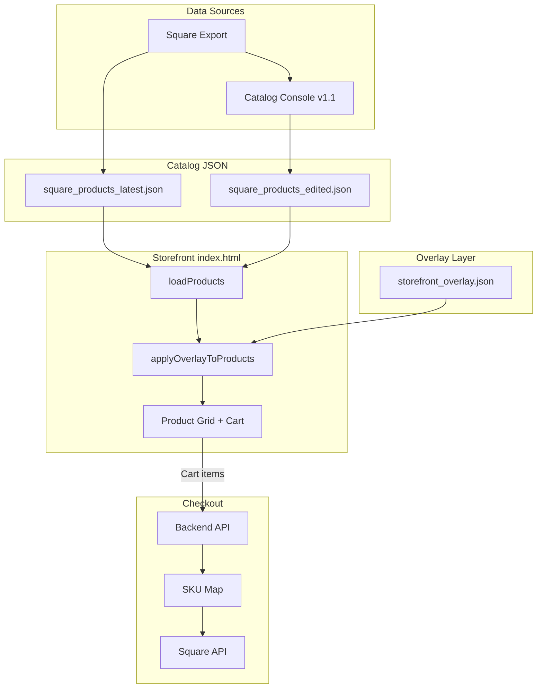

# AeroVista Storefront — Full Project Review

**Review date:** February 24, 2026  
**Scope:** av_storefront repo (storefront, Catalog Console, backend, docs, scripts).

---

## 1. Executive Summary

**What the project is:** A static e‑commerce storefront for AeroVista Apparel, backed by Square (catalog + checkout), an optional Flask API for checkout/bootstrap, and a local-first Catalog Console for cleaning Square exports. The storefront supports two catalog sources (Live vs Edited) and a JSON overlay for ordering, visibility, and consistency (titles, prices, descriptions).

**Health:** Documentation is strong; architecture is clear (Square = source of truth, overlay = presentation). The main gaps are: (1) duplicate/legacy files in Catalog Console (root vs v1.1, and “copy” files), (2) storefront audit items (accessibility, validation) not yet fully addressed, (3) README saying “FastAPI/Starlette” while the backend is Flask. Standardizing on Catalog Console v1.1 and cleaning duplicates is recommended.

---

## 2. Repository Layout

| Path | Purpose |
|------|--------|
| **Root** | `index.html` (canonical storefront), `square_products_latest.json` (+ dated fallbacks), `storefront_overlay.json`, `README.md`, `handoffnotes.md` |
| **AeroVista_Catalog_Console/** | Catalog editor: root = older single-panel; **v1.1** = recommended (Bulk, Validate, Import CSV). Docker serves v1.1 on port 8080. |
| **backend/** | Flask API: `/api/health`, `/api/square/bootstrap`, `/api/square/checkout`. Docker/Compose, Cloudflare Tunnel, SKU map from env. |
| **docs/** | Hosting, DNS, API routing, catalog/variant planning, data quality, Printful mapping, audit report, comparison/roadmap. |
| **scripts/** | Python utilities: `normalize_categories.py`, `convert_catalog.py`, `bulk_remove_bg.py`, etc. |
| **tools/** | e.g. `generate_sku_map.py` |
| **public/** | Legacy/archived frontend; not served in production. |
| **.cursor/plans/** | Migration plan (treasure trove phased migration). |

**External reference:** `dropship.store` is a separate repo at `D:\mini.shops\dropship.store`; it is a “treasure trove” of ideas and scripts (e.g. data quality, Printful export). Not a subfolder of av_storefront.

### Key JSON Files

| File | Purpose |
|------|---------|
| `square_products_latest.json` | Live catalog (default source) |
| `square_products_edited.json` | Edited catalog (optional source) |
| `storefront_overlay.json` | Order, visibility, titles, prices, descriptions |
| `backend/sku_map.generated.json` | Cart key → Square variation mapping for checkout |

---

## 3. Tech Stack

- **Frontend (storefront):** Vanilla HTML/CSS/JS, no build step. Catalog and overlay loaded at runtime. Square Web Payments SDK. Can be deployed to GitHub Pages, Firebase, or any static host.
- **Catalog Console:** Vanilla HTML/JS, Tailwind via CDN. Local-first (file import/export, optional localStorage). No Node/npm; no `package.json` in the repo.
- **Backend:** Python 3, Flask, gunicorn. Docker/Compose; Cloudflare Tunnel; NXCore/Traefik in production. API base: e.g. `https://api.aerovista.us`.
- **Data:** Square = catalog and checkout source of truth. Printful = fulfillment/cost only (optional). `storefront_overlay.json` = presentation layer (order, visibility, rules + overrides for titles/prices/descriptions).

---

## 4. Catalog Console: Root vs v1.1

| Aspect | Root (`AeroVista_Catalog_Console/`) | v1.1 (`v1.1/`) |
|--------|-------------------------------------|-----------------|
| **Entrypoint** | `index.html` | `index.html` (recommended in README and Docker) |
| **Import** | JSON only | JSON + **Import CSV** |
| **UI** | Single edit panel | **Tabs:** Edit, **Bulk**, **Validate** |
| **Bulk** | None | Tags, group/type, pricing (value/delta/type-based/round .99), normalize sizes/colors, merge duplicates |
| **Validation** | None | Issues panel, jump to product, **Export Issues CSV** |
| **CSV tool** | None | **csv_to_json_converter.html** (standalone) |
| **Code size** | `app.js` ~725 lines | `app.js` ~1,476 lines |

**Recommendation (aligned with docs):** Use **v1.1** as the canonical Catalog Console. Root can remain as backup or be deprecated; all workflows and docs should point to `v1.1/index.html`.

**Duplicate files in v1.1:** `index copy.html` and `app copy.js` have been moved to `v1.1/archive/` (see archive/README.md). Canonical entrypoint is `v1.1/index.html` and `v1.1/app.js`.

---

## 5. Storefront Behavior (Root index.html)

### Data Flow

### Catalog and Overlay

- **Catalog sources:** Live (default) = `square_products_latest.json` + dated fallbacks; Edited = `square_products_edited.json` or `localStorage` key `av_storefront_edited_catalog`. Toggle via **Catalog** dropdown; choice persisted in `av_storefront_catalog_source`.
- **Overlay:** `storefront_overlay.json` loaded after catalog; applies to **both** Live and Edited. Controls: `itemsByVariationId` / `itemsByCartKey`, `collections`, `ads`, and **rules** (titleFormat, defaultBrand, priceLadders, fees, shipBufferCents, costByLadder) + **overrides** (per productKey: collection, productType, color, descriptions, ladderKey, copyLock).
- **Checkout:** Uses `window.STORE_API_BASE` (e.g. `https://api.aerovista.us`). Square bootstrap and checkout via backend; cart keys must exist in backend SKU map. User adds items (cart key format: `Color__Size`, e.g. `Black__M`); checkout calls `POST /api/square/checkout`; backend looks up each cart key in SKU map and creates Square order/payment.
- **API config:** Base URL `window.STORE_API_BASE`. Override for testing: `?api=local8009`, `?api=local8088`, `?api=local18088`, or `?api=prod`.
- **Holographic treatment:** Products with “Holographic” in name or tags get a holo overlay on the card image.

---

## 6. Backend (Flask)

- **Entrypoint:** `backend/app.py`. README and root README correctly describe endpoints and env; root README mistakenly says “FastAPI/Starlette-style” — the app is Flask.
- **Endpoints:** `/api/health`, `/api/square/bootstrap`, `/api/square/checkout`. CORS via `ALLOWED_ORIGINS`. SKU map from `SQUARE_SKU_MAP_JSON` or `SQUARE_SKU_MAP_FILE`.
- **Scripts:** `update_sku_map_from_catalog.py`, `validate_profit_floor.py`, `generate_data_quality_report.py`, Printful-related scripts (fulfillment/cost only). See `backend/README.md`.

---

## 7. Documentation Quality

- **Strong:** `README.md`, `handoffnotes.md`, `docs/README.md`, `docs/CATALOG_CONSOLE_COMPARISON_AND_ROADMAP.md`, `docs/DROPSHIP_STORE_TREASURE_TROVE.md`, hosting/DNS/API docs, variant pricing and data quality docs.
- **Audit:** `docs/AUDIT_REPORT.md` (Feb 2026) lists critical/high/medium/low issues (form labels, validation, security, SEO). Use it as a remediation backlog.
- **Plan:** `.cursor/plans/treasure_trove_phased_migration_23b63c02.plan.md` defines phased import from dropship.store and adoption of Catalog Console v1.1 (Phase 0).

---

## 8. Findings and Recommendations

### 8.1 Correct and Keep

- Square as single source of truth for catalog and checkout; overlay for presentation only.
- Two catalog sources (Live/Edited) and overlay applied to both.
- Catalog Console v1.1 as the recommended app (Bulk, Validate, Import CSV).
- Backend env-based config, CORS, and SKU map pattern.
- Docs structure and handoff notes.

### 8.2 Fix or Clarify

1. **Root README (done):** Change “optional FastAPI/Starlette-style backend” to “optional Flask backend” (or “Python Flask API”) so it matches `backend/app.py`.
2. **Catalog Console duplicates (done):** Remove or archive `v1.1/index copy.html` and `v1.1/app copy.js` to avoid confusion; document “canonical = index.html + app.js” in Console README if not already.
3. **Storefront audit:** Critical and High items from `docs/AUDIT_REPORT.md` have been resolved. See `docs/AUDIT_RESOLUTION_CHECKLIST.md` and the "Resolution status" section in `docs/AUDIT_REPORT.md`.

Items 1 and 2: Root README was already updated to Flask; Catalog Console copy files were moved to `v1.1/archive/`.

### 8.3 Optional Improvements

- **Phase 0 (plan):** Confirm Docker and all internal links point to `v1.1/index.html`; deprecate or hide root Console in navigation/docs.
- **Data quality:** Run `generate_data_quality_report.py` (or equivalent) on Square exports before/after Console edits; use v1.1 Validate before publishing.
- **Profit floor:** Keep using `validate_profit_floor.py` with overlay `rules` (costByLadder, fees, shipBufferCents) before major catalog/overlay changes.

---

## 9. How to Update Products

See **[docs/HOW_TO_UPDATE_PRODUCTS.md](HOW_TO_UPDATE_PRODUCTS.md)** for step-by-step instructions:

- **Option A:** Update live catalog (production feed) — replace JSON, regenerate SKU map
- **Option B:** Edit via Catalog Console (edited source) — import, edit, export, deploy
- **Option C:** Change presentation only (overlay) — edit `storefront_overlay.json`
- **Option D:** Validate before publishing — profit floor, data quality scripts

---

## 10. Quick Reference

| Need to… | Look at |
|----------|---------|
| Change what the store shows (order, titles, prices) | `storefront_overlay.json` + `handoffnotes.md` §5 |
| Edit catalog (Square export → edited JSON) | `AeroVista_Catalog_Console/v1.1/index.html` |
| **How to update products (step-by-step)** | `docs/HOW_TO_UPDATE_PRODUCTS.md` |
| Change catalog file path | `index.html`: `loadProducts()` or `window.STORE_CATALOG_PATH` / `STORE_EDITED_CATALOG_PATH` |
| Fix checkout 400 (unknown SKU) | Add cart keys to backend SKU map; regenerate with `tools/generate_sku_map.py` |
| Point at different API | `window.STORE_API_BASE` or URL `?api=local8088` |
| Fix checkout / API | `backend/app.py`, `backend/README.md`, SKU map env |
| Fix storefront catalog loading | `index.html`: `loadProducts()`, `getCatalogSource`, catalog dropdown |
| Deploy storefront | Static host: `index.html`, catalog JSON, `storefront_overlay.json`, `favicon.svg`, `img/` |
| Deploy backend | Docker Compose; see `backend/README.md` |
| Deploy or debug API routing | `docs/HOSTING_AND_DNS.md`, `docs/NXCORE_STORE_API_ROUTING_STATUS.md` |
| See audit backlog | `docs/AUDIT_REPORT.md` |
| See Console vs v1.1 and roadmap | `docs/CATALOG_CONSOLE_COMPARISON_AND_ROADMAP.md` |
| Reuse dropship.store ideas | `docs/DROPSHIP_STORE_TREASURE_TROVE.md`, `.cursor/plans/treasure_trove_phased_migration_23b63c02.plan.md` |

---

*This review summarizes the av_storefront project structure, behavior, and recommendations. Update this doc when doing large structural or process changes.*
